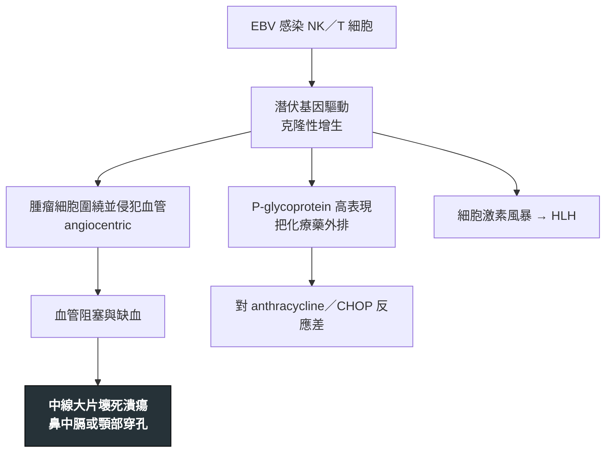

---
tags:
  - Med/Disease/Hema
  - lymphoma
  - NK-T
  - EBV
  - 禁忌
aliases:
  - ENKTL
  - NK/T lymphoma
  - 結外NK／T細胞淋巴瘤，鼻型
  - Extranodal NK/T-cell Lymphoma, Nasal Type
created: 2026-07-11
updated: 2026-07-26
status: 可用
source: 依 [[Hema Category]] 展開；WHO HAEM5（2022）
cssclass: clinical-note
presents_as:
  - "[[Nasal obstruction]]"
  - "[[Fever]]"
diagnosed_by:
  - "[[Nasal biopsy]]"
  - "[[EBER in situ hybridization]]"
treated_by:
  - "[[Radiotherapy]]"
  - "[[L-asparaginase]]"
differential:
  - "[[PTCL]]"
  - "[[DLBCL]]"
complication:
  - "[[HLH]]"
  - "[[Hemorrhage]]"
---

# NK-T Lymphoma ｜ 結外 NK／T 細胞淋巴瘤，鼻型 · Extranodal NK/T-cell Lymphoma, Nasal Type

> [!abstract] 一句話總覽
> **EBV 幾乎 100% 陽性**的高度侵襲性 NK（或細胞毒 T）淋巴瘤，好發於**亞洲與中南美**，侵犯上呼吸道中線。腫瘤細胞**圍著血管長並破壞血管**，造成**中線臉部壞死毀損**（舊稱 lethal midline granuloma）。治療核心是**放療＋含 L-asparaginase 的方案**，不是 CHOP。

> [!tip] 30 秒行動卡
> **診斷關鍵**：鼻塞、血涕、鼻腔潰瘍壞死 → 深部切片找 **CD56+、胞質 CD3ε+、EBER+**
> **治療骨架**：侷限鼻型以 **[[Radiotherapy]] 為主軸**＋含 **[[L-asparaginase]]** 的化療；播散期以 asparaginase 方案為骨幹
> **絕對不可**：拿標準 **CHOP** 當第一線

---

## 定義與定位

| 項目 | 重點 |
|---|---|
| 本質 | **EBV 驅動**的成熟 NK／細胞毒 T 細胞淋巴瘤，以**結外**病灶起家 |
| 好發族群 | **亞洲、中南美**較多；中年為主 |
| 分類位置 | 成熟 T／NK · 結外；見 [[Hema Category]] |
| 好發部位 | **鼻腔、鼻咽、上顎等中線**；少數原發於皮膚、腸道 |

## 病因與機制

> [!tip] 一條線推出全部處置
> 「血管中心性壞死」＋「P-glycoprotein」解釋了整篇：因為壞死，**切片常只切到壞死組織**，要深部、多點、重複切；因為 P-gp 外排 anthracycline，**CHOP 無效**，須改用 **L-asparaginase**，並用**放療**處理侷限中線病灶。

## 臨床表現

- **典型**：鼻塞、血性鼻涕、顏面腫脹、鼻腔或上顎**潰瘍壞死**，可穿孔毀容
- **提示性**：局部症狀久治不癒、抗生素無效；伴發燒與體重減輕
- **少見但重要**：原發於皮膚、腸道等結外部位；**噬血症候群（HLH）**——高燒、血球下降、鐵蛋白飆高

→ 相關主訴流程：[[Fever]]、[[Skin lesion]]

## 診斷

| 診斷條件 | 內容 |
|---|---|
| 檢體 | 鼻腔病灶**深部、多點切片**；表淺壞死區無診斷價值 |
| 病毒 | **EBER 原位雜交陽性**——幾乎是必要條件 |
| 免疫表型 | **CD56+**、**胞質 CD3ε+ 但表面 CD3−**、細胞毒顆粒（granzyme B、TIA-1）陽性 |
| 形態 | **Angiocentric／angiodestructive** 浸潤，伴大片壞死 |
| 分期 | 鼻竇與顱底影像、全身 PET-CT、骨髓檢查；測**血漿 EBV DNA** |

**要開的檢查**：[[Nasal biopsy]]、[[EBER in situ hybridization]]、[[Bone marrow biopsy]]

## 鑑別診斷

| 要排除的 | 支持它的線索 | 怎麼排除 |
|---|---|---|
| 肉芽腫性多血管炎（GPA） | 同樣中線破壞，但 **ANCA 陽性**、有肺腎侵犯 | ANCA＋切片無 EBER |
| 侵襲性黴菌感染 | 免疫低下、黑色焦痂、血管侵犯 | 真菌染色與培養 |
| 古柯鹼引起的中膈破壞 | 使用史；無腫瘤細胞 | 病史＋切片 |

## 治療

| 情境 | 處置 |
|---|---|
| 侷限鼻型（I–II） | **[[Radiotherapy]] 為療效主幹**＋含 [[L-asparaginase]] 化療 |
| 播散期（III–IV） | 以 **[[L-asparaginase]]** 為骨幹的多藥方案 |
| 復發／難治 | 免疫檢查點抑制劑等新療法；適合者評估 [[Allogeneic HSCT]] |

## 併發症與預後

- **要盯的併發症**：**[[HLH]]**、局部大出血（[[Hemorrhage]]）、鼻／顎穿孔與續發感染
- **預後**：**侷限鼻型**在放療＋asparaginase 時代已明顯改善；**播散期與非鼻部位差**；**血漿 EBV DNA** 可監測療效與復發

## 禁忌與陷阱

> [!danger] 絕對不可
> | 情境 | 絕對不可 | 為什麼 | 該做什麼 |
> |---|---|---|---|
> | 確診 ENKTL | 用標準 **CHOP** 當第一線 | 腫瘤高度表現 **P-glycoprotein**，把 anthracycline 外排 | 改用含 **[[L-asparaginase]]** 的方案；侷限期一定要納入 [[Radiotherapy]] |
> | 鼻腔反覆潰瘍壞死、切片只見壞死與發炎 | 就此排除淋巴瘤 | 血管中心性壞死會把腫瘤細胞蓋掉 | **重複深部切片**並加做 EBER |
> | 高燒＋血球下降＋鐵蛋白飆高 | 只當敗血症處理 | 可能是 **[[HLH]]**，延誤會迅速致命 | 查 ferritin、三酸甘油酯、sCD25，並同時治療原發淋巴瘤 |

> [!warning] 常見錯誤
> - 把標記記成 **CD5**——NK 的標記是 **CD56**；CD5 屬 T／CLL／Mantle。
> - 看到「表面 CD3 陰性」就否定 T／NK 譜系——本病是**胞質 CD3ε 陽性**。
> - 只做表淺切片或一次切片就下「壞死性發炎」。

## 相關連結

- [[AITL]] — 同樣與 EBV 相關，但譜系與部位不同
- [[PTCL]] — 排除 ENKTL 後才叫 NOS
- [[Hema Category|血液淋巴腫瘤分類 · Master Map]]
