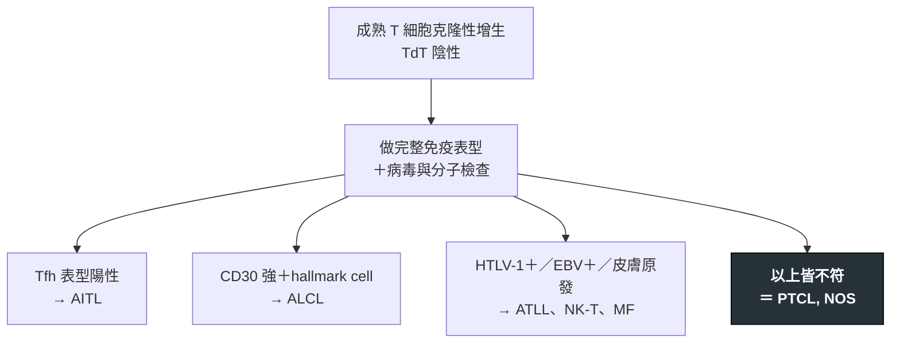

---
tags:
  - Med/Disease/Hema
  - lymphoma
  - mature-T
aliases:
  - PTCL
  - PTCL-NOS
  - 周邊T細胞淋巴瘤
  - Peripheral T-cell Lymphoma, NOS
created: 2026-07-11
updated: 2026-07-26
status: 可用
source: 依 [[Hema Category]] 展開；WHO HAEM5（2022）
cssclass: clinical-note
presents_as:
  - "[[Lymphadenopathy]]"
  - "[[Fever]]"
diagnosed_by:
  - "[[Lymph node biopsy]]"
  - "[[Flow cytometry]]"
treated_by:
  - "[[Brentuximab vedotin]]"
  - "[[Autologous HSCT]]"
differential:
  - "[[AITL]]"
  - "[[ALCL]]"
  - "[[ATLL]]"
  - "[[NK-T Lymphoma]]"
complication:
  - "[[Tumor lysis syndrome]]"
  - "[[Febrile neutropenia]]"
---

# PTCL ｜ 周邊 T 細胞淋巴瘤，非特定型 · Peripheral T-cell Lymphoma, NOS

> [!abstract] 一句話總覽
> 成熟 T 細胞淋巴瘤的**排除性診斷籃**：當一個侵襲性成熟 T 細胞腫瘤**不符合任何已命名的實體**時，才叫 PTCL, NOS。所以它不是一個機制，而是一個**剩餘集合**——沒有專屬靶點，預後也因此比多數 B 細胞淋巴瘤差。

> [!tip] 30 秒行動卡
> **診斷關鍵**：先證明是**成熟 T**（CD3+、**TdT 陰性**），再**逐一排除**有名字的實體，才貼上 NOS
> **治療骨架**：CHOP 為基礎的多藥化療；CD30 陽性者可用含 [[Brentuximab vedotin]] 的方案；首次緩解後適合者做 [[Autologous HSCT]]
> **絕對不可**：無（但不可在檢查未做完前就下 NOS）

---

## 定義與定位

| 項目 | 重點 |
|---|---|
| 本質 | 成熟（**TdT 陰性**）T 細胞來源的侵襲性淋巴瘤，**不符合任何特定實體** |
| 好發族群 | 中老年為主；在亞洲的比例高於西方 |
| 分類位置 | 成熟 T／NK · NOS；見 [[Hema Category]] |
| 定位邏輯 | **診斷是「減法」**——先排除 [[ALCL]]、[[AITL]]、[[ATLL]]、[[Mycosis Fungoides]]、[[NK-T Lymphoma]] 等 |

## 病因與機制

> [!tip] 一條線推出全部處置
> PTCL, NOS 沒有共同的**驅動機制**，只有共同的**排除過程**。既然沒有靶點，治療就只能用泛用的多藥化療，緩解後靠移植鞏固——這也直接解釋了它為何不如有明確驅動基因的 ALK+ [[ALCL]]。反過來說，**把診斷做徹底比治療選擇更有價值**：只要能從籃子裡撈出一個有名字的實體，就多一種專屬療法。

## 臨床表現

- **典型**：全身淋巴結腫大、**B symptoms**、LDH 升高，病程進展快
- **提示性**：常見**結外侵犯**（皮膚、肝脾、骨髓、腸道）；多數診斷時已是進期
- **少見但重要**：可伴嗜酸性球增多、搔癢或噬血現象——這類「免疫失調」表現要回頭想 [[AITL]]

→ 相關主訴流程：[[Lymphadenopathy]]、[[Fever]]

## 診斷

| 診斷條件 | 內容 |
|---|---|
| 檢體 | **切除式淋巴結生檢**——結構與足量組織缺一不可 |
| 成熟度 | **TdT 陰性**（對照 [[T-ALL]] 的 TdT 陽性母細胞） |
| 免疫表型 | **CD3+**，多為 CD4+；常**丟失 pan-T 抗原**（CD5／CD7）；需查 CD30 |
| 必排項目 | Tfh 標記（CD10、PD-1、CXCL13）、ALK、**EBER**、**HTLV-1**——全陰性才是 NOS |
| 克隆性 | **TCR 基因重排**佐證克隆性 |

**要開的檢查**：[[Lymph node biopsy]]、[[Flow cytometry]]、[[Bone marrow biopsy]]

## 鑑別診斷

| 要排除的 | 支持它的線索 | 怎麼排除 |
|---|---|---|
| [[AITL]] | Tfh 表型、HEV 與 FDC 網增生、高球蛋白 | 整組 Tfh 免疫染色 |
| [[ALCL]] | **CD30 強且均一**、hallmark cell | CD30 與 ALK 染色 |
| [[ATLL]]、[[NK-T Lymphoma]] | 病毒相關：HTLV-1 或 EBV | 血清學／PCR、EBER |
| 反應性 T 細胞增生 | 結構保留、無克隆 | TCR 重排＋表型異常 |

## 治療

| 情境 | 處置 |
|---|---|
| 第一線 | CHOP 為基礎的多藥化療；**CD30 陽性**者可用含 [[Brentuximab vedotin]] 的方案 |
| 鞏固 | 首次緩解後，體能可承受者做 [[Autologous HSCT]] |
| 復發／難治 | HDAC 抑制劑、抗葉酸製劑等；年輕者評估 [[Allogeneic HSCT]] |
| 支持性 | 高腫瘤負荷時預防 [[Tumor lysis syndrome]]；化療期感染防治 |

## 併發症與預後

- **要盯的併發症**：[[Tumor lysis syndrome]]、[[Febrile neutropenia]]、結外病灶造成的壓迫或穿孔
- **預後**：整體**比同期別的侵襲性 B 細胞淋巴瘤差**，復發常見；風險評估多沿用 IPI

## 禁忌與陷阱

> [!danger] 絕對不可
> 本病無立即致死型絕對禁忌；最大的風險是**檢查沒做完就貼上 NOS**——把 ALK+ [[ALCL]]、[[ATLL]] 這類有專屬療法的病埋進籃子裡。

> [!warning] 常見錯誤
> - **把 NOS 當診斷起點而非終點**——它是排除完之後的結論。
> - 沒做 **CD30**——漏掉可用 [[Brentuximab vedotin]] 的族群。
> - 沒查 **HTLV-1／EBER**——[[ATLL]] 與 [[NK-T Lymphoma]] 的治療路徑完全不同。
> - 看到 CD3 陰性就排除 T 細胞來源——成熟 T 淋巴瘤常丟失 pan-T 抗原。
> - 拿 TdT 陽性的母細胞腫瘤來歸類——那是 [[T-ALL]]，不是 PTCL。

## 相關連結

- [[AITL]] · [[ALCL]] · [[ATLL]] · [[Mycosis Fungoides]] · [[NK-T Lymphoma]] — 必須先排除的「有名字」實體
- [[T-ALL]] — TdT 陽性母細胞的對照組
- [[Hema Category|血液淋巴腫瘤分類 · Master Map]]
