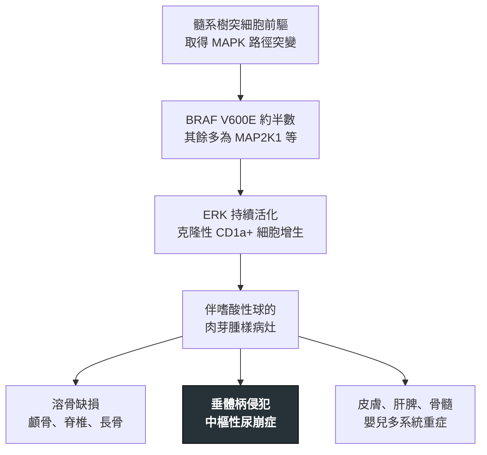

---
tags:
  - Med/Disease/Hema
  - histiocytosis
  - dendritic-cell
  - BRAF
  - 禁忌
aliases:
  - LCH
  - 朗格漢斯細胞組織球增生症
  - 組織球增生症
  - Langerhans Cell Histiocytosis
created: 2026-07-11
updated: 2026-07-26
status: 可用
source: 依 [[Hema Category]] 展開；WHO HAEM5（2022）
cssclass: clinical-note
presents_as:
  - "[[Bone pain]]"
  - "[[Skin lesion]]"
diagnosed_by:
  - "[[Skin biopsy]]"
  - "[[Bone marrow biopsy]]"
treated_by:
  - "[[Vinblastine]]"
  - "[[BRAF inhibitor]]"
differential:
  - "[[Hairy Cell Leukemia]]"
complication:
  - "[[Diabetes insipidus]]"
---

# LCH ｜ 朗格漢斯細胞組織球增生症 · Langerhans Cell Histiocytosis

> [!abstract] 一句話總覽
> **不是淋巴瘤**，而是**樹突／組織細胞的髓系腫瘤**：帶 **MAPK 路徑突變（約半數 BRAF V600E）**的克隆性朗格漢斯細胞在組織內堆積。表現從**單一骨病灶**到**嬰兒多系統重症**，所以確診後一定要再回答「侵犯多廣」。

> [!tip] 30 秒行動卡
> **診斷關鍵**：溶骨病灶或頑固脂漏樣皮疹 → 切片找 **CD1a+、S100+、Langerin／CD207+**（電顯 **Birbeck 顆粒**）
> **治療骨架**：單灶刮除／局部處理；多系統用 [[Vinblastine]] ＋類固醇；V600E 者可用 [[BRAF inhibitor]]；肺型**戒菸**
> **絕對不可**：忽略多尿多渴——**中樞性尿崩症**延遲診斷不可逆

---

## 定義與定位

| 項目 | 重點 |
|---|---|
| 本質 | 髓系樹突細胞來源的**克隆性腫瘤**，不是反應性增生 |
| 好發族群 | 各年齡；兒童以骨與多系統為主，成人肺型與**吸菸**相關 |
| 分類位置 | 組織細胞／樹突細胞腫瘤；見 [[Hema Category]] |
| 臨床分型（傳統名） | **Eosinophilic granuloma**（單一骨病灶）／**Hand-Schüller-Christian**（顱骨缺損＋尿崩＋突眼）／**Letterer-Siwe**（嬰兒多系統） |

## 病因與機制

> [!tip] 一條線推出全部處置
> 既然是**MAPK 路徑的髓系腫瘤**而非免疫反應，就同時解釋了：病灶各處是同一株細胞（所以要全身分期）、**有突變就能標靶**（BRAF 抑制劑）。

## 臨床表現

- **典型**：**疼痛性溶骨病灶**（顱骨最常見，其次脊椎、長骨），可局部腫脹或病理性骨折
- **提示性**：**脂漏樣或紫斑樣皮疹**（頭皮、耳後、腋下、腹股溝），常被當脂漏性皮膚炎；反覆中耳炎、外耳道流膿
- **少見但重要**：**中樞性尿崩症**（多尿、多渴）＝垂體柄侵犯；嬰兒多系統型有肝脾腫大與血球下降；成人**肺 LCH** 以咳嗽、氣胸表現

→ 相關主訴流程：[[Bone pain]]、[[Skin lesion]]

## 診斷

| 診斷條件 | 內容 |
|---|---|
| 形態 | **咖啡豆狀／有核溝（grooved）核**，背景常見**嗜酸性球** |
| 免疫表型 | **CD1a+、S100+、Langerin／CD207+**（診斷主軸） |
| 電子顯微鏡 | **Birbeck 顆粒**——**網球拍狀**細胞質構造 |
| 分子 | **BRAF V600E**（約半數）；其餘多為 MAP2K1 等 MAPK 路徑突變 |
| 分期 | 全身骨骼影像／PET，評估**風險器官**（肝、脾、骨髓）；中樞症狀加垂體 MRI |

**要開的檢查**：[[Skin biopsy]]、[[Bone marrow biopsy]]、腦部 MRI

## 鑑別診斷

| 要排除的 | 支持它的線索 | 怎麼排除 |
|---|---|---|
| 骨髓炎、Ewing 肉瘤等 | 影像相似的溶骨病灶 | **切片**：CD1a／CD207 陽性 |
| 其他組織細胞病（ECD、JXG） | 病灶分佈與年齡不同 | CD1a／CD207 **陰性** |
| [[Hairy Cell Leukemia]] | 同樣常見 **BRAF V600E** | **完全不同的疾病**，靠形態與表型分開 |

## 治療

| 情境 | 處置 |
|---|---|
| 單灶骨病灶 | 刮除／局部處理 ± 病灶內類固醇 |
| 多灶或多系統 | 全身治療：**[[Vinblastine]] ＋類固醇** |
| 難治且帶 **BRAF V600E** | **[[BRAF inhibitor]]**（或下游 MEK 抑制劑） |
| 成人肺 LCH | **戒菸是關鍵**，部分病灶可因此改善 |

## 併發症與預後

- **要盯的併發症**：**[[Diabetes insipidus]]**（最常見的長期後遺症）、神經退化性 CNS-LCH、脊椎塌陷、肺型氣胸
- **預後**：由**侵犯範圍**決定——單灶骨病灶極佳、可自行消退；**嬰兒多系統合併風險器官侵犯**最兇險

## 禁忌與陷阱

> [!danger] 絕對不可
> | 情境 | 絕對不可 | 為什麼 | 該做什麼 |
> |---|---|---|---|
> | LCH 病人多尿、多渴 | 當成脫水或糖尿病帶過 | 這是**垂體柄侵犯的中樞性尿崩**，延遲診斷後不可逆 | 查血鈉與尿／血漿滲透壓、安排**腦下垂體 MRI**，確診後長期給 desmopressin |
> | 兒童單一溶骨病灶 | 未切片就當骨髓炎或骨腫瘤處理 | 治療路徑完全不同 | 先做**切片**與全身骨骼評估 |

> [!warning] 常見錯誤
> - 把 LCH 當成淋巴瘤——它是**樹突／組織細胞腫瘤**，譜系完全不同。
> - 診斷後不做**全身分期**——單灶與多系統治療差很多。
> - 只治病灶，不追蹤尿崩等長期後遺症。

## 相關連結

- [[Hairy Cell Leukemia]] — 同帶 BRAF V600E 的另一種病
- [[Diabetes insipidus]] — 最需要主動偵測的併發症
- [[Hema Category|血液淋巴腫瘤分類 · Master Map]]
