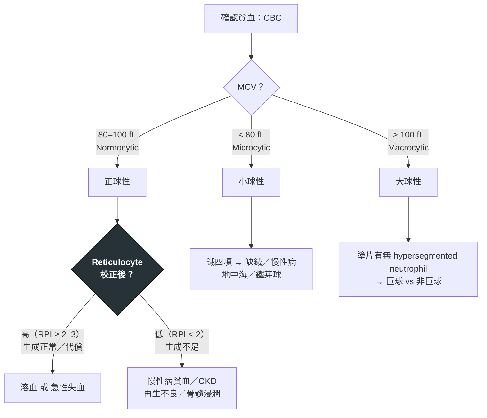

---
tags:
  - Med/Disease/Hema
  - syndrome
  - anemia
  - 禁忌
aliases:
  - 貧血
  - Anemia
created: 2026-07-09
updated: 2026-07-26
status: 可用
source: 原手寫整理；WHO 貧血診斷標準、AABB 輸血指引
cssclass: clinical-note
presents_as:
  - "[[Fatigue]]"
  - "[[Dyspnea]]"
diagnosed_by:
  - "[[CBC with differential]]"
  - "[[Peripheral blood smear]]"
  - "[[Reticulocyte count]]"
treated_by:
  - "[[Iron supplementation]]"
  - "[[Blood transfusion]]"
differential:
  - "[[MDS]]"
  - "[[Multiple Myeloma]]"
complication:
  - "[[Heart failure]]"
---

# Anemia ｜ 貧血 · Anemia

> [!abstract] 一句話總覽
> 貧血是「紅血球攜氧能力下降」的**共同表現（syndrome）而非單一疾病**。臨床上永遠要問兩件事：**(1) 是哪一類（MCV × reticulocyte）？(2) 背後的病因是什麼？** 分類是為了縮小病因，治療則一定要針對病因，而不是只補血。

> [!tip] 30 秒行動卡
> **診斷關鍵**：CBC ＋ **MCV × reticulocyte 兩軸** ＋ **周邊血抹片**——這三樣到齊，病因範圍就已收斂到可以點名。
> **治療骨架**：**永遠針對病因**；輸血只是橋接、不取代病因治療，且採限制性策略（一般 < 7、心臟／圍術期 < 8 g/dL）。
> **絕對不可**：只補葉酸而未先排除／矯正 B12 缺乏——血象會漂亮，神經損害卻不可逆。

---

## 定義與定位

*Definition：這是 syndrome 不是單一疾病——先用閾值確認它存在，再用兩軸決定它屬於哪一類。*

| 項目 | 重點 |
|---|---|
| 本質 | 循環紅血球量不足、組織供氧下降的**共同表現（syndrome）**，不是單一疾病 |
| 好發族群 | 全年齡；育齡女性與嬰幼兒以缺鐵為主，老年人以慢性病貧血、[[MDS]]、隱匿失血為主 |
| 分類位置 | 兩軸分類：形態學（MCV）× 動力學（reticulocyte）；血液惡性病的定位見 [[Hema Category]] |
| 診斷起點 | **Hb 低於該族群閾值**（見下表），但**速度與症狀比絕對值更決定處置** |

貧血 = 循環中**紅血球量（RBC mass）不足**，導致組織供氧下降。臨床以 **Hb（血紅素）** 為主要指標（Hct、RBC count 為輔）。

### WHO Hb 診斷閾值（海平面）

| 族群 | Hb 閾值 (g/dL) |
|---|---|
| 成年男性 (≥15 y) | < 13.0 |
| 成年女性（非孕，≥15 y） | < 12.0 |
| 孕婦 | < 11.0 |
| 兒童 6–59 個月 | < 11.0 |
| 兒童 5–11 y | < 11.5 |
| 兒童 12–14 y | < 12.0 |

> [!note] 嚴重度分級（WHO，**非孕成人**約略值）
> 輕度 11–正常｜中度 8–10.9｜重度 < 8.0（症狀與速度比絕對值更決定處置）。
> **孕婦與 6–59 個月幼兒**的分級不同：中度 7.0–9.9、**重度 < 7.0**。

### 判讀陷阱 Pitfalls（Hb 會「騙人」的情況）

> [!warning] 別被單一 Hb 誤導
> - **血漿容積變化**：Hb 是**濃度**。脫水／利尿 → 假性偏高（血液濃縮）；懷孕、過度輸液、脾腫大 → 稀釋性假性貧血（dilutional／pseudoanemia）。
> - **急性大出血初期 Hb 可正常**：出血當下 RBC 與血漿等比例流失，需數小時～數天血漿再充填後 Hb 才下降 → 早期要看**生命徵象與臨床**，不是等 Hb 掉。
> - **速度 > 絕對值**：慢性貧血可代償到 Hb 6–7 仍能行走；急性掉到同樣數字卻可能休克。

## 病因與機制

*分類 Classification 就是機制——用兩個互補的軸把所有病因收攏，這是縮小病因的核心工具。*

用**兩個互補的軸**同時思考，交叉定位病因：

- **軸 A — 形態學（by MCV）**：便於「一眼分流」。
- **軸 B — 動力學／病生理（by reticulocyte）**：判斷是**生成不足**還是**破壞／流失過多**。

> [!tip] 一條線推出全部處置
> 紅血球只有三種出錯方式：**做太少、破太快、漏出去**。MCV 告訴你「做的時候缺哪一種原料」，reticulocyte 告訴你「是產線壞了還是消耗端在燒」——所以處置永遠是同一條線：**兩軸定位機轉 → 補回缺的原料或關掉那個消耗 → 輸血只在等病因治療起效時撐住供氧**。不必背病因清單，順著這條線推就能推出來。

### 軸 A：形態學分類 by MCV

| 類型 | MCV | 常見病因 |
|---|---|---|
| **小球性 Microcytic** | < 80 fL | **缺鐵 IDA**、地中海貧血 Thalassemia、慢性病貧血 ACD（部分）、鐵芽球性 Sideroblastic、鉛中毒 |
| **正球性 Normocytic** | 80–100 fL | 慢性病貧血、CKD（EPO↓）、急性失血、溶血、再生不良性、骨髓浸潤、早期 IDA |
| **大球性 Macrocytic** | > 100 fL | **巨球性**：B12／葉酸缺乏、影響 DNA 合成藥物；**非巨球性**：酒精、肝病、甲狀腺低下、[[MDS]]、reticulocytosis |

> [!tip] 小球性口訣 **TAILS**
> **T**halassemia、**A**nemia of chronic disease、**I**ron deficiency、**L**ead poisoning、**S**ideroblastic anemia。

> [!tip] 大球性再細分（關鍵分岔）
> **巨球性 Megaloblastic**（DNA 合成障礙）→ 塗片可見 **hypersegmented neutrophils**、卵圓形大紅血球：B12／葉酸缺乏、MTX／hydroxyurea／AZT／5-FU 等。
> **非巨球性 Non-megaloblastic**（膜脂質增加或未成熟細胞）→ 無 hypersegmentation：酒精、肝病、甲狀腺低下、[[MDS]]、**網狀紅血球增多本身**（retic 體積大會拉高 MCV）。

### 軸 B：動力學分類 by Reticulocyte（最重要的分岔點）

Reticulocyte（網狀紅血球）反映**骨髓的即時反應**。正球性貧血尤其要靠它分流。

- **校正網狀紅血球 % = retic % × (病人 Hct / 45)**
- **RPI（reticulocyte production index）= 校正 retic % ÷ 成熟因子**（Hct 45→1.0、35→1.5、25→2.0、15→2.5）

| RPI | 意義 | 病因方向 |
|---|---|---|
| **≥ 2–3（高）** | 骨髓有反應 | **溶血、急性失血**（生成正常，是「消耗端」問題） |
| **< 2（低）** | 骨髓反應不足 | 生成障礙：缺鐵／B12／葉酸、ACD、CKD、再生不良、骨髓浸潤、[[MDS]] |

> [!note] 三大病生理機轉（把所有病因收攏成三類）
> 1. **生成減少 Decreased production**（低 retic）：原料不足（鐵／B12／葉酸）、骨髓抑制或被取代、EPO 不足（CKD）。
> 2. **破壞增加 Increased destruction ／ 溶血**（高 retic）：血管內 vs 血管外。
> 3. **失血 Blood loss**（急性後高 retic）：外顯或隱匿（GI 最常見）。

## 臨床表現

*Symptoms & Signs：一半來自缺氧與代償（與病因無關），另一半是病因自己留下的線索。*

### 一般表現（缺氧 ＋ 代償，與病因無關）

- **症狀**：疲倦、虛弱、運動性呼吸困難（exertional dyspnea）、頭暈、頭痛、心悸、注意力下降；嚴重時心絞痛、暈厥、心衰竭。
- **徵象**：**結膜／手掌／甲床蒼白**、tachycardia、收縮期 flow murmur、脈壓增寬；嚴重可見高輸出心衰。
- 影響嚴重度的三因子：**貧血速度、絕對值、心肺共病與活動需求**。

### 病因特異性線索（Cause-specific clues）— 問診／理學一秒導向

| 線索 | 指向 |
|---|---|
| 異食癖 pica、湯匙指 koilonychia、口角炎、舌炎、restless legs | **缺鐵 IDA** |
| Plummer-Vinson（食道蹼＋IDA＋吞嚥困難） | 慢性缺鐵 |
| **對稱性感覺異常、本體／振動覺喪失、步態不穩（脊髓後索＋側索）** | **B12 缺乏（subacute combined degeneration）** |
| 舌炎＋神經症狀，但**葉酸缺乏無神經學表現** | 鑑別 B12 vs 葉酸 |
| 黃疸、深色尿、脾腫大、色素性膽結石 | **溶血 Hemolysis** |
| 家族史、特定族群、骨骼變化（重症） | 地中海貧血 Thalassemia |
| 黑便／血便、月經過多、體重減輕 | **失血／潛在惡性腫瘤** |

> [!warning] 紅旗 Red flags（需加速並排除惡性／急重症）
> 成年男性或停經後女性的缺鐵 → **視為 GI 出血／腫瘤，直到排除**；合併體重減輕、淋巴結腫、出血傾向、pancytopenia、骨痛 → 疑血液惡性或骨髓病變。

→ 相關主訴流程：[[Fatigue]]、[[Dyspnea]]、[[Pancytopenia]]

## 診斷

*Diagnostic Approach：一步步縮小，順序不要跳。*

> [!info] 五步走
> **Step 1 確認** CBC（必要時重驗，排除假性）→ **Step 2 MCV ＋ 網狀紅血球** → **Step 3 周邊血液抹片 peripheral smear** → **Step 4 依分類做標的檢查** → **Step 5 找根本病因**（尤其失血源）。

### 初始套組 Initial workup

CBC + differential、**MCV / RDW**、**reticulocyte count**、**周邊血液抹片**。之後依 MCV 分流下述標的檢查。

**要開的檢查**：[[CBC with differential]]、[[Peripheral blood smear]]、[[Reticulocyte count]]、鐵四項（Fe／TIBC／TSAT／ferritin）、B12＋folate；必要時 [[Bone marrow biopsy]]。

### 鐵四項判讀（小球性核心）

| 項目 | 缺鐵 IDA | 慢性病貧血 ACD | 地中海貧血 Thal. trait | 鐵芽球性 Sideroblastic |
|---|---|---|---|---|
| 血清鐵 Serum Fe | ↓ | ↓ | 正常／↑ | ↑ |
| **TIBC / transferrin** | **↑** | **↓** | 正常 | 正常／↓ |
| Transferrin sat | ↓ | 正常／↓ | 正常／↑ | ↑ |
| **Ferritin** | **↓↓** | **正常／↑** | 正常／↑ | ↑ |
| 其他 | RDW↑ | hepcidin↑ | Hb 電泳異常、RBC 數目相對高 | 環狀鐵芽球 (Prussian blue) |

> [!warning] Ferritin 是**急性期反應物**
> 發炎／感染／肝病時 ferritin 可假性正常甚至偏高，**遮蔽真正的缺鐵**。判讀原則：Ferritin **< 15–30 → 幾乎確診缺鐵**；有發炎時 ferritin < 100（或 TSAT < 20%）仍高度懷疑缺鐵；此時可參考**可溶性 transferrin receptor (sTfR)**（缺鐵↑、ACD 正常）。

### 小球性分流：IDA vs 地中海貧血

| 鑑別工具 | 缺鐵 IDA | 地中海貧血 trait |
|---|---|---|
| **RDW** | **↑（大小不均）** | 多為正常 |
| **RBC 數目** | 低 | 正常／偏高 |
| **Mentzer index (MCV/RBC)** | **> 13** | **< 13** |
| Ferritin / 鐵四項 | 缺鐵型 | 正常 |
| Hb 電泳 | 正常 | HbA2↑（β）／ 需 DNA（α） |

### 大球性分流

1. 抹片看 **hypersegmented neutrophils** → 區分巨球 vs 非巨球。
2. 驗 **B12、葉酸 folate**。
3. **B12 vs 葉酸的代謝物**：

| 代謝物 | B12 缺乏 | 葉酸缺乏 |
|---|---|---|
| **甲基丙二酸 MMA** | **↑** | 正常 |
| 同半胱胺酸 Homocysteine | ↑ | ↑ |

4. 疑**惡性貧血 Pernicious anemia**：anti-**intrinsic factor** antibody（特異性高）、anti-parietal cell antibody（敏感性高）。
5. 非巨球性：查 **TSH、肝功能、酒精史**；懷疑 **[[MDS]]** → 骨髓檢查。

> [!danger] 補充順序
> **先補／併補 B12，再補葉酸**。單獨大量補葉酸會改善血液學表現，卻**掩蓋並可能惡化 B12 的神經損害（不可逆）**。

### 溶血工作站 Hemolysis workup（高 retic 正球性）

**篩檢四指標**：LDH **↑**、間接（未結合）膽紅素 **↑**、**haptoglobin ↓**、reticulocyte **↑**（＋尿 urobilinogen↑）。

| 進一步 | 判讀 |
|---|---|
| **DAT ／ 直接 Coombs** | 陽性 → **免疫性溶血 (AIHA)**；陰性 → 非免疫（膜、酵素、Hb 病、機械、微血管病） |
| 血管內 vs 血管外 | 血管內：血紅素尿、hemosiderinuria、haptoglobin↓↓、游離 Hb↑ |
| **周邊抹片形態** | 見下表，常一眼定位 |

| 抹片形態 | 指向 |
|---|---|
| Schistocytes（碎裂細胞） | **MAHA**：TTP／HUS／DIC、機械瓣膜 |
| Spherocytes | 遺傳性球形紅血球症、warm AIHA |
| Bite cells / Heinz bodies | **G6PD 缺乏**（氧化壓力） |
| Sickle cells | 鐮刀型紅血球疾病 |
| Target cells | 地中海貧血、肝病、HbC |
| Teardrop cells（淚滴狀） | 骨髓纖維化、骨髓浸潤 |
| Basophilic stippling | 鉛中毒、地中海、鐵芽球性 |
| Howell-Jolly bodies | 無脾／脾功能低下 |
| Hypersegmented neutrophils | 巨球性（B12／葉酸） |

![[assets/rbc-morphology-panel.jpg|760]]
*第一組先定位形狀：D 黑箭頭＝spherocyte；E＝target cell；G＝teardrop／dacryocyte；H＝schistocyte。臨床連結依序想免疫性／遺傳性球形紅血球症、thalassemia／肝病、骨髓纖維化、MAHA／機械性溶血。Source: [Berzuini et al., *Front Physiol* 2022, Figure 1](https://pmc.ncbi.nlm.nih.gov/articles/PMC9289213/)（CC BY 4.0）。*

![[assets/rbc-bite-cells.jpg|420]]
*Bite cell／degmacyte：紅血球邊緣像被咬掉一塊，是脾臟移除 Heinz body 後留下的缺口；看到它先想 G6PD deficiency／氧化壓力。Source: [Wikimedia Commons — BITE CELLS](https://commons.wikimedia.org/wiki/File:BITE_CELLS.jpg), RJDS MEDIX（CC BY-SA 4.0）。*

![[assets/rbc-basophilic-stippling.jpg|360]]
*Basophilic stippling：胞質內散在深藍小點，代表聚集的核糖體 RNA；粗大顆粒優先想鉛中毒，也可見於 thalassemia、鐵芽球性貧血。Source: [Wikimedia Commons — Micrograph of a red blood cell with basophilic stippling](https://commons.wikimedia.org/wiki/File:Micrograph_of_a_red_blood_cell_with_basophilic_stippling.jpg), Mikael Häggström（CC0）。*

![[assets/rbc-howell-jolly.jpg|560]]
*Howell–Jolly body：紅血球內單一、圓而深紫的核 DNA 殘體；正常脾會清除，出現時先想脾切除後或功能性無脾。Source: [Wikimedia Commons — Howell-Jolly smear](https://commons.wikimedia.org/wiki/File:Howell-Jolly_smear_2010-11-17.JPG), Paulo Henrique Orlandi Mourao（CC BY-SA 3.0）。*

![[assets/rbc-hypersegmented-neutrophil.jpg|560]]
*Hypersegmented neutrophil：核葉 ≥6，或多個 neutrophils 有 5 葉；與 macro-ovalocytes 一起出現時高度支持 B12／folate deficiency 的 megaloblastic anemia。Source: [Wikimedia Commons — Hypersegmented Neutrophils](https://commons.wikimedia.org/wiki/File:Hypersegmented_Neutrophils.jpg), Prof. Osaro Erhabor（CC BY-SA 4.0）。*

## 鑑別診斷

*Differential Diagnosis：依 MCV 收斂——先分三大類，再在類內比對關鍵鑑別點。*

### 小球性 Microcytic（MCV < 80）

| 疾病 | 關鍵鑑別點 |
|---|---|
| **缺鐵性貧血 IDA** | Ferritin↓、TIBC↑、RDW↑、Mentzer > 13；**成人務必找失血源** |
| 地中海貧血 Thalassemia | RBC 數正常／高、RDW 正常、Mentzer < 13、Hb 電泳、家族史 |
| 慢性病貧血 ACD | 通常正球，慢性可轉小球；Ferritin 正常／↑、TIBC↓、hepcidin↑ |
| 鐵芽球性 Sideroblastic | 鐵↑／ferritin↑、環狀鐵芽球；先天或藥物／酒精／鉛／isoniazid |
| 鉛中毒 Lead | basophilic stippling、職業／環境暴露、神經症狀 |

### 正球性 Normocytic（MCV 80–100）— 用 retic 二分

| Retic 低（生成不足） | Retic 高（溶血／失血） |
|---|---|
| 慢性病貧血、CKD（EPO↓） | 溶血（免疫／非免疫） |
| 再生不良性貧血 Aplastic | 急性失血 |
| 骨髓浸潤／纖維化、白血病 | — |
| 早期 IDA、內分泌（甲低、垂體、腎上腺） | — |

### 大球性 Macrocytic（MCV > 100）

| 巨球性 Megaloblastic | 非巨球性 Non-megaloblastic |
|---|---|
| B12 缺乏（PA、胃切除、末端迴腸病變、素食、metformin／PPI） | 酒精、肝病 |
| 葉酸缺乏（攝取不足、酒精、妊娠、溶血、MTX） | 甲狀腺低下 |
| 藥物（MTX、hydroxyurea、AZT、5-FU） | **[[MDS]]**（老年、pancytopenia） |
| — | reticulocytosis（溶血／出血代償） |

## 治療

*Treatment：永遠針對病因。分類只是手段，病因才是標的。*

> [!important] 總原則
> 貧血是**表現**：先找病因再治療。輸血只在症狀性／急重症時作為橋接，不取代病因治療。監測**網狀紅血球反應**作為療效的早期指標。

### 缺鐵性貧血 IDA

- **口服鐵**：ferrous sulfate 325 mg（含元素鐵 ~65 mg）。**目前傾向「隔日單次」給藥**（降低 hepcidin 反饋、提升分次吸收率並減少腸胃副作用）。與維生素 C 併服助吸收；避免與制酸劑／鈣／茶咖啡同服。
- **療效追蹤**：retic 於 **3–7 天**上升；Hb 約每 **2–3 週升 ~1 g/dL**；正常後**再續補 3–6 個月**以補足儲存鐵（目標 ferritin 回升）。
- **靜脈鐵 IV iron**（ferric carboxymaltose ／ iron sucrose 等）適應症：口服不耐／無效、吸收不良（IBD、胃繞道）、持續失血、CKD、需快速補充或懷孕中後期。
- **關鍵**：找出並處理**失血源**（成人 IDA 常需 GI 內視鏡評估）。

### 巨球性 ／ 維生素缺乏

- **B12 缺乏**：cobalamin **IM**（PA／吸收不良首選，1000 µg：起始密集→每月維持）或**高劑量口服 1000–2000 µg/日**；**惡性貧血需終身補充**。**先矯正 B12 再補葉酸**。
- **葉酸缺乏**：口服 folic acid（通常 1–5 mg/日）；**補之前先排除合併 B12 缺乏**。

### 慢性病貧血 ACD ／ CKD

- **ACD**：**治療根本疾病**為主；症狀性可個別評估 ESA ± 鐵（需先確認鐵儲存）。
- **CKD 腎性貧血**：先補鐵（目標 TSAT／ferritin 達標）＋ **ESA（EPO 類）**；**Hb 目標約 10–11.5 g/dL，不刻意 > 11.5–13**（過高與中風／心血管事件↑相關 — TREAT／CHOIR／CREATE 試驗）。新型 **HIF-PH inhibitor（如 roxadustat）** 為口服選項（依地區核准）。

### 溶血性貧血 Hemolytic

| 類型 | 治療重點 |
|---|---|
| **溫型 AIHA** | **類固醇一線**；復發／難治 → rituximab、脾切除；治療續發原因（藥物／淋巴增生／自體免疫） |
| 冷凝集素病 | 保暖、避免誘因；rituximab；避免溫型用的脾切除無效 |
| **G6PD 缺乏** | **避免氧化誘因**（磺胺、抗瘧、蠶豆、感染）；支持性 |
| 遺傳性球形紅血球症 HS | 葉酸補充；重症脾切除（術前疫苗） |
| **地中海貧血 major** | 規律輸血 + **鐵螯合**（deferasirox 口服 ／ deferoxamine ／ deferiprone）；**luspatercept**；HSCT 可治癒；基因治療（TDT 已有核准產品） |
| **鐮刀型 SCD** | **hydroxyurea（↑HbF）**、水化、止痛、感染預防與疫苗、輸血；新藥 voxelotor、crizanlizumab、L-glutamine；HSCT ／ **基因治療（2023 起核准）** |

### 生成不足 ／ 骨髓衰竭

- **再生不良性貧血 Aplastic**：年輕且有配對 → **異體 [[Allogeneic HSCT]]**；否則**免疫抑制（ATG + cyclosporine ± eltrombopag）**。
- **[[MDS]]**：依風險分層（支持性輸血 ± 螯合、ESA、lenalidomide[del(5q)]、hypomethylating agents、HSCT）。

### 急性失血 & 輸血閾值

- **急性失血**：止血 + 容量復甦 + 依血流動力學輸血；每單位 PRBC 約升 Hb **~1 g/dL**。
- **輸血閾值（AABB, 限制性策略）**：一般住院／穩定病人 **Hb < 7 g/dL**；心臟病或接受骨科／心臟手術者 **< 8 g/dL**。避免僅為「數字好看」而輸血。

## 併發症與預後

- **要盯的併發症**：
  - **高輸出性心衰竭**（[[Heart failure]]）——慢性重度貧血代償到極限時出現，脈壓增寬、flow murmur 是前哨。
  - **心絞痛／心肌缺血**——既有冠心病者供需失衡，是「輸血閾值放寬到 < 8 g/dL」的族群。
  - **輸血相關鐵沉積**——長期輸血依賴者（地中海貧血 major、[[MDS]]、再生不良性貧血）累積鐵毒性，需定期評估並鐵螯合。
- **預後**：取決於**病因**而非 Hb 數值本身。同樣 Hb 8 g/dL，缺鐵補鐵即可完全恢復，[[MDS]]、骨髓浸潤或溶血則各有其病程與風險。
- **診斷未完成＝治療未完成**：成人不明原因缺鐵**在排除 GI 惡性腫瘤前不算完成診斷**，即使 Hb 已被鐵劑矯正到正常。

## 禁忌與陷阱

> [!success] 考前／查房速記（高頻重點 Key Points ／ Pearls）
> - **兩軸思考**：MCV（形態）× reticulocyte（動力學）＝病因分流的骨架。
> - **Reticulocyte 是正球性貧血的關鍵分岔**：高 → 溶血／失血；低 → 生成不足。
> - **Ferritin 是急性期反應物**：發炎時會遮蔽缺鐵；ferritin↓ 對 IDA 特異性高。
> - **RDW**：IDA↑、地中海貧血 trait 多正常；**Mentzer index < 13 → 地中海，> 13 → IDA**。
> - **B12 vs 葉酸**：只有 **B12 有神經症狀**；**MMA↑ 專一指向 B12**；**先補 B12 再補葉酸**。
> - **溶血四指標**：LDH↑、間接膽紅素↑、haptoglobin↓、retic↑；**DAT 陽性 → 免疫性**。
> - **抹片形態**常一眼定位：schistocyte→MAHA、spherocyte→HS／warm AIHA、bite cell→G6PD、teardrop→骨髓浸潤。
> - **成人不明原因 IDA = 找 GI 出血／腫瘤，直到排除**。
> - **CKD 貧血 Hb 目標 10–11.5**，不過度矯正。
> - **輸血採限制性**：一般 < 7、心臟／圍術期 < 8 g/dL。

> [!danger] 絕對不可
> | 情境 | 絕對不可 | 為什麼 | 該做什麼 |
> |---|---|---|---|
> | 大球性貧血、**B12 狀態未明** | 單獨大量補葉酸 | 血液學表現會改善，卻**掩蓋並惡化不可逆的神經損害**（subacute combined degeneration） | **先驗／先補 B12，再補葉酸**；必要時同時給 |
> | **成年男性或停經後女性**的缺鐵 | 只開鐵劑就結案 | 應**視為 GI 出血／腫瘤，直到排除** | 安排 **GI 內視鏡評估**，找到並處理失血源 |
> | 發炎／感染／肝病病人 ferritin 正常 | 因此排除缺鐵 | ferritin 是**急性期反應物**，會遮蔽真正的缺鐵 | 看 **TSAT < 20%** 或 **sTfR**；發炎時 ferritin < 100 仍高度懷疑 |
> | **CKD 貧血**使用 ESA | 把 Hb 矯正到 **> 11.5–13** | 與**中風／心血管事件增加**相關（TREAT／CHOIR／CREATE） | 目標 **Hb 10–11.5 g/dL**，先確認鐵儲存達標 |

> [!warning] 常見錯誤
> - 只看 Hb 就開鐵劑——沒有 MCV、沒有 reticulocyte、沒有抹片，等於沒有分流。
> - 看到 ferritin「正常」就排除缺鐵，忘了它在發炎時會被拉高。
> - **Mentzer index 記反**：> 13 才是 IDA，< 13 是地中海貧血 trait。
> - 以為葉酸缺乏也會有神經症狀——**只有 B12 會**；要分辨就驗 MMA（B12 缺乏才↑）。
> - 急性大出血初期看到 Hb 正常就放心——血漿尚未再充填，此時要看生命徵象而不是等數字掉。

## 相關連結

- [[Iron Deficiency Anemia]] — 缺鐵性貧血
- [[Thalassemia]] — 地中海貧血
- [[Megaloblastic Anemia]] — 巨球性貧血（B12／葉酸缺乏）
- [[Hemolytic Anemia]] — 溶血性貧血
- [[Anemia of Chronic Disease]] — 慢性病貧血
- [[Aplastic Anemia]] — 再生不良性貧血
- [[MDS]] — 骨髓分化不良症候群，老年大球性貧血／pancytopenia 的必排項
- [[Peripheral blood smear]] — 周邊血液抹片，兩軸之外的第三隻眼
- [[Hema Category|血液淋巴腫瘤分類 · Master Map]]

> [!quote] 免責
> 本筆記為醫學教育／複習用整理，臨床決策請以最新指引與個別病人情況為準。部分治療（新藥、基因治療、輸血閾值）依地區核准與指引版本可能更新。
