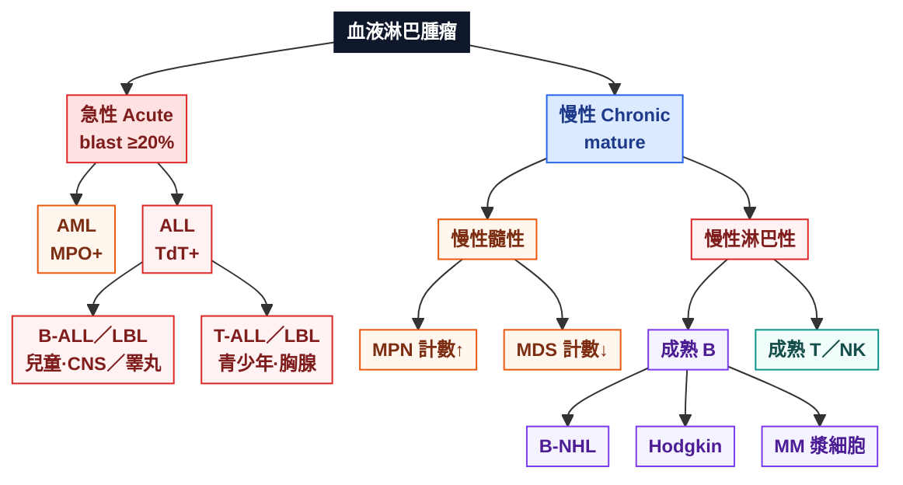
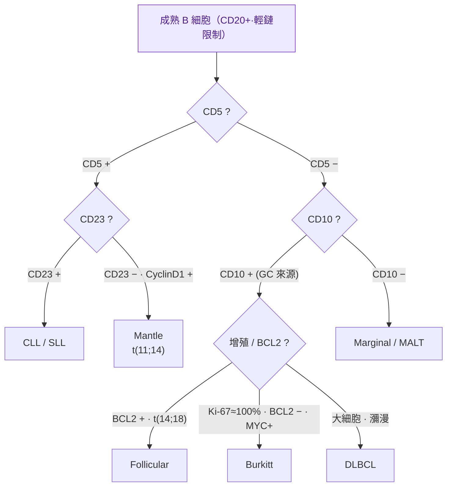

---
tags:
  - Med/MOC/Hema
  - hematology
  - WHO-classification
aliases:
  - Hema Category
  - Category
  - 血液淋巴腫瘤分類
created: 2026-07-09
updated: 2026-07-26
status: 可用
source: 手寫 Hema Note（重建 + 勘誤）；WHO HAEM5（2022）
cssclass: clinical-note
---


# 🩸 血液淋巴腫瘤分類 · Hematolymphoid Neoplasms

> [!abstract] 這份筆記怎麼讀
> 全部依「**急性 vs 慢性**」× 「**髓性 vs 淋巴性**」兩軸展開。先看 [[#1 主分類樹 Master Map]] 抓骨架，再用 [[#2 免疫標記速查 Marker Cheat Sheet]] 和 [[#🧬 關鍵基因速查表]] 補細節。
> **各疾病專篇**已分資料夾（見下方資料夾地圖），可從 [[#專篇索引（點進去下鑽）]] 點進；每篇底部都連回本檔。
> 手寫原稿的**錯誤與待補**集中在最後 [[#⚠️ 原筆記勘誤 Corrections]] 與 [[#➕ 建議補充 Additions]]，趕時間可直接跳過去看。
> 標 🆕 的是 **WHO 第 5 版（2022）** 的命名/概念更新。

---

## 資料夾地圖 Folder Map

根目錄只留 **本索引** 與 **非腫瘤對照**；血癌專篇依主幹分五夾：

```text
Hema/
├─ Hema Category.md          ← 你在這裡（總圖／索引）
├─ Anemia.md                 ← 貧血（非腫瘤對照）
├─ 01-急性白血病/            AML · APL · B-ALL · T-ALL
├─ 02-慢性髓性/              CML · PV · ET · PMF · MDS
├─ 03-成熟B細胞/             DLBCL · Burkitt · CLL · FL · Mantle · MALT · HCL · MM · HL
├─ 04-成熟T-NK/              PTCL · ALCL · AITL · MF/SS · ATLL · NK/T
└─ 05-組織細胞/              LCH
```

| 資料夾 | 對應主軸 | 專篇 |
|---|---|---|
| `01-急性白血病` | 急性 | [[AML]] · [[APL]] · [[B-ALL]] · [[T-ALL]] |
| `02-慢性髓性` | 慢性 + 髓性 | [[CML]] · [[PV]] · [[ET]] · [[PMF]] · [[MDS]] |
| `03-成熟B細胞` | 慢性 + 淋巴 B | [[DLBCL]] · [[Burkitt]] · [[CLL-SLL]] · [[Follicular Lymphoma\|FL]] · [[Mantle Cell Lymphoma\|Mantle]] · [[MALT Lymphoma\|MALT]] · [[Hairy Cell Leukemia\|HCL]] · [[Multiple Myeloma\|MM]] · [[Hodgkin Lymphoma\|HL]] |
| `04-成熟T-NK` | 慢性 + 淋巴 T/NK | [[PTCL]] · [[ALCL]] · [[AITL]] · [[Mycosis Fungoides\|MF/SS]] · [[ATLL]] · [[NK-T Lymphoma\|NK/T]] |
| `05-組織細胞` | 非淋巴瘤 | [[LCH]] |
| 根目錄 | 非腫瘤 | [[Anemia\|貧血]] |

---

## 0. 兩個分類主軸 The 2 Axes

| 軸 | 分兩端 | 判斷依據 | 一句話 |
|---|---|---|---|
| **成熟度** | 急性 Acute（immature）↔ 慢性 Chronic（mature） | 芽細胞比例、TdT | 芽細胞 **≥ 20%** → 急性白血病（WHO 門檻） |
| **系別** | 髓性 Myeloid ↔ 淋巴性 Lymphoid | MPO / 淋巴標記 | MPO+ 或 Auer body → 髓性；淋巴標記(CD3/CD19…) → 淋巴性 |

> [!danger] 為什麼急性是「medical emergency」
> 急性白血病 = 未成熟芽細胞塞滿骨髓 → 正常造血被排擠 → **貧血、感染（發燒）、出血**（三聯徵）。
> 骨髓通常 **hypercellular**；周邊血抹片可見芽細胞。**APL（AML-M3, t(15;17)）** 因 DIC 風險最急，需立即 ATRA/砷劑，是急症中的急症。

---

## 1. 主分類樹 Master Map

> [!tip] 圖太大看不全時
> 1. **先看下面「一眼骨架」**——純文字樹，不需滑左右  
> 2. 視覺圖改成 **上下排（TB）**，手機／窄欄比較塞得下  
> 3. Obsidian：`Cmd/Ctrl + -` 縮小；或暫時把筆記開成**寬欄／閱讀模式**  
> 4. 仍嫌擠就只記兩軸：**急性↔慢性** × **髓性↔淋巴性**，細節下鑽各章

### 一眼骨架（免滑）

```text
血液淋巴腫瘤
├─ 急性 Acute（blast ≥20%）
│  ├─ AML 急性髓性（MPO+）
│  └─ ALL 淋巴母細胞（TdT+）
│     ├─ B-ALL／LBL（兒童·CNS／睪丸）
│     └─ T-ALL／LBL（青少年·胸腺）
└─ 慢性 Chronic（mature）
   ├─ 慢性髓性
   │  ├─ MPN（計數↑：CML／PV／ET／PMF）
   │  └─ MDS（計數↓·dysplasia）
   └─ 慢性淋巴性
      ├─ 成熟 B 細胞 → B-NHL · Hodgkin（RS）· 漿細胞瘤（MM）
      └─ 成熟 T／NK 淋巴瘤
```

### 專篇索引（點進去下鑽）

| 分支 | 專篇 |
|---|---|
| **急性髓性** | [[AML]] · [[APL]]（DIC 急症） |
| **急性淋巴** | [[B-ALL]] · [[T-ALL]] |
| **MPN** | [[CML]] · [[PV]] · [[ET]] · [[PMF]] |
| **MDS** | [[MDS]] |
| **成熟 B（侵襲）** | [[DLBCL]] · [[Burkitt]] · [[Mantle Cell Lymphoma\|Mantle]] |
| **成熟 B（惰性）** | [[CLL-SLL]] · [[Follicular Lymphoma\|FL]] · [[MALT Lymphoma\|MALT]] · [[Hairy Cell Leukemia\|HCL]] |
| **漿細胞** | [[Multiple Myeloma\|MM]] |
| **何杰金** | [[Hodgkin Lymphoma\|HL]] |
| **成熟 T／NK** | [[PTCL]] · [[ALCL]] · [[AITL]] · [[Mycosis Fungoides\|MF/SS]] · [[ATLL]] · [[NK-T Lymphoma\|NK/T 鼻型]] |
| **組織細胞** | [[LCH]] |
| **非腫瘤對照** | [[Anemia\|貧血]] |

### 視覺圖（上下排，較好塞進一屏）



> [!tip] 記憶錨點：年齡 × 系別
> - **B-ALL** → 小小孩 (kid)　**T-ALL** → 青少年 (teen)　**AML** → 老人 (old)
> - **CML/PV/ET/MDS** → 中老年　**Hodgkin** → 雙峰（年輕 + 老年）

---

## 2. 免疫標記速查 Marker Cheat Sheet

| 標記                                | 指向                        | 高頻用途 / 備註                                         |
| --------------------------------- | ------------------------- | ------------------------------------------------- |
| **TdT**                           | 未成熟（芽細胞）                  | 分辨 ALL/LBL（+）vs 成熟淋巴瘤（−）                          |
| **MPO**                           | 髓性                        | AML 的定義性標記；Auer body 同義髓性                         |
| **NSE**                           | 單核球系                      | AML-M4/M5、牙齦浸潤                                    |
| **CD19 / CD20 / CD79a / PAX5**    | B 細胞                      | CD20 是 rituximab 標靶                               |
| **CD3**                           | T 細胞                      | 表面 CD3=成熟 T；**胞質 CD3ε**=NK/T 淋巴瘤                  |
| **CD56**                          | **NK 細胞**                 | ⚠️ 不是 CD5；也見於漿細胞瘤、NK/T 淋巴瘤                        |
| **CD138 (syndecan-1)**            | 漿細胞                       | 骨髓瘤                                               |
| **CD1a / S100 / CD207(langerin)** | 樹突/Langerhans 細胞          | LCH；CD1a 也標皮質胸腺細胞                                 |
| **CD10 (CALLA)**                  | 生發中心 (GC)                 | Follicular、Burkitt、GCB-DLBCL；也見 B-ALL             |
| **BCL6**                          | 生發中心                      | GC 來源標記                                           |
| **BCL2**                          | 抗凋亡                       | **反應性 GC 陰性；Follicular 陽性**（判良惡關鍵）；**Burkitt 陰性** |
| **Cyclin D1 (BCL1)**              | Mantle                    | t(11;14)                                          |
| **CD5**                           | T 細胞 + **CLL/SLL、Mantle** | B 細胞上出現 CD5 = 異常                                  |
| **CD23**                          | CLL/SLL（+）                | 與 Mantle（−）鑑別的關鍵                                  |
| **CD30**                          | RS 細胞、ALCL                | 也見胚胎癌                                             |
| **CD15**                          | RS 細胞、顆粒球                 | Hodgkin                                           |
| **CD4**                           | 輔助 T                      | 多數 CTCL（MF/SS、ATLL、AITL）                          |
| **ALK**                           | ALCL(ALK+)                | t(2;5) NPM-ALK                                    |

> [!note] 單株性 Clonality 怎麼證
> - **B 細胞** → **輕鏈限制**（κ:λ 偏一邊）或 IGH 重排
> - **T 細胞** → **TCR 基因重排（V(D)J）**
> - 反應性增生 = 多株（polyclonal）；腫瘤 = 單株（monoclonal）。例：MALT 由 *H. pylori* 引起的 **polyclonal → monoclonal** 演變。

---

## 3. 急性白血病 Acute Leukemia

### 3.1 [[AML]] 急性髓性白血病

| 面向 | 重點 |
|---|---|
| 定義 | 骨髓芽細胞 **≥20%**（🆕 WHO 2022：具**特定基因異常**者多數**不再要求 20%**，惟 *BCR::ABL1*、*CEBPA* 仍需 20%） |
| 形態/標記 | **Auer body**、**MPO+**；單核系 **NSE+**、**牙齦/皮膚浸潤** |
| 分類邏輯 | ① AML with **defining genetic abnormalities**（預後好）② AML **defined by differentiation**（原 NOS, M0–M7） |
| 高頻基因 | **t(15;17) PML::RARA**（[[APL]]/M3）· **t(8;21) RUNX1::RUNX1T1** · **inv(16) CBFB::MYH11**（皆偏 favorable） |

> [!warning] [[APL]]（AML-M3, t(15;17)）
> Faggot cells、**DIC** 高風險 → **醫療急症**。治療 **ATRA + 砷劑**（誘導分化），是少數「不化療也能治」的白血病。詳見專篇。

### 3.2 ALL 急性淋巴母細胞白血病/淋巴瘤

| | **[[B-ALL]]／LBL** | **[[T-ALL]]／LBL** |
|---|---|---|
| 好發 | 兒童 | 青少年 |
| 常見表現 | **白血病**（骨髓/血） | **淋巴瘤**（胸腺/縱膈腫塊） |
| 特殊部位 | **CNS、睪丸** | 上腔靜脈壓迫 |
| 標記 | TdT+, CD19, CD10 | TdT+, **CD3, CD5, CD7** |
| 細胞遺傳 | 好：hyperdiploid、**t(12;21) ETV6::RUNX1**；差：**t(9;22) Ph+**、KMT2A(嬰兒) | NOTCH1 突變常見 |

---

## 4. 慢性髓性腫瘤 Chronic Myeloid

### 4.1 MPN 骨髓增生性腫瘤（計數 ↑）

> [!info] 共通機轉
> **RTK / JAK-STAT 持續活化** → 不需生長因子刺激就能增殖 → 骨髓 hypercellular、周邊血某系（或多系）**升高**。可演變為骨髓纖維化或轉為 AML。

| 疾病 | 主升 | 驅動基因 | 記憶點 |
|---|---|---|---|
| **[[CML]]** | 顆粒球（WBC） | **t(9;22) BCR::ABL1（費城染色體）** | 嗜鹼球↑、脾腫；TKI(imatinib)；可 blast crisis |
| **[[PV]]** | **紅血球 (RBC↑)** | **JAK2 V617F**(>95%) | 搔癢、血栓、臉紅 |
| **[[ET]]** | **血小板 (PLT↑)** | JAK2 / CALR / MPL | 血栓/出血 |
| **[[PMF]]** | 纖維化 | JAK2 / CALR / MPL | 淚滴狀 RBC、leukoerythroblastic、巨脾、巨核細胞異常 |

### 4.2 [[MDS]] 骨髓化生不良腫瘤（計數 ↓）🆕

> [!note] MPN 與 MDS 的分水嶺
> 兩者骨髓都可 hypercellular，但 **MPN 周邊血計數↑，MDS 因無效造血 → 周邊血細胞↓（pancytopenia）**。
> - **Dysplasia**：≥1 系、≥10% 細胞形態異常
> - 診斷需 **細胞遺傳學**；風險 → 轉 **AML**
> - 亞型線索：ring sideroblast（*SF3B1*）、**del(5q)** 症候群（預後佳，lenalidomide）
> - 🆕 WHO 2022 更名 **Myelodysplastic neoplasms**（縮寫仍 MDS）

---

## 5. 成熟 B 細胞淋巴瘤 Mature B-cell Lymphoma

> [!tip] 先分「惰性 vs 侵襲性」
> - **Indolent 惰性**：小～中細胞、長得慢、常無法根治但可長期共存（FL, CLL/SLL, MZL）→ 多見於**年長者**
> - **Aggressive 侵襲性**：中～大細胞、mitosis 旺、需化療、但**可能治癒**（DLBCL, Burkitt, Mantle 偏侵襲）

### 5.1 用標記做鑑別（高產出）



### 5.2 各論

| 疾病 | 免疫表型 | 關鍵基因 | 臨床/形態 | 惰↔侵 |
|---|---|---|---|---|
| **[[DLBCL]]** | CD20+, GCB(**CD10/BCL6**) vs ABC(MUM1)（Hans） | **double-hit: MYC + BCL2(±BCL6)** | **最常見 NHL**；nodal 或 **extranodal**；R-CHOP 可治癒 | 侵襲 |
| **[[Burkitt]]** | CD10+, BCL6+, **BCL2 −**, **Ki-67≈100%** | **t(8;14) IGH::MYC**, EBV | **Starry-sky**（tingible-body macrophage）；endemic=**顎骨/非洲童**、sporadic=**迴盲部/腹部**、免疫缺陷型 | 高度侵襲 |
| **[[CLL-SLL\|CLL / SLL]]** | **CD5+, CD23+**, CD20(dim) | — | lymphocytosis→白血病(CLL) / 淋巴結(SLL)；**smudge cell**；**Richter 轉化→DLBCL** | 惰性 |
| **[[Follicular Lymphoma\|Follicular]]** | **CD10+, BCL6+, BCL2+** | **t(14;18) IGH::BCL2** | 淋巴結腫、**nodular/濾泡**結構、少見白血病；可轉 DLBCL | 惰性 |
| **[[MALT Lymphoma\|Marginal / MALT]]** | CD5−, CD10− | **t(11;18) BIRC3::MALT1** | 胃(**H. pylori**)、唾液腺(Sjögren)、甲狀腺(橋本)、眼、肺；**polyclonal→monoclonal**；除菌可退 | 惰性 |
| **[[Mantle Cell Lymphoma\|Mantle]]** | **CD5+, CD23−**, **Cyclin D1+**, SOX11+ | **t(11;14) IGH::CCND1** | 腸道 lymphomatous polyposis；老年男 | 侵襲 |
| **[[Hairy Cell Leukemia\|Hairy cell]]** | CD11c/CD25/CD103+ | **BRAF V600E** | 脾腫、全血球↓、乾抽、毛狀突起；cladribine | 惰性 |

> [!warning] BCL2 是「良惡開關」也是「Burkitt 陷阱」
> - **反應性生發中心 = BCL2 陰性；Follicular lymphoma = BCL2 陽性** → 這是判斷濾泡是不是腫瘤的關鍵。
> - **Burkitt = BCL2 陰性**（配 Ki-67≈100%、MYC+）。若一個「像 Burkitt」的腫瘤 **BCL2 陽性**，要高度懷疑 **double-hit / 高惡性度 B 細胞淋巴瘤**，而非典型 Burkitt。

---

## 6. 漿細胞腫瘤 Plasma Cell Neoplasm（[[Multiple Myeloma]]）

| 面向 | 重點 |
|---|---|
| 標記 | **CD138+, CD38+, CD56+**（異常）、cytoplasmic Ig、輕鏈限制 |
| 分泌 | **單株 Ig（M-spike）**、尿中 Bence-Jones（輕鏈） |
| 臨床 **CRAB** | **C**a↑ 高血鈣 · **R**enal 腎損傷 · **A**nemia 貧血 · **B**one 溶骨病灶(punched-out) |
| 形態 | 骨髓漿細胞增多、周邊血 **Rouleaux**（錢串狀） |

詳見專篇：[[Multiple Myeloma]]（含 IMWG 生物標記型 MDE）。

---

## 7. [[Hodgkin Lymphoma|何杰金淋巴瘤 Hodgkin Lymphoma]]

| 面向 | 重點 |
|---|---|
| 腫瘤細胞 | **Reed-Sternberg (RS) cell**：**CD15+, CD30+, CD20−/CD45−**, PAX5 弱+ |
| 病毒 | **EBV (HHV4)** 相關（約 40%，mixed cellularity 更高） |
| 擴散 | **連續性淋巴結**擴散、**少 extranodal**（與 NHL 相反） |
| 年齡 | 雙峰（年輕成人 + 老年） |
| 亞型 | Nodular sclerosis（最常見，年輕女）· Mixed cellularity（EBV+）· Lymphocyte-rich/depleted |

> [!note] 別漏 NLPHL
> **Nodular lymphocyte-predominant HL**：**LP/popcorn 細胞 CD20+、CD45+、CD15−、CD30−**（與 classic 相反），預後佳。🆕 ICC 2022 改稱 *nodular lymphocyte-predominant B-cell lymphoma*。

---

## 8. 成熟 T / NK 細胞淋巴瘤 Mature T/NK

| 疾病 | 免疫表型 | 機轉/病毒 | 招牌特徵 | 惡性度 |
|---|---|---|---|---|
| **[[PTCL\|PTCL, NOS]]** | CD3+, **TdT−**, 常 CD4+ | RAS / **JAK-STAT** 活化 | 排除性診斷 | 侵襲 |
| **[[ALCL]]** | **CD30+**, EMA+, CD3 常 − | **ALK+：t(2;5) NPM1::ALK** | **Hallmark cells**（馬蹄/腎形核）；ALK+ 年輕、**預後較好** | ALK+ 佳 / ALK− 差 |
| **[[AITL\|AITL / nodal Tfh]]** 🆕 | **CD4+, CD10+, PD1+, CXCL13+, BCL6+** | **EBV+** B 母細胞背景 | 濾泡樹突網增生、arborizing 血管、多株高球蛋白血；**TCR 單株** | 侵襲 |
| **[[Mycosis Fungoides\|MF / SS]]** | **CD4+**, CD7**丟失** | — | **表皮親和(epidermotropism) + Pautrier microabscess**；**SS=白血病化 + 紅皮症 + 腦回狀(cerebriform)核** | 惰→侵 |
| **[[ATLL]]** | **CD4+, CD25+** | **HTLV-1**（日本、加勒比） | **Flower / clover-leaf cell**、高血鈣、溶骨、皮膚 | 高度侵襲 |
| **[[NK-T Lymphoma\|Extranodal NK/T, nasal]]** | **CD56+, 胞質 CD3ε+** | **EBV+** | **angiocentric → 壞死/潰瘍**、鼻中線破壞 | 非常侵襲 |

> [!tip] 🆕 AITL 已改名
> WHO 2022 把 AITL 併入 **nodal T-follicular helper (Tfh) cell lymphoma**，AITL = 其 **angioimmunoblastic-type**。核心是 **Tfh 表型（CD4/CD10/PD1/CXCL13/BCL6）** + EBV 驅動的 B 細胞背景。原稿「4th lymphoid」應為 **Tfh（follicular helper）**。

---

## 9. 組織細胞 / 樹突細胞腫瘤 Histiocytic / Dendritic

### [[LCH|Langerhans Cell Histiocytosis (LCH)]]

| 面向 | 重點 |
|---|---|
| 本質 | **樹突/組織細胞腫瘤，不是淋巴瘤**（原稿 "not lymphoma" 正確） |
| 標記 | **CD1a+, S100+, langerin/CD207+** |
| 超微/形態 | **Birbeck 顆粒（網球拍狀）**、**咖啡豆/grooved 核**、背景嗜酸性球 |
| 基因 | **BRAF V600E**（約半數） |
| 分型 | 單灶(eosinophilic granuloma)｜多灶單系統(Hand-Schüller-Christian)｜**多灶多系統(Letterer-Siwe，嬰兒，侵襲)**｜肺型(成人吸菸) |

---

## 🧬 關鍵基因速查表 Translocations

| 疾病 | 易位 | 融合基因 | 一句話 |
|---|---|---|---|
| [[CML]] | **t(9;22)** | BCR::ABL1 | 費城染色體、TKI |
| [[APL]] (AML-M3) | **t(15;17)** | PML::RARA | DIC、ATRA |
| [[AML]](favorable) | t(8;21) / inv(16) | RUNX1::RUNX1T1 / CBFB::MYH11 | core-binding factor |
| [[B-ALL]](兒童,好) | t(12;21) | ETV6::RUNX1 | 預後佳 |
| [[Burkitt]] | **t(8;14)** | IGH::MYC | Ki-67≈100%、BCL2− |
| [[Follicular Lymphoma\|Follicular]] | **t(14;18)** | IGH::BCL2 | BCL2 過度表現 |
| [[Mantle Cell Lymphoma\|Mantle]] | **t(11;14)** | CCND1(cyclin D1)::IGH | CD5+CD23− |
| [[MALT Lymphoma\|MALT]] | t(11;18) | BIRC3::MALT1 | 除菌無效者 |
| [[ALCL]](ALK+) | **t(2;5)** | NPM1::ALK | hallmark cell |
| 高惡性度 B(double-hit) | MYC + BCL2(±BCL6) | — | 比 Burkitt/[[DLBCL]] 更兇 |

---

## ⚠️ 原筆記勘誤 Corrections

> [!bug] 需要修正 / 釐清的點
> 依原稿判讀；若括號內是我對手寫的判讀，請你對照原字跡確認。

| # | 位置 | 原稿（判讀） | 應為 | 說明 |
|---|---|---|---|---|
| 1 | 一般標記表 | **「CD5b : NK cell」** | **CD56 : NK cell** | NK 標記是 **CD56**（及 CD16/CD57）。**CD5 反而是 T 細胞 / CLL / Mantle 標記**，兩者易混，務必分開。 |
| 2 | ALCL | **「NPM-TMP3」** | **NPM-ALK，t(2;5)** | ALCL(ALK+) 最常見融合是 **NPM1::ALK（75–85%）**。TPM3-ALK 只是少見變異夥伴，主軸是 **ALK** 這個基因。 |
| 3 | Burkitt | **「BCL2 ?」** | **BCL2 陰性（確定）** | Burkitt 定義上 **BCL2−、Ki-67≈100%、MYC+**。BCL2 陽性要改想 double-hit。 |
| 4 | 急性定義 | 疑似「blast >30% / WBC>30%」 | **芽細胞 ≥ 20%**（WHO 門檻） | 急性白血病門檻是 **≥20%**，不是 30%。🆕 WHO 2022：多數具特定基因異常之 AML 已不需 20%。 |
| 5 | AITL | 「4th lymphoid hyperplasia」 | **Tfh（follicular helper）表型** | 應是 **Tfh** 而非 "4th"；且 🆕 已更名 nodal Tfh lymphoma。 |
| 6 | MF/SS | 「epidermotropism (n7)」 | **CD7 丟失 + Pautrier microabscess** | 招牌是**表皮內 Pautrier 微膿瘍**；MF 常見 **pan-T 抗原 CD7 缺失**。 |
| 7 | Follicular / BCL6 註記 | 「BCL6: GC (BCL2− if benign)」 | 概念正確，補一句 | **反應性 GC → BCL2−；濾泡淋巴瘤 → BCL2+**，這是判良惡的關鍵，不是 BCL6 本身的性質。 |

---

## ➕ 建議補充 Additions

> [!example] 補上這些會更完整
> 下列多數已展開成專篇，可從索引點入：
> - **AML 分化亞型 M0–M7** 與 **favorable 細胞遺傳** → [[AML]] · [[APL]]
> - **B-ALL 細胞遺傳分層** → [[B-ALL]]
> - **DLBCL Hans / double-hit** → [[DLBCL]]
> - **Richter 轉化** → [[CLL-SLL]]
> - **Hairy cell leukemia** → [[Hairy Cell Leukemia]]
> - **MALT t(11;18)** 與除菌 → [[MALT Lymphoma]]
> - **NLPHL** vs classic HL → [[Hodgkin Lymphoma]]
> - **NK/T 鼻型** midline destruction → [[NK-T Lymphoma]]

---

## 🆕 WHO 2022（第 5 版）更新重點

> [!info] 與舊版（2016）差異（供對照，不必全背）
> - 整體走向 **基因驅動分類**，形態退居其次。
> - **MDS → Myelodysplastic neoplasms**（縮寫仍 MDS）。
> - **AML**：具 defining genetic abnormality 者多數 **取消 ≥20% 芽細胞門檻**（*BCR::ABL1*、*CEBPA* 例外）。
> - **AITL → nodal Tfh cell lymphoma, angioimmunoblastic-type**。
> - 新增前驅病灶 **CHIP / CCUS**（clonal hematopoiesis）。
> - **B-ALL** 新增數個 transcriptome 定義亞型，建議 RNA 定序輔助。

---

## 🔗 Sources
- WHO 5th ed (2022) Lymphoid — [Nature Leukemia](https://www.nature.com/articles/s41375-022-01620-2)
- WHO 5th ed (2022) Myeloid/Histiocytic — [Nature Leukemia](https://www.nature.com/articles/s41375-022-01613-1)
- WHO 2022 摘要 — [MLL](https://www.mll.com/en/the-new-who-classification-2022)
- ALCL（ALK/hallmark cell）— [Pathology Outlines](https://www.pathologyoutlines.com/topic/lymphomanonbanaplastic.html)
- Burkitt（BCL2−/MYC/Ki-67）— [Pathology Outlines](https://www.pathologyoutlines.com/topic/lymphomaburkitt.html)

> [!quote] 本檔案
> 重建自手寫 *Hema Note*，經事實查證與 WHO 2022 對照。勘誤中「(判讀)」處請以原稿字跡為準。
