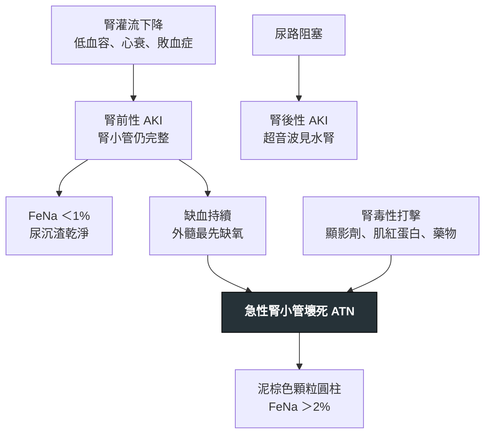

---
tags:
  - Med/Disease/Nephro
  - 禁忌
aliases: [AKI, Acute kidney injury, 急性腎損傷, ATN, Acute tubular necrosis, 急性腎小管壞死, 顯影劑腎病變, 橫紋肌溶解]
created: 2026-07-28
updated: 2026-07-28
status: 可用
source: 114-1 醫學(三) 28、114-2 醫學(三) 24、114-2 醫學(三) 30、115-2 醫學(三) 28 延伸；KDIGO 2012 Clinical Practice Guideline for Acute Kidney Injury（定義與分期）；Harrison's Principles of Internal Medicine 腎臟章
cssclass: clinical-note
presents_as:
  - "[[Edema]]"
  - "[[Oliguria]]"
diagnosed_by:
  - "[[Urinalysis]]"
  - "[[BUN Cr eGFR]]"
  - "[[Urine indices]]"
  - "[[UPCR UACR]]"
  - "[[Arterial blood gas]]"
treated_by:
  - "[[Dialysis]]"
differential:
  - "[[CKD]]"
complication:
  - "[[Hyperkalemia]]"
  - "[[CKD]]"
---

# AKI ｜ 急性腎損傷 · Acute kidney injury

> [!abstract] 一句話總覽
> AKI 是**症候群不是病**：數小時到 7 天內 GFR 下降，用**血清 creatinine 與尿量兩個變數定義**——所以追蹤也只能用這兩個。臨床上要做的三件事：**先分三段定位（腎前／腎性／腎後）**，因為處置完全不同；**停掉正在打腎的東西**；**維持灌流**。沒有任何藥物能加速腎臟恢復，透析只是撐橋，不是治療。

> [!tip] 30 秒行動卡
> **診斷關鍵**（KDIGO，符合任一項即成立）：**48 小時內 Cr 上升 ≥ 0.3 mg/dL｜Cr 升至基準值 ≥ 1.5 倍（發生於過去 7 天內）｜尿量 < 0.5 mL/kg/hr 持續 6 小時**。
> **治療骨架**：**① 一次腎臟超音波排除腎後性**（可逆、便宜、不做會後悔）→ **② 停腎毒性藥與三重打擊組合** → **③ 等張晶體回復灌流** → **④ 依腎功能調整所有藥物劑量** → **⑤ 出現 AEIOU 且保守治療無效才 [[Dialysis]]**。
> **絕對不可**：用任何一個 Cr／BUN 的**絕對數值**當透析指徵；在色素性 AKI 用 FeNa < 1% 斷定「脫水是主因」；起始 RASi／SGLT2 inhibitor 後 Cr 輕度上升就停藥；常規用 N-acetylcysteine 或碳酸氫鈉預防顯影劑腎病變。

---

## 定義與定位

| 項目 | 重點 |
|---|---|
| 本質 | **數小時至 7 天內** GFR 急速下降，導致含氮廢物滯留與水／電解質／酸鹼失衡 |
| **定義變數** | **血清 creatinine ＋ 尿量**——只有這兩個。**監測指標必須與定義變數對齊**：追 AKI 就追 Cr 與尿量，不是追影像 |
| 三段定位 | **腎前性（灌流不足，腎小管完整）／腎性（實質受損）／腎後性（尿路阻塞）**。定位決定處置，所以永遠先定位 |
| 與 CKD 的關係 | 雙向：**AKI 是 [[CKD]] 的獨立危險因子（即使 Cr 回到基準）；CKD 也是 AKI 的危險因子**。臨床上多數是 AKI on CKD |

### KDIGO 分期：Cr 與尿量取「較嚴重」的那一格

| 期 | 血清 creatinine | 尿量 |
|---|---|---|
| **1** | 基準值 **1.5–1.9 倍**，或 48 小時內上升 **≥ 0.3 mg/dL** | < 0.5 mL/kg/hr **持續 6–12 小時** |
| **2** | 基準值 **2.0–2.9 倍** | < 0.5 mL/kg/hr **持續 ≥ 12 小時** |
| **3** | 基準值 **≥ 3.0 倍**，或 Cr **升至 ≥ 4.0 mg/dL**，或**已開始腎臟替代治療** | < 0.3 mL/kg/hr **持續 ≥ 24 小時**，或**無尿 ≥ 12 小時** |

**「Cr 升至 ≥ 4.0」是絕對值、沒有附帶條件**（KDIGO 2012 已取消 AKIN 舊版「須併急性上升 ≥ 0.5 mg/dL」），但前提是病人**已符合 AKI 定義**——穩定的 CKD 病人 Cr 本來就 5.0，不算 Stage 3。

> [!warning] Creatinine 是落後指標，不是即時指標
> GFR 掉下來之後，**Cr 要 24–48 小時才追得上**——所以 Cr 還正常完全不能排除今天發生的 AKI。另外三個系統性偏差：**① 肌肉量少的長者、女性、肝硬化、癱瘓者，Cr 基準本來就低，同樣的 Cr 值代表更差的腎功能，嚴重度被低估。② AKI 期間 Cr 尚未達到穩定態，所有 eGFR 公式（CKD-EPI、Cockcroft-Gault）都不成立，用它算藥物劑量會高估腎功能。③ 大量輸液會稀釋 Cr。**
> 因此問「**最早偵測**」時，答案是**尿量**或新型生物標記（**NGAL、KIM-1、TIMP-2 × IGFBP7**）；問「**最能反映恢復**」時，答案才回到 **Cr 與尿量**。這兩個問題不同，指標也不同。

## 病因與機制

> [!danger] 一條可代入的公式解掉所有「藥物讓 GFR 怎麼走」的題
> **GFR ∝（入球小動脈阻力 ↓、出球小動脈阻力 ↑）**。任何藥物、任何機轉，只要先問「**它動的是哪一端、往哪個方向動**」，答案就出來，不必逐藥背。
> **「三個調控機轉」是考試的數法**：肌源反射 (myogenic reflex)、腎小管–腎絲球回饋 (tubuloglomerular feedback)、**angiotensin II（收縮出球）**——此時**前列腺素（PGE₂ 擴張入球）**就是「不屬於」的那一個。**但嚴格生理學只認兩個內生性自我調節機轉（肌源反射與 TGF）**，angiotensin II、prostaglandin、NO 都算**調控者 (modulator)**——若選項把 AII 與 PGE₂ 並列，兩者都可能是答案，要看選項組合。
> **三重打擊 (triple whammy)** 是這條規則的臨床總結：**NSAID（關入球）＋ ACEI／ARB（開出球）＋ 利尿劑（減少灌流）**三者併用，是社區型 AKI 最常見的藥物組合。
> **反向推論同樣成立**：**SGLT2 inhibitor 起始後的 eGFR 初期下墜不是副作用，是療效的證據**——近端小管少吸收鈉 → 更多 NaCl 到達緻密斑 → 觸發腎小管–腎絲球回饋 → 入球收縮 → 腎絲球內壓下降。**2–4 週內 eGFR 通常降 3–6 mL/min/1.73m²，降幅 < 30% 不需停藥。**

### 三段病因清單

| 定位 | 常見病因 | 關鍵線索 |
|---|---|---|
| **腎前性（最常見）** | 低血容（出血、腹瀉、利尿過度）、心輸出下降（[[Heart failure]]）、有效循環容積不足（[[Cirrhosis]]、敗血症 [[Shock]]）、藥物（三重打擊、calcineurin inhibitor） | 尿沉渣乾淨、**補液後 Cr 迅速回落**（回顧性判準） |
| **腎性－小管 (ATN)** | 缺血延續、**顯影劑**、**橫紋肌溶解／溶血**、aminoglycoside、amphotericin B、cisplatin、腫瘤溶解症候群 | **泥棕色顆粒圓柱**；補液後不回落 |
| **腎性－間質 (AIN)** | 藥物（β-lactam、NSAID、**質子幫浦抑制劑 (PPI)**、sulfonamide、rifampin、allopurinol）、感染、自體免疫 | **白血球圓柱、嗜酸性球尿**；可有皮疹、發燒、嗜酸性球增多（三聯徵常不齊） |
| **腎性－腎絲球／血管** | 腎絲球腎炎、血栓性微血管病 (TMA)、血管炎、膽固醇栓塞 | **紅血球圓柱 ＋ 變形紅血球 ＋ 蛋白尿** |
| **腎後性（最不該漏）** | 前列腺肥大、雙側結石、骨盆腔腫瘤、後腹腔纖維化、導尿管阻塞 | **一次超音波看水腎就排除；解除阻塞後可逆** |

> [!note] 外髓質是全腎的「缺氧邊緣地帶」
> 幾乎所有**缺血型 AKI 的第一個受害者都是外髓質**——顯影劑、休克、敗血症、心臟手術體外循環，機轉不同但最後都收斂到這裡。這一條可以直接推出「為什麼 ATN 的病理變化集中在**近端小管直段與亨利氏環升支粗段**」：那是耗氧最高、血流最差的一段。

## 臨床表現

- **典型**：**多數是住院中被抽血抓到的無症狀 Cr 上升**，或尿量減少
- **提示性**：容積過多（[[Edema]]、肺水腫、頸靜脈怒張）、代謝性酸中毒的深快呼吸、噁心倦怠
- **少見但重要**：**尿毒症狀**（心包摩擦音、腦病變、撲翼樣震顫、出血傾向）代表已到需要透析的程度；**完全無尿**要優先想**雙側阻塞或血管災難**（雙側腎動脈栓塞、主動脈剝離），不是單純 ATN

> [!warning] 「無尿 ＝ 最嚴重」是錯的方向
> **非少尿型 ATN 的預後優於少尿型**，尿量多寡反映的是殘餘腎小管功能，不是損傷程度的單一指標。但**完全無尿 (anuria) 在 ATN 反而罕見**——真的一滴都沒有時，先想阻塞、雙側腎血管阻斷、猛爆性腎絲球腎炎。

→ 相關主訴流程：[[Edema]]、[[Oliguria]]（Workup）

## 診斷

**第一批檢查**：血清 Cr 與電解質、[[Arterial blood gas]]（酸鹼與鉀）、**尿液常規 ＋ 尿沉渣鏡檢**、尿液 Na 與 Cr（算 FeNa）、[[UPCR UACR]]、**腎臟超音波**。

### 尿沉渣：最便宜的定位工具

| 看到什麼 | 指向 |
|---|---|
| **泥棕色顆粒圓柱 (muddy brown granular cast)** | **ATN** |
| **紅血球圓柱、變形紅血球、蛋白尿** | 腎絲球腎炎 |
| **白血球圓柱、嗜酸性球尿** | 急性間質性腎炎 |
| **乾淨** | **腎前性或腎後性** |

### FeNa：支持性指標，不是確診工具

**FeNa (%) ＝（尿 Na × 血 Cr）/（血 Na × 尿 Cr）× 100**　→　**腎前性 < 1%、ATN > 2%**
**用過利尿劑時改看 FeUrea**（利尿劑逼鈉排出會讓 FeNa 假性升高）：**腎前性 < 35%**。

> [!danger] FeNa 的失效條件——這是本科最高頻的陷阱
> FeNa 的**唯一前提**是「腎小管壞了就留不住鈉」。**凡是機轉不走這條路的 AKI，FeNa 就會失效**：
> **① 色素性腎病變（橫紋肌溶解、溶血）② 顯影劑腎病變 ③ 早期阻塞 ④ 腎絲球腎炎 ⑤ 肝腎症候群 ⑥ 心衰竭合併 ATN**——共同點是**都存在強烈的腎內血管收縮／腎前性成分，把鈉的再吸收保留了下來**（橫紋肌溶解與顯影劑其實**已有小管損傷**，只是被血管收縮的成分蓋過去），所以**FeNa 照樣 < 1%，但病人並不是單純脫水**。
> 反方向也會騙人：**利尿劑、既有 CKD、高鹽攝取**會讓真正的腎前性測出 FeNa > 2%。
> **可推廣的通則：任何「單一檢驗值 → 就可以確定診斷」的選項，先假設它錯。** FeNa、BUN/Cr 比值、尿比重、中央靜脈壓全部是**支持性**而非**確診性**指標。

### 兩個必須認得的專屬病因

| | **顯影劑相關 AKI** | **橫紋肌溶解性 AKI** |
|---|---|---|
| **機轉** | **① 髓質（外髓）微循環血管收縮缺血 ② 腎小管直接毒性 ③ 活性氧自由基 (ROS)／氧化壓力**；次要因素是滲透壓與黏稠度上升造成小管內阻塞。**完全不打腎絲球**（**Tamm-Horsfall 蛋白圓柱是 myeloma cast nephropathy 的機轉，別掛到顯影劑上**） | 肌紅蛋白在酸性尿中形成**色素性圓柱阻塞腎小管**＋直接毒性＋容積不足 |
| **時序** | 顯影後 **24–48 小時** Cr 開始上升、**3–5 天達峰**、多數 **7–10 天內回復**（診斷定義的觀察窗常寫 48–72 小時） | 傷害後數小時至一兩天 |
| **線索** | 近期顯影檢查；**FeNa 可 < 1%** | **CK 顯著上升**；尿液試紙潛血陽性但鏡檢無紅血球 |
| **電解質方向** | 無特異 | **K ↑、P ↑、尿酸 ↑、急性期 Ca ↓（沉積於受損肌肉）、AG 上升型酸中毒；恢復期血鈣反彈上升** |
| **預防／治療** | **等張晶體輸液 ＋ 用最低必要劑量顯影劑。N-acetylcysteine 與碳酸氫鈉輸注均已證實無效** | **早期大量等張晶體**是唯一有實證的核心。**碳酸氫鹼化尿液僅「可考慮」，mannitol 無實證益處** |

> [!warning] 情境觸發詞：看到就先驗 CK
> **馬拉松／劇烈運動、被壓埋、長時間昏迷倒地、惡性高熱、statin 併用 gemfibrozil 或 CYP3A4 抑制劑**。
> **擠壓症候群 (crush syndrome) 多一句**：**解除壓迫的瞬間鉀會大量湧入循環**，所以**救出前就要開始輸液**，並準備處理致命性高血鉀。

## 鑑別診斷

| 要排除的 | 支持它的線索 | 怎麼排除 |
|---|---|---|
| **[[CKD]]**（不是急性） | **貧血、低血鈣高血磷、續發性副甲狀腺機能亢進症、超音波見雙腎縮小且皮質變薄** | **調閱舊的 Cr 值**——沒有基準值時這是唯一可靠的方法 |
| 腎後性阻塞 | 前列腺症狀、單腎、骨盆腔惡性腫瘤、無尿與多尿交替 | **腎臟超音波**（早期或後腹腔纖維化可無水腎，高度懷疑時做 CT） |
| 急性間質性腎炎 | 新藥後 1–3 週、皮疹、發燒、嗜酸性球 | 停藥試驗；必要時切片（**類固醇有角色，與 ATN 處置不同**） |
| 腎絲球腎炎／血管炎 | **紅血球圓柱、大量蛋白尿、咳血、皮膚紫斑** | 補體、ANA、ANCA、anti-GBM；**進展快者需緊急切片與免疫抑制** |
| 假性 Cr 上升 | 剛開始 trimethoprim、cimetidine | 這兩者**抑制腎小管分泌 Cr，GFR 其實沒變**；BUN 與尿量不動 |

## 治療

*沒有藥物能加速腎臟恢復。所有治療都是「移除傷害 ＋ 支持到它自己好」。*

| 層次 | 內容 |
|---|---|
| **① 定位** | **一次超音波排除腎後性**；尿沉渣定位腎性亞型 |
| **② 停** | NSAID、ACEI／ARB（急性期暫停）、利尿劑（容積不足時）、aminoglycoside、amphotericin B、顯影劑、可疑的新藥 |
| **③ 灌流** | **等張晶體回復有效循環容積**；敗血症與 [[Shock]] 依原病處理。**低劑量 dopamine 無效且有害** |
| **④ 利尿劑的定位** | **只用來處理容積過多，不能改善腎功能或死亡率**，也不能把少尿型「轉成」非少尿型來改善預後 |
| **⑤ 劑量調整** | 所有經腎排除的藥都要減量；**AKI 期間 eGFR 公式不成立**，高風險藥物測血中濃度 |
| **⑥ 腎臟替代治療** | **AEIOU 任一項 ＋ 保守治療無效** → [[Dialysis]] |

> [!danger] 透析指徵背成「症狀 ＋ 頑固性」，不是背數字
> **A**cidosis（頑固性代謝性酸中毒）／**E**lectrolytes（頑固性高血鉀）／**I**ntoxication（可透析毒物）／**O**verload（頑固性容積過多、肺水腫）／**U**remia（心包膜炎、腦病變、出血傾向）。
> **沒有任何一個 Cr 或 BUN 的數值本身可以當作透析指徵**——選項寫「Cr > 8 就該透析」一律錯。同樣地，**把「藥物治療無效」四個字拿掉**，變成「若併發肺水腫、高血鉀、代謝性酸中毒則應立即透析」，就從正確變成過度的敘述。

## 併發症與預後

- **要盯的併發症**：**高血鉀（最快致命）**、代謝性酸中毒、容積過多與肺水腫、尿毒性心包膜炎與腦病變、藥物過量、感染
- **恢復期多尿 (post-ATN diuresis)**：腎小管功能落後於腎絲球恢復，可能日尿量數公升 → **低血鉀、低血鎂、脫水**，要跟著補
- **預後**：**AKI 即使 Cr 完全回到基準，仍是日後 [[CKD]] 與末期腎病的獨立危險因子**——所以出院後要安排腎功能追蹤，這一步最常被漏掉。腎前性與腎後性若早期解除多可完全恢復；ATN 通常 1–3 週開始恢復；曾需透析者長期腎功能不全的比例明顯上升

## 禁忌與陷阱

> [!danger] 絕對不可
> | 情境 | 絕對不可 | 為什麼 | 該做什麼 |
> |---|---|---|---|
> | 色素性 AKI（橫紋肌溶解、溶血）測得 FeNa < 1% | 據此**確定**脫水是腎衰竭主因 | 腎小管相對完整、鈉照樣回收，**FeNa 在此失效**——低值不能排除 ATN | 驗 **CK 與尿液肌紅蛋白**；**早期大量等張晶體**，不要停在「補水就好」 |
> | 高血鉀、肺水腫、酸中毒**尚未給藥物治療** | 直接說「應立即透析」 | 透析指徵**永遠附帶「頑固性／保守治療無效」** | 先跑藥物治療（鈣穩定心肌、insulin ＋ glucose、排鉀、利尿），無效再 [[Dialysis]] |
> | 起始 RASi 或 SGLT2 inhibitor 後 Cr 輕度上升 | 立刻停藥 | **那是腎絲球內壓下降的預期反應，是療效不是毒性** | **Cr 上升 ≤ 30% 且血鉀正常 → 續用並追蹤**；超過 30% 才找腎動脈狹窄、容積不足、併用 NSAID |
> | 需顯影檢查的高風險病人 | 常規給 **N-acetylcysteine 或碳酸氫鈉**「預防」 | **大型試驗已證實無效**，會造成虛假的安心 | **等張晶體輸液 ＋ 最低必要顯影劑量**；**停 metformin 有兩套並存的說法**：**ACR**——eGFR < 30、已有 AKI、或動脈內且顯影劑第一時間流經腎臟時才停；**FDA 仿單**更嚴——**eGFR 30–60**、肝病／酗酒／心衰竭、或**任何動脈內顯影**都應停。**停 48 小時、複驗腎功能穩定再恢復**（避免乳酸中毒，不是為了護腎） |
> | 容積不足或 CKD 病人 | NSAID ＋ ACEI／ARB ＋ 利尿劑**三者併用** | **三重打擊**：關入球、開出球、減灌流，GFR 直接崩 | 停 NSAID；急性期暫停 RASi 與利尿劑，穩定後再回加 |
> | AKI 尚未穩定 | 用 eGFR 公式算藥物劑量 | **公式假設 Cr 處於穩定態**，AKI 時會**高估**腎功能 → 藥物過量 | 保守給藥、拉長間隔、**高風險藥物測血中濃度** |
> | 不明原因的 Cr 上升 | 略過腎臟超音波 | **腎後性是唯一「一個檢查就排除、解除後可逆」的一類**，漏掉會變成不可逆 | 初次評估就安排**一次**超音波（**不是每天做**） |

> [!warning] 常見錯誤
> - **用影像追功能**：影像看**結構**（阻塞、大小、囊腫、鈣化），生化看**功能**（Cr、eGFR、尿量）。**每日超音波追腎功能恢復**是不適切的檢查。
> - **把「最早偵測」與「最能反映恢復」當同一題**：前者是**尿量**或新型標記，後者才是 **Cr 與尿量**。
> - **忘記 Cr 落後 24–48 小時**：Cr 還正常不能排除今天的 AKI；肌肉量少者的「正常 Cr」可能已是嚴重腎衰竭。
> - **鑑別急性與慢性只看 Cr 高低**：要看**貧血、鈣磷、腎臟大小、舊資料**，單一時間點的 Cr 分不出來。
> - **橫紋肌溶解常規給 mannitol 或碳酸氫鈉**：前者無實證益處，後者僅「可考慮」；核心永遠是**輸液**。

## 相關連結

- [[CKD]] — 雙向危險因子；鑑別急慢性的四個線索（貧血、鈣磷、腎臟大小、舊 Cr）都寫在那裡
- [[Dialysis]] — AEIOU 的操作面、HD 與 PD 的取捨、透析中低血壓與失衡症候群
- [[Hyperkalemia]] — AKI 最快致命的併發症，處置順序與心電圖變化
- [[UPCR UACR]] — 蛋白尿的定量與單位陷阱（UACR 與 UPCR 切點不同）
- [[BUN Cr eGFR]] — Cr 為什麼是落後指標、eGFR 公式在 AKI 為何不成立、哪些藥讓 Cr 假性上升
- [[Urine indices]] — FeNa／FeUrea 的算式、失效表與替代指標
- [[Arterial blood gas]] — AG 校正、Winter 公式、Δ/Δ、尿液 AG 的四式
- [[Heart failure]] · [[Cirrhosis]] · [[Shock]] — 三個最常見的「有效循環容積不足」來源
- [[Antidiabetics]] — SGLT2 inhibitor 的 eGFR dip 與 metformin 的暫停條件
- [[禁忌選項]] — 上表已收錄
