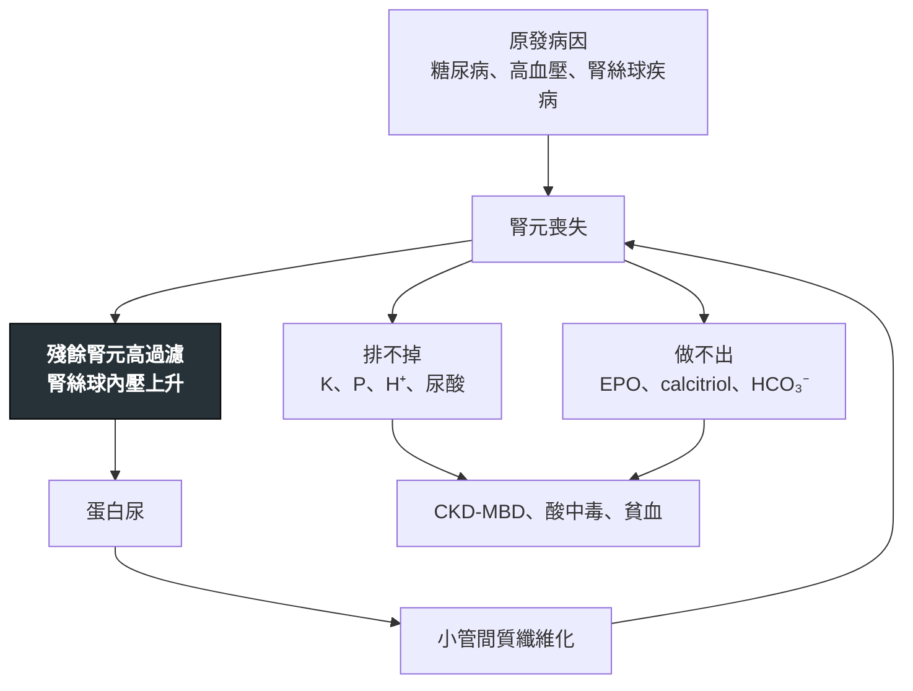

---
tags:
  - Med/Disease/Nephro
  - 禁忌
aliases: [CKD, Chronic kidney disease, 慢性腎臟病, ESRD, End-stage renal disease, 末期腎病, 尿毒症, CKD-MBD, 腎性貧血]
created: 2026-07-28
updated: 2026-07-28
status: 可用
source: 114-1 醫學(三) 29、114-2 醫學(三) 26、115-1 醫學(三) 24、115-1 醫學(三) 29、115-1 醫學(三) 30、115-2 醫學(三) 24、115-2 醫學(三) 25 延伸；KDIGO 2024 CKD Evaluation and Management（CGA 分期與治療）；KDIGO 2026 Anemia in CKD；KDIGO 2017 CKD-MBD Update；KDIGO 2021 Blood Pressure in CKD；台灣腎病年報（本土流病）
cssclass: clinical-note
presents_as:
  - "[[Edema]]"
  - "[[Anemia]]"
diagnosed_by:
  - "[[UPCR UACR]]"
  - "[[Arterial blood gas]]"
treated_by:
  - "[[Dialysis]]"
  - "[[Antidiabetics]]"
  - "[[Statin]]"
differential:
  - "[[AKI]]"
complication:
  - "[[Anemia]]"
  - "[[Hyperkalemia]]"
  - "[[CAD]]"
  - "[[Heart failure]]"
---

# CKD ｜ 慢性腎臟病 · Chronic kidney disease

> [!abstract] 一句話總覽
> CKD 的定義有**兩個門檻、一個時間**：**eGFR < 60，或至少一項腎損傷標記，持續 ≥ 3 個月**。嚴重度用 **CGA 兩軸**（Cause、GFR、Albuminuria）描述，**白蛋白尿那條軸的斜率比 eGFR 更陡**。所有併發症服從同一條**方向律**：**腎臟負責「排掉」的東西會累積、負責「做出來」的東西會不足**。治療的重點不是把數值拉回正常，而是**用四種機轉不同的藥延緩進展，並記得心血管是這群人最大的死因**。

> [!tip] 30 秒行動卡
> **診斷關鍵**：**eGFR < 60 mL/min/1.73m²** 或**腎損傷標記**（UACR ≥ 30 mg/g、尿沉渣異常、腎小管性電解質異常、影像結構異常、病理異常、腎移植病史）**任一項持續 ≥ 3 個月**。**兩者都要有「≥ 3 個月」這個時間條件，否則是 [[AKI]]。**
> **治療骨架**：**四根支柱** ── **① RASi（有蛋白尿者首選）② SGLT2 inhibitor（糖尿病與非糖尿病 CKD 皆有證據）③ finerenone 或 GLP-1 receptor agonist（糖尿病 CKD）④ 血壓／代謝／生活型態**。加藥的原則是**加機轉不同的，不加同一條路上的第二個**。
> **絕對不可**：**ACEI ＋ ARB 併用**；把腎性貧血的 Hb **矯正到正常值**；末期腎病只給 **25(OH)D**；磷結合劑**不隨餐**服用；用**單一 eGFR 數字**決定何時開始透析。

---

## 定義與定位

| 項目 | 重點 |
|---|---|
| 本質 | 腎臟**結構或功能異常持續 ≥ 3 個月**且對健康有影響。**與 [[AKI]] 的分界是「病程 ≥ 3 個月」，不是「可不可逆」**——解除阻塞後的阻塞性腎病變、治療後的腎絲球腎炎，eGFR 都可能回升 |
| 診斷門檻 | **eGFR < 60**，**或**任一腎損傷標記。**兩條路只要一條成立即可**——eGFR 80 但 UACR 500 一樣是 CKD |
| **台灣流病** | **第一名是糖尿病（約佔透析人口 43–50%）**；**第二名是慢性腎絲球腎炎（約 25%）**；**高血壓約排第三、只佔 8% 左右**——最強的誘答是慢性腎絲球腎炎，不是高血壓。**台灣透析盛行率在 USRDS 國際比較中長年世界第一**，發生率亦名列前茅 |
| **競爭風險** | **在 G3 為主、年齡偏長的族群，「先死亡」的機率大於「進展到需要透析」**（心血管約佔 CKD 死因一半）。**兩個會翻面的修飾因子：① 年輕病人相反；② G4–G5 尤其合併 A3 者，進展到腎衰竭的機率超過死亡。** 不論落在哪一端，CKD 都是心血管高風險族群 → 積極用 [[Statin]]、控血壓、戒菸 |
| 分類位置 | [[AKI]] 是危險因子也是併發症；末期腎病的治療端在 [[Dialysis]] 與腎移植 |

### KDIGO CGA 兩軸分期

| **G 分期（eGFR）** | | **A 分期（UACR）** | |
|---|---|---|---|
| **G1** | ≥ 90 | **A1** | < 30 mg/g |
| **G2** | 60–89 | **A2** | **30–300 mg/g** |
| **G3a** | 45–59 | **A3** | **> 300 mg/g** |
| **G3b** | 30–44 | | |
| **G4** | 15–29 | | |
| **G5** | < 15 | | |

> [!danger] 兩軸不是裝飾——白蛋白尿的斜率更陡
> **比較「eGFR 高但蛋白尿多」與「eGFR 低但蛋白尿少」時，選蛋白尿多的那一個更嚴重。** **A3 那一整欄從 G1 到 G5 全部落在高風險以上，沒有一格是低風險**——所以 **G1A3（eGFR 80 ＋ UACR > 300）的風險分層高於 G3aA1（eGFR 50 ＋ UACR 正常）**——前者是橘色「高風險」，後者只是黃色「中度增加」；A3 那一欄要到 **G3aA3** 才進入紅色「極高風險」。
> **邊界值一律「屬於上面那一格」**：**eGFR 60 是 G2 的下緣不是 G3a、45 是 G3a、30 是 G3b、15 是 G4**。**白蛋白尿的表格字面是 A2 ＝ 30–300、A3 ＝ > 300**，所以 300 落在 A2；**但 KDIGO 註明這些切點是近似值**（mg/mmol 的 3 與 30 就是 30÷8.84、300÷8.84 四捨五入來的），**不必把它當成像 G 分期那樣的邊界規則硬背**。
> **單位是本科最高頻的陷阱**：UACR 有三套單位在流通——**mg/g（30／300）**、**mg/mmol（A1 < 3、A2 3–30、A3 > 30）**、**24 小時排泄量 mg/day（切點同 mg/g）**。**看到 3 與 30 這組數字，先確認是不是 mg/mmol。** 另外 **UPCR（總蛋白）的切點是約 150 與 500，不是 30 與 300**——白蛋白與總蛋白不是同一個數字（詳見 [[UPCR UACR]]）。

### 危險因子：兩張不同的清單

| | **會不會得（發生）** | **得了會不會惡化（進展）** |
|---|---|---|
| 共同 | **糖尿病、高血壓、吸菸、肥胖、高齡** | 同左 |
| 各自 | 家族史、曾發生 [[AKI]]、長期 NSAID、腎毒性職業暴露（鉛）、低出生體重 | **蛋白尿是進展速度最強的預測因子**、控制不良的血壓與血糖、反覆 AKI |

> [!warning] 「間接關聯」不等於「常見危險因子」
> 需要三段以上推論才連得上的因子（例：酒精 → 尿酸 → 痛風 → 腎病），在清單題裡通常就是被淘汰的那一個；**一段就到的（糖尿病 → 腎絲球高過濾 → 腎病變）一定在清單上**。作答「下列何者**不是**」時，先確認另外三個都在清單上，而不是去論證那一個為什麼不在。

## 病因與機制

> [!danger] 方向律：一句話解掉整張併發症清單
> **腎臟負責「排掉」的 → 累積；腎臟負責「做出來」的 → 不足。**
> **排的**：鉀、磷、氫離子、尿酸、鎂、尿素 → 全部**上升**。
> **做的**：EPO、calcitriol、碳酸氫根的再生 → 全部**不足**。
> **鈉是「濃度」上的例外，不是「總量」上的例外**：**鈉總量照樣累積**（這正是水腫與高血壓的來源，完全符合方向律），只是**水一起留住，血鈉濃度不變**——所以**高血鈉不是 CKD 的常見併發症**。CKD 病人若真的出現高血鈉，原因通常是**水分攝取不足或無法表達口渴**，不是腎功能本身；反過來，**低血鈉在 CKD 相當常見**，機轉是排水能力下降造成的水過多。
> 這條律的推論：**高過濾是進展的引擎**，所以所有能降低腎絲球內壓的藥（RASi、SGLT2i）都會**在起始時讓 eGFR 先掉一點**，那是療效不是毒性。

## 臨床表現

- **典型**：**G1–G3a 幾乎完全無症狀**，靠抽血與尿液篩檢發現
- **提示性**：夜尿、疲倦、食慾差、[[Edema]]、難以控制的高血壓、[[Anemia]] 的症狀
- **少見但重要**：**以尿毒症狀首次表現**（噁心嘔吐、搔癢、心包摩擦音、腦病變、撲翼樣震顫）代表已接近末期；此時才被診斷的病人預後最差

## 診斷

**確認慢性**：**至少間隔 3 個月的兩次 eGFR 或 UACR**。單次異常只能說「腎功能異常」，不能說 CKD。

**與 [[AKI]] 的分辨**（沒有舊資料時靠這四個線索）：

| 線索 | 指向 CKD |
|---|---|
| **貧血** | 正常球正常色素、網狀紅血球不高 |
| **鈣磷與 PTH** | **低血鈣、高血磷、iPTH 上升** |
| **腎臟超音波** | **雙腎縮小、皮質變薄、皮髓分界不清**（糖尿病腎病變與多囊腎例外，可維持正常或偏大） |
| **舊的 Cr 值** | **最可靠的一項**——有基準值就不必猜 |

**要開的檢查**：eGFR、[[UPCR UACR]]、尿沉渣、[[Arterial blood gas]] 或靜脈血 HCO₃⁻、CBC 與鐵四項、鈣磷與 iPTH、腎臟超音波。

## 鑑別診斷

| 要排除的 | 支持它的線索 | 怎麼排除 |
|---|---|---|
| **[[AKI]]** | 短期內 Cr 急升、無貧血、鈣磷正常、腎臟大小正常 | 調閱舊 Cr；三個月後重驗 |
| 腎前性因素疊加（AKI on CKD） | 近期腹瀉、利尿劑加量、新加 NSAID | 補液或停藥後 Cr 回落 |
| 阻塞性腎病變 | 前列腺症狀、單腎、骨盆腔腫瘤 | **超音波**——可逆，不做會後悔 |
| 藥物／毒物腎病變 | **長期止痛藥（乳突鈣化、腎盂變形）vs 鉛暴露（高尿酸、無鈣化）** | 職業與用藥史 **＋ 影像裁決** |
| 快速進展型腎絲球腎炎 | **數週內 Cr 倍增、紅血球圓柱、系統症狀** | 補體、ANCA、anti-GBM、**緊急切片**——這是唯一有時效性的一項 |

## 治療

### 延緩進展的四根支柱

| 支柱 | 內容 | 關鍵 |
|---|---|---|
| **① RASi（ACEI 或 ARB）** | **A3（G1–G4）不論有無糖尿病都建議用；A2 則是糖尿病者建議，非糖尿病的 A2 建議等級較弱** | **只能選一種**；起始後 Cr 上升 **≤ 30% 且血鉀正常 → 續用** |
| **② SGLT2 inhibitor** | **糖尿病與非糖尿病 CKD 都有腎臟硬終點證據**（DAPA-CKD、EMPA-KIDNEY） | 初期 eGFR dip 通常 < 30%、**4 週後回穩，不需停藥** |
| **③ finerenone／GLP-1 receptor agonist** | 第 2 型糖尿病合併 CKD（FIDELIO-DKD／FIGARO-DKD）；GLP-1RA 的腎臟證據來自 FLOW（semaglutide）。**非糖尿病 CKD 的 finerenone 證據已由 FIND-CKD（NEJM 2026）補上，但仿單尚未擴充，考試短期內仍照糖尿病族群出題** | **機轉不同才疊加** |
| **④ 血壓、代謝、生活型態** | 血壓控制、戒菸、[[Statin]]、避免 NSAID 與腎毒性藥、**蛋白質約 0.8 g/kg/day 併足夠熱量** | 見下方兩個 callout |

> [!danger] 「腎臟保護」與「降血壓／降血糖」是兩件事
> 判準只有一句：**這個藥有沒有「獨立於血壓與血糖之外」的腎臟硬終點證據？**
> **有** → RASi、SGLT2 inhibitor、finerenone、GLP-1 receptor agonist。**沒有** → beta blocker、CCB、單純的胰島素、metformin（不是腎臟保護藥；**eGFR ≥ 30 才可用、< 45 要減量、< 30 停用**）。
> **加藥的規則：加機轉不同的，不加同一條路上的第二個。** **ACEI ＋ ARB（同一條 RAS）＝ 有害**（高血鉀、AKI、無額外益處）；**RASi ＋ SGLT2i ＋ finerenone（三條不同機轉）＝ 有益**。
> **凡是降腎絲球內壓的藥，起始時 Cr 都會先升、eGFR 都會先掉——那是有效的訊號。** 看到「用藥後 Cr 輕度上升就立刻停藥」的選項，先判它錯。

> [!warning] 血壓與蛋白質：兩個會被指引改版與透析與否翻面的數字
> **血壓**：**KDIGO 2021（至今仍是現行版）**建議 CKD 成人**收縮壓 < 120 mmHg，且必須以標準化診間量測法測得**——**非標準化方式量到的血壓不可套用這個目標**，且**腎移植受者與透析病人不適用**。**多數其他指引（含台灣）仍寫 < 130/80**。**國考題若給 130/80 通常視為正確、給 140/90 則太寬鬆**。指引有版本差異時的原則：**考試照舊版答、臨床照新版做。**
> **蛋白質方向在透析前後相反**：**未透析的 CKD 適度限制約 0.8 g/kg/day**（KDIGO；**KDOQI 2020 更嚴：非糖尿病 0.55–0.60、糖尿病 0.6–0.8**）（可改善尿毒症狀，但**代價是營養不良風險**——凡是把飲食介入寫成有利無弊的選項都是錯的）；**已規則血液透析者反而要上調至約 1.0–1.2 g/kg/day**。「低蛋白飲食應持續至透析後」是錯的。

### 併發症的處置

| 併發症 | 方向與重點 |
|---|---|
| **CKD-MBD** | 見下方 callout |
| **腎性貧血** | 見下方 callout |
| **代謝性酸中毒** | **兩段式**：**G3b–G4 先出現高血氯、正常 AG 型**（NH₄⁺ 生成不足）；**eGFR < 15–20 才因硫酸鹽、磷酸鹽滯留變成 AG 上升型**，且**多數病人自始至終都是正常 AG**。**程度有上限：AG 很少 > 20、HCO₃⁻ 很少 < 15**——題目給 AG 30 或 HCO₃⁻ 8 就要另找乳酸、酮酸或中毒。補碳酸氫鈉可延緩進展與骨／肌肉流失 |
| **高血鉀** | 限鉀飲食、停或減量會升鉀的藥、必要時用鉀結合劑；**不要因為怕高血鉀就放棄 RASi**——先想辦法降鉀 |
| **心血管** | **主要死因**。[[Statin]]、血壓、戒菸；CKD 本身就是心血管高風險族群 |
| **容積過多** | 限鈉、袢利尿劑（eGFR 低時需較大劑量） |

> [!danger] CKD-MBD：兩件事推出整區
> **腎臟少做了兩件事**：**① 排不掉磷 → 高血磷。② 1α-羥化酶壞了、做不出 calcitriol → 低血鈣 ＋ 腸道吸收鈣減少。** 兩者一起把 PTH 往上推 → **續發性副甲狀腺機能亢進症**。
> **時序**：**FGF-23 上升是最早的異常**，**血磷通常要到 G4–G5 才明顯升高**——問「最早出現」與問「最常見」答案不同。
> **給哪一種維生素 D？先問 1α-羥化酶還在不在。** 腎功能好的人給 **25(OH)D 或膽鈣化醇**就好；**末期腎病必須給已活化的形式（calcitriol 或活性類似物）**。給 25(OH)D 對他們沒有用。
> **三條治療路，風險方向相反**：**降磷（磷結合劑 ＋ 飲食）／補活性維生素 D／擬鈣劑（cinacalcet、etelcalcetide）**。**維生素 D 與鈣片把血鈣推高，擬鈣劑把血鈣壓低**——選藥看病人的血鈣往哪邊偏。
> **服藥時機是送分題**：**磷結合劑隨餐服用**（寫「飯後 2 小時」或「睡前」一律錯）；**cinacalcet 隨餐或餐後立即**；**碳酸鑭要嚼碎**。**鋁製劑不用的理由是鋁中毒，不是效果較差**——結論對但理由錯，整句就是錯的。
> **骨病變是兩端不是一端**：**PTH 太高 → osteitis fibrosa cystica（纖維性骨炎）；PTH 被壓得太低 → adynamic bone disease（低轉換型骨病）**。這正是**不能把 PTH 壓到正常**的原因，**iPTH 目標「正常上限的 2–9 倍」只適用透析中（G5D）**；**未透析的 G3a–G5 沒有數字目標**，只要求「持續高於正常上限或進行性上升時先找可矯正因素（高血磷、低血鈣、磷攝取過多、維生素 D 不足）」，而且**看趨勢不看單次值**。**鈣磷乘積已不再使用**（< 55 出自 K/DOQI 2003）。

> [!danger] 腎性貧血：是排除性診斷，而且不能追到正常
> **型態是正常球正常色素、網狀紅血球不高**；**最主要的原因是 EPO 生成不足**。
> **順序不能顛倒**：先確認型態與網狀紅血球 → **排除缺鐵、B12／葉酸缺乏、失血、發炎、副甲狀腺亢進、溶血、骨髓疾病** → 才歸因於 EPO 不足。**開 ESA 之前一定要先把鐵補足**：鐵不夠時 ESA 打再多也拉不動（**鐵限制性紅血球生成**），**ESA 反應不良時第一個要查的就是鐵**（其餘鑑別：發炎／感染、失血、副甲狀腺亢進、鋁中毒、純紅血球再生不良）。
> **治療目標是「改善症狀與減少輸血需求」，不是把 Hb 矯正到正常值。** **把 Hb 追到 ≥ 13 g/dL 會增加心血管事件**——TREAT 顯示中風風險約增為兩倍、CHOIR 顯示死亡／心血管複合終點增加，透析族群另有血管通路血栓與喪失增加。**KDIGO 2026：使用 ESA 者目標 Hb ≤ 11.5 g/dL，通常落在 10–11.5 g/dL。**
> **HIF-PHI（roxadustat、daprodustat）**：口服、發炎狀態下仍有效、可壓低 hepcidin 改善鐵利用；**但 KDIGO 2026 仍建議第一線用 ESA 而非 HIF-PHI**，HIF-PHI 保留給偏好口服、無法耐受 ESA、無冷藏條件者；**活動性惡性腫瘤與近期心血管／血栓事件禁用**，中風、通路血栓、血栓栓塞住院期間應暫停。詳見 [[Anemia]]。

> [!warning] 「把檢驗值矯正到正常」在腎臟科幾乎一律是陷阱
> 三個實例共用同一個道理——**慢性適應過的系統，被強行拉回「正常值」的過程本身就是傷害**：**① 腎性貧血的 Hb 追到正常 → 中風與死亡增加。② 低血鈉快速矯正 → 滲透壓性脫髓鞘。③ PTH 壓到正常或血磷過度壓低 → 低轉換型骨病與血管鈣化。** 看到「矯正至正常值」五個字，先判它可疑。

### 何時開始透析

**依症狀，不依數字。** IDEAL 試驗（2010）比較「早開始（eGFR 10–14）」與「晚開始（eGFR 5–7）」，**存活率沒有差別**。現行原則是**出現 AEIOU 的尿毒症狀時開始，一般落在 eGFR 5–10**。**「eGFR < 15 就應開始透析」是錯的。** 準備工作（血管通路、模式選擇、腎移植評估）則要**提早在 G4 就啟動**——見 [[Dialysis]]。

## 併發症與預後

- **要盯的**：[[Anemia]]、CKD-MBD、[[Hyperkalemia]]、代謝性酸中毒、容積過多、營養不良、[[CAD]] 與 [[Heart failure]]
- **預後**：**進展速度最強的預測因子是蛋白尿**，其次是血壓與血糖控制。**在較早期與年長族群，多數人在進展到透析之前就先死亡（心血管為主）；G4–G5 合併 A3 的年輕病人則相反，會先走到腎衰竭**——所以「CKD 治療的唯一目標是延緩透析」與「反正都會先死於心臟病」兩種框架都錯

## 禁忌與陷阱

> [!danger] 絕對不可
> | 情境 | 絕對不可 | 為什麼 | 該做什麼 |
> |---|---|---|---|
> | CKD 合併蛋白尿，想加強腎臟保護 | **ACEI ＋ ARB 併用** | 同一條 RAS 加兩次，**高血鉀與 AKI 風險上升且無額外益處** | 用**單一** RASi 到最大耐受劑量，再**加機轉不同的** SGLT2i／finerenone |
> | 腎性貧血使用 ESA | 把 Hb **矯正到 ≥ 13 g/dL** 以求「正常」 | **心血管事件增加**（TREAT 中風約兩倍、通路血栓） | 目標為**改善症狀、減少輸血**；**Hb ≤ 11.5、通常落在 10–11.5 g/dL**，且**先補足鐵** |
> | 末期腎病的續發性副甲狀腺機能亢進症 | 只給 **25(OH)D／膽鈣化醇** | **1α-羥化酶已壞，活化不了** | 給 **calcitriol 或活性維生素 D 類似物**；同時降磷、視血鈣考慮擬鈣劑 |
> | 高血磷 | 磷結合劑**飯後 2 小時或睡前**服用 | 磷結合劑靠**在腸道與食物中的磷結合**才有效，錯開進食等於沒吃 | **隨餐服用**；碳酸鑭嚼碎；cinacalcet 隨餐或餐後立即 |
> | 起始 RASi 或 SGLT2i 後 Cr 上升 15% | 立刻停藥並改用 CCB | **那是腎絲球內壓下降的預期反應** | **≤ 30% 且血鉀正常 → 續用追蹤**；> 30% 才找腎動脈狹窄、容積不足、NSAID |
> | 已規則血液透析的病人 | 繼續**低蛋白飲食** | 透析會流失胺基酸，限蛋白會造成蛋白質能量耗損 | **上調至約 1.0–1.2 g/kg/day** |
> | CKD 病人需止痛或需顯影檢查 | 常規給 **NSAID**；忽略顯影劑風險 | NSAID 關入球小動脈；三重打擊是社區型 [[AKI]] 最常見的藥物組合 | 改用其他止痛策略；顯影前後**等張晶體輸液**，eGFR < 30 停 metformin |
> | 預計要做動靜脈廔管的病人 | 在該側手臂反覆抽血、打點滴、放 PICC | 破壞血管會讓廔管做不起來 | **提早保護非慣用手前臂**（詳見 [[Dialysis]]） |

> [!warning] 常見錯誤
> - **把「台灣末期腎病最主要病因」答成高血壓**——**是糖尿病**。題目用「最」字時，排名第二的選項就是最強的誘答。
> - **忘記「≥ 3 個月」**：單次 eGFR < 60 不能診斷 CKD，那可能是 [[AKI]]。
> - **只看 eGFR 不看白蛋白尿**：兩條軸獨立，**A3 那一欄從 G1 起就是高風險**。
> - **UACR 的單位沒確認**：mg/g 的 30／300 與 mg/mmol 的 3／30 是同一組切點的兩種寫法；UPCR 又是另一組（約 150／500）。
> - **把「最常見」「最不常見」「最早出現」當同一題**：以 CKD-MBD 為例，最早的是 **FGF-23 上升**，但血磷要到 G4–G5 才升。
> - **看到「高血鈉」就當 CKD 併發症**——鈉是方向律的唯一例外；**低血鈉才是常見的那一個**。

## 相關連結

- [[AKI]] — 雙向危險因子；三個月與四個線索是兩者的分界
- [[Dialysis]] — 何時開始（依症狀不依數字）、HD 與 PD 的取捨、血管通路的提早保護
- [[Anemia]] — 型態 × 網狀紅血球的反推表；腎性貧血只佔「正常球 ＋ 網狀低」那一格
- [[UPCR UACR]] — UACR 與 UPCR 的切點、三套單位、假陽性情境
- [[BUN Cr eGFR]] — G 軸那個 eGFR 從哪來：公式怎麼選（台灣已改用 CKD-EPI 2021）、什麼時候不能用、cystatin C 的角色
- [[Arterial blood gas]] — CKD 酸中毒的兩段式；AG 校正與低白蛋白（CKD 病人常低白蛋白，不校正會讀錯）
- [[T2DM]] — 台灣 CKD 與末期腎病的第一大病因；選藥時 CKD 直接決定優先用哪一類
- [[Antidiabetics]] — SGLT2 inhibitor、GLP-1 receptor agonist、metformin 的腎功能門檻
- [[Statin]] · [[CAD]] · [[Heart failure]] — 競爭風險的那一端：心血管約佔 CKD 死因一半
- [[Hypercalcemia]] — PTH 與血鈣的方向性推論，與 CKD-MBD 是同一套邏輯的兩個方向
- [[禁忌選項]] — 上表已收錄
