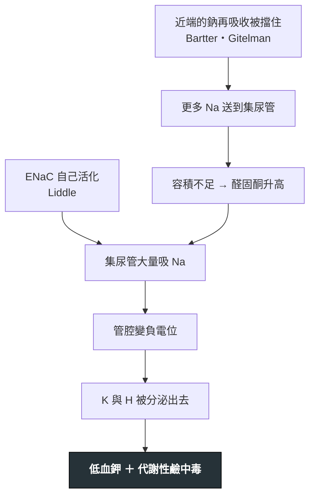

---
tags:
  - Med/Disease/Nephro
  - channelopathy
  - 禁忌
aliases:
  - Bartter syndrome
  - Gitelman syndrome
  - Liddle syndrome
  - Bartter
  - Gitelman
  - Liddle
  - 巴特症候群
  - 吉特曼症候群
  - 利德爾症候群
  - Renal tubulopathy
  - Inherited tubulopathies
  - 遺傳性腎小管病
  - 腎小管離子通道病
created: 2026-07-29
updated: 2026-07-29
status: 可用
source: Harrison's 腎小管疾病章；KDIGO 相關綜論；Endocrine Society PA Guideline（Liddle 的鑑別位置）
cssclass: clinical-note
presents_as:
  - "[[Hypokalemia]]"
  - "[[Hypertension]]"
diagnosed_by:
  - "[[Urine indices]]"
  - "[[Arterial blood gas]]"
differential:
  - "[[Primary aldosteronism]]"
  - "[[Cushing syndrome]]"
  - "[[Congenital adrenal hyperplasia]]"
---

# Renal tubulopathies ｜ 遺傳性腎小管離子通道病 · Bartter / Gitelman / Liddle

> [!abstract] 一句話總覽
> 三個病 ＝ **三個利尿劑的活體模型**。Bartter 天生在吃 **furosemide**、Gitelman 天生在吃 **thiazide**、Liddle 是 **amiloride 的反面**(該被關掉的鈉通道關不掉)。知道對應哪個藥,症狀、電解質、治療全部可以推出來,不必背。

> [!tip] 30 秒行動卡
> **共同長相**:**低血鉀 ＋ 代謝性鹼中毒 ＋ 尿氯高**
> **第一刀是血壓**:**正常或偏低 → Bartter／Gitelman**;**高 → Liddle**
> **第二刀是尿鈣**:**高 → Bartter**;**低(＋顯著低血鎂)→ Gitelman**
> *(例外:**Bartter type 3(ClC-Kb)約四分之一長得像 Gitelman**——低血鎂 ＋ 低尿鈣。尿鈣是好用的刀,不是保證。)*
> **絕對不可**:Liddle 用 spironolactone(無效,要用 **amiloride**);Gitelman 只補鉀不補鎂

---

## 定義與定位

| | **Bartter** | **Gitelman** | **Liddle** |
|---|---|---|---|
| **對應藥物** | Furosemide | Thiazide | Amiloride 的**反面** |
| **位置** | 髓袢升支粗段 **TAL** | 遠曲小管 **DCT** | 集尿管主細胞 |
| **蛋白／基因** | type 1 NKCC2、2 ROMK、3 ClC-Kb、4 Barttin(＋**感音性聽力障礙**)、CaSR | **NCCT**(SLC12A3) | **ENaC**(β/γ 為主,α 亦有報告)功能增強 |
| **遺傳** | **type 1–4 體染色體隱性**;CaSR 型為**顯性**;MAGED2 型為 **X 性聯** | 體染色體**隱性** | 體染色體**顯性** |
| **血壓** | **正常或偏低** | **正常或偏低** | **高** |
| **尿鈣** | **高**(→ 腎鈣化、結石) | **低** | 不特異 |
| **血鎂** | 正常或輕微低 | **顯著低** | 正常 |
| **Renin／Aldosterone** | **都高** | **都高** | **都低** |
| **發病** | 產前～嬰幼兒(羊水過多、早產) | **青少年～成人** | 兒童～年輕成人的高血壓 |
| **治療** | 補 K／Mg、保鉀利尿劑、**NSAID** | **補 Mg 為先** ＋ 補 K、保鉀利尿劑 | **Amiloride／triamterene** ＋ 限鈉 |

> [!important] 為什麼「血壓」是最快的分水嶺
> Bartter／Gitelman 是**失鹽**——容積不足 → RAAS 被逼到全開 → **renin 與 aldosterone 都高**,但血壓仍上不去。
> Liddle 是**鈉通道自己開著**——鈉滯留、容積擴張 → 血壓高 → 回饋把 **renin 與 aldosterone 都壓低**。
> 同樣是低血鉀鹼中毒,**RAAS 的方向完全相反**。

## 病因與機制

> [!note] 三個病的共同終點是同一個
> 不論起點在 TAL、DCT 還是集尿管,最後都收斂到「**集尿管吸鈉 → 管腔負電位 → 丟鉀丟氫**」。
> 差別只在**怎麼走到那一步**:前兩者是被迫(容積不足 → aldosterone),Liddle 是直接(通道壞在終點)。

### 尿鈣為什麼一高一低(最常考的一格)

| | 機制 |
|---|---|
| **Bartter 高尿鈣** | TAL 的鈣是**被動順著管腔正電位**再吸收的,那個正電位由 ROMK 讓 K 回流製造。NKCC2 壞掉 → 正電位消失 → **鈣跟著漏掉** → 腎鈣化、結石 |
| **Gitelman 低尿鈣** | 教科書版本:NCCT 壞掉 → 細胞內鈉低 → 基底側 Na/Ca 交換器加速把鈣送出細胞 → 頂端加速吸收鈣。*(修正:TRPV5 基因剔除鼠仍有一樣的低尿鈣,所以「頂端加速吸收」不是必要步驟;主導機制其實是**容積收縮 → 近端小管被動再吸收鈣增加**。考題仍以教科書版本為答案。)* |

**完全對應藥理**:furosemide 是**升**尿鈣(所以用來治高血鈣)、thiazide 是**降**尿鈣(所以用來防含鈣結石)。記住藥就記住病。

> [!tip] Gitelman 的低血鎂也是同一條路
> DCT 是鎂再吸收(TRPM6)的主場。NCCT 壞掉造成 DCT 結構萎縮 → **鎂大量流失**。
> 這解釋了 Gitelman 的抽筋、tetany、QT 延長與軟骨鈣化,也解釋了為什麼**不補鎂就補不上鉀**。

## 臨床表現

- **Bartter**:羊水過多、早產、生長遲滯、多尿多渴、脫水傾向;**Barttin(type 4)型合併感音性聽力障礙**
  - **type 2(ROMK)的新生兒在出生第一週可能先出現暫時性高血鉀**(可達 9 mmol/L),之後才轉成低血鉀 → **這時候長得像 [[Congenital adrenal hyperplasia|21-羥化酶缺乏的失鹽危象]]**,是新生兒科的重要岔路
- **Gitelman**:**最常見的遺傳性腎小管病**。青少年後才出現的**肌肉抽筋、無力、tetany、感覺異常**;常是健檢意外發現低血鉀
- **Liddle**:**早發高血壓 ＋ 低血鉀**,家族史強(顯性遺傳);多數沒有其他症狀,靠血壓被抓到

→ 相關主訴流程:[[Hypokalemia]]、[[Hypertension]]

## 診斷

| 步驟 | 內容 |
|---|---|
| **1. 確認生化長相** | 低血鉀 ＋ 代謝性鹼中毒 ＋ **尿氯 >20**(排除嘔吐) |
| **2. 量血壓** | 分成兩支 |
| **3. 尿鈣／血鎂** | 分開 Bartter 與 Gitelman(尿鈣用 **spot 尿鈣/肌酸酐比**) |
| **4. Renin ＋ aldosterone** | 都高 → 失鹽型;都低 → Liddle 或其他礦皮質素過多 |
| **5. 排除偽裝**(見下) | **這一步比基因檢測更常改變答案** |
| 6. 基因檢測 | 確診用;不影響急性處置 |

**要開的檢查**:[[Urine indices]](尿氯、尿鉀、尿鈣)、[[Arterial blood gas]]、血 Mg、renin／aldosterone

## 鑑別診斷

| 要排除的 | 支持它的線索 | 怎麼排除 |
|---|---|---|
| **利尿劑濫用**(最重要) | 生化與 Gitelman／Bartter **完全一樣** | **尿液利尿劑篩檢**;數值時好時壞、不符遺傳模式 |
| **催吐／bulimia** | 低血鉀 ＋ 鹼中毒 | **尿氯低(<20)** ← 這是唯一可靠的分辨點 |
| **腹瀉／瀉劑** | 低血鉀 | 是**酸**中毒不是鹼中毒 |
| [[Primary aldosteronism]] | 高血壓 ＋ 低血鉀 ＋ 鹼中毒,與 Liddle **三項一模一樣** | **aldosterone**:PA 高、Liddle 低 |
| 甘草／AME(11β-HSD2) | 同上,aldosterone 與 renin 也都低 | **病史**:甘草、中藥、喉糖 |
| [[Cushing syndrome]] · [[Congenital adrenal hyperplasia]] | 「兩個都低」的其他出口 | 臨床特徵 ＋ 各自的內分泌試驗 |

> [!danger] Gitelman 最容易被誤診成偷吃利尿劑,反過來也一樣
> 兩者的血液與尿液長相**無法區分**。分辨只靠三件事:**① 尿液利尿劑篩檢 ② 數值是否穩定一致 ③ 家族史與發病年齡**。
> 在診斷遺傳病之前先做藥物篩檢,是這一區的標準動作。

## 治療

| 病 | 骨架 |
|---|---|
| **Bartter** | 高鹽高鉀飲食;**補 K ＋ 補 Mg**;保鉀利尿劑(amiloride／spironolactone);**NSAID(indomethacin)**——因為 PGE₂ 顯著升高並放大失鹽 |
| **Gitelman** | **補鎂優先**(不補鎂,鉀補不上去);補 K;保鉀利尿劑;多數不需 NSAID |
| **Liddle** | **Amiloride 或 triamterene ＋ 限鈉**;血壓與血鉀同時改善 |

> [!warning] NSAID 只在 Bartter 有明確角色
> 用在 Bartter 是因為前列腺素過度生成本身就是病理的一部分(舊稱 hyperprostaglandin E syndrome),證據以**產前／新生兒型(type 1、2)最強**。
> 兩個必須追的:**腎功能**(這群人本來就容積不足)、**早產兒的壞死性腸炎(NEC)風險**。

> [!tip] 鏡像對照:Gordon 症候群(PHA-II)
> WNK1／WNK4／KLHL3／CUL3 突變 → NCCT **過度活化** → **高血壓 ＋ 高血鉀 ＋ 代謝性酸中毒**,而且**對 thiazide 反應極好**。
> 它是 Gitelman 的完全鏡像(Gitelman 是 NCCT 失能 → 低血壓、低血鉀、鹼中毒)。記一個就記住兩個。

## 併發症與預後

- **要盯**:慢性低血鉀腎病變、腎鈣化與結石(Bartter)、生長遲滯(Bartter)、QT 延長與心律不整(Gitelman 的低鎂)、Liddle 未治療的高血壓標的器官傷害
- **預後**:Gitelman 多數良性,靠終身補充維持;Bartter 依型別差異大;**Liddle 只要用對藥,血壓與血鉀都可正常化**

## 禁忌與陷阱

> [!danger] 絕對不可
> | 情境 | 絕對不可 | 為什麼 | 該做什麼 |
> |---|---|---|---|
> | Liddle | 用 **spironolactone** | ENaC 不需要 aldosterone 就自己開著,擋受體沒有用 | **Amiloride／triamterene** |
> | Liddle 被當成 PA | 送 adrenal venous sampling／開刀 | 腎上腺沒有病 | 先看 **aldosterone 是低的** |
> | Gitelman 補不上鉀 | 一直加鉀 | **低血鎂**時遠端持續漏鉀 | **先補鎂** |
> | 懷疑遺傳性腎小管病 | 直接送基因、不做藥物篩檢 | 利尿劑濫用的生化長相完全相同 | **先驗尿液利尿劑** |
> | Bartter／Gitelman | 給 thiazide 或 loop 利尿劑治療高血壓以外的目的 | 等於在原本的缺損上再加一刀 | 用保鉀利尿劑 |

> [!warning] 常見錯誤
> - **看到低血鉀鹼中毒就想 PA**——先量血壓,血壓不高整條路就換邊
> - **把尿鈣的方向記反**——回想藥:furosemide 升尿鈣(Bartter 高)、thiazide 降尿鈣(Gitelman 低)
> - **忘了嘔吐**:嘔吐的尿氯**低**,是唯一能與 Gitelman 分開的指標(尿鈉可能被 bicarbonaturia 拉高而騙人,見 [[Urine indices]])
> - **只記三個病名不記對應的藥**——記了藥,尿鈣、血鎂、治療全部自動推得出來

## 相關連結

- [[Hypokalemia]] — 導航主篇;三問演算法寫在那裡
- [[Primary aldosteronism]] — Liddle 最重要的對手;分辨點是 aldosterone 的高低
- [[Cushing syndrome]] · [[Congenital adrenal hyperplasia]] — 「renin 低 ＋ aldosterone 低」的其他兩個出口
- [[Urine indices]] — 尿氯、尿鉀、尿鈣的算式與失效條件
- [[Arterial blood gas]] — 代謝性鹼中毒的分型
- [[Hypercalcemia]] — furosemide 升尿鈣的臨床應用,與 Bartter 是同一條機制
