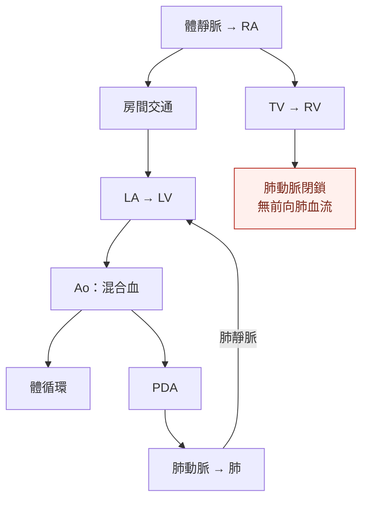

---
tags:
  - Clinical/Disease/Pediatrics
  - Clinical/Disease/Cardio
  - congenital-heart-disease
  - 禁忌
aliases:
  - 肺動脈閉鎖
  - Pulmonary valve atresia
  - PA IVS
  - PA VSD
created: 2026-10-14
updated: 2026-10-14
status: 可用
source:
  - "AHA: Pulmonary Atresia, reviewed 2026-07-31"
  - "Cleveland Clinic: Pulmonary Atresia, 2025-07-14; anatomy illustration"
  - "Giglia et al.: RV-dependent coronary circulation, Circulation 1992"
  - "Sukhavasi et al.: PA/IVS intended strategies, JTCVS 2022"
  - "Stanford Children's: Pulmonary artery reconstruction and unifocalization"
services:
  - Pediatrics
  - Cardio
  - CardiacSurgery
cssclass: clinical-note
presents_as:
  - "[[Cyanosis]]"
diagnosed_by:
  - "[[Echocardiography]]"
treated_by:
  - "[[Pulmonary atresia intervention]]"
differential:
  - "[[TOF]]"
  - "[[TGA]]"
complication:
  - "[[Shock]]"
  - "[[Infective endocarditis]]"
---

# Pulmonary atresia ｜ 肺動脈閉鎖

> [!abstract] 一句話總覽
> **右心室沒有可用的前向通道把血送進肺動脈**；先確認肺血流靠什麼維持，再區分心室中隔完整型與合併心室中隔缺損型，因為兩者的冠狀循環風險與重建方式不同。

> [!tip] 30 秒行動卡
> **診斷關鍵**：新生兒發紺／血氧惡化 → 緊急 [[Echocardiography]]，確認肺動脈閉鎖、心室中隔、右心室與肺血流來源。
> **治療骨架**：依賴動脈導管供應肺血流時，以 **prostaglandin E₁（PGE₁；alprostadil）** 持續靜脈輸注橋接；同步聯絡兒童心臟／加護團隊。不能把所有病型都當成導管依賴型。
> **絕對不可**：尚未釐清冠狀動脈是否依賴右心室供血，就逕行右心室減壓；「把閉鎖處打開」在部分病童反而可能造成心肌缺血。[^aha][^coronary]

## 定義與定位

**Pulmonary atresia** 不只是重度 pulmonary stenosis；閉鎖可在瓣膜或更長段流出道，沒有正常的右心室至肺動脈前向血流。以下以兩個主要病型整理，其他複雜心臟連接異常需另外分析。[^aha][^cleveland]

| 病型 | 中隔與右心 | 決策最重要的問題 |
|---|---|---|
| **Pulmonary atresia with intact ventricular septum（PA/IVS）** | 心室中隔完整；right ventricle（RV）與 tricuspid valve（TV）常有不同程度發育不足 | RV／TV 能否支持肺循環？冠狀動脈是否依賴 RV 壓力？ |
| **Pulmonary atresia with ventricular septal defect（PA/VSD）** | 有 ventricular septal defect（VSD）；RV 常較能發育，可屬 [[TOF]] with pulmonary atresia | 原生肺動脈是否連續、夠大？每個肺段靠哪條血管供血？ |
| **PA/VSD 合併 major aortopulmonary collateral arteries（MAPCAs）** | 主動脈或其分支的側枝供應部分／全部肺段，可能同時有原生肺動脈供血 | 哪些肺段只有單一血源、哪些雙重供血？是否有狹窄或肺血管病變？ |

**PA/IVS 與 PA/VSD 不是同一條病程的輕重兩端。** 本文以 PA/IVS、PA/VSD 指病型；肺動脈寫全名，避免把 PA 同時當作 atresia 與 artery 而混淆。[^strategy][^stanford]

## 心臟解剖：閉鎖之外，還要看中隔與肺血流

![[assets/pulmonary-atresia-cleveland-clinic.jpg|680]]

*圖 1｜Cleveland Clinic 的肺動脈閉鎖示意：主圖標出 blocked pulmonary valve 與 VSD，左上小圖是正常肺動脈瓣。因此這張是「合併 VSD」的示意，不能拿來代表 PA/IVS。原圖另畫出 small right ventricle，但 PA/VSD 並非一律右心室小，仍以個別影像為準。原圖未修改，來源：[Cleveland Clinic，2025](https://my.clevelandclinic.org/health/diseases/14779-pulmonary-atresia)。*

| 看圖／超音波時找什麼 | 為什麼 |
|---|---|
| **RV → 肺動脈的通道** | 區分膜性瓣閉鎖與較長段肌性閉鎖，影響能否導管穿孔或需外科重建 |
| **VSD 有無** | 決定是 PA/IVS 還是 PA/VSD；不是每位都需要關 VSD |
| **Patent ductus arteriosus（PDA，開放性動脈導管）** | 可能是新生兒主要肺血流來源；變窄時可迅速惡化 |
| **房間交通** | PA/IVS 的體靜脈回流需經房間交通到左心；限制性交通可能造成右心房壓力升高與低心輸出 |
| **原生肺動脈與 MAPCAs** | 必須畫出各肺段供血，不能只看中央肺動脈直徑 |

Right atrium（RA）／left atrium（LA）＝右／左心房；left ventricle（LV）＝左心室；aorta（Ao）＝主動脈。圖左側通常對應病人的右心。[^aha][^texas][^stanford]

## 病因與機制

*圖 2｜常見導管依賴型 PA/IVS 的血流拓樸，不是解剖位置圖。PDA 與房間交通各有功能：前者供應肺血流，後者讓體靜脈回流能到達左心；兩者不能互相替代。PA/VSD＋MAPCAs 不可直接套用此圖。[^aha][^texas]*

> [!important] Sinusoids 不等於已證實 RVDCC
> PA/IVS 可有 **ventriculocoronary connections／sinusoids**，即 RV 與冠狀動脈的異常交通。看到交通本身，**不能直接斷言**有 **right ventricle-dependent coronary circulation（RVDCC，右心室依賴性冠狀循環）**。
> 若冠狀動脈狹窄／閉鎖使部分心肌仰賴高壓 RV 經交通供血，降低 RV 壓力可能造成缺血甚至梗塞。需由專家整合冠狀動脈起源、狹窄位置、灌流範圍及血管攝影；不能只靠「有無 sinusoid」決定能否打開流出道。[^coronary]

## 臨床表現

| 表現 | 判讀重點 |
|---|---|
| 新生兒發紺、給氧改善有限 | 結構性肺血流受限；仍須並行排除肺病與感染 |
| 出生後隨 PDA 關閉而惡化 | 提示導管依賴性肺血流；可進展至酸中毒與低灌流 |
| 呼吸急促、餵食困難、體重增加不佳 | 可來自低肺血流；有大量未受限制側枝時，也可能是肺血流過多與心衰竭 |
| 膚色尚可但肺血流不均 | MAPCAs 可使部分肺段高壓過灌流、另一些肺段血流不足；整體血氧不能代表每個肺段安全 |
| 無明顯典型射出性雜音 | 不能排除閉鎖；無血流通過的閉鎖瓣不會產生一般瓣狹窄的跨瓣血流雜音 |

嚴重發紺、意識或灌流改變、乳酸上升均需立即處理；不要把已知先天性心臟病的低血氧當作固定基線而忽略變化。[^aha][^cleveland][^stanford]

## 診斷

| 檢查 | 必須回答的問題 |
|---|---|
| **[[Echocardiography]]＋Doppler** | 中隔完整嗎？閉鎖層次、RV／TV 大小與功能、PDA、房間交通及肺動脈解剖如何？是否提示冠狀動脈交通？ |
| 脈搏血氧飽和度（SpO₂）、blood gas／lactate、血壓與尿量 | 目前氧合與全身灌流是否足夠；不能只看單一 SpO₂ |
| **PA/IVS 的冠狀循環評估** | 介入前是否已釐清 RVDCC？通常需專家心導管與血管攝影，超音波未見明顯異常不等於已排除 |
| **PA/VSD 的電腦斷層血管攝影／心導管** | 原生肺動脈、PDA、MAPCAs、各肺段單一或雙重供血及狹窄；需要時取得壓力／血流資料 |
| Electrocardiogram（ECG）、胸部 X 光 | 輔助看節律、心室負荷與肺血流，不能取代解剖診斷 |
| 遺傳評估 | PA/VSD／TOF 型可合併 22q11.2 deletion 等，依表現安排諮詢與檢查 |

產前可由 fetal echocardiography 發現；出生後須重新確認生理狀態與可用肺血流。[^texas][^cleveland][^coronary][^stanford]

## 鑑別診斷

| 要區分的情境 | 判別重點 |
|---|---|
| Critical pulmonary stenosis | 仍有可辨認的瓣口／前向血流；治療不能只依發紺程度推定為閉鎖 |
| [[TOF]] with pulmonary stenosis | 有 VSD 與流出道阻塞，但仍可能有原生前向肺血流；完整閉鎖需重新規劃肺血流來源 |
| [[TGA]] | 重點是心室與大血管連接、兩循環混合；不是所有新生兒發紺都靠增加肺血流解決 |
| Tricuspid atresia | 主要缺損在 RA → RV 的入口，與 pulmonary atresia 的出口不同 |
| 肺病／persistent pulmonary hypertension of the newborn | 同時看肺部、肺壓與結構；不能只靠給氧反應作最後診斷 |

## 治療

**完整的術前穩定、介入選擇與術後紅旗集中在 [[Pulmonary atresia intervention]]。**

| 情境 | 方向 |
|---|---|
| Duct-dependent pulmonary blood flow | 監測下 PGE₁，銜接 PDA stent 或外科分流／適合的重建 |
| PA/IVS：RV／TV 可用，且冠狀循環允許減壓 | 選定個案以導管穿孔／球囊擴張或外科打開流出道，評估雙心室循環潛力 |
| PA/IVS：RV 邊界大小／功能 | 依成長與血行動力學再評估雙心室或 one-and-a-half ventricle 路徑 |
| PA/IVS：嚴重 RV 發育不足或重要 RVDCC | 常需單心室分期緩和治療；嚴重冠狀循環或心室問題另評估移植 |
| PA/VSD ± MAPCAs | 依肺段供血盤點，選擇肺動脈成長策略／重建、必要時 unifocalization，再評估 RV–肺動脈連接與 VSD closure |

**沒有所有病型共用的矯正月齡或單一 TV 尺寸門檻。** Single-ventricle palliation 是改道支持循環，不能寫成恢復正常雙心室解剖的「完整矯正」。[^strategy][^stanford][^aha]

## 併發症與預後

| 階段 | 追蹤重點 |
|---|---|
| 未建立穩定肺血流 | 急性缺氧、酸中毒、低灌流；MAPCAs 另留意肺血流過多與肺血管病變 |
| RV 減壓／雙心室路徑 | 殘餘流出道阻塞、肺動脈瓣逆流、RV 舒張／收縮功能、冠狀灌流 |
| 分流、支架或 RV–肺動脈 conduit | 血栓／狹窄、肺動脈分支問題及再介入需求 |
| Glenn／Fontan 路徑 | 持續的靜脈壓與循環限制、血栓及心律問題；RVDCC 病童仍可能有缺血風險。[^fontan] |

最終循環型態、冠狀動脈與肺血管條件影響預後；所有路徑都需要終身先天性心臟追蹤。[^longterm][^aha]

## 禁忌與陷阱

> [!danger] 絕對不可
> | 情境 | 絕對不可 | 為什麼 | 該做什麼 |
> |---|---|---|---|
> | PA/IVS，冠狀循環尚未釐清 | 只因 RV 壓力高就逕行減壓 | 可能中斷依賴 RV 壓力的心肌灌流 | 先完成專家冠狀解剖與血行動力學評估 |
> | 仍依賴 PDA 供應肺血流 | 自行停 PGE₁／關閉 PDA | 肺血流可驟減 | 先確認替代肺血流與團隊轉換計畫 |
> | MAPCA 可能是某肺段唯一血源 | 未盤點供血就逕行結紮／栓塞 | 該肺段可能失去灌流 | 先確定肺段連接與重建方案 |

> [!warning] 常見錯誤
> - 有 sinusoids 就等同 RVDCC；或反過來以 RV 大小正常就排除冠狀風險。
> - 把所有 PA/VSD 都當成小 RV，或把所有 pulmonary atresia 都當成需要關 VSD。
> - 把「發紺改善」當成已完成治療；分流／支架與單心室分期都有後續追蹤責任。

## 相關連結與來源

- [[Pulmonary atresia intervention]] — 穩定處置、介入／手術與追蹤
- [[TOF]] · [[TOF correction]] — 與典型 TOF with pulmonary stenosis 比較
- [[TGA]] · [[TGA correction]] — 新生兒發紺的另一條解剖路徑
- [[Pediatric heart disease]] — 小兒先天性心臟病入口

[^aha]: [American Heart Association：Pulmonary Atresia](https://www.heart.org/en/health-topics/congenital-heart-defects/about-congenital-heart-defects/pulmonary-atresia)，檢視日期 2026-07-31；PA/IVS 血流、橋接與長期照護。
[^cleveland]: [Cleveland Clinic：Pulmonary Atresia](https://my.clevelandclinic.org/health/diseases/14779-pulmonary-atresia)，2025-07-14；病型、檢查與原始解剖圖。
[^texas]: [Texas Children’s：Pulmonary Atresia](https://www.texaschildrens.org/content/conditions/pulmonary-atresia)；房間交通、出生後評估與治療。
[^coronary]: [Giglia et al.：Diagnosis and management of right ventricle-dependent coronary circulation in PA/IVS](https://pubmed.ncbi.nlm.nih.gov/1423965/)，Circulation 1992；原始血管攝影研究，用於區分交通與冠狀循環依賴，不能作為現代個案的單一選術標準。
[^strategy]: [Sukhavasi et al.：PA/IVS—Intended strategies](https://pubmed.ncbi.nlm.nih.gov/35414413/)，JTCVS 2022；RV／TV 與冠狀循環導向的策略、不同循環終點。
[^stanford]: [Stanford Children’s：Pulmonary artery reconstruction](https://www.stanfordchildrens.org/en/services/pulmonary-artery-reconstruction/treatment.html)及[中心的 PA/VSD／MAPCAs 外科策略](https://www.stanfordchildrens.org/content/dam/sch/content-public/services/pdf/service/pulmonary-artery-reconstruction/surgical-management-of-pulmonary-atresia-with-ventricular-septal-defect-and-major-aortopulmonary-collateral.pdf)；採用肺段供血與分期評估原則，不照搬中心特定數值門檻。
[^longterm]: [Wright et al.：Long-term outcomes after intervention for PA/IVS](https://pmc.ncbi.nlm.nih.gov/articles/PMC6571047/)，Heart 2019；長期原始世代研究。
[^fontan]: [Elias et al.：Fontan survivors with PA/IVS remain at risk of myocardial ischaemia](https://pubmed.ncbi.nlm.nih.gov/29444216/)，EJCTS 2018；RVDCC 與 Fontan 後缺血／猝死風險的原始追蹤研究。
