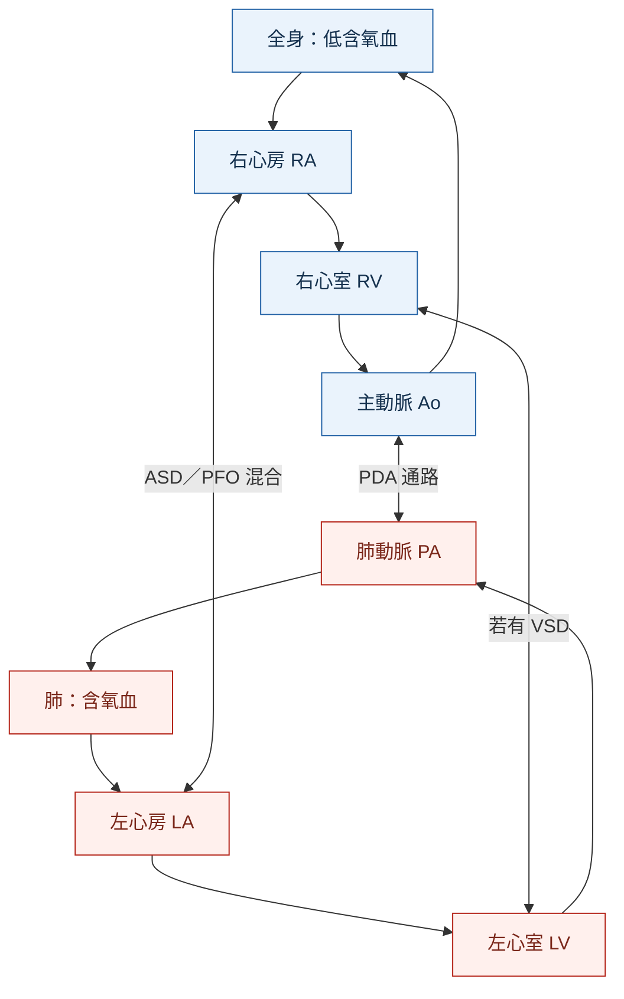

---
tags:
  - Clinical/Disease/Pediatrics
  - Clinical/Disease/Cardio
  - congenital-heart-disease
  - 禁忌
aliases:
  - TGA
  - Transposition of the great arteries
  - d-TGA
  - Dextro-transposition of the great arteries
  - 大動脈轉位
  - 完全型大動脈轉位
created: 2026-10-14
updated: 2026-10-14
status: 可用
source:
  - "CDC: Dextro-Transposition of the Great Arteries, 2026-01-08"
  - "AHA: d-Transposition and L-Transposition, reviewed 2026-04-15"
  - "EACTS/AEPC: TGA with intact ventricular septum guideline, 2017"
  - "Cincinnati Children's: Transposition of the Great Arteries, 2025-07"
  - "OpenAnesthesia: d-TGA; anatomy illustration from University of Michigan Health, C.S. Mott Children's Hospital"
services:
  - Pediatrics
  - Cardio
  - CardiacSurgery
cssclass: clinical-note
presents_as:
  - "[[Cyanosis]]"
  - "[[Shock]]"
diagnosed_by:
  - "[[Echocardiography]]"
treated_by:
  - "[[TGA correction]]"
differential:
  - "[[TOF]]"
  - "[[Pulmonary atresia]]"
complication:
  - "[[Heart failure]]"
---

# Transposition of the great arteries ｜ 大動脈轉位 · d-TGA

> [!abstract] 一句話總覽
> **主動脈接到右心室、肺動脈接到左心室，讓體循環與肺循環各自繞圈**；新生兒能否穩定，取決於兩循環有沒有足夠混合，典型根本治療是 **arterial switch operation（ASO）**。

> [!tip] 30 秒行動卡
> **想到它**：出生後很早發紺，給氧改善有限，**可能沒有明顯心雜音**；立即以 [[Echocardiography]] 確認心室與大血管的連接。[^cincinnati]
> **先救什麼**：呼吸與全身灌流，並以 **prostaglandin E₁（PGE₁）維持導管、評估混合通道**；心房通道受限且嚴重缺氧時需緊急 **balloon atrial septostomy（BAS）**。[^guideline]
> **根本治療**：新生兒期 ASO；手術細節與術前支持見 [[TGA correction]]。
> **絕對不可**：只因已給 PGE₁ 或「有 VSD」就假設混合足夠，延誤受限心房通道的處理。

## 定義與定位

本篇以 **d-TGA** 為主，也是 [[TOF]] 發紺新生兒鑑別中的典型大動脈轉位。**l-TGA／congenitally corrected TGA（ccTGA）是不同連接方式**，不能直接套用相同的新生兒急救與手術路徑。

| 類型 | 心臟連接 | 循環後果 |
|---|---|---|
| **d-TGA** | **Atrioventricular concordance＋ventriculoarterial discordance**：心房接到對的形態心室，心室接到錯的大動脈 | 兩循環平行，依賴混合通道 |
| **ccTGA／l-TGA** | 房室連接與心室—大動脈連接皆 discordant | 兩次反接可形成串聯循環；形態 RV 常承擔體循環，長期留意 RV／三尖瓣功能與 AV block |

「Congenitally corrected」不表示已接受手術或沒有風險；ccTGA 是否手術取決於合併病變、心室與瓣膜功能。[^aha-l]

## 心臟解剖：血液回到同一個循環

![[assets/tga-anatomy-mott.jpg|620]]

*圖 1｜d-TGA 的大血管連接與混合通道。原圖：University of Michigan Health／C.S. Mott Children’s Hospital；取自 [OpenAnesthesia 圖 1](https://www.openanesthesia.org/keywords/d-transposition-of-the-great-arteries/)，原圖未修改。*

| 圖中標號 | 對照解剖 | 讀圖重點 |
|---|---|---|
| **①** | Aorta（Ao）← right ventricle（RV） | 缺氧血再次送回全身 |
| **②** | Pulmonary artery（PA）← left ventricle（LV） | 肺靜脈回來的含氧血再次送回肺 |
| **③** | Ventricular septal defect（VSD） | 心室層級的混合通道；**不是所有 d-TGA 都有** |
| **④** | Atrial septal defect（ASD）／patent foramen ovale（PFO） | 心房層級的混合；BAS 要改善的部位 |
| **⑤** | Patent ductus arteriosus（PDA） | 大血管間的通路；PGE₁ 維持其開放 |

> [!important] 看圖不能反推每個病人都有所有缺損
> 此圖同時畫出 ASD、VSD、PDA 來解釋混合。**d-TGA with intact ventricular septum（TGA/IVS）沒有 VSD**；真正要問的是現有通道的大小、方向與實際混合效果。[^cdc]

## 病因與機制

主要是胚胎發育時大血管與心室的連接異常，多數個案無單一已知病因。病情嚴重度主要取決於 **intercirculatory mixing**，以及是否合併 VSD、左心室流出道阻塞或其他解剖異常。[^aha-d]

*圖 2｜平行循環的功能示意；雙向箭頭代表兩循環之間有交通，不表示每個時間點都等量雙向分流。實際方向受壓力及阻力影響。[^cdc]*

> [!note] 為什麼給很多氧氣仍可能救不了低血氧？
> 肺部即使能把血氧合，含氧血仍可能沿 **肺 → LA → LV → PA → 肺** 繞圈。需要讓含氧血進入體循環；因此氧氣不能取代必要的混合通道。導管開放也不保證能彌補受限的 ASD／PFO。[^guideline]

## 臨床表現

| 表現 | 判讀 |
|---|---|
| 出生後數小時／數日即發紺 | 混合不足；PDA 關閉可使症狀加重 |
| 呼吸急促、餵食不佳 | 可能合併缺氧、心衰竭或其他病變 |
| 雜音很小或沒有 | **不能排除重症**；雜音大小不代表混合效果 |
| Lactate 上升、代謝性酸中毒、末梢灌流差 | 嚴重低氧輸送／休克，需立即升級處理 |
| 較大的混合通道、肺血流多 | 發紺可能較不明顯，但可能逐漸出現肺血流過多與心衰竭 |

臨床表現依混合與合併病變改變，不能把「出生時看起來穩定」當成可延後評估。[^cincinnati]

## 診斷

| 檢查 | 必須回答的問題 |
|---|---|
| **[[Echocardiography]]＋Doppler** | Ao 是否起自 RV、PA 是否起自 LV；ASD／PFO 是否受限、PDA／VSD、心室功能、流出道／主動脈弓與冠狀動脈解剖 |
| Preductal／postductal SpO₂、血壓與灌流 | 建立缺氧與全身氧輸送的趨勢；不能用單一血氧數值決定所有處置 |
| [[Arterial blood gas]]、lactate、glucose | 缺氧後果及穩定治療反應 |
| Chest X-ray／ECG | 可輔助；經典 **egg-on-a-string** 並非每例出現，不能等待典型影像才處理 |
| CT／導管檢查 | 超音波資訊不足或複雜解剖時補充；導管也可作 BAS，不代表所有病人都需常規診斷性導管 |

產前診斷需注意 outflow-tract views，單看 four-chamber view 可能漏掉大血管連接異常。[^guideline][^anatomy]

## 鑑別診斷

| 對象 | 與 d-TGA 的核心差異 |
|---|---|
| [[TOF]] | 主要問題是 RVOT 阻塞與右向左分流；主動脈騎跨，不等於 Ao／PA 接反 |
| [[Pulmonary atresia]] | RV 至 PA 的正常前向出口不通，先確認替代肺血流及 IVS／VSD 分型 |
| 肺病／persistent pulmonary hypertension of the newborn（PPHN） | 肺部氧合或肺血管阻力問題；仍需 echo 排除結構病，也可與 d-TGA 並存 |
| Total anomalous pulmonary venous return（TAPVR） | 異常在肺靜脈回流；阻塞型也可嚴重發紺與呼吸窘迫 |

## 治療

| 階段 | 核心方向 |
|---|---|
| 出生後穩定 | 維持灌流與呼吸，PGE₁ 維持 PDA，立即評估各混合通道 |
| 受限 ASD／PFO 且混合不足 | 緊急 BAS 評估；不能只等待 PGE₁ 或氧氣奏效 |
| 典型 d-TGA 根本治療 | 新生兒期 ASO，重建大血管與冠狀動脈連接 |
| 延遲就診／複雜解剖 | 評估 LV 是否能承擔體循環、VSD／流出道／冠脈條件，選擇個別手術路徑 |

**術前支持、BAS、ASO、舊式 atrial switch 與複雜型替代術式集中在 [[TGA correction]]。**

## 併發症與預後

| 階段／術式 | 需要長期注意 |
|---|---|
| 未矯正／混合不足 | 嚴重缺氧、酸中毒、休克與器官傷害 |
| **Arterial switch 後** | 冠狀動脈問題、neo-aortic root／valve 異常、肺動脈吻合處或分支狹窄 |
| **Atrial switch 後** | Systemic RV 功能下降、systemic tricuspid regurgitation、baffle 狹窄／漏及心律不整 |

多數接受適當治療者可有良好生活功能，但需終身先天性心臟追蹤。追蹤重點必須先確認病人接受的是哪一種 switch。[^aha-d]

## 禁忌與陷阱

> [!danger] 絕對不可
> | 情境 | 絕對不可 | 為什麼 | 該做什麼 |
> |---|---|---|---|
> | 混合不足、持續缺氧／酸中毒 | 因已給 PGE₁ 就延後 BAS 評估 | 開放 PDA 不一定提供足夠混合 | 立即 echo 與兒童心臟介入評估 |
> | 尚未完成矯正且依賴混合通道 | 自行關閉 ASD／PDA | 可能中斷維生的混合 | 配合手術與心臟團隊計畫處理 |

> [!warning] 常見錯誤
> - 把 **d-TGA 與 ccTGA** 混成同一種解剖。
> - 將 BAS 誤認成「完整矯正」；它改善混合，沒有重接大動脈。
> - 把 **arterial switch 與 atrial switch** 當同義詞；兩者承擔體循環的心室不同。

## 相關連結與來源

- [[TGA correction]] — 支持治療與手術
- [[Pediatric heart disease]] — 兒童心臟疾病索引
- [[TOF]] · [[Pulmonary atresia]] · [[Echocardiography]]

[^cdc]: [CDC：Dextro-Transposition of the Great Arteries](https://www.cdc.gov/heart-defects/about/d-tga.html)，2026-01-08；解剖、混合與診斷。
[^aha-d]: [AHA：d-Transposition of the Great Arteries](https://www.heart.org/en/health-topics/congenital-heart-defects/about-congenital-heart-defects/d-transposition-of-the-great-arteries)，檢視日期 2026-04-15；循環、矯正與追蹤。
[^aha-l]: [AHA：L-Transposition of the Great Arteries](https://www.heart.org/en/health-topics/congenital-heart-defects/about-congenital-heart-defects/l-transposition-of-the-great-arteries)，檢視日期 2026-04-15；ccTGA 與 d-TGA 的區別。
[^guideline]: [EACTS／AEPC：TGA with intact ventricular septum 臨床指引](https://www.heartuniversity.org/wp-content/uploads/EACTS-AEPC-2017-Guidelines-Management-of-Transposition-of-the-Great-Arteries-with-Intact-Ventricular-Septum.pdf)，2017，§3–5；以 TGA/IVS 為適用範圍。
[^cincinnati]: [Cincinnati Children’s：Transposition of the Great Arteries](https://www.cincinnatichildrens.org/health/t/transposition)，2025-07；症狀、診斷與治療。
[^anatomy]: [OpenAnesthesia：D-Transposition of the Great Arteries](https://www.openanesthesia.org/keywords/d-transposition-of-the-great-arteries/)；解剖與影像教學，圖 1 原作者為 University of Michigan Health／C.S. Mott Children’s Hospital。
