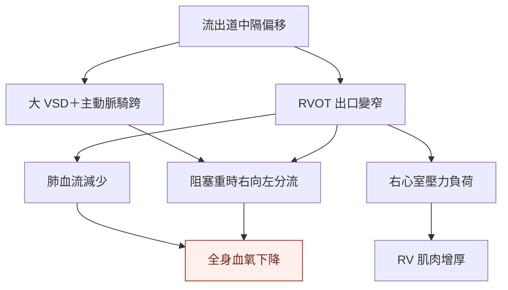

---
tags:
  - Clinical/Disease/Cardio
  - Clinical/Disease/Pediatrics
  - congenital-heart-disease
  - 禁忌
aliases:
  - Tetralogy of Fallot
  - Fallot tetralogy
  - 法洛氏四重症
  - 法洛四合症
created: 2026-10-14
updated: 2026-10-14
status: 可用
source:
  - "CDC: Tetralogy of Fallot, 2026"
  - AATS 2022 Expert Consensus, published 2023
  - ACC TOF Clinical Practice Algorithm, updated 2026-04-12
  - "AHA: Tetralogy of Fallot, reviewed 2026-07-30"
  - "OpenAnesthesia: Tetralogy of Fallot, 2025; CDC anatomy illustration"
services:
  - Cardio
  - CardiacSurgery
  - Pediatrics
cssclass: clinical-note
presents_as:
  - "[[Cyanosis]]"
diagnosed_by:
  - "[[Echocardiography]]"
treated_by:
  - "[[TOF correction]]"
differential:
  - "[[TGA]]"
  - "[[Pulmonary atresia]]"
complication:
  - "[[Infective endocarditis]]"
  - "[[Ventricular tachycardia]]"
---

# TOF ｜ 法洛氏四重症 · Tetralogy of Fallot

> [!abstract] 一句話總覽
> **右心室往肺部的出口受阻，加上大型 ventricular septal defect（VSD）與 overriding aorta，使缺氧血可流向全身**；阻塞程度決定發紺程度，根本處置是 **VSD closure ＋解除 right ventricular outflow tract obstruction（RVOTO）**。

> [!tip] 30 秒行動卡
> **診斷關鍵**：嬰兒發紺／心雜音 → [[Echocardiography]] 確認四項解剖異常及肺血流來源；出生時不一定發紺。
> **治療骨架**：穩定、無症狀者通常 **3–6 個月 complete repair**；嚴重缺氧、duct-dependent pulmonary flow 或 tet spell → 提早由先天性心臟團隊介入。[^aats]
> **突發缺氧**：呼救、安撫、**knee–chest position＋氧氣＋ABCDE**；同步聯絡兒童心臟／加護團隊。懷疑 tet spell 即需立即住院評估，不必等反覆發作。詳見 [[TOF correction#缺氧發作 Tet spell 的急救]]。[^algorithm]
> **絕對不可**：把發作時「雜音變小」當改善；依賴動脈導管供應肺血流者，不可自行停掉維持導管的 prostaglandin E₁（PGE₁）。

## 定義與定位

典型 TOF 是 **cyanotic congenital heart disease**，但輕度阻塞者可呈 **pink TOF**。本篇以 **TOF with pulmonary stenosis（PS）** 為主；合併 pulmonary atresia、major aortopulmonary collateral arteries（MAPCAs）、absent pulmonary valve 或 atrioventricular septal defect 者，需要另外規劃肺血流與手術。[^acc]

## 心臟解剖：先找出四項異常

![[assets/tof-normal-vs-tof-cdc.png|900]]

*圖 1｜左：正常心臟；右：TOF。原圖：CDC／NCBDDD；圖檔取自 [OpenAnesthesia 圖 1](https://www.openanesthesia.org/keywords/tetralogy-of-fallot/)，保留原圖標示。[CDC 疾病說明](https://www.cdc.gov/heart-defects/about/tetralogy-of-fallot.html)。*

| 圖上要找的異常 | 解剖位置 | 對血流的影響 |
|---|---|---|
| **① VSD** | 左、右心室間的缺損，通常大且 nonrestrictive | 兩心室壓力可接近；分流方向主要取決於流出阻力 |
| **② RVOTO／PS** | 右心室漏斗部、肺動脈瓣／瓣環，可延伸至肺動脈 | 血難以從 RV 進入肺部；可以同時有固定與動態阻塞 |
| **③ Overriding aorta** | 主動脈根部跨在 VSD 上方 | 可接收左右兩心室的血，不只是 LV 的含氧血 |
| **④ Right ventricular hypertrophy（RVH）** | 右心室肌肉增厚 | 主要是壓力負荷的結果，並非四個互不相關的原發缺陷 |

> [!note] 讀圖方向與縮寫
> **圖左側通常是病人的右心。** RA／RV＝右心房／右心室；LA／LV＝左心房／左心室；Ao＝主動脈；MPA＝主肺動脈；SVC／IVC＝上／下腔靜脈。TV／MV＝三尖瓣／二尖瓣；PV／AoV＝肺動脈瓣／主動脈瓣。
> 正常路徑：**體靜脈 → RA → RV → 肺動脈 → 肺 → 肺靜脈 → LA → LV → 主動脈**。藍／紅是含氧程度的示意，動脈不一定攜帶含氧血。

## 病因與機制

核心解剖是 **outlet／infundibular septum 前上方偏移**，造成流出道狹窄、VSD 與主動脈騎跨；RVH 隨壓力負荷形成。可合併 **22q11.2 deletion** 等遺傳異常，診斷後應評估相關表現與遺傳諮詢需求。[^anatomy]

*圖 2｜發紺的關鍵是肺血流不足與右向左分流；不是看到 VSD 就一定發紺。*

> [!important] 為什麼蹲下／抱膝會改善？
> 提高 **systemic vascular resistance（SVR）**，讓血較不容易經 VSD 流向主動脈，有助減少右向左分流。哭鬧、脫水、動態 RVOT 收縮或 SVR 下降則可能觸發 **hypercyanotic spell（tet spell）**。急救流程見 [[TOF correction#缺氧發作 Tet spell 的急救]]。

## 臨床表現

| 表現 | 判讀 |
|---|---|
| 發紺／發紺逐漸加重 | 肺血流不足；早期正常血氧不能排除較輕的 TOF |
| 胸骨左緣粗糙 systolic ejection murmur | 主要來自 RVOT／肺動脈流出阻塞，**不是大型 VSD 本身** |
| Tet spell | 突然更發紺、呼吸急促；重者意識改變／昏厥。肺血流驟降時雜音可變短、變小 |
| 餵食困難、體重增加不佳 | 需重新評估缺氧、能量消耗及肺血流狀態 |
| Pink TOF | 阻塞輕，可能無明顯發紺；若左向右分流多，可有肺血流過多與心衰竭表現 |

發紺程度與雜音音量不能單獨代表病情；要合看平常血氧、當下灌流與超音波。[^anatomy][^acc]

## 診斷

| 檢查                               | 要回答的問題                                                          |
| -------------------------------- | --------------------------------------------------------------- |
| **[[Echocardiography]]＋Doppler** | 確認 VSD、aortic override、RVOTO 與 RVH；定位阻塞、肺動脈瓣環／分支肺動脈、動脈導管及冠狀動脈走向 |
| Pulse oximetry                   | 建立個人基準與趨勢；單一數值不能取代解剖及灌流評估                                       |
| Electrocardiogram（ECG）           | 可見右軸偏移／RVH；不能靠 ECG 確診                                           |
| Chest X-ray                      | 可見 **boot-shaped heart** 與肺血管紋理減少；不是每位病童都有                      |
| CT／cardiac MRI／導管檢查              | 超音波資訊不足或解剖複雜時，補肺動脈、側枝與冠狀動脈資料；不一定每例都需導管檢查                        |

產前可由 fetal echocardiography 診斷；出生後以心臟超音波確認。[^cdc][^anatomy]

## 鑑別診斷

| 情境 | 需要區分 | 決策關鍵 |
|---|---|---|
| 新生兒明顯發紺 | [[TGA]]、[[Pulmonary atresia]]、其他複雜先天性心臟病 | 緊急超音波辨認大血管連接、肺血流與混合來源 |
| 發紺＋呼吸窘迫 | 肺病、persistent pulmonary hypertension of the newborn（PPHN） | 結構、肺部病變與肺高壓需並行評估，不以氧氣反應單獨確診 TOF |
| 已知 TOF 突然惡化 | Tet spell、脫水／感染；分流術後另排除 shunt obstruction | 不能把每次低血氧都視為原本的發紺；須看當下肺血流及灌流 |

## 治療

**完整的支持治療、tet spell 急救、分流／支架選擇與手術圖解集中在 [[TOF correction]]。**

| 情境 | 方向 |
|---|---|
| 穩定、無症狀、肺血流足夠 | 追蹤血氧／生長，通常 3–6 個月 complete repair |
| Duct-dependent pulmonary flow | 監測下給 PGE₁ 維持導管，銜接早期介入 |
| 缺氧或 tet spell | 穩定 ABC；疑似 spell 即住院評估 complete repair 或暫時性 palliation |
| 早產、低出生體重、肺動脈小或其他重大共病 | 可先 palliation，再擇期 complete repair；不是每例都要分兩階段 |
| 肺血流過多的 pink TOF | 依肺血流過多／心衰竭處理並規劃修補，不能直接套用「增加肺血流」策略 |

時機與路徑依個別解剖、生理及中心經驗決定。[^aats][^acc][^algorithm]

## 併發症與預後

| 階段 | 重點 |
|---|---|
| 未矯正 | 缺氧發作、成長受影響；重度發作可有昏厥／神經傷害，並留意 [[Infective endocarditis]] |
| 矯正後 | 殘餘 RVOTO／VSD、pulmonary regurgitation、RV 擴大或功能下降、心律不整 |
| 長期 | 即使沒有症狀，仍需終身先天性心臟追蹤；部分病人後續需要肺動脈瓣或其他再次介入 |

追蹤會依問題安排 echo、ECG／ambulatory monitoring、cardiac MRI 與運動功能評估。手術改變循環，**不等於終身不再需要追蹤**。[^aha][^acc]

## 禁忌與陷阱

> [!danger] 絕對不可
> | 情境 | 絕對不可 | 為什麼 | 該做什麼 |
> |---|---|---|---|
> | Duct-dependent pulmonary flow | 自行停用 PGE₁ 或關閉導管 | 肺血流可能驟減 | 由心臟團隊確認替代肺血流後調整 |
> | 發紺變重且雜音變小 | 誤認阻塞改善而延誤處理 | 可能是流過 RVOT 的血更少 | 立即評估與處理 tet spell |

> [!warning] 常見錯誤
> - 把「四重症」理解成必須做四個獨立手術；矯正核心是 **VSD＋RVOT**。
> - 把 PGE₁ 或 propranolol 當成每位 TOF 的固定處方。
> - 將 pulmonary atresia／MAPCAs 的重建，直接套成典型 TOF with PS 的標準手術。

## 相關連結與來源

- [[TOF correction]] — 術前支持、tet spell、palliation 與 complete repair
- [[Echocardiography]] · [[Cardiac auscultation]] — 診斷與床邊判讀
- [[Pediatric heart disease]] · [[Cardiac Surgery]] · [[Cardio Category]] — 科別入口

[^cdc]: [CDC：Tetralogy of Fallot](https://www.cdc.gov/heart-defects/about/tetralogy-of-fallot.html)，2026-01-08。四項異常與診斷。
[^aats]: [AATS 2022 Expert Consensus：Management of infants and neonates with TOF](https://pubmed.ncbi.nlm.nih.gov/36522807/)，JTCVS 2023；本篇採用共識摘要可核對的時機與風險分層。
[^acc]: [ACC：Unrepaired and repaired TOF clinical practice algorithm](https://www.acc.org/latest-in-cardiology/articles/2024/10/30/13/20/clinical-practice-algorithm-for-the-follow-up-of-unrepaired-and-repaired-tof)，更新 2026-04-12。
[^algorithm]: [ACC：TOF 前後修補流程圖](https://www.acc.org/-/media/Non-Clinical/Images/Latest-in-Cardiology/Articles/2024/10/ACPC-EA-TOF-Algorithm.pdf)，2026 修訂，p. 1：疑似 hypercyanotic spell 的住院介入評估。
[^aha]: [AHA：Tetralogy of Fallot](https://www.heart.org/en/health-topics/congenital-heart-defects/about-congenital-heart-defects/tetralogy-of-fallot)，檢視日期 2026-07-30。
[^anatomy]: [OpenAnesthesia：Tetralogy of Fallot](https://www.openanesthesia.org/keywords/tetralogy-of-fallot/)，2025-12-02；解剖、理學及影像教學，圖 1 原始出處為 CDC。手術時機以 AATS／ACC 的適用條件為準。
