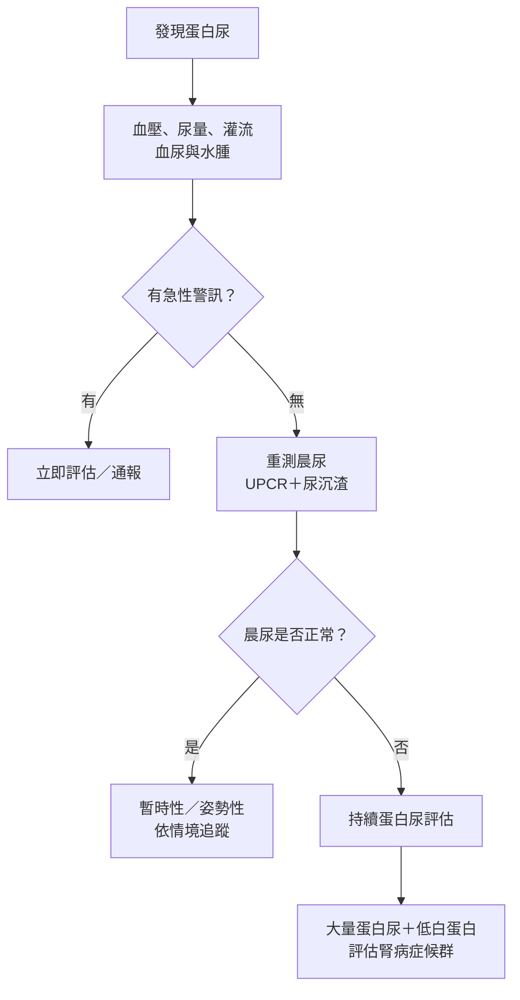

---
tags:
  - Clinical/Disease/Pediatrics
  - Clinical/Disease/Nephro
  - syndrome
  - 禁忌
aliases:
  - 兒童蛋白尿
  - 小兒蛋白尿
  - 兒童腎病症候群
  - Pediatric nephrotic syndrome
created: 2026-10-01
updated: 2026-10-01
status: 可用
source:
  - 小兒科Vol.8，共筆第51–63頁（PDF頁碼相同）；課程摘要列蔡宜蓉老師、舊共筆
  - KDIGO 2025 Nephrotic Syndrome in Children，Figure 1及初始治療建議
  - IPNA steroid-sensitive nephrotic syndrome recommendations，2022線上發表／2023卷期
services:
  - Pediatrics
  - Nephro
cssclass: clinical-note
diagnosed_by:
  - "[[UPCR UACR]]"
  - "[[BUN Cr eGFR]]"
complication:
  - "[[AKI]]"
---

# Pediatric proteinuria and nephrotic syndrome ｜ 兒童蛋白尿與腎病症候群

> [!abstract] 一句話總覽
> 兒童蛋白尿先分**暫時性、姿勢性、持續性**；大量蛋白尿合併低白蛋白血症時考慮 **nephrotic syndrome（NS，腎病症候群）**。典型學齡前病例常是 **minimal change disease（MCD，微小變化病）**；處理水腫前，最重要的是判斷**血管內到底缺水還是水太多**。

> [!tip] 30 秒行動卡
> **先確認**：晨起第一泡尿的 **urine protein-to-creatinine ratio（UPCR）**＋尿沉渣；同時量血壓、體重並評估尿量、水腫與灌流。
> **記數字**：2 歲以上 UPCR 正常通常 ≤0.2 mg/mg；**≥2 mg/mg 是 nephrotic range**，不是一般蛋白尿的門檻。
> **治療骨架**：典型原發性 NS 以類固醇為主；水腫依循環容積處理，急性水腫期限鹽。
> **絕對不可**：病童已有低血容量／低灌流，仍只因外觀水腫就直接利尿。
> **立即通報**：低血壓、四肢冰冷／回填延遲、顯著少尿、呼吸困難、發燒合併腹痛、突發胸痛或神經症狀。

## 明早回答：這章我學到什麼

> [!quote] 1–2 分鐘口頭版本
> 我把這章整理成三個重點。第一，看到兒童蛋白尿不能直接當成腎臟病，要先確認是不是發燒、運動造成的暫時性蛋白尿，或青少年常見的姿勢性蛋白尿，所以會用晨起第一泡尿做 UPCR，再一起看尿沉渣、血壓和腎功能。
>
> 第二，大量蛋白尿合併低白蛋白血症，要想到腎病症候群，常伴水腫和高血脂。學齡前兒童最常見的病理是 minimal change disease；典型表現通常可以先用類固醇治療，不一定一開始就切片。如果有明顯血尿、低補體、持續高血壓，或治療反應不好，就要重新評估其他病因。
>
> 第三，也是這章最重要的部分，是水腫不代表血管裡的水很多。Underfill 是蛋白流失、膠體滲透壓下降，水跑到組織，血管內反而不足；此時直接利尿會讓灌流更差。Overfill 則以腎臟留鈉留水為主，處置方向不同。所以我會先看血壓、心跳、末梢灌流、尿量和腎功能，再決定怎麼處理水腫。追蹤還要注意感染、血栓、急性腎損傷，以及類固醇反應和復發情形。

**只有 20 秒時**：先用晨尿 UPCR 分辨蛋白尿，再辨認典型 MCD；水腫先判斷 underfill／overfill，不能直接利尿。長期看治療反應與復發，急性期注意感染、血栓和 AKI。

## 定義與定位

本講義以共筆 **p.51–62** 為主，p.62–63 的題目只用來辨識容易混淆的觀念。標示「指引校正」者是外部查證，不能說成老師原本的授課內容。

| 概念 | 要知道什麼 | 來源 |
|---|---|---|
| Proteinuria | 一項檢查異常，有不同病因；不等於 NS | 共筆 p.51–56 |
| 一般蛋白尿 | 定時尿蛋白約 >4 mg/m²/hr；須注意年齡與採檢條件 | 共筆 p.51–52 |
| Nephrotic-range proteinuria | UPCR ≥2 mg/mg（=2,000 mg/g）；共筆也列 >40 mg/m²/hr | 共筆 p.51、57；[K] |
| Nephrotic syndrome | 大量蛋白尿＋低白蛋白血症；常見水腫、高血脂 | 共筆 p.57 |
| Nephritic syndrome | 發炎性腎絲球表現：血尿、血壓升高、腎功能下降較突出；仍可有蛋白尿 | 共筆 p.59；用來對照理解 |
| MCD | 典型學齡前原發性 NS 最常見病理；**NS 是症候群，MCD 是病理診斷** | 共筆 p.57、61 |

> [!info] 指引校正：不要等 albumin 低於 2 才想到 NS
> 共筆 p.57 寫 albumin <2 g/dL；KDIGO 2025 定義用 **<3 g/dL**，搭配 nephrotic-range proteinuria；若 albumin 未能取得，可用水腫作為替代條件。[K] 高血脂是常見伴隨表現，低血容量不是必要診斷條件。

## 蛋白尿：先確認，再分類

### 判讀與採檢

| 問題 | 實際判讀 |
|---|---|
| 為何不是看一次 dipstick 就下診斷？ | 是半定量、主要對 albumin 敏感，受尿液濃度與 pH 影響；共筆列濃尿、鹼尿可能偽陽性 |
| 為何取晨起第一泡尿？ | 夜間平躺後採檢，較能避開直立活動造成的蛋白尿；先採檢再開始日常活動 |
| UPCR 看哪個單位？ | **mg/mg 與 mg/g 相差 1,000 倍**；0.2 mg/mg=200 mg/g，2 mg/mg=2,000 mg/g |
| 2 歲以上 | 正常上限通常 0.2 mg/mg；持續超過需評估 |
| 6–24 個月 | 常用上限約 0.5 mg/mg；共筆 p.52 內文寫 0.5、嵌入表格寫 0.6，**原文不一致**，需依年齡與檢驗參考值判讀；不要套到新生兒 |
| 需要人人收 24 小時尿嗎？ | 不需要因單次異常就直接安排；先重測、用晨尿定量，依臨床需要追加檢查。[I] |

來源：共筆 p.51–52、55–56。檢查原理的延伸入口為 [[UPCR UACR]]；該既有筆記未於本次改寫，兒童門檻以本頁為準。

> [!warning] UPCR 不等於每個孩子一天排出的蛋白克數
> 共筆 p.52 的「mg/mg 約等於 g/day」是粗略估計，受每日 creatinine 排出量影響；**不能直接套用在不同體型的小孩**。回答時報 UPCR 的實際單位即可，不把 0.2 mg/mg 說成必然等於 200 mg/day。[K：單位與換算限制]

### 三種臨床型態（共筆 p.55–56）

| 型態 | 線索 | 下一步 |
|---|---|---|
| Transient proteinuria 暫時性 | 發燒、劇烈運動時出現，誘因消失後改善 | 身體恢復、避免劇烈運動後重測晨尿 |
| Orthostatic proteinuria 姿勢性 | 直立活動時陽性，晨尿正常；沒有其他警訊 | 確認晨尿與尿沉渣、血壓正常後追蹤；不是只測一次正常就永遠不管 |
| Persistent proteinuria 持續性 | 晨尿反覆異常，可能合併血尿、高血壓、腎功能異常 | 評估腎絲球／腎小管病因，必要時轉小兒腎臟科 |

## 病因與機制

### 蛋白從哪裡來？（共筆 p.52–55）

| 機制 | 核心問題 | 例子／提示 |
|---|---|---|
| Glomerular | 腎絲球過濾屏障異常，蛋白漏出 | MCD、focal segmental glomerulosclerosis（FSGS）、發炎性腎絲球疾病 |
| Tubular | 近端腎小管回收小分子蛋白的能力下降 | 腎小管間質疾病；可伴其他近端回收功能異常 |
| Overflow | 血中小分子蛋白太多，超過回收能力 | Rhabdomyolysis 的 myoglobin；多發性骨髓瘤不是兒童常見病因 |
| 尿路／組織來源 | 尿中本來就有腎小管及泌尿道分泌蛋白 | Uromodulin（Tamm–Horsfall protein）等；不是所有尿蛋白都是 albumin |

**過濾屏障**由 endothelium、glomerular basement membrane 和 podocyte 構成；足突間 slit diaphragm 的重要蛋白包括 nephrin、podocin。MCD 的典型電顯表現是 **foot process effacement**。共筆用電性與結構解釋蛋白流失，回答時以「過濾屏障功能異常」統整即可。

> [!note] 如何從蛋白流失推到表現？
> Albumin 流失 → 血漿膠體滲透壓下降 → 水進入組織，形成水腫。若有效循環容積下降，會活化 **renin–angiotensin–aldosterone system（RAAS）**，再留鈉留水。高血脂還牽涉肝臟脂蛋白合成與清除改變，不能只當成「吃太油」。（共筆 p.57–58）

## 核心重點：Underfill 與 Overfill

**來源：共筆 p.59，原文標為本節課最大重點。** 這是在判斷循環容積與水腫機制，不是只靠疾病名稱分類。

| 比較 | Underfill | Overfill |
|---|---|---|
| 起點 | 蛋白流失、膠體滲透壓下降，液體移入組織 | 腎臟原發性留鈉留水 |
| 血管內 | 有效循環不足 | 容積維持或增加 |
| 留鈉原因 | 低灌流後的代償反應 | 腎臟本身排鈉異常／排出不足 |
| 評估線索 | 心跳快、末梢冷、capillary refill 延遲、低血壓、少尿 | 血壓偏高、容量負荷增加；嚴重時呼吸症狀 |
| 處置思考 | 先恢復灌流，再判斷利尿時機 | 依水分負荷、血壓與腎功能考慮利尿及限制攝取 |
| 主要陷阱 | 越腫越利尿，反而惡化低血容量 | 因 albumin 低就一律輸注，可能增加容量負荷 |

> [!warning] 指引校正：NS 也可能 overfill
> 共筆用「原發性 NS→underfill、腎炎→overfill」教學，但不能當一對一規則。NS 的血管內容積可低、正常或高；要以臨床評估決策，不能單看 albumin 或水腫程度。[I]
>
> 有低血容量時先避免利尿；albumin 是否需要、如何輸注及後續利尿，應由團隊依灌流判斷並監測呼吸、血壓、尿量。**休克要立即處理，不能把一般水腫的 albumin＋利尿流程直接套上去。**

## 臨床表現與鑑別診斷

典型情境是學齡前兒童出現眼周／下肢水腫、體重增加，尿液大量蛋白，嚴重者腹水或胸水；尿量可能下降。（共筆 p.57–58）

| 表現 | 思考方向 | 判讀限制 |
|---|---|---|
| 學齡前、典型 NS、無明顯系統性徵象 | MCD 常見 | 對類固醇反應好支持典型 SSNS，但不是切片證明 MCD |
| 明顯血尿、持續高血壓、低補體 | 考慮其他腎絲球疾病／次發性病因 | 高血壓增加疑慮，不能單獨「排除 MCD」 |
| 皮疹、關節症狀、多器官表現 | 考慮 SLE、IgA vasculitis 等 | 需要與病史、尿沉渣及免疫檢查整合 |
| 嬰兒起病、家族史、其他器官異常 | 考慮遺傳／先天性病因 | 不能說所有兒童 NS 都沒有致病基因 |
| 類固醇反應不佳 | FSGS 等病理或其他病因需重評 | 「抗藥」是治療反應分類，並不直接等於 FSGS |

來源：共筆 p.53、55、57、61；非典型表現補充 [I]。

## 診斷與切片：要回答到哪一層？

| 評估 | 目的 |
|---|---|
| 病史 | 時間、發燒／運動、尿色、泡泡尿、水腫、尿量、近期感染、藥物、皮疹／關節症狀、家族史 |
| 理學檢查 | 血壓、體重、水腫分布、心跳、末梢灌流、呼吸；判斷是否 underfill |
| 晨尿 UPCR＋尿沉渣 | 確認量與持續性，找血尿等線索 |
| Albumin、腎功能、電解質；血脂 | 評估 NS 表現與併發問題；腎功能入口 [[BUN Cr eGFR]] |
| 有非典型線索時加做 | 補體、相關自體免疫／感染檢驗等，由鑑別診斷決定，不是人人整套篩檢 |

**典型病例不一定起始就切片**：共筆 p.61 的主旨是先看類固醇反應。**非典型或治療反應差**再積極評估切片及必要的基因檢測；年齡較大要個別判斷，不能把共筆的「8 歲」背成絕對門檻。[I]

## 治療與追蹤

| 階段／問題 | 學習重點 |
|---|---|
| 初發典型 NS | 類固醇為治療主軸；同時處理水腫與急性併發症 |
| 急性水腫 | 限鹽；是否限水、albumin 或利尿取決於容量評估，不能所有病童一律同樣處理 |
| 反覆復發／類固醇依賴 | 需平衡疾病與藥物毒性，由小兒腎臟科評估減少類固醇暴露的方案；共筆以 cyclophosphamide 為例，並非唯一選項 |
| 追蹤 | 晨尿蛋白趨勢、體重、水腫、血壓、尿量、感染症狀與藥物副作用 |
| 緩解後 | 回復適齡飲食與活動，非終生限鹽，也不應用低蛋白飲食處理尿蛋白流失 |

來源：共筆 p.60–62；容量處理依上一節校正。

> [!info] 指引校正：初發類固醇療程
> 共筆 p.61 的分次服藥及後段 3–6 個月療程不是目前標準起始方案。KDIGO 2025：prednisone／prednisolone **60 mg/m²/day 或 2 mg/kg/day（上限 60 mg/day）4 或 6 週**，接著 **40 mg/m² 或 1.5 mg/kg（上限 40 mg／次）隔日給藥 4 或 6 週**，共 8 或 12 週。[K] 此處用於理解，實際依照主治處方；老師共筆也註明劑量不是本課強調重點。

### 治療反應：不要只說「有比較消腫」

| 名詞 | 回答重點 |
|---|---|
| Complete remission 完全緩解 | 晨尿 UPCR ≤0.2 mg/mg，或試紙陰性／trace，持續至少 3 天 [K] |
| Steroid-sensitive NS（SSNS） | 標準類固醇治療 4 週內完全緩解 [K] |
| Relapse 復發 | 曾完全緩解後，再出現 nephrotic-range proteinuria [K]；不是單次 trace 就算 |
| Frequently relapsing NS | 目前標準：初次緩解後 6 個月內 ≥2 次，或其後任一 12 個月內 ≥3 次；共筆 p.61 的一年 ≥4 次是舊標準 [K] |
| Steroid-dependent NS | 連續兩次在療程中或停藥 14 天內復發 [K] |
| Steroid-resistant NS（SRNS） | 標準治療 4 週未完全緩解需評估；部分緩解者有第 4–6 週確認期 [K] |

## 併發症與預後

| 要留意 | 機制／臨床連結 | 出現什麼要警覺 |
|---|---|---|
| 感染 | 免疫防禦受影響，加上免疫抑制治療；共筆強調自發性細菌性腹膜炎與肺炎鏈球菌 | 發燒、腹痛、腹膜刺激徵象；腹痛不可只當成水腫 |
| 血栓 | 抗凝血蛋白流失與血液濃縮等共同作用 | 突發胸痛、呼吸困難、單側肢體腫痛、神經症狀 |
| 低血容量／[[AKI]] | 灌流下降可能造成腎前性損傷 | 尿量下降、creatinine 上升、循環不穩；不能假設每次 AKI 都只有腎前性原因 |
| 高血脂 | 常隨蛋白尿改善而改善 | 追蹤趨勢；典型急性期不因一次高數值就常規加降脂藥 |
| 治療副作用 | 類固醇及其他免疫抑制藥各有毒性 | 感染、血壓、成長與代謝等需隨治療追蹤 |

來源：共筆 p.58、60–62。**典型 steroid-sensitive 病童即使會復發，長期腎功能常可維持良好**；不可把這個預後推廣到所有 SRNS 或遺傳性疾病。

> [!warning] 對家長不能過度保證
> 共筆「通常不遺傳」可用於一般典型病例的說明，但先天性／遺傳性 NS 是例外。「疾病本身」也要與「治療副作用」分開；例如 cyclophosphamide 可能有性腺毒性，不能承諾所有療程都完全不影響生育。[I]

## 老師可能追問：先自己回答，再展開

> [!question]- 1. 小孩一次尿蛋白 1+，下一步？
> 看採檢情境與急性警訊，量血壓、問水腫尿量；用晨尿 UPCR＋尿沉渣確認。不要一次陽性就診斷 NS。

> [!question]- 2. 為什麼不是所有蛋白尿都要吃類固醇？
> 蛋白尿是現象，可能暫時性、姿勢性、腎絲球性或腎小管性；治療必須對應病因。

> [!question]- 3. UPCR 0.2 和 2 分別代表什麼？
> 都先確認 mg/mg 單位。0.2 是 2 歲以上常用正常上限；2 是 nephrotic-range 門檻，兩者相差十倍。

> [!question]- 4. 為什麼全身腫，血管內卻可能缺水？
> Albumin 流失使血漿膠體滲透壓下降，水轉到組織；外觀水腫不等於有效循環容積充足。

> [!question]- 5. Underfill 要看什麼，而不是只看 albumin？
> 看血壓、心跳、capillary refill、末梢溫度、尿量與腎功能；低血壓、心跳快、末梢灌流差支持容量不足。

> [!question]- 6. 為何典型兒童 NS 不一定先切片？
> 常見 MCD 且多對類固醇有反應；典型病例可先看治療反應。非典型表現或反應不佳則需重新評估。

> [!question]- 7. 最要記的急性併發症？
> 感染、血栓、低血容量與 AKI。發燒腹痛想到腹膜炎；突發胸痛／呼吸困難／神經症狀想到血栓。

> [!question]- 8. 復發是否代表以後一定會腎衰竭？
> 不是。典型 SSNS 可以反覆復發但腎功能仍維持良好；需看治療反應、病因與藥物毒性，不能只數復發次數。

## 禁忌與陷阱

> [!danger] 絕對不可
> | 情境 | 絕對不可 | 為什麼 | 該做什麼 |
> |---|---|---|---|
> | 已有低血容量／低灌流 | 只因水腫就直接加強利尿 | 可能加重 AKI、休克與血栓風險 | 先通報、評估並恢復灌流 |
> | 發燒合併腹痛 | 未評估就當成單純腹水 | 可能為嚴重感染 | 儘速評估感染及其他急症 |

> [!warning] 常見錯誤與原文限制
> - **低血容量不是 NS 定義的必要條件**，NS 也可能 overfill。
> - 一次蛋白尿不能直接診斷 CKD；共筆 p.51 的 CKD 說明省略了**至少 3 個月**的持續性條件。[K]
> - 共筆 p.55 把 Alport syndrome 排在 secondary GN 下；整理時應理解為遺傳性腎絲球基底膜疾病，不照分類位置死背。
> - 共筆 p.62–63「哪種疾病不會蛋白尿」題目標答藥物性急性腎小管間質腎炎，卻與 p.54–55 的 tubular proteinuria 機制衝突。**不要背成間質性腎炎不會蛋白尿**；這題只保留為原文疑點。
> - 共筆的「有高血壓就排除 MCD」應理解為非典型警訊，而非單一徵象即可排除。

## 相關連結與來源

- [[UPCR UACR]] — 尿蛋白檢查原理與既有腎臟筆記入口。
- [[BUN Cr eGFR]] — 腎功能指標。
- [[AKI]] — 急性腎損傷。
- [[CKD]] — 慢性病的持續性條件。
- **共筆主來源**：小兒科Vol.8.pdf（本機參考資料）。PDF 頁碼與印刷頁碼一致；p.51–56 蛋白尿、p.57–60 NS 與水腫機制、p.61–62 治療預後、p.62–63 題目。課程摘要 p.3 列「小兒蛋白尿、兒童腎病症候群」；章節標題 p.51 為「兒童腎病症候群」，內含 Proteinuria。
- **[K] 外部校正**：[KDIGO 2025 Clinical Practice Guideline for the Management of Nephrotic Syndrome in Children](https://kdigo.org/wp-content/uploads/2025/04/KDIGO-2025-Guideline-for-Nephrotic-Syndrome-in-Children.pdf) — Figure 1（S256／S262）、初始治療（S257–258）；CKD 與單位說明 S249–250。
- **[I] 外部校正**：[IPNA clinical practice recommendations for children with steroid-sensitive nephrotic syndrome](https://theipna.org/wp-content/uploads/2023/01/IPNA.GL_.SSNS_.PedNeph22.pdf) — Initial diagnostic work-up、Management of edema and hypovolemia、Cyclophosphamide safety。

整理與指引查核日期：2026-10-01。這是共筆導讀與口頭問答講義；未觀看課程影片，不能代表影片逐字內容或證明已完成課程。
