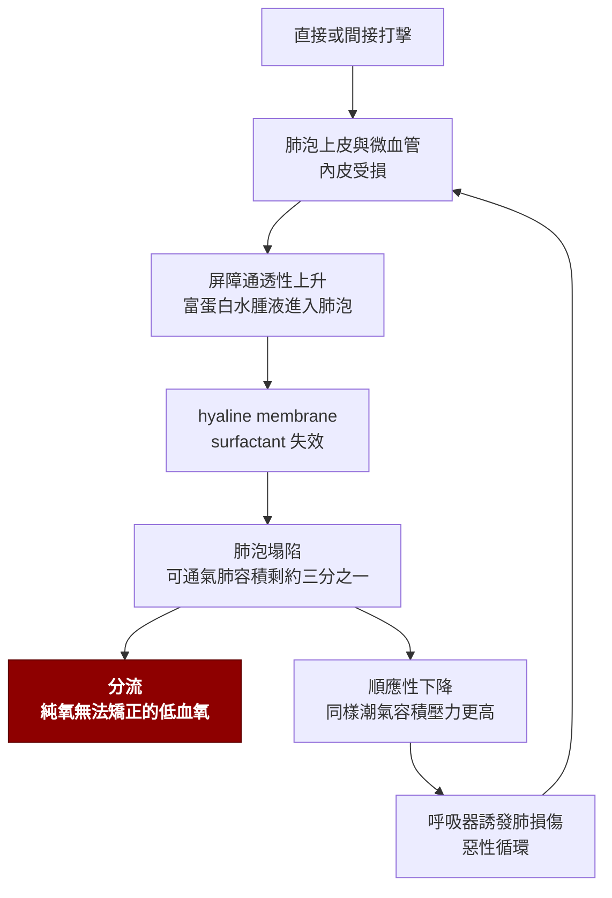

---
tags:
  - Med/Disease/Resp
  - Med/Disease/General
  - emergency
  - 禁忌
aliases:
  - ARDS
  - Acute respiratory distress syndrome
  - 急性呼吸窘迫症候群
  - Berlin definition
  - Diffuse alveolar damage
  - DAD
  - 瀰漫性肺泡損傷
  - Acute lung injury
  - ALI
created: 2026-07-28
updated: 2026-07-28
status: 可用
source: 113-1 醫學(三) 49（急性低血氧性呼吸衰竭而 CXR 正常的鑑別，答案 C——ARDS 正是它的反面：定義上一定要有雙側浸潤）、115-2 醫學(三) 3（shunt 給 100% 純氧不改善，答案 C）、114-1 醫學(三) 49（NIV 適應症，答案 B）、114-1 醫學(三) 59（呼吸器病人併胃潰瘍出血不可用抗凝劑做 VTE 預防，答案 C）延伸；Berlin definition 2012；ARDSNet ARMA／FACTT；PROSEVA；ART；ACURASYS／ROSE；DEXA-ARDS；EOLIA；2024 ATS ARDS 指引更新；Harrison's。⚠ 2023 年提出、2024 年正式發表的 New Global Definition 已納入 SpO₂/FiO₂ 與非插管族群——考試照 Berlin 答，臨床要知道新版存在
cssclass: clinical-note
presents_as:
  - "[[Dyspnea]]"
  - "[[Shock]]"
diagnosed_by:
  - "[[Chest X-ray]]"
  - "[[Arterial blood gas]]"
  - "[[Echocardiography]]"
treated_by:
  - "[[Mechanical ventilation]]"
  - "[[ECMO]]"
  - "[[Corticosteroids]]"
differential:
  - "[[Heart failure]]"
  - "[[Pneumonia]]"
  - "[[Pulmonary embolism]]"
complication:
  - "[[Pneumothorax]]"
  - "[[Shock]]"
---

# ARDS ｜ 急性呼吸窘迫症候群 · Acute Respiratory Distress Syndrome

> [!abstract] 一句話總覽
> 全身性或肺部的打擊 → **肺泡–微血管屏障通透性增加** → 富含蛋白質的水腫液灌滿肺泡 → **不是水太多，是牆漏了**。結果是**分流（shunt）造成的頑固低血氧**與肺順應性塌陷。它**沒有特效藥**：治療的全部內容是「治原發病 ＋ 用不會再傷肺的方式撐過去」——**降低死亡率的介入幾乎都是呼吸器設定與姿勢，不是藥**。

> [!tip] 30 秒行動卡
> **診斷關鍵**：誘因後 **1 週內**急性惡化 ＋ **雙側浸潤** ＋ **P/F ≤300（PEEP ≥5 下量）** ＋ **不能只用心衰竭或輸液過多解釋**（四項全要）
> **治療骨架**：**潮氣容積 6 mL/kg 預測體重、Pplat ≤30、driving pressure ＜15** ＋ **P/F ＜150 就趴（≥16 小時/天）** ＋ 限水（休克解除後）＋ 治原發病
> **絕對不可**：用**實際體重**算潮氣容積；為了衝 PaO₂ 加大潮氣容積；做長時間 recruitment maneuver

---

## 定義與定位

ARDS 不是一個病因，是**一群不同打擊共用的最終肺部表現**——病理長相是 **diffuse alveolar damage (DAD)：肺泡上皮壞死 ＋ hyaline membrane**。它的所有診斷條件都是**排除性與描述性的**，因此「診斷 ARDS」實際上等於「證明這不是心因性肺水腫」。

| 項目 | 重點 |
|---|---|
| 本質 | **通透性肺水腫（permeability edema）**，非靜水壓性——水腫液蛋白質濃度高 |
| 病理 | **DAD**：滲出期 hyaline membrane → 增生期 → 部分進入纖維化期 |
| 低血氧機轉 | **真正的分流（shunt）**：肺泡塌陷或灌滿水但仍有血流通過 → **給 100% 純氧改善有限**（見 [[Arterial blood gas]]） |
| 分類位置 | 「雙側浸潤 ＋ 頑固低血氧」那一格；隔壁是心因性肺水腫（[[Heart failure]]），兩者靠**心臟證據**分開 |

### Berlin definition（2012）— 四項全要，考試就考這一張

| 條件 | 內容 |
|---|---|
| **時間** | 誘因發生或呼吸症狀惡化後 **1 週內** |
| **影像** | [[Chest X-ray]] 或 [[Chest CT]] 上**雙側浸潤**，且**不能完全由**肋膜積液、肺葉塌陷、結節解釋 |
| **水腫來源** | **不能完全由心衰竭或輸液過多解釋**；無明確 ARDS 危險因子時，需**客觀證據（如 [[Echocardiography]]）**排除靜水壓性肺水腫 |
| **氧合分級**（**必須在 PEEP 或 CPAP ≥5 cmH₂O 下量**） | **輕度** 200 ＜ P/F ≤300｜**中度** 100 ＜ P/F ≤200｜**重度** P/F ≤100 |

> [!warning] Berlin 相對於舊版（AECC）刪掉了兩樣東西
> ① **廢除 "acute lung injury (ALI)" 這個名稱**，改成輕度 ARDS；② **刪除 PCWP ≤18 mmHg 這條**——因為 ARDS 與左心衰竭**可以並存**，用一個壓力數字去互斥是錯的。看到選項寫「診斷 ARDS 需 PCWP ≤18」，那是舊定義。
> 另外兩個常被忽略的細節：**輕度 ARDS 的 ≥5 cmH₂O 可以用非侵襲性 CPAP／NIV 提供，不必插管**（中重度則在侵襲性 PEEP ≥5 下量）——但**完全沒有 PEEP／CPAP、只戴面罩給氧的病人，嚴格說還不能分級**；**P/F 會隨 PEEP 與 FiO₂ 浮動**，同一個病人下午比上午差不代表病惡化。

> [!note] 2023 New Global Definition：知道它存在，但考試照 Berlin 答
> 新版把三件事放寬：**① SpO₂/FiO₂ ≤315 可取代 P/F**（限 SpO₂ ≤97% 時）；**② 承認非插管 ARDS**——高流量鼻導管 **≥30 L/min**，或 NIV／CPAP **PEEP ≥5**；**③ 肺部超音波可作為影像依據**；並為資源有限地區另設條款：**只用 SpO₂/FiO₂ ≤315，既不要求 PEEP，也不要求最低氧流量**。這是 COVID-19 大量 HFNC 病人逼出來的修訂。**國考題幹若給 P/F 與 PEEP，仍照 Berlin 分級。**

## 病因與機制

| 打擊類型 | 代表原因 |
|---|---|
| **直接（肺內）** | **[[Pneumonia]]——最常見的單一誘因（LUNG SAFE 59.4%）**、**吸入性肺炎（14.2%）**、溺水、吸入性傷害（煙、毒氣）、肺挫傷、脂肪栓塞、再灌流（肺移植、肺栓塞取栓後） |
| **間接（肺外）** | **肺外敗血症（16.0%）**、**[[Acute pancreatitis]]**、嚴重外傷與燒傷、**大量輸血（TRALI）**、藥物過量（鴉片、水楊酸）、體外循環術後 |

> [!note] 「最常見的原因」有兩個答案，要看題目怎麼問
> 依 **LUNG SAFE（JAMA 2016）單一誘因**排序：**肺炎 59.4% ＞ 肺外敗血症 16.0% ＞ 吸入 14.2%**。但教科書常寫「**敗血症最常見**」——那是把肺源性敗血症（也就是肺炎）與肺外敗血症合計之後的說法。兩句話並不矛盾，前提不同：**問「單一誘因」答肺炎，問「臨床情境」答敗血症。**

> [!tip] 「Baby lung」——一句話推出整套呼吸器設定
> ARDS 的肺**不是均勻變硬，是大部分泡掉、剩一小塊還能通氣**（可通氣容積約剩正常的三分之一，卻仍接收全部的潮氣容積）。所以**用「正常」的 10–12 mL/kg 去灌，對那塊 baby lung 而言是兩三倍的過度撐張**。
> 從這一句可以推出全部：**要小潮氣容積**（避免 volutrauma）、**要 PEEP**（避免肺泡反覆開闔的 atelectrauma）、**要限制 Pplat 與 driving pressure**（那才是 baby lung 真正承受的應力）、**趴著可以讓塌掉的背側肺重新參與**。這也解釋了為什麼**呼吸器本身會製造與放大 ARDS**——VILI 的四種型態：volutrauma、barotrauma、atelectrauma、**biotrauma**（發炎介質進入全身循環 → 遠端器官衰竭，這是 ARDS 病人多半死於多重器官衰竭而非窒息的原因）。

**病程三期**：**滲出期（約 0–7 天）** hyaline membrane、水腫；**增生期（約 7–21 天）** 第二型肺泡細胞增生、纖維母細胞進場，多數人在此開始好轉；**纖維化期（＞3 週，僅部分人進入）** 肺結構重塑、需長期呼吸器。**類固醇的時機爭議就落在這條時間軸上**。

## 臨床表現

- **典型**：誘因後 **6–72 小時內**出現的**呼吸急促與頑固低血氧**、呼吸費力、兩側瀰漫性囉音
- **提示性**：**給氧反應差**（面罩加到底 SpO₂ 仍拉不上來）；焦躁、意識改變；同時有敗血症或胰臟炎的全身表現
- **少見但重要**：**急性肺心症（acute cor pulmonale）** 造成的右心衰竭與休克；氣胸（尤其已上高 PEEP 者）

> [!danger] 「純氧給到底還是低血氧」不是壞運氣，是診斷線索
> **分流的定義就是「血流經過完全沒有通氣的肺泡」**，這些血不管吸入氣體含氧多少都不會被氧合——所以**提高 FiO₂ 幾乎無效，要靠 PEEP 與趴姿把塌掉的肺泡打開**才會改善。相對地，**V/Q mismatch（如氣喘、COPD）給純氧會改善**。這一組對比是 115-2 那一題的全部內容，也是床邊判斷「這是哪一種低血氧」最快的一刀。
> 反過來的陷阱：**[[Pulmonary embolism]] 與肝肺症候群也是分流或類分流，但 CXR 是乾淨的**——「急性低血氧而胸部 X 光正常」的鑑別是肺栓塞、右至左分流、肝硬化、氣喘（113-1 Q49）；**ARDS 一定有雙側浸潤，所以正好被排除在那張清單之外**。

→ 相關主訴流程：[[Dyspnea]]

## 診斷

診斷靠的是**把四項 Berlin 條件逐條核對**，其中唯一需要主動做檢查的是第三項。**沒有任何一個 lab 可以確診 ARDS。**

**要開的檢查**：[[Arterial blood gas]]（算 P/F、看有無高碳酸血症）、[[Chest X-ray]]（雙側浸潤，床邊即可）、[[Echocardiography]]（排除心因性、同時看右心室）、[[BNP]]、感染與敗血症的全套 workup（找原發病才是重點）

> [!tip] 分不出 ARDS 還是心因性肺水腫時，看這六格
> | 線索 | ARDS | 心因性肺水腫 |
> |---|---|---|
> | 病史 | 敗血症、外傷、胰臟炎、吸入 | 心臟病史、輸液過多、[[Atrial fibrillation]] 發作 |
> | 頸靜脈怒張、S3、下肢對稱水腫 | **通常無** | **常有** |
> | 心影與血管分布 | **心臟不大**，浸潤偏周邊、瀰漫、常見 air bronchogram | **心臟擴大**，肺門周圍蝶翼狀、上肺葉血流重分布、Kerley B 線、肋膜積液 |
> | [[BNP]] | 偏低（＜100 pg/mL 支持 ARDS） | 偏高（＞500 pg/mL 支持心因性） |
> | [[Echocardiography]] | LVEF 與充盈壓大致正常 | LVEF 下降或充盈壓上升 |
> | 水腫液／血漿蛋白比 | **≥0.65（通透性／滲出液）** | **＜0.65（靜水壓性／濾出液）** |
>
> **但兩者可以並存**——這正是 Berlin 寫「不能**完全**由心衰竭解釋」而不是「不可有心衰竭」的原因。

## 鑑別診斷

| 要排除的 | 支持它、不支持 ARDS 的線索 | 怎麼排除 |
|---|---|---|
| [[Heart failure]]／心因性肺水腫 | 頸靜脈怒張、S3、心臟擴大、蝶翼狀分布、利尿後快速改善 | [[Echocardiography]] ＋ [[BNP]]（見上表）。**最重要、也最常誤診的一個** |
| 瀰漫性 [[Pneumonia]] | 單側或局部為主、膿痰、明確病原 | 影像分布 ＋ 培養。**注意：重症肺炎可以「就是」ARDS 的病因**，兩者不是二選一 |
| **瀰漫性肺泡出血 (DAH)** | **咳血、Hb 進行性下降**、血管炎或自體免疫背景 | **支氣管肺泡灌洗液連續三份愈來愈血性**是招牌；驗 ANCA、anti-GBM |
| **急性間質性肺炎 (AIP)／急性嗜伊紅性肺炎** | **找不到任何誘因**；後者 BAL 嗜伊紅球 ＞25%、對類固醇反應戲劇性 | BAL 細胞分類；AIP 屬排除性診斷（等於「特發性 ARDS」） |
| [[Pulmonary embolism]] | **肺部聽診乾淨、CXR 乾淨**、單側腿腫、右心室擴大 | CTPA。低血氧同樣頑固，但**影像完全不同** |
| 大量輸血後（**TRALI**） | 輸血後 **6 小時內**發作、發燒、低血壓 | 時間關係。**TRALI 本身就是一種 ARDS**，要與循環超載（TACO）分開——後者是靜水壓性、BNP 高、利尿有效 |

## 治療

**除了治療原發病之外，唯一有明確死亡率效益的介入是「怎麼接呼吸器」與「趴不趴」。** 以下依證據強度排列。

### 一、肺保護通氣 — 底線中的底線

| 參數 | 目標 | 為什麼 |
|---|---|---|
| **潮氣容積** | **6 mL/kg 預測體重（PBW）**；可先 8 再於 1–2 小時內降到 6，必要時降到 4 | ARDSNet **ARMA**：6 vs 12 mL/kg PBW，**院內死亡率 31.0% vs 39.8%**（絕對差 8.8 個百分點）——這是全篇最大的一個數字 |
| **Plateau pressure** | **≤30 cmH₂O** | 超過即代表 baby lung 被過度撐張 |
| **Driving pressure（Pplat − PEEP）** | **＜15 cmH₂O** | 它把潮氣容積校正到「還能通氣的肺容積」上，是與死亡率相關最強的單一呼吸器參數 |
| **PEEP** | 依 **PEEP/FiO₂ 對照表**；中重度用**較高 PEEP** | 撐開塌陷肺泡、減少 atelectrauma |
| **氧合目標** | **PaO₂ 55–80 mmHg 或 SpO₂ 88–95%** | 再高沒有好處，只換來更高的 FiO₂ 與壓力 |
| **pH** | 允許 **permissive hypercapnia**，pH 大致 ≥7.15–7.20 | **保肺優先於保 PaCO₂**；呼吸次數可加到 35/分 |

> [!danger] PBW 只由「身高與性別」決定，跟現在體重無關
> 男性 **50 ＋ 0.91 ×（身高 cm − 152.4）**；女性 **45.5 ＋ 0.91 ×（身高 cm − 152.4）**。
> 用實際體重算是**臨床與考試最高頻的錯誤**：一位 **160 cm、95 kg 的女性**，PBW ≈ **52.4 kg** → 潮氣容積約 **315 mL**（同身高男性 PBW ≈ 56.9 kg → 約 341 mL）；用實際體重 95 kg 算會給到 **570 mL**——**接近兩倍，等於直接製造 VILI**。肺的大小跟胖瘦無關，只跟身高與性別有關。

### 二、姿勢與其他有效介入

| 介入 | 用在誰 | 重點 |
|---|---|---|
| **俯臥（prone positioning）** | **P/F ＜150**（FiO₂ ≥0.6、PEEP ≥5）的中重度；在肺保護設定下**穩定 12–24 小時後再確認仍符合**，才開始 | **PROSEVA：每天 ≥16 小時，28 天死亡率 16.0% vs 32.8%**——效益極大、成本極低。機轉是讓背側塌陷肺復張並使胸腔壓力分布均勻 |
| **限制輸液（conservative fluid）** | **休克已解除**的病人 | FACTT：**縮短呼吸器天數與加護病房天數，但死亡率無差異**。⚠ FACTT 有收休克病人，只是**協定在使用升壓劑期間不啟動**（停用滿 12 小時才套用） |
| **神經肌肉阻斷劑（cisatracurium）** | 早期重度 ARDS、深度鎮靜下仍與呼吸器對抗 | ACURASYS 正向、**ROSE 中性**；**2024 ATS 對早期重度 ARDS 仍為「有條件建議使用」（低確定性）**。ROSE 之後不再全面常規化，多保留給重度低血氧或嚴重人機不同步者，療程 **≤48 小時** |
| **類固醇** | 早期中重度 | 2024 ATS **有條件建議給**；DEXA-ARDS 收案為 **P/F ≤200 且 ARDS 確立後 24 小時內**開始，用 **dexamethasone 20 mg/天 ×5 天 → 10 mg/天 ×5 天**。⚠ **不要拖到晚期**（見下方 LaSRS） |
| **VV-[[ECMO]]** | 已做足肺保護仍**極重度**：P/F ＜50 ＞3 小時、P/F ＜80 ＞6 小時，或 pH ＜7.25 且 PaCO₂ ≥60 ＞6 小時 | EOLIA 收案條件即上列；60 天死亡率 35% vs 46%（**p ＝ 0.09，未達顯著**，且對照組 **28%（35/125）** 跨組接受救援 ECMO）。**2024 ATS 對選定的重度病人「有條件建議」，ESICM 2023 則給「強烈建議」——兩大學會不一致。**完整內容見 [[ECMO]] |

> [!warning] LaSRS 常被講太滿：它的主結果是中性的
> LaSRS（NEJM 2006）比較的是**已持續 ≥7 天的 ARDS** 給 methylprednisolone：**60 天死亡率 29.2% vs 28.6%，主要終點陰性**。傷害訊號**只出現在「入組時已發病 ≥14 天」的事後次族群**（人數少）。所以正確的記法是「**別拖到晚期才開始**」，而不是「超過 14 天給就會害死人」；同樣地，這個試驗**不能拿來反對第一週給藥**。

### 三、看起來合理但不該做的

> [!warning] 這一格全部是「曾經流行、後來被試驗打掉」的
> - **長時間 recruitment maneuver ＋ PEEP 遞減滴定：ART 試驗 28 天死亡率反而增加 → 強烈不建議。**「較高 PEEP」要用對照表達成，不是靠反覆用力撐開。
> - **高頻震盪通氣（HFOV）**：OSCILLATE 死亡率增加、OSCAR 無效 → 不用。
> - **吸入型 NO**：**只改善氧合、不改善死亡率**，且增加腎損傷 → 僅作為等待 ECMO 的橋接。**「氧合改善 ≠ 活下來」是 ARDS 全篇最重要的方法學教訓。**
> - **外源性 surfactant、β₂-agonist、statin、常規白蛋白**：成人 ARDS 皆無效（β₂-agonist 在 BALTI-2 甚至有害）。
> - **為了「把水拉掉」而在休克中猛利尿**：FACTT 的協定在使用升壓劑期間本來就不執行。

**同時永遠在做的**：治療原發病（敗血症的抗生素與 source control 是決定生死的那一半）、鎮靜最小化、**每日評估可否拔管**、預防呼吸器相關肺炎（床頭抬高 30–45°、每日中斷鎮靜）、營養、VTE 與壓力性潰瘍預防。

> [!warning] VTE 預防要看有沒有在出血（114-1 Q59 的陷阱）
> 呼吸器病人常規給藥物性 VTE 預防——**但正在胃潰瘍出血時，抗凝劑是最不適當的那一項**，該改成間歇性充氣加壓等機械性預防。同一組「常規措施」的清單，只要題幹塞進一個活動性出血，答案就翻面。

## 併發症與預後

- **要盯的併發症**：**氣壓傷（[[Pneumothorax]]、縱膈氣腫）**、呼吸器相關肺炎、**急性肺心症與右心衰竭**（高 PEEP 與高碳酸血症會加重）、[[Shock]] 與多重器官衰竭、[[Delirium]] 與加護病房後天肌無力
- **預後**：整體死亡率約 **35–45%**，隨 Berlin 分級上升——**Berlin 原始世代 輕度 27%／中度 32%／重度 45%**；LUNG SAFE 為 34.9%／40.3%／46.1%。**多數人死於多重器官衰竭與敗血症，不是死於低血氧**——這也是為什麼「改善氧合的藥」全部沒有降低死亡率
- **存活者**：肺功能多在 6–12 個月內大致恢復（DLCO 可能持續偏低），**真正的長期殘疾來自肌無力、認知功能下降與 PTSD**——即 post-intensive care syndrome

## 禁忌與陷阱

> [!danger] 絕對不可
> | 情境 | 絕對不可 | 為什麼 | 該做什麼 |
> |---|---|---|---|
> | 任何 ARDS | 用 **10–12 mL/kg** 的潮氣容積 | ARMA：死亡率相差約 9 個百分點 | **6 mL/kg PBW，Pplat ≤30** |
> | 計算潮氣容積 | 用**實際體重** | 肥胖者會被灌到近兩倍 → VILI | **PBW 只用身高與性別算** |
> | 低血氧但 Pplat 已達 30 | 為了衝 PaO₂ 而加大潮氣容積 | 換來 VILI 與 biotrauma | 接受 **permissive hypercapnia**；升級到俯臥或 [[ECMO]] |
> | 中重度 ARDS | 長時間 **recruitment maneuver ＋ PEEP 遞減滴定** | ART：28 天死亡率增加 | 用 **PEEP/FiO₂ 對照表**取得較高 PEEP |
> | ARDS 已持續**兩週以上** | 此時才第一次開始高劑量類固醇 | LaSRS 主結果雖為中性，但**入組時已發病 ≥14 天的次族群死亡率反而上升** | 要給就**早期給**（DEXA-ARDS 是確診後 24 小時內）；晚期不新起 |
> | **仍在休克**的 ARDS | 一律套用限制輸液策略 | 低灌流加重器官衰竭；FACTT 的協定在升壓劑使用期間本就不啟動 | 先復甦，停用升壓劑滿 12 小時後才轉限水 |
> | 意識不清、痰多、血行動力不穩 | 用 **NIV** 硬撐 | 誤吸與延遲插管 → 死亡率上升（114-1 Q49） | **及早插管**行侵襲性通氣 |
> | 呼吸器病人**正在胃潰瘍出血** | 用抗凝劑做 VTE 預防 | 活動性出血（114-1 Q59） | 改機械性預防 |
> | 雙側浸潤但**尚未排除心因性** | 直接當 ARDS 積極輸液 | 誤診會讓靜水壓性肺水腫惡化 | 先 [[Echocardiography]] ＋ [[BNP]] |

> [!warning] 常見錯誤
> - **拿 PCWP ≤18 當 Berlin 條件**——那是舊的 AECC 定義，Berlin 已刪除，因為 ARDS 與心衰竭可以並存。
> - **忘記 P/F 必須在 PEEP ≥5 下量**（輕度可用**非侵襲性 CPAP ≥5** 達成，不必插管），也忘記「輕度 ARDS」已取代舊的 ALI 這個詞。
> - **看到氧合改善就以為治療有效**——吸入型 NO、HFOV、surfactant 全都改善氧合而不改善存活。
> - **只有輕度就趴**——PROSEVA 的門檻是 **P/F ＜150**，不是所有 ARDS。
> - **把 ARDS 當成純粹的肺病**——不找、不治敗血症的源頭，呼吸器設定再漂亮也沒用。
> - **用「給純氧沒反應」判斷病人沒救**——那只是分流的定義，正確反應是加 PEEP、趴、必要時 [[ECMO]]。
> - **把重症肺炎與 ARDS 當成互斥的兩個答案**——肺炎是 ARDS 最常見的直接病因。

## 相關連結

- [[Dyspnea]] — 「雙側浸潤 ＋ 頑固低血氧」的入口；[[Arterial blood gas]] 有分流 vs V/Q mismatch 的完整對照
- [[Heart failure]] — 最重要、最常誤診的鑑別；心因性肺水腫的完整內容在那一篇
- [[Pneumonia]] · [[Acute pancreatitis]] · [[Sepsis]] — 最常見的三個病因；治原發病才是治 ARDS
- [[Pulmonary embolism]] — 同樣頑固低血氧，但**影像乾淨**，是 113-1 Q49 那張清單的成員
- [[Mechanical ventilation]] · [[ECMO]] — 呼吸器參數與 VV-ECMO 的深度歸屬在那兩篇
- [[Chest X-ray]] · [[Echocardiography]] · [[BNP]] — 診斷 ARDS 等於證明「不是心因性」
- [[Pneumothorax]] · [[Shock]] · [[Delirium]] — 病程中最該盯的三個併發症
- [[禁忌選項]]
