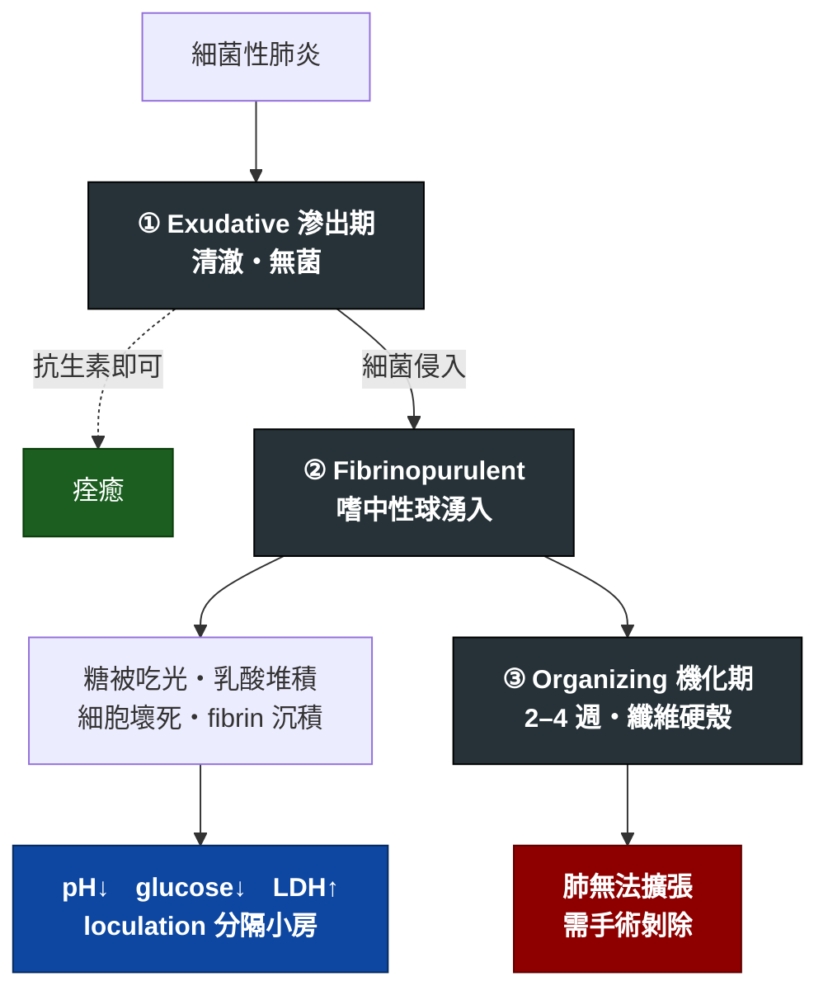

---
tags:
  - Med/Disease/Resp
  - empyema
  - pleural-effusion
  - 禁忌
aliases:
  - Empyema
  - 膿胸
  - Empyema thoracis
  - Pleural empyema
created: 2026-07-25
updated: 2026-07-25
status: 可用
source: 標準呼吸科框架；胸水數字門檻查證自 StatPearls / ATS（見文中）。案例來源：內科 OSCE 考古（68y/o M, RUQ pain aggravated during respiration）
cssclass: clinical-note
presents_as:
  - "[[RUQ pain]]"
  - "[[Chest pain]]"
  - "[[Dyspnea]]"
  - "[[Fever]]"
diagnosed_by:
  - "[[Chest X-ray]]"
  - "[[Pleural fluid analysis]]"
treated_by:
  - "[[Chest tube drainage]]"
differential:
  - "[[Pleural effusion]]"
  - "[[Pneumonia]]"
  - "[[Tuberculosis]]"
---

# Empyema ｜ 膿胸 · Empyema Thoracis

> [!abstract] 一句話總覽
> **胸膜腔內積膿**。絕大多數是肺炎的併發症（parapneumonic），自然史是「單純積液 → complicated → 膿胸 → 纖維化包覆」。治療永遠是**兩條腿**：**抗生素 ＋ 引流**，缺一不可——光給抗生素治不好，因為藥物穿不進膿液包覆的腔室。

> [!tip] 30 秒行動卡
> **診斷關鍵**：CXR 有胸水 → **一定要抽胸水**。抽出來是膿、或 Gram stain/culture 陽性、或 pH < 7.20 → 就是要引流。
> **治療骨架**：IV 抗生素（涵蓋 S. pneumoniae、Staph、厭氧菌）＋ **胸管引流**；引流不順 → 胸腔內纖維溶解劑 → VATS decortication。
> **絕對不可**：只給抗生素不引流。

---

## 定義與定位

| 項目 | 重點 |
|---|---|
| 本質 | 胸膜腔內化膿性積液 |
| 最常見成因 | **Parapneumonic**（細菌性肺炎併發），約佔多數 |
| 其他成因 | 胸腔手術後、外傷、食道破裂、膈下膿瘍向上蔓延、肺膿瘍破入胸膜腔 |
| 分類位置 | [[Pleural effusion]] 的一種——**exudate**（滲出液） |

> [!warning] 三個名詞要分清楚
> | 名稱 | 定義 | 要不要引流 |
> |---|---|---|
> | Uncomplicated parapneumonic effusion | 肺炎旁的單純滲出液，無菌 | 通常不用，抗生素即可 |
> | **Complicated** parapneumonic effusion | 細菌已侵入胸膜腔，但還沒變成肉眼膿 | **要** |
> | **Empyema 膿胸** | 肉眼可見膿液 | **要** |
>
> 在還沒抽胸水之前，最精確的寫法是 **`pleural effusion, susp. empyema`**——`susp.` 兩個字誠實地標示了「影像看得到水，但性質未定」。

## 病因與機制

> [!tip] 為什麼指標長這樣，不用背
> 細菌與白血球在密閉腔室裡狂吃葡萄糖、行無氧代謝 → **糖被吃光、乳酸使 pH 下降**；細胞大量壞死 → **LDH 釋出而升高**。
> 所以 **pH 下降是最早、最敏感的變化**，會早於 glucose 掉下來、也早於 LDH 衝高。

![[assets/empyema-stages.jpg]]
*膿胸由 exudative → fibrinopurulent → organization：游離液體逐漸形成 fibrin 分隔與 loculation，最後纖維殼限制肺擴張，單純 thoracentesis 已難以清除。Source: [Kuru & Altinok, “Empyema in children” Figure 1](https://pmc.ncbi.nlm.nih.gov/articles/PMC10995679/)（CC BY-NC 4.0）。*

## 臨床表現

- **典型**：發燒、咳嗽有痰、**pleuritic 胸痛**（深呼吸加劇）、喘
- **提示性**：近期呼吸道感染後「燒退一半又燒起來」、體重減輕、倦怠
- **少見但重要**：右下胸／膈肌附近病灶可**投射成右上腹痛**，病人主訴會是肚子痛而不是胸痛

> [!danger] 為什麼會表現成腹痛
> 橫膈膜與下段胸壁的體感神經（T7–T11）和上腹壁**共用皮節**；壁層胸膜受刺激的痛覺會被大腦定位到上腹。
> 因此「**上腹痛 ＋ 隨呼吸加劇**」這個組合，永遠要把胸腔放進鑑別——這條在任何來源的案例都成立。

→ 相關主訴流程：[[RUQ pain]]、[[Chest pain]]、[[Dyspnea]]

## 診斷

| 診斷條件 | 內容 |
|---|---|
| 影像 | [[Chest X-ray]]：肋膈角變鈍、meniscus sign；大量時縱膈腔被推向健側。側躺（decubitus）片可看流不流動 → 判斷有無 loculation |
| 進階影像 | 胸部超音波（看 loculation 最好、可導引穿刺）；CT（看 pleural thickening、split pleura sign） |
| **確診** | **[[Pleural fluid analysis]]（胸腔穿刺）**——抽到膿，或培養／Gram stain 陽性 |

**要開的檢查**：CXR、胸水分析、CBC/DC、CRP、血液培養、痰培養＋抗酸染色

### 胸水判讀：需要引流的門檻

| 指標 | 切點 | 意義 |
|---|---|---|
| 肉眼 | 膿 (frank pus) | 直接診斷膿胸 |
| Gram stain / culture | 陽性 | Complicated |
| **pH** | **< 7.20** | 最敏感的早期指標，一般視為插胸管的適應症 |
| Glucose | **< 40 mg/dL**（部分文獻用 < 60） | Complicated |
| LDH | **> 1000 IU/L** | Complicated |

> [!warning] 這裡有文獻不一致，請跟課本核對
> Glucose 切點 **StatPearls 寫 < 40 mg/dL**，但較早的文獻（及部分教科書）用 **< 60 mg/dL 搭配 pH 7.2–7.3 = 即將形成膿胸**。
> **pH 7.2–7.3 是灰色地帶**——建議連續追蹤胸水 pH ＋ 臨床觀察再決定要不要插管。
> 各來源一致認可的一組是：**pH < 7.20 / glucose < 40 / LDH > 1000 / 培養陽性 / 肉眼膿**。

![[assets/empyema-cxr-ct.jpg]]
*同一右側膿胸的 CXR 與增強 CT：平片只有右胸大片陰影；CT 才清楚顯示胸膜腔內液體、氣泡、壓迫性肺塌陷與胸膜增強。Source: [Ilsen et al., “Comparative Interpretation of CT and Standard Radiography of the Pleura” Figure 8](https://pmc.ncbi.nlm.nih.gov/articles/PMC6100645/)（CC BY 4.0）。*

![[assets/empyema-split-pleura.jpg]]
*split pleura sign 特寫：增厚且增強的壁層與臟層胸膜被液體分開。膿胸通常呈胸膜基底、透鏡狀並與胸壁成鈍角；肺膿瘍較圓、位於肺實質且多成銳角。Source: [同文 Figure 9](https://pmc.ncbi.nlm.nih.gov/articles/PMC6100645/)（CC BY 4.0）。*

## 鑑別診斷

| 要排除的 | 支持它的線索 | 怎麼排除 |
|---|---|---|
| [[Pleural effusion]] transudate（心衰竭、肝硬化、腎病症候群） | 兩側對稱、無發燒、有 JVE／水腫 | **Light's criteria** → transudate |
| [[Tuberculosis]] 結核性胸膜炎 | 久咳、盜汗、體重減輕、接觸史 | 胸水 **ADA > 40 U/L**、淋巴球為主、抗酸染色／培養 |
| 惡性胸水 | 體重減輕、血性胸水、量大且反覆 | 細胞學、胸膜切片 |
| [[Pneumonia]] 單純肺炎無積液 | 有浸潤但無肋膈角變鈍 | CXR ± 超音波 |
| [[Lung abscess]] 肺膿瘍 | 空洞內有 air-fluid level | CT 可分辨（膿瘍是圓的、與胸壁成銳角） |

> [!note] ADA 切點的細節
> 常用 **40 U/L**（高盛行區敏感度約 88–91%、特異度 85–93%）。
> 有研究指出 ADA 隨年齡下降，建議 **≤55 歲用較高切點、>55 歲用較低切點**——屬進階調整，一般仍以 40 U/L 為準。

## 治療

| 情境 | 處置 |
|---|---|
| **一律** | **IV 抗生素 ＋ 引流，兩者缺一不可** |
| 抗生素 | 經驗性涵蓋 Streptococcus、Staphylococcus、**厭氧菌**（社區型常見吸入性）；院內型需考慮 MRSA 與 Gram(−)。**依當地抗藥性與院內指引調整** |
| 引流 | [[Chest tube drainage]]（chest tube 或 pigtail catheter），超音波導引可提高成功率 |
| 引流不順／多房分隔 | 胸腔內纖維溶解劑（tPA ＋ DNase） |
| 上述失敗／已機化 | **VATS 或開胸 decortication**（剝除纖維硬殼） |
| 支持 | 氧氣、止痛（讓病人敢深呼吸）、營養、肺部復健 |

> [!danger] 為什麼不能只給抗生素
> 膿液黏稠、pH 低、又被 fibrin 分隔成小房——抗生素穿透差、局部酸性也會降低部分藥物活性。**不引流就治不好**，而且拖久會進入機化期，那時只剩開刀一途。

## 併發症與預後

- **要盯的併發症**：敗血症、**呼吸衰竭**（積液壓迫可使血氧持續下降，要盯 SpO₂）、支氣管肋膜瘻管（bronchopleural fistula）、纖維胸（fibrothorax）造成永久性肺功能受損、膿液向外破出（empyema necessitatis）
- **預後因子**：從發病到引流的**時間**（愈早愈好）、是否已 loculation、宿主免疫狀態、致病菌種

## 禁忌與陷阱

> [!danger] 絕對不可
> | 情境 | 絕對不可 | 為什麼 | 該做什麼 |
> |---|---|---|---|
> | 已確認 complicated effusion / 膿胸 | 只給抗生素、不引流 | 藥物穿不進膿腔，會拖進機化期 | 立刻安排引流 |
> | 大量胸水 | 單次抽出過多（一般建議 ≤ 1–1.5 L） | Re-expansion pulmonary edema | 分次引流、過程監測症狀 |
> | 凝血功能不明 | 直接穿刺／插胸管 | 出血、hemothorax | 先查 PT/INR、血小板 |
> | CXR 只看到胸水 | 直接下 empyema 診斷 | 未驗胸水無法區分 uncomplicated / complicated / 膿胸 | 寫 `susp. empyema`，安排胸腔穿刺 |

> [!warning] 常見錯誤
> - 忽略「pleuritic 上腹痛」可能來自胸腔。
> - **忘記把結核放進鑑別**——慢性、淋巴球為主的滲出液尤其要驗 ADA 與抗酸染色。
> - 引流前沒跟病人說明氣胸／hemothorax 風險。

## 相關連結

- [[RUQ pain]] — 常見的主訴入口之一
- [[Pleural fluid analysis]] — Light's criteria 與引流門檻
- [[Chest tube drainage]] — 處置細節與併發症
- [[Pneumonia]] — 最常見的上游病因
- [[Tuberculosis]] — 主要鑑別
