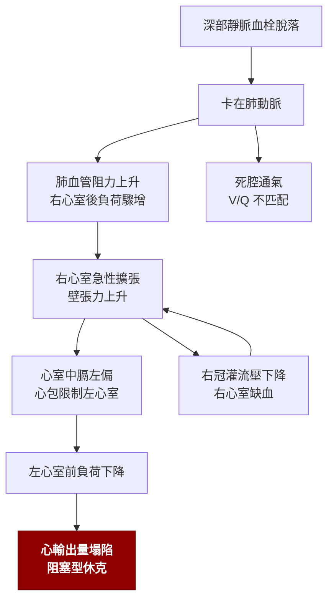

---
tags:
  - Med/Disease/Resp
  - Med/Disease/Cardio
  - emergency
  - 禁忌
aliases:
  - PE
  - Pulmonary embolism
  - 肺栓塞
  - 肺動脈栓塞
  - VTE
  - Venous thromboembolism
  - 靜脈血栓栓塞
  - DVT
  - Deep vein thrombosis
  - 深部靜脈血栓
  - Saddle embolism
created: 2026-07-27
updated: 2026-07-28
status: 可用
source: 114-1 醫學(三) 4、51、115-2 醫學(三) 3 延伸（肺栓塞在三年考卷中皆以鑑別診斷出現）；2019 ESC 肺栓塞指引；ASH 2020 VTE 指引；Harrison's；分層與再灌流依 2019 ESC。2026 年 2 月 AHA/ACC 等十學會發表首份聯合急性 PE 指引，改用 Acute PE Clinical Categories A–E 取代 massive／submassive，PERT 為 Class 1——依 ESC／Harrison's 出題時本篇分層不會錯，但要知道新分類存在
cssclass: clinical-note
presents_as:
  - "[[Dyspnea]]"
  - "[[Chest pain]]"
  - "[[Shock]]"
diagnosed_by:
  - "[[Chest CT]]"
  - "[[Echocardiography]]"
treated_by:
  - "[[DOAC]]"
  - "[[Heparin]]"
  - "[[Fibrinolytics]]"
differential:
  - "[[ACS]]"
  - "[[Aortic dissection]]"
  - "[[Cardiac tamponade]]"
  - "[[Pneumothorax]]"
complication:
  - "[[Shock]]"
  - "[[Heart failure]]"
---

# Pulmonary embolism ｜ 肺栓塞 · Venous Thromboembolism

> [!abstract] 一句話總覽
> 靜脈血栓（絕大多數來自下肢近端深部靜脈）脫落後卡進肺動脈——**致死的不是缺氧，是右心室急性後負荷過載造成的阻塞型休克**。它很少是主角，卻是每一次胸痛與喘都**必須先排除的那一個**；流程的第一步永遠是「血行動力穩不穩」，不是「D-dimer 多少」。

> [!tip] 30 秒行動卡
> **診斷關鍵**：突發喘 ＋ 心搏過速 ＋ **肺部聽診乾淨**。穩定 → 臨床機率分層 → D-dimer 或直接 **CTPA**；**不穩 → 床邊 [[Echocardiography]] 看右心室，看到擴大就足以決策**
> **治療骨架**：**抗凝**是所有人的底線；**高風險（休克或持續低血壓）加溶栓**；中風險只抗凝 ＋ 密切監測
> **絕對不可**：高機率病人拿 D-dimer 陰性排除；把不穩定的病人推去做 CT；懷孕用 DOAC 或 warfarin

---

## 定義與定位

**Venous thromboembolism (VTE)** 是同一個病的兩端：血栓長在深部靜脈叫 **deep vein thrombosis (DVT)**，脫落卡進肺動脈叫 **pulmonary embolism (PE)**。**壓迫式超音波只在 30–50% 的 PE 病人找得到 DVT**（早年靜脈攝影年代才是 70%），所以**下肢超音波陰性完全不能排除 PE**；反過來，相當比例的近端 DVT 病人做影像會發現無症狀 PE——**兩者共用同一套抗凝選擇與療程規則**，所以寫成一篇。

| 項目 | 重點 |
|---|---|
| 本質 | 肺動脈被血栓阻塞 → **右心室後負荷驟增**；它是**阻塞型休克**三大成因之一（另兩個：[[Cardiac tamponade]]、張力性[[Pneumothorax]]，見 [[Shock]]） |
| 栓子來源 | **下肢近端深部靜脈（膕、股、髂）為主**；孤立性小腿遠端血栓造成 PE 的比例低得多 |
| 非血栓性栓塞 | 脂肪（長骨骨折）、羊水、空氣、腫瘤、感染性栓子——機轉與處置完全不同 |
| 分類位置 | 「喘但肺部聽診乾淨」那一格的第一名（見 [[Dyspnea]]） |

## 病因與機制

> [!tip] 為什麼死的是右心室，不是肺
> 右心室平常**只對抗約六分之一的體循環阻力，壁薄、沒有肥厚的儲備**，後負荷突然上升就直接擴張。擴張之後兩條路同時往下走：① **中膈被推向左邊，而心包限制住總容積 → 左心室裝不進血 → 心輸出量塌陷**；② 右心室壁張力上升、體循環血壓卻下降 → **右冠灌流壓下降 → 右心室缺血 → 更收不動**——這就是 [[Troponin]] 會升高的原因，也解釋了為什麼一旦低血壓就急速惡化。
> 一句話：**病灶在肺，死因在右心，塌掉的是左心。**

> [!note] 為什麼低血氧，卻常常 PaCO₂ 偏低
> 主機轉是**血流重新分配造成的 V/Q 不匹配**（栓塞區成為死腔通氣，其餘肺區被過度灌注而 V/Q 偏低），加上肺泡塌陷與部分右向左分流。所以**A-a gradient 增大**、PaO₂ 下降；而病人因疼痛與反射性過度換氣，**PaCO₂ 通常偏低**（呼吸性鹼中毒）。
> 兩個反向陷阱：**PaO₂ 與 SpO₂ 正常完全不能排除 PE**；**PaCO₂ 由低轉正常或上升，代表他快撐不住了**。肺功能的指紋則是**肺量計正常、TLC 正常、DLCO 單獨下降**——管路不通，氣道與肺泡本身是好的。

### 危險因子 — Virchow's triad 就是分類法

> [!tip] 一句話推出整張清單
> **Virchow's triad：血流滯留、內皮損傷、高凝狀態。** 任何因子丟進這三格檢驗，套不進去的就不是危險因子。滯留＝不動；損傷＝有創傷或器械；高凝＝癌症、荷爾蒙、遺傳、發炎。

| 分類 | 具體項目 |
|---|---|
| **血流滯留** | 手術後、**制動與臥床**、中風後偏癱、石膏固定、**長途飛行或久坐**、心衰竭、肥胖、懷孕（子宮壓迫髂靜脈） |
| **內皮損傷** | 大手術（**尤其骨科：髖與膝關節置換、髖骨折**）、外傷與骨折、**中央靜脈導管**、過去 VTE 病史 |
| **高凝（後天）** | **惡性腫瘤**（尤其胰臟、胃、腦、肺、卵巢與血液惡性腫瘤）、**抗磷脂症候群**、**口服避孕藥與荷爾蒙補充**、**懷孕與產後（產後風險最高）**、**腎病症候群**（antithrombin 由尿流失）、**骨髓增生性腫瘤**（尤其 JAK2 陽性）、發炎性腸道疾病、敗血症、heparin-induced thrombocytopenia、**tamoxifen 等 SERM**、高齡、吸菸 |
| **高凝（遺傳）** | **factor V Leiden（西方最常見）**、prothrombin G20210A、protein C／protein S／antithrombin 缺乏 |

> [!info] [[Antiphospholipid syndrome]] 要單獨記
> 它是少數「**動脈與靜脈都會栓**」的疾病，但**靜脈端最常見，其中下肢 DVT 是所有單一表現的第一名**；動脈端最常見的是腦中風，產科最常見的是反覆早期流產——**三種問法三個答案**。
> 診斷要求**間隔至少 12 週兩次抗體陽性**（排除感染造成的一過性陽性）；三種抗體中 **lupus anticoagulant** 的血栓風險最高，名字是反諷的：試管內延長 aPTT，人體內促凝血。**三重陽性者必須用 warfarin，不可用 DOAC。** 相對地，**遺傳性血栓體質驗出來很少改變抗凝療程的決定**，不必背完整清單——真正決定療程的是「這一次是誘發型還是未誘發型」。

## 臨床表現

- **典型**：**呼吸困難（最常見）與心搏過速**，多為突發或數小時內加重；焦慮不安、呼吸急促
- **提示性**：**肋膜性胸痛與咳血 → 代表周邊、較小、造成肺梗塞的栓子**（刺激到胸膜才會痛）；單側下肢腫脹壓痛；低度發燒
- **少見但重要**：**暈厥、低血壓、心跳停止（多為 PEA）→ 代表中央大栓塞**；新發[[Atrial fibrillation]]

> [!danger] 理學檢查常常完全正常——這件事本身就是線索
> PE **最常見的徵象是心搏過速與呼吸急促，其餘都可以是正常的**；**肺部聽診乾淨**是它的招牌，因為空氣進出沒問題，被擋住的是血流。所以「喘得明顯、SpO₂ 卻還好、肺聽起來乾乾淨淨」不是「應該沒事」，而是**你剛拿到最有鑑別力的一條資訊**（完整那一格見 [[Dyspnea]]）。
> 右心負荷的徵象只有大栓塞才出現：**頸靜脈怒張、loud P2、右側 S3、三尖瓣逆流雜音**——看到就代表已經走到危險端。

> [!warning] 兩組反直覺的對應
> **咳血不是最常見的症狀**，它反而代表「周邊、比較小」的栓子；真正大的中央栓塞表現是**暈厥與低血壓**，常常不痛也不咳血。
> **胸痛的性質會告訴你位置**：肋膜性痛 → 周邊；胸骨後壓迫感 → 中央大栓塞造成的右心室缺血，此時最像 [[ACS]]。

→ 相關主訴流程：[[Dyspnea]]、[[Chest pain]]

## 診斷

### 第一個岔路：血行動力穩不穩 — 整套流程的順序顛倒就會出事

| 狀態 | 定義 | 走哪一條 |
|---|---|---|
| **不穩定** | 心跳停止；阻塞型休克（收縮壓 ＜90 mmHg 或需升壓藥才維持 ≥90 mmHg，且合併器官低灌流）；**持續低血壓**（收縮壓 ＜90 mmHg 或下降 ≥40 mmHg 且持續 ＞15 分鐘，非新發心律不整、低血容或敗血症所致） | **立刻床邊 [[Echocardiography]]**：右心室擴大與功能不良即足以決策，**不必等 CTPA**；同步準備再灌流 |
| **穩定** | 以上皆非 | 走臨床機率分層 → D-dimer 或影像 |

> [!danger] 不穩定的病人不推去做 CT
> 影像室沒有監測、沒有人手、沒有藥。**床邊超音波看到右心室擴大 ＋ 合適的臨床情境，就足以啟動溶栓**——這是全篇最重要的一句。支持性徵象：右心室／左心室舒張末徑比 **≥1.0**、中膈變平呈 **D-shape**、**McConnell sign**（右心室游離壁動作低下但心尖收縮保留）、下腔靜脈擴張且不隨呼吸塌陷。反過來說，**不穩定而右心室完全正常，就要改找別的休克原因**（見 [[Shock]]）。

### 穩定病人：先分層，再決定要不要驗

| 工具 | 由什麼組成（記結構，不記配分） | 怎麼用 |
|---|---|---|
| **Wells score** | DVT 的臨床徵象、心搏過速、近期制動或手術、VTE 病史、咳血、惡性腫瘤，以及**「PE 是不是最可能的診斷」**（權重最重、也最主觀的一項） | 分低／中／高三層，或二分為 **PE unlikely／likely** |
| **revised Geneva score** | 同一個骨架，但**全部為客觀項目、不含醫師主觀判斷** | 分層結果與 Wells 相當；不想引入主觀性時用它 |
| **PERC rule**（8 項全符合才算過） | 年齡 ＜50、心率 ＜100、SpO₂ ≥95%、無單側腿腫、無咳血、**4 週內**無需要住院的手術或外傷、無 VTE 病史、未使用外源性雌激素 | **只用在臨床機率本來就很低的人**：8 項全符合就**連 D-dimer 都不必驗**。它不是診斷工具——**任何一項不符合 ≠ 有 PE**，只代表要往下走 D-dimer |

### D-dimer — 只有一種正確用法

> [!danger] 它是排除工具，不是診斷工具
> **陰性預測值高、特異度極差。** 年齡、感染、術後、外傷、惡性腫瘤、懷孕、住院、心衰竭、主動脈剝離全都會讓它升高。**臨床高機率者不驗，直接排 CTPA**——高機率下陰性不足以排除，只換來延誤。
> **＞50 歲改用年齡調整切點 ＝ 年齡 × 10 µg/L FEU**（例如 70 歲用 700），可明顯減少不必要的影像；**僅限「非高機率」病人，且僅適用以 FEU 報告的試劑（標準切點 500 µg/L）**，報 DDU 的實驗室要先換算。（2019 ESC 與 ADJUST-PE 原文寫「＞50 歲」；部分文獻寫「≥50 歲」。50 歲整時 age×10 ＝ 500 ＝ 標準切點，臨床無差異，但引指引原文時是「＞50 歲」）
> 另一套被驗證的策略是 **YEARS**：三項臨床項目（DVT 徵象、咳血、PE 為最可能診斷）**全無時切點放寬到 1000 µg/L**，有任一項則用 500 µg/L；懷孕另有 pregnancy-adapted YEARS。

### 影像

| 工具 | 定位 | 什麼時候用 |
|---|---|---|
| **CT pulmonary angiography (CTPA)** | **首選確診工具**：直接看到肺動脈內的**充盈缺損**，同時量右心室／左心室比值做風險分層，還能一次看出替代診斷 | 穩定病人的第一線（見 [[Chest CT]]） |
| **V/Q scan**（通氣灌流掃描） | 找**灌流缺損而通氣正常**的不匹配區；對乳房的輻射劑量較低 | **腎功能不良、顯影劑過敏、懷孕**；胸部 X 光乾淨者判讀率最好 |
| **下肢壓迫式超音波** | 找到近端 DVT 就等於拿到治療的理由 | 不能做 CTPA、或想避免輻射時的替代路徑 |

![[assets/ctpa-acute-pe-signs.jpg|900]]
*急性 PE 的 CTPA 組圖：a saddle embolus；b 中央 filling defect 被顯影血流包圍的 doughnut／polo-mint sign；c 與血管長軸平行的 railway-track sign；d 擴張肺動脈內血栓；e–f 肺梗塞的 reverse-halo pattern；g 以心內膜邊界最大短軸量得 RV/LV >1。Source: [Multimodality imaging of acute and chronic pulmonary thromboembolic disease](https://pmc.ncbi.nlm.nih.gov/articles/PMC10928553/), Fig. 3。*

### 心電圖與生物標記 — 都不是拿來確診的

| 發現 | 意義 |
|---|---|
| **竇性心搏過速** | **最常見的心電圖表現**；心電圖也可以完全正常 |
| **S1Q3T3** | 經典但**既不敏感也不特異**，**約 15% 的急性 PE 出現**（不限大栓塞）。**看到有意義，沒看到毫無意義** |
| **V1–V4 T 波倒置** | **右心室負荷（right heart strain）**的表現，在 PE 中比 S1Q3T3 常見且與預後相關；同類旁證還有新發右束支傳導阻滯、電軸右偏、V1 的 qR、心房顫動 |
| **[[Troponin]] 升高**、**BNP／NT-proBNP 升高**（見 [[BNP]]） | 分別是右心室缺血與右心室壁張力上升的證據 → **兩者都是風險分層用，不是診斷用**；PE 的 troponin 升幅通常較小、變化較平（對照見 [[EKG ischemia]] 與 [[ACS]]） |

盛行率排序：**竇性心搏過速約 31%（最常見）> 順鐘向轉位 28% > V1–V3 T 波倒置 18% > S1Q3T3 15% > 新發 RBBB 14%**——T 波倒置比 S1Q3T3 常見，但差距不大。

> [!note] 胸部 X 光的角色是「排別人」
> **[[Chest X-ray]] 正常完全不能排除 PE**；反過來，「喘得厲害而 X 光乾淨」本身就支持它。經典徵象都罕見且不特異：**Westermark sign**（局部血管紋理稀少）、**Hampton hump**（貼胸膜的楔形陰影，代表肺梗塞）、**Fleischner sign**（肺動脈擴大）。它真正的用途是抓出氣胸、肺炎、肺水腫這些替代解釋。
> 肺梗塞可造成少量**滲出液**性胸水，細胞可為嗜中性球或嗜伊紅球為主——見 [[Pleural fluid analysis]]。

## 鑑別診斷

*PE 幾乎不會是主角，但它永遠是「必須先排除的那一個」——這一節就是為此存在。*

| 要排除的 | 支持它、不支持 PE 的線索 | 怎麼分開 |
|---|---|---|
| [[ACS]] | 壓迫感、放射到手臂或下頜、冒冷汗；**troponin 明顯動態上升**；**連續導程的 ST 段變化**；典型冠心症危險因子（見 [[CAD]]） | EKG（見 [[EKG ischemia]]）＋ [[Troponin]] 動態。PE 的 troponin 升幅小，心電圖是**右心**的變化（V1–V4 T 倒置）而非局部缺血分布。**兩者可以並存**，大量 PE 也會造成第 2 型心肌梗塞 |
| [[Aortic dissection]] | **瞬間即達最痛**的撕裂痛、痛會遷移、**兩臂收縮壓差 ＞20 mmHg**、新出現的舒張期雜音、縱膈變寬 | **D-dimer 兩者都升高，分不開**；靠 CTA／CTPA 一次分開。**未排除剝離前不可抗凝或溶栓** |
| [[Cardiac tamponade]] | 頸靜脈怒張 ＋ 低血壓 ＋ 心音遙遠、**pulsus paradoxus** | **兩者都是阻塞型休克、都會頸靜脈怒張**——床邊超音波一眼分開：填塞是**心包積液 ＋ 右心房室塌陷**，PE 是**右心室擴大而心包乾淨** |
| [[Pneumothorax]] | **單側呼吸音消失 ＋ 叩診過度反響**、氣管偏向對側 | **理學檢查就分得開**（PE 是聽診乾淨、兩側對稱）；張力性是臨床診斷，先減壓不等影像 |
| [[Pneumonia]] | **發燒、膿痰、局部濕囉音與叩診濁音、egophony**；病程數天 | [[Chest X-ray]] 有 consolidation。PE 的低度發燒不會伴隨膿痰與實質化 |
| [[Heart failure]] 急性失代償 | **orthopnea 與 PND**、兩側基部囉音、S3、下肢**對稱**水腫、體重增加 | [[BNP]]、[[Chest X-ray]]、[[Echocardiography]] 看**左心**；PE 的腿腫是**單側不對稱**，肺是乾淨的 |
| 心因性／過度換氣 | 手腳與口周發麻、嘆息式呼吸、年輕、無危險因子 | **排除性診斷**——PERC 全符合才輪得到它 |

> [!tip] 三個阻塞型休克靠床邊超音波一次分完
> **右心室擴大而心包乾淨 → PE；心包積液加右心塌陷 → 填塞；lung sliding 消失加氣管偏移 → 張力性氣胸。** 這三句就是「頸靜脈怒張 ＋ 低血壓 ＋ 肺乾淨」這個組合的全部答案（血行動力參數對照見 [[Shock]]）。
> 再補一格最容易歸錯科的：**PE 造成的右上腹痛**——橫膈附近的胸膜刺激，或急性右心衰竭造成肝鬱血與 Glisson 囊擴張，會被當成膽囊或肝的問題，見 [[RUQ pain]]。

## 治療

### 嚴重度分層 — 決定要不要再灌流

| 分層 | 定義 | 處置 |
|---|---|---|
| **高風險（massive）** | **休克或持續低血壓** | **抗凝 ＋ 立刻再灌流**（全身性溶栓為第一線） |
| **中高風險（submassive）** | 血壓正常，但 **PESI III–V 或 sPESI ≥1**，**且**影像有右心室功能不良、**且** [[Troponin]] 升高（兩者皆陽性） | 抗凝 ＋ **住院密切監測**；惡化才做**救援性溶栓** |
| **中低風險** | 血壓正常，PESI III–V 或 sPESI ≥1，但右心室功能不良與 troponin **只有一項或都沒有** | 抗凝 ＋ 住院觀察 |
| **低風險** | 血壓正常、**PESI I–II 或 sPESI ＝ 0**、右心室正常**且生物標記陰性** | 抗凝；**部分可早期出院或門診治療**。⚠ **sPESI ＝ 0 但生物標記升高或影像有右心室功能不良者仍歸「中低風險」，不是低風險** |
| **sPESI 六項各 1 分** | 年齡 ＞80、癌症、慢性心肺疾病、心率 ≥110、收縮壓 ＜100 mmHg、SpO₂ ＜90% | **0 分才算低風險** |

> [!danger] 中風險不要常規溶栓
> PEITHO 試驗顯示：中高風險病人常規全身溶栓雖然減少血行動力惡化，**但大出血與顱內出血明顯增加，整體死亡率沒有改善**。所以**中風險的標準做法是抗凝 ＋ 監測，只有真的惡化（血壓開始掉）才救援性溶栓**——這與「高風險一定要溶栓」是兩個相反方向，不要混在一起記。

### 再灌流

| 方式 | 用在誰 | 重點 |
|---|---|---|
| **全身性溶栓** | **高風險**；中高風險惡化時的救援 | 最常用 **alteplase (rt-PA) 100 mg 靜脈輸注 2 小時**（心跳停止時可快速推注）。**症狀發生 48 小時內效益最大，但 6–14 天內仍有部分效益**（見 [[Fibrinolytics]]） |
| **導管取栓／導管內溶栓、外科取栓** | 溶栓有**禁忌**或溶栓失敗；騎跨型大栓塞 | 導管用局部低劑量溶栓或機械碎解抽吸，全身出血風險較低；外科需體外循環。**ECMO 只是橋接，必須銜接到再灌流** |

### 抗凝 — 每一個 PE 病人都要

| 情境 | 首選 | 不可用／要避開 |
|---|---|---|
| **一般病人** | **[[DOAC]]**：rivaroxaban、apixaban 可直接口服起始；edoxaban、dabigatran **要先打 5 天腸胃外抗凝** | — |
| 血行動力不穩、準備溶栓、腎功能極差、需隨時可逆轉 | **靜脈 unfractionated heparin**（見 [[Heparin]]）：半衰期短、可用 protamine 反轉 | 多數 DOAC 在嚴重腎功能不全受限 |
| **懷孕期** | **low-molecular-weight heparin (LMWH)**（全程；產後至少再打 6 週，總療程至少 3 個月） | **DOAC 與 [[Warfarin]] 皆不可用**（前者通過胎盤且安全資料不足，後者有致畸性） |
| **產後哺乳** | **LMWH、UFH 或 [[Warfarin]] 皆可**（warfarin 幾乎不進入母乳，是哺乳期唯一可用的口服抗凝劑） | **DOAC 不可用** |
| **[[Antiphospholipid syndrome]]**（三重陽性風險最高，但**建議適用於全體 APS**） | **[[Warfarin]]，無限期** | **不可用 DOAC**——**TRAPS 試驗**因血栓與出血事件過多提前中止，動脈事件（多為中風）明顯較多；**有動脈血栓病史者尤其不可用** |
| **癌症相關 VTE** | **首選 DOAC（apixaban／rivaroxaban／edoxaban）**，LMWH 仍可用（ASH 2021 建議 DOAC 優於 LMWH；ESC 2019 寫兩者皆可） | **胃腸道或泌尿道腫瘤要留意 DOAC 的出血風險**——未切除者 edoxaban／rivaroxaban 的腸胃道出血較多，這一群偏向 LMWH 或 apixaban |

> [!warning] 高度懷疑而影像還沒回來，先抗凝
> 出血風險可接受時，**臨床中／高機率的病人在等待影像期間就該開始抗凝**——等待的那段時間血栓還在長；反過來，**低機率者不要「先打了再說」**。

### 療程 — 先問「誘因還在不在」

| 情況 | 療程 |
|---|---|
| **重大（major）暫時性誘發**：全身麻醉 ＞30 分鐘的手術、因急性病住院或臥床 ≥3 天、骨折外傷 | **3–6 個月（實務多取 3 個月）後停藥**——誘因消失，復發率低 |
| **輕微（minor）暫時性誘發**：小手術、住院 ＜3 天、**雌激素／口服避孕藥、懷孕與產後**、長途飛行 | 先治 3–6 個月，之後**應考慮無限期抗凝**——不是自動停藥。懷孕相關 VTE 需抗凝到**產後至少 6 週、總療程至少 3 個月** |
| **未誘發（unprovoked）**，或由**慢性因子**誘發（自體免疫疾病等無法消除的因子） | 先治 3 個月，之後**建議無限期抗凝**，除非出血風險高；維持期可改**低劑量 DOAC：apixaban 2.5 mg BID 或 rivaroxaban 10 mg QD**（限**無癌症**者） |
| **活動性癌症** | **至少 6 個月**，之後**只要癌症仍活動或仍在治療就持續抗凝**——癌症還在，風險就還在 |

> [!note] 停藥決策的兩個常見誤解
> **「找不到誘因」比「有誘因」更該長期吃**——未誘發代表病人本身就是高風險體質，停藥後復發率遠高於術後那一群，直覺常常反過來。另外 ASH 2020 建議**不要靠預後評分、D-dimer 或殘餘血栓超音波來例行決定停不停藥**；決策靠的是「誘發型與否 ＋ 出血風險 ＋ 病人意願」。

> [!warning] 下腔靜脈濾器只有一個真正的適應症
> **抗凝有絕對禁忌（正在大出血、剛完成顱內手術），或在充分抗凝下仍反覆栓塞。** 它**不降低死亡率**，反而增加**長期 DVT 復發**；一旦能抗凝就要取出濾器並開始抗凝。**「PE 很嚴重所以順便加放濾器」是錯的。**

## DVT｜深部靜脈血栓

- **好發部位**：下肢深部靜脈，**近端（膕、股、髂）才是造成 PE 的主力**；**上肢 DVT** 多與**中央靜脈導管、節律器導線、惡性腫瘤**相關，少數為用力性的 Paget–Schroetter（胸廓出口壓迫）
- **表現**：單側肢體腫脹、疼痛、發紅發熱、淺靜脈擴張。**兩側對稱腫脹通常不是 DVT**（見 [[Edema]]）。**Homans sign**（背屈踝關節時小腿痛）**敏感度與特異度都差，既不能確立也不能排除**，屬於「知道就好」的徵象
- **診斷首選：壓迫式超音波（compression ultrasonography）**，判讀重點是**靜脈壓不扁**（正常靜脈會被探頭完全壓扁、動脈不變形）；搭配 Wells DVT score 與 D-dimer 決定要不要做
- **治療與併發症**：抗凝藥物與療程規則與 PE 完全相同。**近端 DVT 一律抗凝**；**孤立性小腿遠端 DVT** 若症狀輕微、無高危因子，可先連續超音波追蹤看它會不會往上延伸。長期要盯 **post-thrombotic syndrome**（慢性腫脹、色素沉著、靜脈潰瘍）

## 併發症與預後

- **要盯的併發症**：阻塞型 [[Shock]] 與心跳停止（多為 PEA）、右心室衰竭、抗凝造成的出血、**chronic thromboembolic pulmonary hypertension (CTEPH)**、post-PE syndrome（持續喘與運動不耐）、DVT 端的 post-thrombotic syndrome
- **早期死亡最強的預測因子**：**血行動力不穩**——其餘全部加起來都比不上；次之是右心室功能不良 ＋ [[Troponin]] 升高並存。**復發風險排序**：活動性癌症 ＞ 未誘發 ＞ 慢性因子誘發 ＞ 暫時因子誘發

> [!note] CTEPH：喘了幾個月都沒好的那一群
> 急性 PE 後血栓沒有完全溶解、機化成纖維性阻塞 → 慢性肺高壓與右心衰竭。**PE 後 3–6 個月仍持續喘、運動耐受度回不來，就要安排 [[Echocardiography]] ＋ V/Q scan**（篩檢 CTEPH 時 V/Q scan 比 CTPA 敏感）。它是少數**可以手術治癒的肺高壓**。

## 禁忌與陷阱

> [!danger] 絕對不可
> | 情境 | 絕對不可 | 為什麼 | 該做什麼 |
> |---|---|---|---|
> | 臨床**高機率** PE | 拿 D-dimer 陰性來排除 | 高機率下陰性預測值不足，只換來延誤 | **直接排 CTPA**；不能做就 V/Q scan 或下肢超音波 |
> | 血行動力**不穩定**的疑似 PE | 推去影像室做 CTPA | 途中失去監測與急救能力 | **床邊 [[Echocardiography]] 看右心室**，看到擴大就啟動再灌流 |
> | 胸痛尚未排除 [[Aortic dissection]] | 給溶栓或抗凝 | 假腔擴大、破裂、心包積血，直接致死 | **先做影像。**「疑似主動脈剝離」是溶栓的**絕對**禁忌 |
> | 有溶栓**絕對禁忌**者（2019 ESC 六項）：**出血性中風或不明原因中風（任何時間）**、6 個月內缺血性中風、中樞神經腫瘤、3 週內重大外傷／大手術／嚴重頭部外傷、出血體質、活動性出血（**主動脈剝離與腦血管畸形不在 ESC 的肺栓塞表內，來自 STEMI 溶栓禁忌，臨床上一樣不可給**） | 給全身性溶栓 | 顱內出血致死 | 改**導管取栓或外科取栓**；抗凝仍要給 |
> | **懷孕**的 VTE | 用 **DOAC 或 warfarin** | DOAC 安全資料不足且通過胎盤；warfarin 有致畸性 | **全程 LMWH**；需要影像時走 V/Q scan 或低劑量 CTPA |
> | **抗磷脂症候群（尤其三重陽性）** | 用 **DOAC** | 試驗顯示動脈血栓事件反而較多 | 用 **[[Warfarin]]** 並監測 INR |
> | 血壓正常的**中風險** PE | 常規給全身性溶栓 | PEITHO：大出血與顱內出血增加、死亡率未改善 | 抗凝 ＋ 密切監測；惡化才**救援性**溶栓 |
> | 大量 PE 造成右心衰竭與低血壓 | 大量快速輸液 | 右心室已經擴張，再撐大只會讓中膈更左偏、左心更裝不進血 | **限量試驗性輸液（約 500 mL）**；無效就上 norepinephrine，並走再灌流 |
> | Heparin-induced thrombocytopenia | 改用 LMWH | 交叉反應，血栓會惡化 | 換**非 heparin 類**：argatroban、fondaparinux |

> [!warning] 常見錯誤
> - **用「肺部聽診乾淨」或「胸部 X 光正常」排除 PE**——這兩件事反而是支持它的線索。
> - **用 SpO₂ 或 PaO₂ 正常排除 PE**——年輕人代償得很好；**呼吸速率快而 SpO₂ 正常是更危險的組合**。
> - **把咳血當成最常見的表現**——最常見的是**呼吸困難與心搏過速**；咳血代表周邊、較小的栓子。
> - **等 S1Q3T3 出現才想到 PE**——最常見的心電圖是**竇性心搏過速**，S1Q3T3 不敏感也不特異。
> - **看到 [[Troponin]] 升高就當 [[ACS]]**；**把 PERC 當診斷工具**——前者在 PE 屬風險分層，後者只在低機率族群用來免驗 D-dimer。
> - **在腎功能不良或顯影劑過敏的病人硬做 CTPA**——那正是 **V/Q scan** 的守備範圍。**但懷孕不是「一律走 V/Q」**：2019 ESC 認為 CTPA 的胎兒輻射遠低於致畸閾值，**胸部 X 光異常時 CTPA 才是首選**，X 光乾淨時才用灌流掃描；V/Q 的真正優勢是**母體乳房吸收劑量低很多**。ASH 則建議懷孕優先 V/Q——兩大指引在此不一致。
> - **未誘發型 VTE 吃滿 3 個月就停**——那一群才是最該長期抗凝的；抗磷脂症候群則要用 warfarin 而非 DOAC。
> - **大量 PE 低血壓時猛灌水**——只會讓右心室更脹、左心室更空。

## 相關連結

- [[Dyspnea]] · [[Chest pain]] — 「喘但聽診乾淨」與胸痛 can't-miss 清單，PE 都排第一
- [[ACS]] · [[CAD]] · [[Aortic dissection]] · [[Cardiac tamponade]] · [[Shock]] — 三個阻塞型休克與胸痛三巨頭的互相排除
- [[DOAC]] · [[Heparin]] · [[Warfarin]] · [[Fibrinolytics]] · [[Antiphospholipid syndrome]] — 抗凝與溶栓的選擇；APS 是最典型必須用 warfarin 而非 DOAC 的 VTE；其他該選 warfarin 的還有**嚴重腎功能不全、與強效 P-gp／CYP3A4 誘導劑併用、哺乳期**
- [[Troponin]] · [[BNP]] · [[EKG ischemia]] · [[Echocardiography]] — 前三個是風險分層不是診斷；超音波才是不穩定病人的決策工具
- [[Chest CT]] · [[Chest X-ray]] · [[Pleural fluid analysis]] — 影像與肺梗塞胸水的角色
- [[Heart failure]] · [[Pneumonia]] · [[Pneumothorax]] · [[Edema]] · [[RUQ pain]] — 「突然變喘」與最容易被歸錯科的表現
