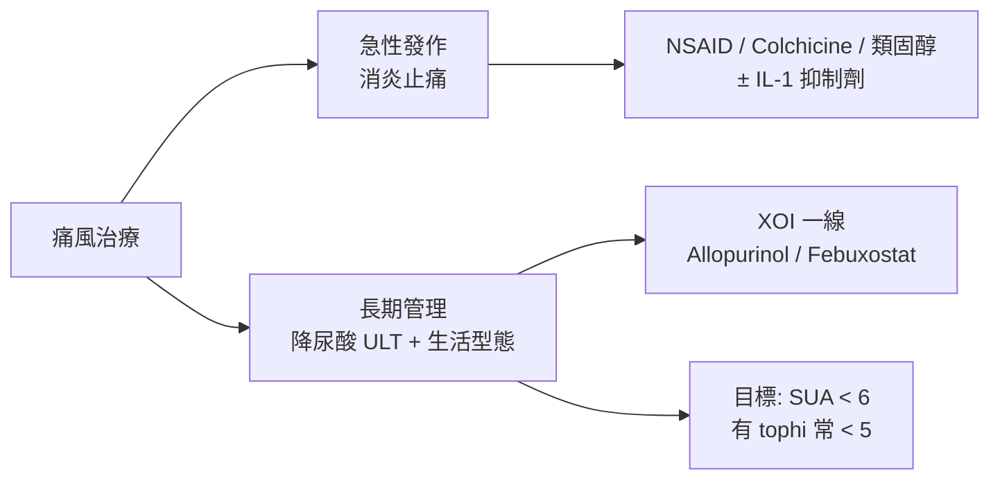

---
tags:
  - Med/臨床/immune
  - Gout
  - 痛風
  - hyperuricemia
  - rheumatology
aliases:
  - Gout
  - 痛風
  - 痛風性關節炎
  - Gouty arthritis
created: 2026-07-20
updated: 2026-07-20
source: 原 outline 補完；ACR／EULAR 臨床框架；圖：Wikimedia Commons
cssclass: clinical-note
status: 完整
---

# 痛風 Gout

> [!abstract] 一句話總覽
> **單鈉尿酸鹽（monosodium urate, MSU）結晶**沉積於關節／軟組織，反覆急性關節炎，久之形成 **tophus** 與侵蝕性關節病變。本質是 **高尿酸血症（hyperuricemia）** 長期過飽和後的結晶病；治療分 **急性消炎** 與 **長期降尿酸（urate-lowering therapy, ULT）** 兩軌，不可混為一談。

---

## 1. 定義與核心概念

| 項目 | 重點 |
|---|---|
| 本質 | **MSU crystal deposition disease**（結晶性關節炎） |
| 致病結晶 | **Monosodium urate（MSU）**；針狀、負雙折射（見 §4） |
| 必要背景 | 幾乎都有長期 **hyperuricemia**，但 **高尿酸 ≠ 痛風** |
| 急性表現 | 極痛的單／少關節炎（典型第一 MTP = **podagra**） |
| 慢性表現 | 反覆發作 → **tophaceous gout**、骨侵蝕、關節破壞 |

> [!warning] 兩個必分的概念
> - **Hyperuricemia**：血清尿酸過高（常見切點 **> 6.8 mg/dL** ≈ 溶解度極限；實驗室上限常寫 7.0）。是風險因子，**不是診斷痛風的充分條件**。
> - **Gout**：已有 **MSU 結晶相關臨床／影像／關節液證據** 的疾病狀態。多數高尿酸者終生不發作。

### 1.1 高尿酸怎麼來（機轉兩大類）

| 類型 | 機轉 | 常見情境 |
|---|---|---|
| **Underexcretion（多數，~90%）** | 腎／腸道排尿酸不足 | 原發性、CKD、利尿劑、低劑量 aspirin、酒精 |
| **Overproduction** | 嘌呤代謝↑、細胞轉換↑ | 腫瘤溶解、骨髓增殖（如 PV）、HGPRT 缺乏、高果糖／高嘌呤飲食 |

> [!tip] 記憶錨點
> 尿酸是 **嘌呤代謝終產物**（人類缺 uricase）。降尿酸藥分：**抑制生成（xanthine oxidase inhibitor, XOI）** vs **促進排泄（uricosuric）** vs **酵素分解（pegloticase）**。

---

## 2. 臨床分期與表現

*痛風臨床總覽圖（podagra、tophi 等）。Source: Wikimedia Commons / BruceBlaus (CC BY).*

### 2.1 自然病史（四階段）

1. **Asymptomatic hyperuricemia** — 僅血尿酸高，無症狀
2. **Acute gouty arthritis** — 急性發作（數小時達峰，極痛）
3. **Intercritical（interval）gout** — 發作間期看似正常，但關節內常仍有結晶
4. **Chronic tophaceous gout** — 結節、侵蝕、慢性關節病變

### 2.2 急性發作特徵

- **突發、極痛**（常夜間／清晨）；數小時內達巔峰
- **單關節最常見**；**第一 MTP（podagra）** 最經典
- 其他高頻部位：中足、踝、膝；上肢（腕、指）多見於久病／老年
- 紅、腫、熱、極度觸痛；可有低度發燒 → **務必與蜂窩性組織炎／化膿性關節炎鑑別**
- 未治療通常 **數天～2 週** 自行緩解（self-limited）

*急性痛風（podagra）：大趾 MTP 關節紅腫。Source: Wikimedia Commons / Doc James (CC BY-SA).*

*急性痛風亦可見於上肢小關節（久病／老年較常見）。Source: Wikimedia Commons.*

*痛風好發關節分布（第一 MTP 最經典）。Source: Wikimedia Commons / BruceBlaus (CC BY).*

> [!danger] 急症思維：Septics first
> 急性熱關節 = **感染性關節炎必須先排除**（尤其有發燒、風險因子、或診斷未確立）。關節抽液可同時做 **Gram stain／culture + 偏振光鏡檢結晶**。

### 2.3 Tophi（痛風石）

- 慢性 MSU 結晶聚集於軟組織／骨／關節
- 常見：耳廓、鷹嘴囊、指／趾伸側、跟腱、第一 MTP
- 可潰破排出白堊樣物質；影像上對應侵蝕與軟組織腫塊
- 代表 **結晶負荷高** → 幾乎一定需要 **積極 ULT**

[慢性 tophaceous gout：第一 MTP 痛風石：原始來源](https://commons.wikimedia.org/wiki/File:Tophaceous_gout_of_Lt_MTP_joint,_elder_female_patient,_Thailand.jpg)（畫面含手環文字，公開副本只保留來源連結。）
*慢性 tophaceous gout：左第一 MTP 明顯 tophus。Source: Wikimedia Commons.*

*肘部（鷹嘴囊）tophi——慢性痛風經典部位之一。Source: Wikimedia Commons.*

*雙手多發 tophi 與關節變形。Source: Wikimedia Commons.*

---

## 3. 致病機轉 Pathogenesis

> [!info] 核心一句
> **MSU 結晶 → 先天免疫（innate immunity）活化 → NLRP3 inflammasome → IL-1β → 中性球主導的急性炎症**。

| 步驟 | 內容 |
|---|---|
| 1. 過飽和 | 長期 hyperuricemia → 組織液過飽和 → MSU 結晶沉積 |
| 2. 結晶釋出／暴露 | 溫度↓、pH 變化、創傷、脫水、尿酸快速升降 → 促發急性反應 |
| 3. 先天免疫 | 巨噬／單核球吞噬 MSU → **NLRP3 inflammasome** 活化 |
| 4. 效應 | **Caspase-1 → pro–IL-1β → IL-1β**；趨化中性球；補體、NETs 參與 |
| 5. 自限 | 吞噬後結晶「包被」、抗炎介質↑、細胞凋亡 → 發作可自行緩解 |

**誘發因子（急性發作）**

- 酒精（尤其啤酒）、高嘌呤大餐、果糖飲料
- **利尿劑**、住院／手術、創傷、脫水
- **開始或調整 ULT 初期**（尿酸波動可「動到」結晶）→ 故啟動 ULT 常需 **預防性 colchicine／低劑量抗炎**

> [!tip] 為何腳趾？
> 末梢關節 **溫度較低** → 尿酸溶解度下降 → MSU 較易析出（podagra 的物理化學基礎）。

---

## 4. 診斷 Diagnosis

### 4.1 金標準

**關節液（或 tophus 吸出物）偏振光顯微鏡：針狀 MSU 結晶，強負雙折射（negatively birefringent）**  
（相對：CPPD 為菱形／棒狀、弱正雙折射 → 假性痛風）

| 結晶 | 形狀 | 雙折射 | 疾病 |
|---|---|---|---|
| **MSU** | 針狀 needle | **負**（黃／藍依方位） | 痛風 |
| **CPPD** | 菱形 rhomboid | **弱正** | 假性痛風／CPPD 病 |

*偏振光顯微鏡：針狀 monosodium urate（MSU）結晶——診斷金標準。Source: Wikimedia Commons (CC BY).*

*Tophus 壓片光學顯微鏡可見尿酸結晶。Source: Wikimedia Commons / Mikael Häggström (CC0).*

### 4.2 影像 Imaging

| 模态 | 特徵 | 臨床用途 |
|---|---|---|
| **Ultrasound** | **Double contour sign**（軟骨表面高回聲線）；tophus 低回聲／異質腫塊；power Doppler 活動性炎症 | 床邊、無輻射；支持結晶沉積 |
| **Dual-energy CT（DECT）** | 依原子序區分 **尿酸結晶** vs 鈣 | 非侵入性確認 MSU 沉積；tophi 負荷評估 |
| **X-ray** | 晚期：**overhanging edge erosions**、軟組織腫塊（tophus）、關節旁骨質破壞；早期常正常 | 分期／鑑別；不敏感於早期 |
| MRI | 非特異性滑膜炎、骨侵蝕、tophus | 較少作第一線痛風診斷 |

*超音波教學圖：軟骨表面 double contour 等痛風相關徵象。Source: Wikimedia Commons / Mikael Häggström (CC0).*

*足部 X 線：痛風性骨侵蝕／關節旁破壞（晚期較明顯）。Source: Wikimedia Commons / Mikael Häggström (CC0).*

*手部 X 線：慢性痛風性侵蝕與關節破壞。Source: Wikimedia Commons / Mikael Häggström (CC0).*

> [!note] Double contour sign
> 軟骨表面「雙輪廓」高回聲 = 軟骨上 MSU 沉積的超音波徵象，對痛風有高度特異性（仍非 100% 取代結晶證實）。

### 4.3 實驗室 Lab

| 項目 | 重點 |
|---|---|
| **Serum uric acid（SUA）** | 發作**當下可正常甚至偏低**（急性期尿酸可下降）→ **不能靠單次正常排除痛風**；發作間期再測更有意義 |
| 關節液 | 白細胞常 **數萬**（中性球為主），外觀可似感染 → **一定要送培養** |
| CBC／CRP／ESR | 急性期升高；非特異性 |
| 腎功能、肝功能 | 用藥前必查（NSAID、colchicine、ULT 劑量） |
| 24h 尿酸排泄（選做） | 區分 overproducer vs underexcretor；決定 uricosuric 是否合適 |

### 4.4 分類標準（臨床／研究用）

**ACR／EULAR 2015 gout classification criteria**（分類 ≠ 嚴格臨床診斷 checklist，但考試／研究常用）：

| 面向 | 加分方向（概念） |
|---|---|
| 臨床 | 發作型態（突發、極痛、紅腫、≤1 天達峰、自行緩解）、**第一 MTP**、tophus |
| 實驗室 | **關節液 MSU+**（可直接歸入；權重最高）、SUA 水平 |
| 影像 | 超音波 double contour、DECT 尿酸沉積、X 線典型侵蝕 |

> [!warning] 臨床實務
> 能抽液就抽液（結晶 + 排感染）。不能抽時：典型病史 + 高尿酸 ± 影像（US／DECT）可高度懷疑並先治療，但保留「仍可能是 sepsis／CPPD／其他」的警戒。

---

## 5. 鑑別 Diagnosis 鑑別

| 疾病 | 如何分開 |
|---|---|
| **感染性關節炎** | 培養；風險（注射藥、免疫抑制、人工關節）；可併存！ |
| **CPPD／假性痛風** | 結晶形態與雙折射；好發膝／腕；常伴軟骨鈣化 |
| **蜂窩性組織炎** | 以皮膚／軟組織為主；關節活動相對保留（但可難分） |
| **外傷／骨折** | 病史、影像 |
| **血清陰性脊椎關節炎、RA** | 病程、血清學、影像分布不同；慢性痛風可 mimic |
| **其他結晶** | 極少見（oxalate 等） |

---

## 6. 治療 Treatment

治療永遠分兩條軌道：

### 6.1 急性發作 Acute flare

> [!tip] 原則
> **愈早愈好**（症狀出現後愈快用藥效果愈好）。三線抗炎藥效力相近，依 **共病、腎肝功能、藥物交互** 選一種（或必要時併用）。

| 藥物 | 要點 | 注意 |
|---|---|---|
| **NSAID** | 足量、短程（如 naproxen、indomethacin 等） | 避開：CKD、心衰、活動性潰瘍、抗凝高風險 |
| **Colchicine** | **低劑量方案**：例如 1.2 mg 後 1 小時再 0.6 mg（之後每日預防劑量依規）；**早用有效** | **CYP3A4／P-gp 抑制劑**（clarithromycin、某些 azole、cyclosporine 等）→ 毒性；**嚴重腎／肝損**慎用或禁用；腹瀉常見 |
| **Corticosteroids** | 口服（如 prednisone 短程）、關節內注射（單關節且已排除感染）、或 IM | 感染未排除勿關節內注射；糖尿病血糖波動 |
| **IL-1 抑制劑**（anakinra 等） | 難治／上述皆禁忌時 | 昂貴、感染風險；非第一線 |

**輔助**

- 休息、冰敷、充足水分
- 急性期**不必**為了「先降尿酸」而加 ULT；若 **已在吃 ULT → 繼續吃、不要停**（停藥反而波動誘發）

### 6.2 何時開始降尿酸 ULT

常見適應（臨床／指引精神）：

- 反覆發作（如 ≥2 次／年）
- **Tophi**、影像證實結晶負荷／慢性痛風性關節病
- 痛風合併 **CKD stage ≥2**、尿酸結石、或尿酸明顯過高（依指引閾值）
- 部分情境：首次發作但高危（tophus、CKD、SUA 極高等）可考慮早期 ULT

### 6.3 長期降尿酸 Urate-lowering therapy

| 藥物 | 機轉 | 重點 |
|---|---|---|
| **Allopurinol** | XOI（一線首選） | **從低劑量開始**（尤其 CKD），逐步上調至達標；注意 **HLA-B\*5801**（華人／東南亞高風險）→ 嚴重皮膚反應（SJS／TEN／DRESS）風險，高風險族群考慮篩檢 |
| **Febuxostat** | 選擇性 XOI | Allopurinol 不耐／無效時；**心血管病史**者需謹慎（部分試驗示 CV 風險訊號） |
| **Probenecid** 等 uricosuric | 促腎排尿酸 | 需足夠腎功能、非 overproducer、無尿路結石史為佳；多喝水 |
| **Pegloticase** | 重組 uricase | **難治性 tophaceous gout**；快速降尿酸；注意輸液反應、G6PD |

**治療目標（treat-to-target）**

| 情境 | 目標 SUA |
|---|---|
| 一般痛風 | **< 6 mg/dL**（< 360 µmol/L） |
| 有 tophi／高負荷 | 常目標 **< 5 mg/dL**，至 tophi 溶解 |

> [!warning] 啟動 ULT 的「防爆」
> 降尿酸初期易誘發急性發作 → **預防性抗炎**（常用 **低劑量 colchicine** 3–6 個月，或低劑量 NSAID／類固醇依情況）。**達標後維持 ULT**，通常是長期甚至終身。

### 6.4 生活型態與共病

- **減重**（若過重）、規律運動；避免暴飲暴食
- 限制：**啤酒／烈酒**、含糖飲料（果糖）、內臟等高嘌呤食物
- 鼓勵：充足水分；低脂乳製品可能有保護效應
- 積極處理 **代謝症候群、高血壓、CKD、高血脂**
- 複核用藥：噻嗪類／loop 利尿劑、低劑量 aspirin 等對尿酸的影響（權衡原適應症，勿隨便停）

### 6.5 無症狀高尿酸血症

- **一般不為「降數字」而用 ULT**（除非特定高危／腫瘤溶解預防等情境）
- 重點：生活型態、找次發原因、心血管與腎風險管理

---

## 7. 考試／臨床速查卡

| 主題 | 一句話 |
|---|---|
| 結晶 | MSU、針狀、**負雙折射** |
| 典型關節 | **第一 MTP（podagra）** |
| 影像口訣 | US **double contour**；X 線 **overhanging edge**；**DECT** 見尿酸 |
| 急性三選一 | **NSAID / colchicine / steroid** |
| 長期一線 | **Allopurinol**（低起慢加、HLA-B\*5801） |
| 目標 | SUA **< 6**（tophus 常 **< 5**） |
| 陷阱 | 發作時 SUA 可正常；高尿酸 ≠ 痛風；先排除 **septic arthritis** |

---

## 相關連結

- （免疫／風濕分類待建）可連至結晶性關節炎、CPPD、高尿酸血症
- [[PV]] — 骨髓增殖可致高尿酸／痛風
- 腫瘤溶解症候群（TLS）— 大量細胞崩解 → 急性高尿酸（內科急症，路徑不同）

---

## 圖檔來源（Wikimedia Commons）

| 檔名 | 內容 | 來源頁 |
|---|---|---|
| `assets/gout-podagra.jpg` | 急性第一 MTP（podagra） | [Gout2010.JPG](https://commons.wikimedia.org/wiki/File:Gout2010.JPG) |
| `assets/gout-acute-hand.jpg` | 急性手部痛風 | [Acute gout.jpg](https://commons.wikimedia.org/wiki/File:Acute_gout.jpg) |
| `assets/gout-joints-affected.jpg` | 好發關節示意 | [Joints affected by gout.jpg](https://commons.wikimedia.org/wiki/File:Joints_affected_by_gout.jpg) |
| `assets/gout-tophaceous-mtp.jpg` | MTP tophus | [Tophaceous gout of Lt MTP…](https://commons.wikimedia.org/wiki/File:Tophaceous_gout_of_Lt_MTP_joint,_elder_female_patient,_Thailand.jpg) |
| `assets/gout-tophi-elbow.jpg` | 肘 tophi | [GoutTophiElbow.JPG](https://commons.wikimedia.org/wiki/File:GoutTophiElbow.JPG) |
| `assets/gout-tophaceous-hands.jpg` | 雙手 tophi | [Tophaceous gout.jpg](https://commons.wikimedia.org/wiki/File:Tophaceous_gout.jpg) |
| `assets/gout-msu-crystals-polarized.jpg` | 偏振光 MSU | [Gout - Sodium Urate Crystals - Polarized](https://commons.wikimedia.org/wiki/File:Gout_-_Sodium_Urate_Crystals_-_Polarized_(49274750631).jpg) |
| `assets/gout-urate-tophus-microscopy.jpg` | Tophus 壓片結晶 | [Light microscopy…urate crystals](https://commons.wikimedia.org/wiki/File:Light_microscopy_of_a_touch_preparation_of_a_gout_tophus,_showing_urate_crystals.jpg) |
| `assets/gout-us-signs.jpg` | 超音波徵象 | [Gout signs ultrasound.jpg](https://commons.wikimedia.org/wiki/File:Gout_signs_ultrasound.jpg) |
| `assets/gout-xray-foot.jpg` | 足 X 線 | [Foot radiography gout.jpg](https://commons.wikimedia.org/wiki/File:Foot_radiography_gout.jpg) |
| `assets/gout-xray-hand.jpg` | 手 X 線 | [Hand radiography gout.jpg](https://commons.wikimedia.org/wiki/File:Hand_radiography_gout.jpg) |
| `assets/gout-signs-symptoms.jpg` | 症狀總覽圖（備用） | [Gout Signs and Symptoms.jpg](https://commons.wikimedia.org/wiki/File:Gout_Signs_and_Symptoms.jpg) |

> 圖片來自 [Wikimedia Commons · Category:Gout](https://commons.wikimedia.org/wiki/Category:Gout)，多為 CC BY / CC BY-SA / CC0；本地已縮圖至約 1200px 以利筆記閱讀。
