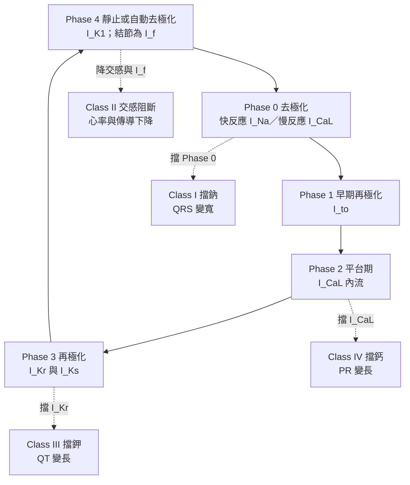

---
tags:
  - Med/Drug/Cardio
  - antiarrhythmic
  - 禁忌
aliases:
  - Antiarrhythmics
  - 抗心律不整藥
  - Vaughan Williams
  - Amiodarone
  - Lidocaine
  - Mexiletine
  - Flecainide
  - Propafenone
  - Procainamide
  - Quinidine
  - Disopyramide
  - Sotalol
  - Dofetilide
  - Ibutilide
  - Dronedarone
  - Adenosine
  - Digoxin
created: 2026-07-27
updated: 2026-07-28
status: 可用
source: 114-1 醫學(三) 9、10、115-2 醫學(三) 7、12 延伸；2022 ESC 與 2017 AHA/ACC/HRS 心室性心律不整指引；2023 ACC/AHA 心房顫動指引；各藥仿單
cssclass: clinical-note
drug_class: 抗心律不整藥（Vaughan Williams I–IV ＋ 分類外的 adenosine、digoxin、magnesium、ivabradine）
indication:
  - "[[Atrial fibrillation]]"
  - "[[Ventricular tachycardia]]"
  - "[[HCM]]"
adverse_effect:
  - 促心律不整 proarrhythmia
  - QT 延長與 torsades de pointes
  - 心搏過緩與房室阻斷
contraindication:
  - "Class Ic 用於結構性心臟病"
  - "房室結阻斷劑用於預激性心房顫動"
---

# Antiarrhythmics ｜ 抗心律不整藥 · Vaughan Williams 分類

> [!abstract] 一句話總覽
> 這一類藥全部作用在**心臟動作電位（action potential）的某一相**上，所以整套分類其實是「**這個藥擋掉哪一段電流**」的分類：**Class I 擋 Na⁺（改變 Phase 0 → 影響 QRS）、Class III 擋 K⁺（拉長 Phase 3 → 影響 QT）、Class IV 擋 L-type Ca²⁺（作用在結節 → 影響 PR 與心率）、Class II 擋交感（改變 Phase 4 的自律性）**。把離子與相位對上，心電圖變化與副作用都能推出來——**唯一推不出、只能背的是 Class Ib 反向縮短動作電位時程**。而真正降低死亡率的只有 **Class II（beta-blocker）**，其餘多半只減少發作次數。

> [!tip] 開藥速查
> **急性終止**：AVNRT／AVRT → **adenosine 6 mg 快推**｜穩定單型性心室頻脈 → **procainamide** 或 **amiodarone 150 mg／10 分鐘**｜torsades → **硫酸鎂 1–2 g**｜**預激性心房顫動 → procainamide 或 ibutilide**（房室結阻斷劑全禁，**靜脈 amiodarone 同樣禁**）
> **心率控制**：beta-blocker、非二氫吡啶類鈣離子阻斷劑（verapamil、diltiazem）、digoxin
> **節律控制（口服）**：無結構性心臟病 → flecainide／propafenone／dronedarone／sotalol｜有結構性心臟病或心衰竭 → **amiodarone、dofetilide**
> **絕對不可**：**結構性心臟病用 Class Ic**｜**未定性的寬 QRS 心搏過速給 verapamil**｜**心肌梗塞後預防性給 lidocaine、高劑量 amiodarone 或 Class Ic**（beta-blocker 是唯一例外）｜**氣喘給 adenosine**

---

## 心臟動作電位與離子電流

整篇藥理都掛在這張圖上。要先分清楚兩件事：**誰在載流**（構成動作電位本身的通道電流），**誰只是在旁邊維持條件**（幫浦與交換器撐住梯度、電解質調節通道行為）。這一層分不開，後面的藥理就全歪。

### 快反應細胞（心房肌、心室肌、Purkinje 纖維）

| 相 | 發生什麼 | **主導電流** |
|---|---|---|
| **Phase 0** | 快速去極化（上升支陡） | **I_Na**（快速鈉內流） |
| **Phase 1** | 早期再極化的小凹 | **I_to**（瞬時外向鉀流，另有 Cl⁻ 成分） |
| **Phase 2** | 平台期 | **I_CaL 內流 ↔ 鉀外流**互相抵銷 |
| **Phase 3** | 再極化——**決定 QT 長度** | **I_Kr**（快速）、**I_Ks**（緩慢） |
| **Phase 4** | 靜止膜電位約 **−85 ～ −90 mV**、穩定不漂移 | **I_K1**（內向整流鉀流） |

### 慢反應細胞（竇房結 sinoatrial node、房室結 atrioventricular node, AV node）

| 差異 | 慢反應細胞 |
|---|---|
| **Phase 0 由誰負責** | **I_CaL——不是 I_Na**（此處快鈉通道多處於失活狀態）→ 上升支慢、傳導慢 |
| **Phase 4** | **沒有穩定靜止電位**：**I_f（funny current，HCN 通道的 Na⁺ 內流）** ＋ T-type Ca²⁺ 造成**自動舒張期去極化** |
| Phase 1、2 | **沒有**明顯的 Phase 1 與平台期 |
| 最大舒張電位 | 約 **−60 mV**（因為 **I_K1 極少**） |
| 藥理意義 | **Class II 與 Class IV 主要作用在這裡**；Class I 幾乎不影響結節 |

> [!tip] 「直接參與」與「只是有影響」是兩件事
> **載流的主角**：I_Na、I_CaL、I_to、I_Kr／I_Ks、I_K1、I_f——它們構成動作電位本身。
> **只是在旁邊維持條件的**：**Na⁺/K⁺-ATPase**（3 Na⁺ 出／2 K⁺ 入，撐住梯度，**不構成上升支**——digoxin 打的就是它）、**Na⁺/Ca²⁺ exchanger（NCX）**（3 Na⁺ 入／1 Ca²⁺ 出；鈣過載時產生延遲後去極化的內向電流，但不是動作電位的組成）、**Mg²⁺**（阻斷 L-type Ca²⁺ 通道、穩定膜，**不載任何一相的電流**）。
> 所以 **Mg²⁺ 不直接參與動作電位，卻是 torsades de pointes 的首選治療**——同一個離子在「組成」與「治療」兩個層次的地位完全相反。

> [!info] 動作電位怎麼變成心電圖
> **心室肌 Phase 0 的總和 ＝ QRS**（擋 Na⁺ → **QRS 變寬**）；**Phase 2–3 ＝ ST-T**，**動作電位時程 action potential duration (APD) ≈ QT**（擋 K⁺ → **QT 變長**）；**房室結傳導 ＝ PR**（擋 Ca²⁺ 或交感 → **PR 變長**）。抗心律不整的核心手法則是拉長**有效不應期 effective refractory period (ERP)**，讓折返的波前撞上還在不應期的組織。

![[assets/cardiac-action-potentials.svg|960]]
*心室肌與竇房結動作電位對照。心室肌 Phase 0 由 I_Na 主導、Phase 2 為 I_CaL 與 outward K⁺ currents 平衡、Phase 3 由 I_Kr／I_Ks 再極化、Phase 4 由 I_K1 維持約 −85 mV；竇房結沒有 Phase 1、2，Phase 4 以 I_f／I_CaT 自發去極化，Phase 0 改由 I_CaL 主導，最大舒張電位約 −60 mV。依 [Cardiac action potential and antiarrhythmic drugs](https://pmc.ncbi.nlm.nih.gov/articles/PMC3623268/) 與 [The sinoatrial node current puzzle](https://pmc.ncbi.nlm.nih.gov/articles/PMC4711507/) 重繪。*

## 機轉 Mechanism｜Vaughan Williams 分類

### Class I：擋 Na⁺，靠「解離動力學」再分三支

三支的差別不在擋得多不多，而在**藥物從鈉通道解離的速度**。解離愈慢，下一次心跳來時卡著的藥愈多 → 傳導愈慢 → QRS 愈寬。

| 支 | 解離速度 | 對 **APD／QT** | 對 **QRS** | 代表藥 | 一句話 |
|---|---|---|---|---|---|
| **Ia** | **中等**（1–10 秒） | **延長**（兼擋 **I_Kr**） | 增寬 | **quinidine、procainamide、disopyramide** | 一手擋鈉一手擋鉀 → **QRS 與 QT 都長** |
| **Ib** | **快**（＜1 秒） | **縮短**（擋晚期／窗電流 Na⁺） | 幾乎不變 | **lidocaine、mexiletine** | **全類唯一縮短 APD**；只在心室有效 |
| **Ic** | **慢**（＞10 秒） | 幾乎不變 | **增寬最多** | **flecainide、propafenone** | 傳導慢得最兇 → **促心律不整最兇** |

> [!tip] 使用依賴性（use-dependence）是 Class I 的共同特性，也解釋了 Ib 的選擇性
> 藥物偏好結合在**開啟或失活狀態**的鈉通道，所以**心跳愈快、組織愈去極化（缺血），被擋掉的通道就愈多**——藥自己會挑「有問題的組織與有問題的心跳」下手。
> **Ib 解離最快**，正常心率的正常心肌來不及被擋住，只在**缺血、去極化、心跳快**的心室組織顯效。這一句同時解釋三件事：**lidocaine 對心房性心律不整無效**（心房 APD 短，藥還沒結合就解離了）、**它在心肌缺血時最有用**、**它不加寬正常人的 QRS**。

> [!danger] Class Ic 的促心律不整：CAST 的教訓寫在藥理裡
> Class Ic **大幅減慢傳導卻不延長不應期**——折返路徑變慢、波長變短，等於替折返鋪路，在**疤痕或缺血心肌**上尤其致命。**CAST** 用 flecainide／encainide 成功壓制了心肌梗塞後的心室早期收縮，**總死亡率反而上升**，試驗提前中止。
> 第二個獨立陷阱：Class Ic 會把心房顫動**整流成較慢的心房撲動**，慢下來的心房率反而能 **1:1 下傳**，心室率暴衝——所以做節律控制時**必須同時給房室結阻斷劑**。
> 第三：flecainide／ajmaline／procainamide 會**誘發出 Brugada 型心電圖**，在診斷是藥物激發試驗，在已知病人身上是禁忌（見 [[Inherited arrhythmia syndromes]]）。

### Class II、III、IV 與分類外的四個主力

| 類 | 標的 | 心電圖方向 | 代表藥 | 重點 |
|---|---|---|---|---|
| **II** | **β 受體** → cAMP↓ → I_f 與 I_CaL 間接下降 | **PR ↑**、心率 ↓；QRS 與 QT 不變 | esmolol、metoprolol、bisoprolol、propranolol、carvedilol（見 [[Beta blocker]]） | **唯一被證實降低死亡率與猝死的一類**；靜脈首選 **esmolol 500 µg/kg 推注 1 分鐘 → 50–200 µg/kg/min**，**半衰期約 9 分鐘**，最適合不確定耐受度時試打 |
| **III** | **I_Kr 為主**（sotalol 兼 β 阻斷、amiodarone 跨四類） | **QT ↑↑** | amiodarone、**sotalol**、**dofetilide**、ibutilide、dronedarone | **反向使用依賴性**（見下）；**torsades 高風險的是 sotalol、dofetilide、ibutilide；amiodarone 與 dronedarone 雖延長 QT，torsades 發生率都很低** |
| **IV** | **L-type Ca²⁺（結節為主）** | **PR ↑**、心率 ↓ | **verapamil、diltiazem**（非二氫吡啶類） | **負性肌力** → **HFrEF 禁用**；verapamil 的負性肌力與便秘比 diltiazem 明顯 |
| **分類外** | 各自不同 | 依機轉 | **adenosine**（A1 受體 → 開 I_KACh、抑制 cAMP）、**digoxin**（Na⁺/K⁺-ATPase ＋ 迷走張力）、**Mg²⁺**、**ivabradine**（純擋 **I_f**，新版分類列為 **Class 0**） | 房室結阻斷有四條路：adenosine、digoxin、Class II、Class IV |

> [!warning] 反向使用依賴性（reverse use-dependence）——推不出來，只能背
> **Class III 的 APD 延長效果在心率「慢」的時候最強、心跳快的時候反而弱。** 兩個後果剛好都是壞的：① 真正需要它的**快速心律不整**當下效果打折；② 心搏過緩、長間歇、早搏後的代償間歇之後 QT 拉到最長 → **torsades 就在這時發動**（典型的 short–long–short 序列）。
> **amiodarone 是明顯的例外**：它同時阻斷多種通道、反向使用依賴性弱、不增加跨心壁再極化離散度，所以 **QT 明顯延長但 torsades 發生率 ＜1%**。

## Amiodarone

> [!abstract] 為什麼它自成一節
> 它**同時具備四類作用**：**Class III**（擋 I_Kr、I_Ks，主作用）＋ **Class I**（擋失活態 Na⁺ 通道）＋ **Class II**（非競爭性 α／β 阻斷）＋ **Class IV**（擋 L-type Ca²⁺）——這既解釋了「什麼心律不整都能用」，也解釋了「什麼器官都會傷」。藥動同樣異常：**高度親脂、分布體積約 60 L/kg、半衰期 40–55 天**，所以**必須先負荷**，而且**停藥後數週到數月仍有藥效與交互作用**。

| 情境 | 劑量 |
|---|---|
| **口服負荷（心室性心律不整，美國仿單）** | **800–1600 mg／日分次 × 1–3 週**（累積約 10 g）→ **600–800 mg／日 × 約 1 個月** → 維持 **400 mg/日** |
| **口服負荷（心房顫動）** | 劑量低得多：**600 mg／日 × 約 4 週 → 200 mg／日維持**（台灣常見寫法：**600 → 400 → 200 mg 各 1–2 週**） |
| **口服維持** | **200–400 mg QD**（心房顫動多用 200 mg、心室性心律不整常用 400 mg）——用**能控制住的最低劑量** |
| **靜脈（穩定 VT／急性）** | **150 mg／10 分鐘** → **1 mg/min × 6 小時** → **0.5 mg/min × 18 小時**（24 小時上限約 **2.2 g**） |
| **靜脈（無脈搏 VT／VF）** | **300 mg 靜脈推注**，必要時再 **150 mg** |
| **腎功能不良** | **不需依腎調整**（肝膽排除）——這是它在透析病人的優勢，見 [[Dialysis]] |

### 器官毒性與追蹤時程

| 系統 | 表現 | 追蹤 |
|---|---|---|
| **肺（最可怕）** | 間質性肺炎、肺纖維化、急性呼吸窘迫；**乾咳 ＋ 漸進性喘 ＋ DLCO 下降** | **基線胸部 X 光 ＋ 肺功能含 DLCO**；之後**胸部 X 光每年一次**；**一有呼吸道症狀立刻重做影像與 PFT** |
| **甲狀腺** | **低下較常見**；亢進分兩型——**Type 1**（碘誘發合成過量，本有甲狀腺病）用抗甲狀腺藥、**Type 2**（破壞性甲狀腺炎）用**類固醇** | **基線 TSH ＋ free T4**，之後**每 6 個月** |
| **肝** | 轉胺酶上升常見；肝炎與肝硬化罕見 | **基線 AST／ALT**，之後**每 6 個月**；**＞3 倍正常上限要停藥** |
| **眼** | **角膜微沉積（corneal verticillata）幾乎人人都有**，多半無症狀或只有光暈——**不是停藥理由**；**視神經病變罕見但可致盲——要停藥** | **只有本來就有視力異常者才做基線眼科評估**；**之後不需常規定期檢查，出現視力症狀才轉眼科（含 slit lamp）** |
| **皮膚／神經** | 光敏感、日曬部位**藍灰色沉著**（與累積劑量相關）；周邊神經病變、失調、震顫 | 防曬衛教 ＋ 病史詢問，無需常規檢驗 |

> [!info] 一句話記住追蹤節奏
> **「半年抽血、一年照相、症狀導向的眼與肺。」**——**TSH ＋ free T4 與 AST／ALT 每 6 個月**、**胸部 X 光與心電圖每年**；**肺功能（含 DLCO）基線做一次、之後出現不明咳嗽或呼吸困難才重做**；**眼科不常規定期做，有視力症狀才轉診**。

| 交互作用 | 機轉 | 處理 |
|---|---|---|
| **Warfarin** | 抑制 **CYP2C9** → INR 上升（起效延遲數天至數週、停藥後仍持續） | **warfarin 減量約 30–50%**，起始後密集追 INR（見 [[Warfarin]]） |
| **Digoxin、[[DOAC]]** | 抑制 **P-glycoprotein** → digoxin 濃度約加倍、DOAC 濃度上升 | **digoxin 減半**並追濃度；DOAC 依仿單減量或換藥 |
| **Statin** | 抑制 **CYP3A4** → 肌病變／橫紋肌溶解 | **simvastatin 上限 20 mg／日、lovastatin 上限 40 mg／日**；改用不走 CYP3A4 的 pravastatin／rosuvastatin（見 [[Statin]]） |
| beta-blocker、非二氫吡啶類 CCB | 加成的心搏過緩與房室阻斷 | 減量、監測心率 |

## QT 延長：一群同向、一個反向

| 方向 | 誰 |
|---|---|
| **延長 QT** | **Class Ia**（quinidine、procainamide、disopyramide）、**Class III**（amiodarone、sotalol、ibutilide、dofetilide、dronedarone）；非心臟藥：巨環類與氟喹諾酮類抗生素、azole 抗黴菌藥、haloperidol／ziprasidone／三環抗憂鬱劑／citalopram、ondansetron、methadone、hydroxychloroquine、arsenic trioxide；**低血鉀（見 [[Hypokalemia]]）、低血鎂、低血鈣** |
| **縮短 QT** | **Class Ib（lidocaine、mexiletine）**、**digoxin**、**高血鈣** |

> [!warning] 只要問一句「它擋不擋 I_Kr」，QT 的答案就出來了
> **Class III 一定擋、Class Ia 會擋、Class Ib／Ic 與 Class II、IV 基本上不擋。**
> **digoxin 不但不延長 QT，還縮短它**——典型的「digoxin effect」是**杓狀 ST 段壓低 ＋ T 波變平或倒置 ＋ QT 縮短 ＋ U 波明顯**，而且這是**藥效表現、不等於中毒**。
> 另一組反直覺：**Class Ia 的 torsades 與劑量無關**（quinidine 可在治療濃度發生）；**劑量依賴的是 Class Ic 的促心律不整與 sotalol 的 QT 延長**。

## 適應症與選藥邏輯

> [!tip] 三個問題就把藥選完
> **① 心房還是心室？** 心房的節律控制靠 **Class Ic 與 Class III**（dofetilide、ibutilide 幾乎是心房專用）；**lidocaine 對心房完全無效**，心室才是它的地盤。
> **② 有沒有結構性心臟病？** 這一題只決定一件事：**Class Ic 能不能用**——有就不能用，改 amiodarone／sotalol／dofetilide。
> **③ 急性終止還是長期維持？** 急性靠靜脈（adenosine、procainamide、amiodarone、ibutilide、Mg²⁺），長期靠口服；而且**長期用藥的目標多半是減少發作次數與症狀，不是延長壽命**。
> 附帶一條決定 **adenosine 有沒有用**的規則：**房室結在折返環路內才會被它終止**（AVNRT／AVRT 會停；心房撲動與心房顫動只是把心房波露出來）。

| 情境 | 用藥角色 |
|---|---|
| **心率控制**（細節見 [[Atrial fibrillation]]） | **beta-blocker** 或**非二氫吡啶類 CCB** 為主力；**HFrEF 或低血壓改 digoxin／amiodarone**；digoxin 只壓休息心率、對運動時心率效果差 |
| **節律控制（心房）** | 無結構性心臟病：flecainide、propafenone、dronedarone、sotalol｜結構性心臟病或 [[Heart failure]]：**amiodarone、dofetilide**｜急性藥物轉律：**ibutilide**（靜脈）、口袋藥 flecainide／propafenone |
| **[[Ventricular tachycardia]]** | 急性穩定：procainamide 或 amiodarone｜長期：**[[Beta blocker]] ＋ [[ICD]]**；amiodarone／sotalol **減少發作與放電、不改善存活**；mexiletine 常作為加成用藥 |
| **[[HCM]]** | **disopyramide** 靠最強的負性肌力**降低左心室流出道壓力差**——Class Ia 罕見的「拿副作用當療效」 |
| **[[Inherited arrhythmia syndromes]]** | **quinidine**（擋 I_to）用於 Brugada 與短 QT；**mexiletine**（擋晚期鈉電流）用於 LQT3；**beta-blocker** 是 LQT1／LQT2 與 CPVT 的骨幹 |

## 劑量與用法

### 靜脈（急性）

| 藥 | 劑量 | 關鍵陷阱 |
|---|---|---|
| **Adenosine** | **6 mg 快速推注 ＋ 立刻沖 20 mL 生理食鹽水**；無效可 **12 mg**（仿單允許再一次 12 mg；**2020 AHA ACLS 只列兩劑**） | **仿單禁忌：第二度／第三度房室阻斷、病竇症候群或症狀性心搏過緩（無節律器者）**；**支氣管痙攣性肺病（氣喘）應避免**；**半衰期 ＜10 秒**，必須大孔徑近心端靜脈快推；**心臟移植者或經中心靜脈給藥先減到 3 mg**；**dipyridamole／carbamazepine 增效需減量**、**theophylline／咖啡因拮抗需加量** |
| **Lidocaine** | **1–1.5 mg/kg 推注**，可每 5–10 分鐘追加 **0.5–0.75 mg/kg**（總量 ≤3 mg/kg）→ **1–4 mg/min** 維持 | **肝血流依賴**：心衰竭、肝病、老年、併用 cimetidine 都要減量；毒性是**中樞性**——口周麻、耳鳴、視覺模糊、抽搐 |
| **Procainamide** | **20–50 mg/min**，直到終止／低血壓／**QRS 增寬 ＞50%**／總量 **17 mg/kg** → **1–4 mg/min** 維持 | 低血壓、延長 QT；腎功能不良時活性代謝物 **NAPA**（本身具 Class III 作用）累積 |
| **Ibutilide** | **≥60 kg：1 mg 輸注 10 分鐘**，必要時 10 分鐘後再 1 mg；**＜60 kg：0.01 mg/kg** | **給藥後持續心電圖監測 ≥4 小時**；先把鉀鎂補足 |
| **Diltiazem／verapamil** | diltiazem **0.25 mg/kg（常用 20 mg）／2 分鐘**，15 分鐘後可 0.35 mg/kg → 5–15 mg/hr｜verapamil **2.5–5 mg／2 分鐘**可重複 | HFrEF 禁用；**未定性的寬 QRS 心搏過速絕對不給** |
| **Magnesium sulfate** | **1–2 g／15 分鐘**，必要時重複 | **torsades 不看血鎂濃度就給** |

### 口服（長期）

| 藥 | 劑量 | 關鍵限制 |
|---|---|---|
| **Sotalol** | **80 mg BID 起始**，可加至 120–160 mg BID | **依 CrCl 調「間隔」不是調劑量**：＞60 → q12h；**30–59 → q24h**；**10–29 → q36–48h**；**＜10 → 個別化（幾乎不用）**。最大總日劑量 320 mg。**心房顫動適應症另加：基線 QT ＞450 ms、血鉀 ＜4 mEq/L、氣喘禁用；舊版仿單並禁用於 CrCl ＜40**。**住院起始 ≥3 天** |
| **Dofetilide** | **125–500 µg BID**，依 **CrCl 與 QTc** 查表定劑量 | **CrCl ＜20 禁用**；**住院起始 3 天**；與 verapamil、cimetidine、trimethoprim、ketoconazole、hydrochlorothiazide **禁止併用**（濃度飆升） |
| **Flecainide** | **50–150 mg BID**；口袋藥單次 **200–300 mg** | **結構性心臟病禁用**；**必須併用房室結阻斷劑** |
| **Propafenone** | **150–300 mg TID**；口袋藥單次 **450–600 mg** | 同上；**本身有弱 β 阻斷作用** → 氣喘慎用；金屬味 |
| **Mexiletine** | **200 mg q8h 起始**，常用 200–300 mg q8h | 口服版的 lidocaine；噁心、震顫 |
| **Dronedarone** | **400 mg BID 隨餐** | **禁用：NYHA Class IV，或有症狀心衰竭且近期失代償需住院（FDA 仿單，ANDROMEDA）；AHA/ACC 心房顫動指引寫作 NYHA III–IV 或近 4 週內失代償。另禁用於永久型心房顫動（PALLAS）**；肝毒性 |
| **Digoxin** | **0.125–0.25 mg QD**（靜脈負荷 0.25 mg q6h 至總量 0.75–1.5 mg） | 心衰竭目標濃度 **0.5–0.9 ng/mL**；老年與腎功能不良要下修 |

> [!danger] Sotalol 與 dofetilide 的起始是一套硬規則
> **起始前**：矯正**低血鉀與低血鎂**、測**基線 QTc**（已延長就不能起始）、算 **CrCl** 定劑量。
> **起始時**：**住院連續心電圖監測**（sotalol ≥3 天或到穩態、dofetilide 3 天）——**多數 torsades 發生在最初 3 天**；**sotalol：每次加量後 2–4 小時測 QTc；QTc ≥500 ms 就減量、拉長間隔或停藥。dofetilide：基線 QTc ＞440 ms（心室傳導異常者 ＞500 ms）不得起始；第一劑後 2–3 小時測，較基線上升 ＞15% 或 ＞500 ms 就降一階；第二劑以後任何一次 QTc ＞500 ms 就直接停藥。**
> 兩個藥都**經腎排除**，腎功能一惡化就累積——腎功能是它們的命脈。

## 副作用 Adverse Effects

| 藥／類 | 招牌副作用 | 能從機轉推嗎 |
|---|---|---|
| **Class Ia** | quinidine：**cinchonism**（耳鳴、頭痛、視覺模糊）、腹瀉（最常見）、免疫性血小板低下、**抗膽鹼作用反而加快房室傳導**｜procainamide：**藥物誘發性紅斑性狼瘡**（慢乙醯化者風險高）、顆粒球缺乏症｜disopyramide：**最強負性肌力 ＋ 最強抗膽鹼**（口乾、尿滯留、青光眼惡化） | 部分（狼瘡只能背） |
| **Class Ib** | **中樞神經毒性**：口周麻、耳鳴、意識改變、抽搐；mexiletine 另有腸胃不適與震顫 | 可以 |
| **Class Ic** | **促心律不整（proarrhythmia）——全類共通，Ic 最兇**；另有視覺障礙、負性肌力；propafenone 有金屬味與支氣管痙攣 | 可以 |
| **Class III（除 amiodarone）** | **torsades de pointes**；sotalol 另有 beta-blocker 全套副作用；dronedarone 有肝毒性 | 可以 |
| **Amiodarone** | 見專節（肺／甲狀腺／肝／眼／皮膚／神經） | 部分 |
| **非二氫吡啶類 CCB** | 低血壓、心搏過緩、**便秘（verapamil）**、下肢水腫、負性肌力 | 可以 |
| **Adenosine** | **顏面潮紅、胸悶、瀕死感、數秒的短暫心搏停止**（會自行恢復）、**支氣管痙攣** | 可以 |

> [!danger] Digoxin 中毒
> | 面向 | 內容 |
> |---|---|
> | 誘因 | **低血鉀（最重要）**、低血鎂、高血鈣、腎功能惡化、脫水；**P-gp 抑制劑**（amiodarone、verapamil、quinidine、巨環類、itraconazole） |
> | 全身症狀 | 厭食、噁心嘔吐（最早）、**黃綠色視覺與光暈（xanthopsia）**、意識混亂 |
> | 心律不整 | **心房頻脈合併房室阻斷**（經典）、**雙向性心室頻脈**（近乎特徵性）、各級房室阻斷、加速性交界節律；**心房顫動卻出現規則而緩慢的心室率 → 想毛地黃中毒** |
> | 濃度 | 傳統治療範圍 0.8–2.0 ng/mL、心衰竭目標 **0.5–0.9**；**＞2.0 屬中毒範圍，但低血鉀時「治療濃度」也會中毒** |
> | 解毒 | **digoxin immune Fab（DigiFab）**：致命性心律不整、**急性中毒合併 K⁺ ＞5.0**、大量誤食或濃度極高時使用。**急性中毒的高血鉀不可給鈣**（傳統教學的「石頭心」顧慮），改用胰島素／葡萄糖 |

## 交互作用與監測

| 併用什麼 | 會發生什麼 | 怎麼處理 |
|---|---|---|
| **Amiodarone ＋ warfarin／digoxin／statin／[[DOAC]]** | CYP2C9、CYP3A4、P-gp 全被抑制 → 各自濃度上升 | 見 Amiodarone 專節的減量規則 |
| **兩種以上延長 QT 的藥** | QT 效應相加 → torsades | 併用前查 QTc、補鉀補鎂；能換就換 |
| **Verapamil／diltiazem ＋ beta-blocker** | 房室結雙重阻斷 → **高度房室阻斷、心搏停止** | **靜脈併用尤其危險**，避免 |
| **利尿劑造成低血鉀／低血鎂** | 同時放大 digoxin 毒性**與** QT 延長 | 最常見的可矯正誘因，見 [[Hypokalemia]] |
| **Adenosine ＋ dipyridamole／carbamazepine**；**＋ theophylline／咖啡因** | 前者增效 → 長時間心搏停止；後者競爭性拮抗 A1 受體 → 失效 | 前者**減到 3 mg 起**；後者需較高劑量或改用其他方式 |

**要追蹤的指標**：**心電圖的 QRS 與 QTc**（Class I 看 QRS、Class Ia／III 看 QTc）、**血鉀與血鎂**、**腎功能**（sotalol、dofetilide、procainamide、digoxin、flecainide）、**肝功能與甲狀腺功能**（amiodarone）、**digoxin 血中濃度**（給藥後 ≥6–8 小時採檢）

## 特殊族群

| 族群 | 注意事項 |
|---|---|
| **孕婦／哺乳** | **adenosine 是孕期室上頻脈的首選**；digoxin、metoprolol、propranolol、flecainide、sotalol 使用經驗較多；**amiodarone 應避免**（胎兒甲狀腺功能低下、生長遲滯、神經毒性） |
| **老年** | digoxin 依肌肉量與腎功能**下修**；lidocaine 因肝血流下降要減量；**sotalol／dofetilide 的風險隨腎功能下降陡升** |
| **腎衰竭／[[Dialysis]]** | **依 CrCl 調量或禁用**：sotalol、dofetilide、digoxin、procainamide（NAPA）、flecainide；**amiodarone 不需依腎調整** |
| **肝功能不良** | **lidocaine、propafenone、amiodarone 減量**（lidocaine 最敏感，心衰竭造成肝血流下降時同樣要減） |
| **兒童** | adenosine **0.1 mg/kg（上限 6 mg）** → 無效改 **0.2 mg/kg（上限 12 mg）** |
| **氣喘／慢性阻塞性肺病** | 避開 **adenosine** 與非選擇性 beta-blocker（propranolol、sotalol、carvedilol）；propafenone 也有弱 β 阻斷作用 |

## 禁忌與陷阱

> [!danger] 絕對不可
> | 情境 | 絕對不可 | 為什麼 | 該做什麼 |
> |---|---|---|---|
> | **結構性心臟病**（心肌梗塞後、[[Heart failure]]、明顯左心室肥厚、[[CAD]]） | **Class Ic（flecainide、propafenone）** | 傳導減慢卻不延長不應期，在疤痕心肌上造出折返；**CAST** 顯示總死亡率上升 | 改 **amiodarone、sotalol、dofetilide**，或走電燒／[[ICD]] |
> | **機轉不明的寬 QRS 心搏過速** | **verapamil／diltiazem** | 若其實是 [[Ventricular tachycardia]]：負性肌力 ＋ 血管擴張 → 血壓崩潰、退化成心室顫動 | 預設當 VT 處理：**procainamide／amiodarone**；不穩定 → **同步整流** |
> | **心肌梗塞後恢復竇性節律** | **預防性 lidocaine 或高劑量 amiodarone**（2017 AHA/ACC/HRS **Class III: Harm**）；**Class Ic 則另由 CAST 禁掉** | 增加的心搏過緩與傳導阻滯抵銷掉減少心室顫動的好處；Class Ic 在 CAST 使總死亡率上升 | **[[Beta blocker]] 是唯一例外**——確認再灌流、補鉀補鎂、給 beta-blocker |
> | **預激症候群合併心房顫動**（快、寬、不規則） | **adenosine、verapamil、diltiazem、digoxin、beta-blocker、以及靜脈 amiodarone（2015 ACC/AHA/HRS 列為 Class III: Harm——它不屬房室結阻斷劑，要另外背）** | 阻斷房室結 → 衝動全改走旁路 → 心室率暴衝 → 心室顫動 | **procainamide** 或 ibutilide；不穩定直接同步電擊 |
> | **氣喘或支氣管痙攣當下** | **adenosine**；非選擇性 beta-blocker | adenosine 誘發支氣管收縮 | 室上頻脈先試迷走手法，再用 **verapamil／diltiazem** |
> | **QTc 已延長、低血鉀或低血鎂、進行中的 torsades** | **Class Ia 與 Class III（含 amiodarone）** | 這些藥本身延長 QT，等於加油 | **硫酸鎂 1–2 g**、補鉀、停掉元兇藥、必要時超速起搏 |
> | **HFrEF** | **非二氫吡啶類 CCB（verapamil、diltiazem）**；**dronedarone**（NYHA III–IV 或近期失代償） | 負性肌力惡化失代償；dronedarone 在 ANDROMEDA 增加死亡 | 率控改 **digoxin 或 amiodarone**；節律控改 amiodarone／dofetilide |
> | **第二度 II 型或第三度房室阻斷、病竇症候群且無節律器** | beta-blocker、非 DHP-CCB、digoxin、amiodarone | 完全阻斷、心搏停止 | 先處理傳導問題（節律器），再談抗心律不整藥 |
> | **腎功能不良者或門診** | 不依 **CrCl** 調量、或直接在門診起始 **sotalol／dofetilide** | 藥物累積使 QT 暴衝，而多數 torsades 就發生在最初 3 天 | 依 CrCl 定劑量與間隔（**sotalol：CrCl 10–29 拉長到 q36–48h、＜10 個別化，心房顫動適應症舊版禁用於 CrCl ＜40**；**dofetilide CrCl ＜20 禁用**）；**住院連續監測 3 天** |

> [!warning] 常見錯誤
> - 把 **Class Ib 記成延長 QT**——它是**全類唯一縮短 APD** 的；也常忘記 **lidocaine 對心房性心律不整無效**。
> - 把 **digoxin 記成延長 QT**——它**縮短** QT；「杓狀 ST 壓低 ＋ U 波」是**藥效不是中毒**，中毒要看心律不整與症狀。
> - 用 **amiodarone 去治 torsades**——它自己就延長 QT；Class Ia 與其他 Class III 在此同樣全禁。
> - 把 **sotalol 當成單純的 beta-blocker**——它是**非選擇性 β ＋ I_Kr 阻斷**，會延長 QT、必須依腎功能調量、氣喘不能用。
> - 用 Class Ic 做節律控制卻**忘記加房室結阻斷劑**——心房顫動轉成心房撲動後 **1:1 下傳**，心室率反而更快。
> - **停掉 amiodarone 就以為交互作用結束**——半衰期 **40–55 天**，對 warfarin 與 digoxin 的影響會延續數週到數月；也別把 **adenosine 當成「試試看是不是 VT」的萬用工具**（不規則或多型性的寬 QRS 心搏過速絕對不給）。

## 相關連結

- [[Atrial fibrillation]]／[[Ventricular tachycardia]] — 這兩篇寫「**什麼時候用哪個藥**」（率控 vs 節律控的取捨、寬 QRS 的鑑別與急性終止流程、轉律前後的抗凝規則）；本篇只寫**藥本身是什麼**
- [[Heart failure]]／[[HCM]]／[[CAD]] — 為什麼非 DHP-CCB 與 Class Ic 在結構性心臟病變成禁忌；disopyramide 降低流出道壓力差
- [[Beta blocker]]／[[ICD]]／[[Inherited arrhythmia syndromes]] — 唯一降低死亡率的一類、猝死預防的裝置端、quinidine 與 mexiletine 的基因型導向用法；[[Hypokalemia]]／[[Warfarin]]／[[DOAC]]／[[Statin]]／[[Dialysis]] — 同時放大 digoxin 毒性與 QT 延長的共同誘因、amiodarone 三個必背的交互作用、腎排除藥物的禁區
