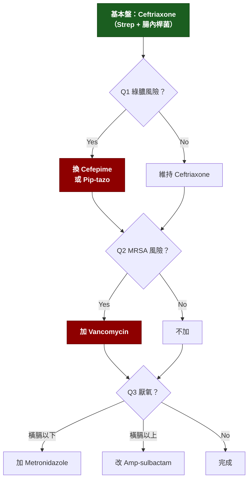

---
tags:
  - Med/MOC/ID
  - Med/Drug/Antibiotics
  - infectious-disease
aliases:
  - Antibiotics Category
  - 抗生素骨架
  - 抗生素菌譜
  - Empiric therapy
created: 2026-07-28
updated: 2026-07-28
status: 可用
source: IDSA guidelines（CAP 2019 / HAP-VAP 2016 / SSTI 2014 / cIAI · 腦膜炎 2004+2017 / FN 2010）；Sanford Guide；台灣本土流行病學
cssclass: clinical-note
---

# 💊 抗生素極簡骨架 · Empiric Antibiotic Skeleton

> [!abstract] 這份筆記怎麼讀（考前一天版）
> 全篇只有 **12 支主力藥（＋3 支台灣補丁）**、**6 個菌群**、**20 個部位情境**。刻意留白，遇到再補。
> 讀的順序：先背 [[#1. 三問決策法]]（30 秒），再看 [[#4. 涵蓋矩陣]]（本篇心臟）與 [[#5. 複方 β-lactam：加了抑制劑換來什麼]]（Unasyn／Tazocin／Augmentin 的邏輯），最後掃 [[#6. 部位 → 菌 → 藥]]。
> [[#2. 定殖地圖]] 是你「不知道哪個部位長哪種菌」的解方——**感染的菌來自那個部位平常住的菌**，這是整個感染科最省力的推論規則。
> 時間只剩 20 分鐘：跳到 [[#8. 高頻陷阱]] 和 [[#10. 自我測驗]]。

---

## 1. 三問決策法

> [!tip] 行動層｜經驗性抗生素 = 一個基本盤 + 三個 yes/no
> 不要從「有幾百種抗生素」開始想。從**基本盤**（蓋 Strep + Enterobacterales，例如 Ceftriaxone）出發，然後只問三個問題。答 yes 就往上加一格。

| 問題 | 什麼時候答 yes | 加什麼 |
|---|---|---|
| **Q1 要蓋綠膿桿菌嗎？** | 住院 >48h／近 90 天用過抗生素／結構性肺病（支氣管擴張、囊狀纖維化）／中性球低下／長期導管、呼吸器／燒燙傷 | 把 β-lactam 換成 **Cefepime · Pip-tazo · Meropenem** |
| **Q2 要蓋 MRSA 嗎？** | 化膿性皮膚感染／導管相關／院內／敗血性休克／已知 MRSA 定殖／近期住院或洗腎 | **加 Vancomycin** |
| **Q3 要蓋厭氧菌嗎？** | **橫膈膜以上**：誤吸、肺膿瘍、牙源、頭頸深部　**橫膈膜以下**：腹腔、骨盆、憩室炎、糖尿病足、壞死性感染 | 上：**Amp-sulbactam / Clindamycin**　下：**加 Metronidazole**（或直接用本身含厭氧的 Pip-tazo / Ertapenem / Amp-sulbactam） |

> [!warning] 第四個隱形問題：**非典型**
> 只有 **肺炎** 需要問。β-lactam 對 Mycoplasma／Chlamydophila／Legionella 完全無效（它們沒有細胞壁）。住院 CAP → Ceftriaxone **+ Azithromycin**，或 Levofloxacin 單用。

---

## 2. 定殖地圖

> [!abstract] 理解層｜為什麼這張表能解決「不知道哪個部位長什麼菌」
> 絕大多數感染是**內源性**的：病人自己身上的常駐菌跑到不該去的地方。所以「部位 → 菌」其實是「**這個部位的鄰居是誰**」。記住鄰居，菌就推得出來。

| 部位 | 常駐菌 | 跑錯地方會造成 |
|---|---|---|
| **皮膚** | Coagulase-negative staph（S. epidermidis）· S. aureus · Corynebacterium | 蜂窩性組織炎、導管相關菌血症、人工植入物感染 |
| **鼻前庭** | S. aureus（20–30% 人帶菌） | 術後傷口、菌血症、心內膜炎 |
| **鼻咽** | S. pneumoniae · H. influenzae · M. catarrhalis | 中耳炎、鼻竇炎、CAP |
| **口咽 / 牙齦溝** | Viridans strep · 口腔厭氧（Peptostreptococcus · Prevotella · Fusobacterium） | 誤吸性肺炎、肺膿瘍、牙源性膿瘍、亞急性心內膜炎 |
| **食道～小腸上段** | 幾乎無菌（胃酸） | — |
| **大腸** | Bacteroides fragilis（數量最多）· E. coli · Klebsiella · Enterococcus | 腹腔感染、憩室炎、UTI、膽道、SBP、肝膿瘍 |
| **陰道** | Lactobacillus · Group B Strep | 產褥感染、新生兒 GBS 敗血症 |
| **尿道遠端** | 少量皮膚菌 | E. coli 逆行 → UTI |
| **醫院環境／水／濕潤處** | **Pseudomonas · Acinetobacter · Stenotrophomonas · Legionella** | VAP、燒燙傷、導管、水源性肺炎 |

> [!tip] 一句話規則
> **橫膈膜以上的厭氧菌 = 口腔菌；橫膈膜以下的厭氧菌 = 大腸菌。** 這兩群用的藥不一樣（見 Q3）。

---

## 3. 六個菌群

> [!abstract] 只分六群，不背菌名清單
> 考題給你的是**情境**，不是菌名。你要做的是把情境歸到六群之一。

| 群 | 代表菌 | 從哪來 | 典型戰場 | 第一直覺用藥 |
|---|---|---|---|---|
| **① 葡萄球菌群** GPC 成串 · catalase(+) | S. aureus（MSSA/MRSA）· CoNS | 皮膚、鼻腔 | 皮膚軟組織、骨關節、導管、心內膜炎、菌血症 | MSSA → **Cefazolin** MRSA → **Vancomycin** |
| **② 鏈球菌群** GPC 成鏈 · catalase(−) | S. pneumoniae · S. pyogenes(GAS) · Viridans · GBS | 鼻咽、口腔、皮膚 | 肺炎、腦膜炎、咽炎、蜂窩組織炎、壞死性筋膜炎 | **Penicillin / Ceftriaxone**（幾乎都還有效） |
| **③ 腸球菌** GPC · 自成一格 | E. faecalis · E. faecium | 大腸 | UTI、腹腔、心內膜炎、導管 | **Ampicillin**（faecalis） Vancomycin；VRE → Linezolid |
| **④ 腸內桿菌** GNB · 會發酵 | E. coli · Klebsiella · Proteus · Enterobacter · Serratia | 大腸 | UTI、腹腔、膽道、肝膿瘍、菌血症、院內肺炎 | **Ceftriaxone**；ESBL → **Carbapenem** |
| **⑤ 非發酵菌（難搞群）** GNB · 不發酵 | **Pseudomonas aeruginosa** · Acinetobacter · Stenotrophomonas | 醫院、水、環境 | VAP、中性球低下發燒、燒燙傷、導管 | **Cefepime / Pip-tazo / Meropenem** Stenotrophomonas → **TMP-SMX** |
| **⑥ 厭氧菌** | 上：Peptostrep · Prevotella · Fusobacterium 下：**Bacteroides fragilis** | 口腔 / 大腸 | 誤吸、肺膿瘍 / 腹腔、骨盆、糖尿病足 | 上：**Amp-sulbactam · Clindamycin** 下：**Metronidazole** |
| **（＋）非典型** | Mycoplasma · Chlamydophila · Legionella | 社區呼吸道 | CAP | **Azithromycin · Doxycycline · Levofloxacin** |

> [!danger] 分群的意義在「盲區」
> 記藥不是記它能殺什麼，而是記它**殺不到什麼**。整個 cephalosporin 家族的盲區可以用 **LAME** 記：
> **L**isteria · **A**typicals · **M**RSA · **E**nterococcus。**第 1–4 代**對這四個都沒用。
> 唯一例外：**Ceftaroline（第 5 代）有 MRSA 活性**——「哪一個 cephalosporin 能治 MRSA」是常見考點。

---

## 4. 涵蓋矩陣

> [!tip] 行動層｜本篇心臟，其他都是註解
> ✅ 可靠　🔶 部分／不是首選　❌ 沒有。看**縱行**（同一支藥的盲區）比看橫列更有用。

| 抗生素 | ②鏈球菌 (含肺炎鏈球菌) | ①MSSA | ①MRSA | ③腸球菌 | ④腸內桿菌 | ⑤綠膿 | ⑥厭氧 | 非典型 | 過 BBB |
|---|:--:|:--:|:--:|:--:|:--:|:--:|:--:|:--:|:--:|
| **1. Ampicillin / Amoxicillin** | ✅ | ❌ | ❌ | ✅ | 🔶 | ❌ | 🔶上 | ❌ | ✅ |
| **2. Amp-sulbactam / Amox-clav** <small>Unasyn · Augmentin</small> | ✅ | ✅ | ❌ | ✅ | 🔶 | ❌ | ✅ **上下皆可** | ❌ | 🔶 |
| **3. Cefazolin**（1代） | ✅ | ✅ **首選** | ❌ | ❌ | 🔶 PEcK | ❌ | ❌ | ❌ | ❌ |
| **4. Ceftriaxone**（3代） | ✅ **首選** | 🔶 | ❌ | ❌ | ✅ | ❌ | ❌ | ❌ | ✅ |
| **5. Cefepime**（4代） | ✅ | ✅ | ❌ | ❌ | ✅ | ✅ | ❌ | ❌ | ✅ |
| **6. Pip-tazobactam** <small>Tazocin</small> | ✅ | ✅ | ❌ | 🔶 faecalis | ✅ | ✅ | ✅ | ❌ | ❌ |
| **7. Ertapenem** | ✅ | ✅ | ❌ | ❌ | ✅ **含ESBL** | ❌ | ✅ | ❌ | ❌ |
| **8. Meropenem** | ✅ | ✅ | ❌ | 🔶 弱，勿依賴 | ✅ **含ESBL** | ✅ | ✅ | ❌ | ✅ |
| **9. Vancomycin** | ✅ | ✅ | ✅ **首選** | ✅ faecalis | ❌ | ❌ | 🔶 | ❌ | 🔶 |
| **10. Levofloxacin** | ✅ | 🔶 | ❌ | 🔶 | ✅ | 🔶 需 750mg | ❌ | ✅ | 🔶 |
| **11. Azithromycin** | 🔶 抗藥高 | ❌ | ❌ | ❌ | ❌ | ❌ | 🔶 | ✅ **首選** | ❌ |
| **12. Metronidazole** | ❌ | ❌ | ❌ | ❌ | ❌ | ❌ | ✅ **下** | ❌ | ✅ |
| **（13. TMP-SMX）** | ❌ | ✅ | ✅ 社區型 | ❌ | 🔶 台灣抗藥高 | ❌ | ❌ | ❌ | ✅ |

> [!warning] 讀這張表要抓的四條縱線
> 1. **MRSA 那一行只有 Vancomycin 和 TMP-SMX 是 ✅** → 所以「要不要加 Vanco」是獨立的一個決定。
> 2. **綠膿那一行只有 Cefepime · Pip-tazo · Meropenem · Levofloxacin** → 記這四支就夠。**Ceftriaxone 和 Ertapenem 沒有綠膿**。
> 3. **腸球菌那一行所有 cephalosporin 都是 ❌** → 看到 Enterococcus 想 Ampicillin 或 Vancomycin。
> 4. **厭氧那一行**：Pip-tazo / carbapenem / Amp-sulbactam 本身就含，**不用再加 Metronidazole**（加了是重複，考題常設這個陷阱）。

---

### 12 支藥的一句話定位

| # | 藥 | 一句話 | 最該記的用途 | 最該記的地雷 |
|---|---|---|---|---|
| 1 | **Ampicillin** | 老藥，但**唯一好用的腸球菌／Listeria 藥** | >50 歲腦膜炎加它蓋 Listeria；腸球菌 | 對 penicillinase(+) 的 MSSA 無效 |
| 2 | **Amp-sulbactam** | 加了 BLI 就換來 **MSSA + 全域厭氧** | 誤吸性肺炎、肺膿瘍、人／動物咬傷、糖尿病足 | 對綠膿無效；台灣 Acinetobacter 常用 sulbactam 成分 |
| 3 | **Cefazolin** | **MSSA 的首選**，窄而深 | MSSA 菌血症／骨關節炎、蜂窩性組織炎、手術預防 | 不過 BBB；沒有腸球菌 |
| 4 | **Ceftriaxone** | **社區感染的萬用基本盤**，一天一次、過 BBB | CAP、腦膜炎（**2 g q12h**，比其他適應症加倍）、腎盂腎炎、SBP、淋病、K. pneumoniae 肝膿瘍、傷寒沙門氏菌菌血症 | **沒有綠膿**、沒有腸球菌、沒有厭氧；膽泥／假性結石；新生兒與含鈣輸液併用禁忌 |
| 5 | **Cefepime** | Ceftriaxone **加上綠膿** | HAP／VAP、中性球低下發燒、院內感染 | 腎功能不良未調量 → **cefepime 腦病變／非痙攣性癲癇** |
| 6 | **Pip-tazobactam** | **除了 MRSA／非典型／ESBL，幾乎全包** | 院內腹腔感染、HAP、來源不明敗血症 | 不過 BBB；與 Vancomycin 併用增加 AKI |
| 7 | **Ertapenem** | 「**社區型 carbapenem**」，一天一次 | 社區 ESBL 的 UTI／腹腔感染 | 三個沒有：**綠膿 · 腸球菌 · Acinetobacter**（記 **PEA**） |
| 8 | **Meropenem** | 火力天花板 | 重症、ESBL＋綠膿、中樞神經感染 | 仍無 MRSA／E. faecium／非典型；Imipenem 癲癇風險較高 |
| 9 | **Vancomycin** | **MRSA 的代名詞**，只殺革蘭氏陽性 | MRSA 一切感染；**口服**治 C. difficile | 口服不吸收（只治腸道）；腎毒性；監測已從 trough 15–20 改為 **AUC₂₄/MIC 400–600**；**紅人症候群是組織胺反應、不是過敏** → 放慢輸注，不要標記為藥物過敏 |
| 10 | **Levofloxacin** | 口服吸收近 100% 的**廣效呼吸道 FQ** | CAP 單藥、複雜 UTI、口服降階 | QT 延長、肌腱斷裂、主動脈剝離、C. diff；**Ciprofloxacin 不能治肺炎鏈球菌** |
| 11 | **Azithromycin** | 蓋**非典型**用的配角 | CAP 加在 Ceftriaxone 上；Legionella、百日咳 | 台灣肺炎鏈球菌對 macrolide 抗藥率極高 → **不可單用治 CAP** |
| 12 | **Metronidazole** | 純厭氧殺手 + 原蟲，**沒有任何好氧活性** | 配 Ceftriaxone 蓋腹腔厭氧；阿米巴、滴蟲、Giardia | **誤吸／肺膿瘍不可單用**——不是因為蓋不到口腔厭氧（它蓋得到 Prevotella、Fusobacterium），而是蓋不到共病原的**微需氧／好氧鏈球菌**；對 Actinomyces 無效；disulfiram 反應（禁酒） |
| ＋ | **TMP-SMX** | 冷門但**四個獨門**：PCP、Nocardia、Stenotrophomonas、**青黴素過敏者的 Listeria** | PCP 治療＋預防；社區型 MRSA 皮膚感染 | 台灣大腸桿菌抗藥率 ~50–70% → **只當「確認菌種後的指定用藥」，不當經驗性用藥**；高血鉀、SJS/TEN、Cr 假性上升（抑制腎小管分泌） |

### ＋3 支：台灣考場繞不開的補丁

> [!tip] 不進主矩陣，但每年都出現
> | 藥 | 為什麼非記不可 | 地雷 |
> |---|---|---|
> | **Ceftazidime**（3 代） | 唯一「有綠膿的第三代」；也是 **Vibrio vulnificus** 與 **類鼻疽** 的指定藥 | **革蘭氏陽性／S. aureus 活性很差**（和 Cefepime 的關鍵差別）；與 Aztreonam 側鏈交叉 |
> | **Doxycycline** | 台灣人畜共通症的通用解：**恙蟲病 · 鉤端螺旋體 · Q 熱 · Vibrio · Aeromonas**；也蓋 CAP 非典型與社區型 MRSA 皮膚感染 | 食道潰瘍（服後勿平躺）、光敏感；孕婦與 8 歲以下相對禁忌 |
> | **Clindamycin** | 壞死性感染中**抑制外毒素合成**（不是為了殺菌）；口腔厭氧；青黴素過敏的替代 | **C. difficile 風險最高**；**B. fragilis 抗藥 30–50% → 橫膈膜以下不要用**；S. aureus 有誘導型抗藥（D-test） |

---

## 5. 複方 β-lactam：加了抑制劑換來什麼

> [!abstract] 一個原則就能推完全部複方
> β-lactamase inhibitor（BLI）**自己幾乎不殺菌**。它的工作是當誘餌，去綁住細菌分泌的 β-lactamase，讓本體 β-lactam 活著走到 PBP。
> 所以 **BLI 只解決「酵素分解」這一種抗藥機轉**。細菌若靠別的方式抗藥，加什麼 BLI 都沒用——這句話能一次解掉大半的複方考題。

### 5-1 本體負責什麼、BLI 換來什麼

| 複方 | 台灣叫法 | **本體**負責 | **BLI** 換來 | 仍然沒有 |
|---|---|---|---|---|
| **Amoxicillin + Clavulanate** | Augmentin（安滅菌）· Curam | 鏈球菌 · 腸球菌 | **MSSA** · **厭氧（含 B. fragilis）** · H. influenzae · M. catarrhalis · 部分 E. coli/Klebsiella | 綠膿 · MRSA · ESBL · AmpC · 非典型 |
| **Ampicillin + Sulbactam** | **Unasyn** | 同上 | 同上，**再加 Acinetobacter** — sulbactam 對 Acinetobacter 有**自己的直接殺菌力**，不只是當誘餌 | 綠膿 · MRSA · ESBL |
| **Piperacillin + Tazobactam** | **Tazocin** | **綠膿** · 腸內桿菌 · E. faecalis | **MSSA** · **厭氧** · 大部分產酵素的 GNB | MRSA · 非典型 · AmpC · **已知 ESBL 菌血症不建議用**（MERINO 試驗劣於 meropenem） |
| **Cefoperazone + Sulbactam** | Sulperazon（台灣很常見） | 部分綠膿 · 腸內桿菌 | 厭氧 · Acinetobacter | MRSA · 腸球菌；**cefoperazone 帶 NMTT 側鏈 → 低凝血酶原血症／出血、disulfiram 反應** |

> [!tip] 三個複方的差別，一句話記
> **Unasyn／Augmentin = 加了厭氧與 MSSA，但仍然沒有綠膿。**
> **Tazocin = Unasyn 再加上綠膿。**
> 兩者都沒有 MRSA——因為 MRSA 的抗藥跟酵素無關（見下）。

> [!danger] Imipenem-cilastatin（Tienam）的 cilastatin **不是** BLI
> Cilastatin 是**腎脫氫肽酶 I（DHP-I）抑制劑**，作用是防止 imipenem 在腎小管被分解、順帶降低腎毒性——**與抗菌譜完全無關**。Meropenem 對 DHP-I 穩定，所以不需要搭配。這是高頻考點，別答成「擴大菌譜」。

### 5-2 為什麼有時候「加了 BLI 還是不行」

| 抗藥機轉 | 代表菌 | 傳統 BLI 救得了嗎 | 該換成什麼 |
|---|---|:--:|---|
| 一般 penicillinase | MSSA · H. influenzae · M. catarrhalis | ✅ **這是 BLI 的主場** | Augmentin / Unasyn |
| **ESBL** | E. coli · Klebsiella | 🔶 體外有效、臨床不可靠 | **Carbapenem**（無綠膿風險用 Ertapenem） |
| **AmpC（可誘導）** | **E**nterobacter · **S**erratia · **C**itrobacter · **P**rovidencia · **M**organella（**ESCPM**） | ❌ clavulanate 本身還會誘導 | **Cefepime** 或 Carbapenem |
| **Carbapenemase**（KPC · NDM · OXA-48） | CRE | ❌ | 新一代 BLI（Ceftazidime-avibactam）／Colistin |
| **標的改變：PBP2a（mecA）** | **MRSA** | ❌ **完全無關** | **Vancomycin** |
| 孔道消失／幫浦外排 | 綠膿 · Acinetobacter | ❌ | 依感受性報告 |

> [!danger] 這張表是整個「複方」的重點
> **MRSA 靠的是換掉標的（PBP2a），不是分泌酵素** → 所以 Augmentin、Unasyn、Tazocin、任何 carbapenem 都殺不了它。
> 常見題型：「病人已用 Tazocin 仍持續發燒」→ 要想 **MRSA／黴菌／膿瘍未引流／非細菌性發燒**，而不是「Tazocin 火力不夠」。

### 5-3 兩個實務細節

> [!warning] 開藥時會踩到的
> **Augmentin 加量不能靠多吃幾顆**：clavulanate 一多就腹瀉。要加量得換高比例劑型（875/125、2000/125），讓 amoxicillin 上去而 clavulanate 總量不變。
> **Tazocin 對綠膿建議延長輸注**（每劑輸 3–4 小時）：β-lactam 是時間依賴性殺菌，拉長 T>MIC 比拉高濃度有效。
> **Tazocin + Vancomycin 併用會增加急性腎損傷**，要密切追腎功能。

### 5-4 台灣常見商品名對照

> [!note] 國考寫學名，值班聽商品名
> 考卷幾乎都用學名；但臨床上講的是下面右欄。兩邊都要能對上。
> 不同醫院進的廠牌可能不同，這張表是最常見的說法，不是唯一。

| 學名 | 常聽到的名字 |
|---|---|
| Amoxicillin-clavulanate | Augmentin（安滅菌）· Curam |
| Ampicillin-sulbactam | **Unasyn** |
| Piperacillin-tazobactam | **Tazocin** |
| Cefoperazone-sulbactam | Sulperazon |
| Cefazolin | Cefamezin · Kefzol |
| Ceftriaxone | **Rocephin（羅氏芬）** |
| Ceftazidime | Fortum |
| Cefepime | **Maxipime** |
| Ertapenem | Invanz |
| Imipenem-cilastatin | **Tienam（泰能）** |
| Meropenem | **Mepem（美平）** |
| Vancomycin | Vancocin |
| Levofloxacin | **Cravit（可樂必妥）** |
| Ciprofloxacin | Ciproxin |
| Azithromycin | Zithromax |
| Metronidazole | **Flagyl** |
| TMP-SMX | **Baktar** |
| Clindamycin | Dalacin C |
| Doxycycline | Vibramycin |

---

## 6. 部位 → 菌 → 藥

> [!tip] 行動層｜考題最常直接問這張表
> 「最可能菌」欄位是**第一直覺**，不是完整清單。

| 部位／情境 | 最可能菌 | 經驗性首選 | 為什麼是它 |
|---|---|---|---|
| **CAP · 門診** | 肺炎鏈球菌 · Mycoplasma · H. influenzae | 高劑量 Amoxicillin **或** Doxycycline；有共病 → Levofloxacin | 要蓋鏈球菌＋非典型 |
| **CAP · 住院** | 同上 ＋ Legionella | **Ceftriaxone + Azithromycin** 或 Levofloxacin 單用 | Q4 非典型 = yes |
| **HAP / VAP** | 綠膿 · Acinetobacter · MRSA · 腸內桿菌 | **Pip-tazo 或 Cefepime**；加 Vancomycin 若「90 天內用過靜脈抗生素」或單位 MRSA >20%；雙重 GNB 覆蓋若休克／單位綠膿抗藥 >10% | Q1 = yes，Q2 視風險。**HCAP 這個分類 2016 年已廢除** |
| **單純誤吸性肺炎**（無膿瘍） | 口咽菌叢；厭氧其實少見 | **依 CAP 處理**（Ceftriaxone ± Azithromycin） | 2019 IDSA/ATS **不建議常規加厭氧覆蓋** |
| **肺膿瘍 / 膿胸 / 壞死性肺炎 / 惡臭痰** | 口腔厭氧 ＋ Viridans strep | **Amp-sulbactam** 或 Clindamycin | 這時才需要 Q3 = 橫膈以上 |
| **單純膀胱炎** | E. coli（>80%）· Klebsiella · Staph. saprophyticus | **Nitrofurantoin 5 天** 或 **Fosfomycin 3 g 單劑** | 台灣 E. coli 對 TMP-SMX 抗藥 ~50–70% → **不可經驗性用 TMP-SMX**（IDSA 門檻是抗藥率 <20%）。Nitrofurantoin **對 Proteus 無效** |
| **腎盂腎炎** | E. coli · Klebsiella · Proteus | **Ceftriaxone** 或 Levofloxacin | 需要組織濃度 → **不可用 Nitrofurantoin／Fosfomycin** |
| **社區腹腔感染**（闌尾破裂、憩室炎、膽道） | 腸內桿菌 ＋ B. fragilis | **Ceftriaxone + Metronidazole**，或 Ertapenem 單用 | Q3 = 橫膈以下。**社區型不需常規蓋腸球菌**；院內／免疫低下／人工瓣膜／術後復發才要 |
| **SBP 自發性細菌性腹膜炎** | **單一菌**：E. coli · Klebsiella · 肺炎鏈球菌 | **Ceftriaxone**；Albumin **1.5 g/kg D1 + 1 g/kg D3**（若 Cr>1、BUN>30、Bili>4） | 診斷門檻 **腹水 PMN ≥250/mm³**。**不需蓋厭氧**；長多重菌 → 懷疑 secondary peritonitis。**院內型或近期用過 β-lactam → 升到 carbapenem ± 抗 MRSA** |
| **蜂窩性組織炎（非化膿）** | **Group A Strep** 為主 | **Cefazolin**（口服 Cephalexin） | 不必常規蓋 MRSA |
| **膿瘍 / 癤（化膿）** | S. aureus，含社區型 MRSA | **切開引流**（主角）＋ TMP-SMX 或 Vancomycin | 引流比抗生素重要 |
| **壞死性筋膜炎** | 混合型 或 GAS 或 Vibrio | **緊急清創** ＋ Pip-tazo/Meropenem ＋ Vancomycin ＋ **Clindamycin** | Clindamycin 抑制外毒素合成，不是為了殺菌（GAS 對 clindamycin 抗藥上升中，**Linezolid 為新興替代**） |
| **糖尿病足（深部）** | 混合：GPC ＋ GNB ＋ 厭氧 | **Amp-sulbactam** 或 Pip-tazo | 三群全包 |
| **社區型腦膜炎 18–50 歲** | 肺炎鏈球菌 · 腦膜炎雙球菌 | **Ceftriaxone 2 g q12h + Vancomycin** ＋ **Dexamethasone** | Vanco 是為了抗藥性肺炎鏈球菌 |
| **腦膜炎 >50 歲 / 免疫低下** | ＋ **Listeria** | 上述 ＋ **Ampicillin**（青黴素過敏 → TMP-SMX） | Cephalosporin 對 Listeria 無效（LAME） |
| **腦膜炎 · 術後／頭部外傷／腦室引流** | 綠膿 · S. aureus/MRSA · CoNS | **Vancomycin + Cefepime**（或 Ceftazidime／Meropenem） | **不可用 Ceftriaxone**——蓋不到綠膿。這是經典誘答 |
| **急性心內膜炎（自體瓣膜）** | S. aureus | **Vancomycin**（＋ Ceftriaxone） | 急性＝金黃色葡萄球菌 |
| **亞急性心內膜炎** | Viridans strep · 腸球菌 | Ampicillin + Ceftriaxone，或 Vanco + Gentamicin | 亞急性＝口腔／腸道菌 |
| **化膿性關節炎 / 骨髓炎** | S. aureus；年輕性活躍 → 淋病雙球菌 | **Vancomycin**（＋ Ceftriaxone） | 確認 MSSA 後降階 Cefazolin |
| **導管相關血流感染** | CoNS · S. aureus · Candida · GNB | **Vancomycin ＋ Cefepime/Pip-tazo**（＋ 拔管） | Q1、Q2 都 yes |
| **中性球低下發燒** | 綠膿是最怕的 | **Cefepime 或 Pip-tazo 或 Meropenem 單藥** | **不常規加 Vancomycin**。加 Vanco 的六個時機：導管相關感染 · 皮膚軟組織感染 · **影像確診肺炎** · 血流動力學不穩／休克 · **嚴重黏膜炎** · 血培養長 GPC 待鑑定（或已知 MRSA 定殖） |

> [!warning] 台灣在地高頻（國考特別愛考）
> | 情境 | 菌 | 處置 |
> |---|---|---|
> | 糖尿病人 · 肝膿瘍 · 合併視力模糊或腦膜炎 | **Klebsiella pneumoniae**（K1/K2 高黏稠型侵襲症候群） | Ceftriaxone ＋ 引流 ＋ **4–6 週**；**眼內炎是急症** → 眼科會診＋玻璃體內注射 |
> | 肝硬化 · 生食牡蠣或海水傷口 · 快速壞死性軟組織感染 | **Vibrio vulnificus** | 緊急清創 ＋ **Doxycycline + Ceftazidime**（IDSA 建議組合；Cefotaxime／Ceftriaxone 為替代） |
> | 淡水接觸傷口 · 肝病 | **Aeromonas hydrophila** | 清創 ＋ **Doxycycline + Ciprofloxacin 或 Ceftriaxone** |
> | 颱風／豪雨後 · 糖尿病 · 肺炎或膿瘍 | **Burkholderia pseudomallei**（類鼻疽） | 急性期 **Ceftazidime 或 Meropenem IV ≥10–14 天**，再 **TMP-SMX 根除 ≥3 個月** |
> | 颱風／泡水／接觸鼠尿 · 發燒＋黃疸＋腎損傷＋結膜充血 | **Leptospira**（鉤端螺旋體） | **Doxycycline**（輕症）／**Penicillin G 或 Ceftriaxone**（重症）；注意 Jarisch-Herxheimer |
> | 野外／草叢暴露 · 發燒＋**焦痂 eschar**＋淋巴結腫 | **Orientia tsutsugamushi**（恙蟲病） | **Doxycycline**（β-lactam 完全無效） |
> | 老人／動脈硬化 · Salmonella 菌血症 | 非傷寒型 Salmonella | Ceftriaxone；務必想到 **黴菌性動脈瘤 mycotic aneurysm** |

---

## 7. 確認菌種後的降階

> [!tip] 培養報告出來後，答案通常是「換窄一點」
> 考題若給你培養結果，多半在考「降階（de-escalation）」。

| 培養長出 | 首選（不是廣效藥） |
|---|---|
| **MSSA** | **Cefazolin** 或 Oxacillin／Nafcillin — 比 Vancomycin **更有效**，一定要換 |
| MRSA | Vancomycin（肺炎可考慮 Linezolid） |
| 肺炎鏈球菌（感受性） | Penicillin 或 Ceftriaxone |
| Group A Strep | Penicillin（＋ Clindamycin 若毒素症候群） |
| E. faecalis | Ampicillin |
| E. faecium / VRE | Linezolid 或 Daptomycin |
| E. coli / Klebsiella（一般） | Ceftriaxone |
| ESBL(+) 腸內桿菌 | **Carbapenem**（Ertapenem 若無綠膿風險） |
| Pseudomonas | Cefepime · Pip-tazo · Meropenem · Ceftazidime |
| **Stenotrophomonas** | **TMP-SMX**（幾乎所有 β-lactam 天然抗藥） |
| B. fragilis | Metronidazole |

---

## 8. 高頻陷阱

> [!danger] 絕對不可
> | 情境 | 絕對不可 | 為什麼 | 該做什麼 |
> |---|---|---|---|
> | 懷疑綠膿 | 用 **Ceftriaxone** 或 **Ertapenem** | 兩者都沒有抗綠膿活性 | 換 Cefepime／Pip-tazo／Meropenem |
> | 培養長 Enterococcus | 用任何 **Cephalosporin** | 全世代天然無效（LAME） | Ampicillin 或 Vancomycin |
> | 腎盂腎炎 | 用 **Nitrofurantoin** | 不進腎實質、血中濃度太低 | Ceftriaxone 或 FQ（另：**CrCl <30 不可用 Nitrofurantoin**，尿中濃度不足） |
> | MRSA **肺炎** | 用 **Daptomycin** | 被肺泡界面活性劑去活化 | Vancomycin 或 Linezolid |
> | 菌血症 | 用 **Tigecycline** | 血中濃度過低 | 依菌種選有殺菌力的藥 |
> | 一般 C. difficile 感染 | 只給**靜脈** Vancomycin | 靜脈 vanco 不進腸腔 | **口服 Fidaxomicin（2021 IDSA 首選）或口服 Vancomycin**；Metronidazole 已降為「兩者皆不可得時的非重症替代」 |
> | 肺膿瘍／壞死性肺炎 | **單用 Metronidazole** | 蓋不到共病原的微需氧鏈球菌 | Amp-sulbactam 或 Clindamycin |
> | 橫膈膜以下厭氧感染 | 用 **Clindamycin** | B. fragilis 對它抗藥率 30–50% | Metronidazole |
> | 已用 Pip-tazo／carbapenem | 再加 **Metronidazole** | 厭氧覆蓋重複 | 不要加 |

> [!warning] 其他常錯
> **Ciprofloxacin 不能治社區型肺炎**——對肺炎鏈球菌活性不足；Levofloxacin／Moxifloxacin 才是 respiratory FQ。
> **Moxifloxacin 沒有綠膿、也不用於 UTI**（尿中濃度低）；Levofloxacin 兩者都有。
> **Vancomycin 治 MSSA 比 Cefazolin 差**，確認 MSSA 一定降階。
> **Azithromycin 在台灣不可單用治 CAP**——台灣肺炎鏈球菌對 macrolide 抗藥率約 **85%**（全球最高之一）。但 Azithromycin 仍是 **傷寒／Shigella／Campylobacter** 的首選。
> **Penicillin 過敏看的是「側鏈」不是「世代」**：整體交叉反應 <2%（未做皮膚測試者 <1%）。**Cefazolin 的 R1 側鏈與所有 penicillin 都不同 → 幾乎零交叉，青黴素過敏者多半可用**。真正要避開的是側鏈相同的組合：Amoxicillin↔Cefadroxil／Cefprozil、Ampicillin↔Cephalexin／Cefaclor。Carbapenem <1%；**Aztreonam 與 Ceftazidime 側鏈相同**，兩者間會交叉。
> **Cefepime 腦病變**：腎功能不良未調劑量的老人出現意識改變／肌陣攣／非痙攣性癲癇，先想到它。
> **Dexamethasone 的時機比藥更重要**：0.15 mg/kg IV q6h × 4 天，必須在**第一劑抗生素之前 10–20 分鐘或同時**給；給晚了無效。培養證實不是肺炎鏈球菌就停掉。
> **S. aureus 菌血症有固定套路**：全部做心臟超音波、追蹤血培養至陰轉、找並處理感染源；單純型從第一次陰性培養起算 **IV ≥14 天**，複雜型 **4–6 週**。口服降階在這個病是錯的。
> **靜脈 Metronidazole 唯一正確的時機是猛爆性 C. difficile**：口服 Vancomycin 500 mg q6h **＋ IV Metronidazole 500 mg q8h**（腸阻塞時加 vanco 灌腸）。

---

## 9. 這份骨架刻意省略了什麼

> [!note] 留白是設計，不是遺漏
> 現在**不用**碰：Aminoglycoside 細節、Linezolid／Daptomycin／Ceftaroline 的完整譜、Colistin、Tigecycline、Aztreonam、抗黴菌（Fluconazole／Echinocandin／Ampho B）、抗病毒、抗結核、新一代 β-lactam/BLI（Ceftazidime-avibactam、Ceftolozane-tazobactam 等）、Fosfomycin 的靜脈用法。
> **補進來的時機**：實際照顧到那個病人、或考古題出現第二次時，再開一篇 `Drug/` 專篇。不要在骨架期就展開。

---

## 10. 自我測驗

> [!question] 蓋住右欄，先答再看
> | 題目 | 答案 |
> |---|---|
> | Cephalosporin 的四個盲區？ | **LAME**：Listeria · Atypicals · MRSA · Enterococcus |
> | Ertapenem 缺哪三個？ | **PEA**：Pseudomonas · Enterococcus · Acinetobacter |
> | 有抗綠膿活性的四支（本骨架內）？ | Cefepime · Pip-tazo · Meropenem · Levofloxacin |
> | 65 歲細菌性腦膜炎，經驗性用什麼？ | Ceftriaxone + Vancomycin + **Ampicillin** + Dexamethasone |
> | 肝硬化病人腹水，PMN 300，該用？要不要蓋厭氧？ | Ceftriaxone；**不用**蓋厭氧（SBP 是單一菌） |
> | MSSA 菌血症用 Vancomycin 對嗎？ | 不對，**Cefazolin／Oxacillin** 較優，須降階 |
> | 肺膿瘍為何不能單用 Metronidazole？ | 不是蓋不到厭氧，是蓋不到共病原的**微需氧鏈球菌** → 用 Amp-sulbactam |
> | 單純誤吸性肺炎要不要加厭氧覆蓋？ | **不用**（2019 IDSA/ATS），除非有膿瘍／膿胸／壞死 |
> | 術後腦膜炎用 Ceftriaxone 對嗎？ | 不對，要 **Vancomycin + Cefepime**（蓋綠膿與 staph） |
> | Dexamethasone 什麼時候給？ | **第一劑抗生素之前或同時**；給晚了無效 |
> | 台灣單純膀胱炎能不能經驗性用 TMP-SMX？ | **不行**，E. coli 抗藥率遠超過 20% 門檻 → Nitrofurantoin 5 天或 Fosfomycin 單劑 |
> | 哪一個 cephalosporin 能治 MRSA？ | **Ceftaroline**（第 5 代） |
> | 青黴素過敏可以用 Cefazolin 嗎？ | 多數可以——**R1 側鏈與所有 penicillin 都不同** |
> | C. difficile 現在的首選？ | **口服 Fidaxomicin**（次選口服 Vancomycin）；猛爆性才加 IV Metronidazole |
> | 焦痂 + 發燒 + 野外暴露 → 用什麼？ | **Doxycycline**（恙蟲病；β-lactam 無效） |
> | Ceftazidime 和 Cefepime 差在哪？ | Ceftazidime **革蘭氏陽性活性差**；Cefepime 兩邊都有 |
> | 為什麼 Clindamycin 不能用在腹腔？ | B. fragilis 抗藥率 30–50% |
> | Augmentin 比 Amoxicillin 多了什麼？ | **MSSA + 厭氧**（＋H. influenzae／M. catarrhalis）；**仍然沒有綠膿** |
> | Unasyn 和 Tazocin 最關鍵的差別？ | **Tazocin 有綠膿，Unasyn 沒有** |
> | Unasyn 有什麼別的複方沒有的？ | **Sulbactam 對 Acinetobacter 有直接活性** |
> | 為什麼加 BLI 也殺不了 MRSA？ | MRSA 抗藥是 **PBP2a 標的改變**，不是分泌 β-lactamase |
> | Tienam 裡的 cilastatin 幹嘛的？ | **抑制腎 DHP-I**，防止 imipenem 被分解；**與菌譜無關** |
> | 已知 ESBL 菌血症可以用 Tazocin 嗎？ | **不建議**（MERINO 試驗劣於 meropenem）→ Carbapenem |
> | AmpC 那群菌（ESCPM）該用什麼？ | **Cefepime 或 Carbapenem**；BLI 無效且會誘導 |
> | 病人用 Tazocin 仍持續發燒，先想什麼？ | MRSA／黴菌／**膿瘍未引流**，不是「火力不夠」 |
> | 中性球低下發燒要不要常規加 Vancomycin？ | **不要**，除非導管感染／皮膚軟組織／休克／已知 MRSA |
> | Stenotrophomonas 首選？ | **TMP-SMX** |
> | 糖尿病人肝膿瘍合併視力模糊，最可能菌？ | **Klebsiella pneumoniae**（侵襲性症候群，須查眼內炎） |
> | 用了 Pip-tazo 還要加 Metronidazole 嗎？ | 不用，厭氧已覆蓋 |
> | 腎盂腎炎可以用 Nitrofurantoin 嗎？ | 不行，不進腎實質 |

---

## 相關連結

- [[Anti]] — 抗生素總覽（待展開）
- [[禁忌選項]] — 全 vault 禁忌彙整
- 待建專篇：`Drug/Vancomycin` · `Drug/Beta-lactam` · `Drug/Fluoroquinolone`
- 待建 Workup：`Workup/發燒` · `Workup/敗血症`
