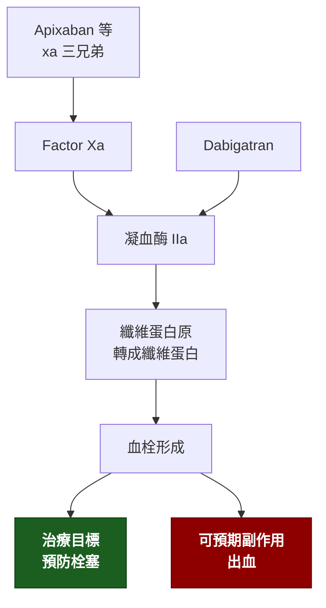

---
tags:
  - Med/Drug/Cardio
  - anticoagulant
  - 禁忌
aliases:
  - DOAC
  - NOAC
  - 新型口服抗凝血劑
  - 直接口服抗凝血劑
  - Dabigatran
  - Apixaban
  - Rivaroxaban
  - Edoxaban
created: 2026-07-26
updated: 2026-07-26
status: 可用
source: 113-1 醫學(三) 10 延伸；2023 ACC/AHA 與 2024 ESC 心房顫動指引；各藥仿單
cssclass: clinical-note
drug_class: 直接口服抗凝血劑（直接凝血酶抑制劑／Factor Xa 抑制劑）
indication:
  - "[[Atrial fibrillation]]"
  - "[[Venous thromboembolism]]"
adverse_effect:
  - 出血
contraindication:
  - "[[Mechanical heart valve]]"
  - 中重度二尖瓣狹窄
---

# DOAC ｜ 直接口服抗凝血劑 · Direct Oral Anticoagulants

> [!abstract] 一句話總覽
> 直接抑制凝血瀑布中的**單一因子**（凝血酶 IIa 或 Factor Xa），不必像 warfarin 那樣繞道維生素 K。因此**不需常規監測 INR、食物交互作用少、起效與退效都快**。在**非瓣膜性**心房顫動與靜脈血栓栓塞已取代 warfarin 成為第一線。

> [!tip] 開藥速查
> **四種藥**：dabigatran（**IIa**）／apixaban · rivaroxaban · edoxaban（**Xa**）
> **給藥頻率**：**BID** — dabigatran、apixaban｜**QD** — rivaroxaban、edoxaban
> **反轉劑**：dabigatran → **idarucizumab**｜Xa 抑制劑 → **andexanet alfa**（無藥時用 4F-PCC）
> **絕對不可**：機械性心臟瓣膜、中重度二尖瓣狹窄

---

## 機轉 Mechanism

> [!tip] 名字就是機轉
> 名字裡有 **-xa-** 的（api**xa**ban、rivaro**xa**ban、edo**xa**ban）＝ **Xa 抑制劑**。
> **dabigatran 是唯一例外**：走 **IIa（凝血酶）**，也用唯一的專屬反轉劑。

## 四藥對照

*這張表本身就是考點。*

| 藥 | 標的 | 頻率 | 反轉劑 | 腎排除比例 | 特別注意 |
|---|---|---|---|---|---|
| **Dabigatran** | Factor **IIa** | **BID** | **Idarucizumab** | **最高（約 80%）** | 消化不良／腸胃道出血較多；可被透析清除 |
| **Apixaban** | Factor Xa | **BID** | Andexanet alfa | 最低（約 27%） | **腎功能極差時相對最可用**；出血風險最低 |
| **Rivaroxaban** | Factor Xa | **QD** | Andexanet alfa | 中等 | **須隨餐服用**才能完整吸收 |
| **Edoxaban** | Factor Xa | **QD** | Andexanet alfa（仿單外） | 中等 | **CrCl ＞95 禁用於非瓣膜性 Afib**——中風風險反而升高 |

> [!warning] andexanet alfa 的適應症比你以為的窄
> FDA 僅核准反轉 **apixaban 與 rivaroxaban**；用於 edoxaban、LMWH、fondaparinux 屬仿單外使用。

## 適應症 Indications

| 適應症 | 角色 |
|---|---|
| **非瓣膜性**[[Atrial fibrillation]] 的中風預防 | **第一線**，優於 warfarin |
| 深部靜脈血栓與肺栓塞的治療與次級預防 | 第一線 |
| 骨科大手術後的血栓預防 | 第一線之一 |
| 抗磷脂症候群 | **不建議**（rivaroxaban 試驗中血栓事件較 warfarin 多） |
| 機械瓣膜、中重度二尖瓣狹窄 | **禁用**——只能 warfarin |

> [!info] Afib 要不要抗凝：CHA₂DS₂-VASc
> 只有**兩項給 2 分**：**年齡 ≥75**、**中風／TIA 或血栓栓塞病史**。其餘（心衰竭、高血壓、糖尿病、血管疾病、年齡 65–74、女性）各 1 分。
> 男性 ≥2 分、女性 ≥3 分建議抗凝。
> **版本註記**：2024 ESC 已改用 **CHA₂DS₂-VA**（拿掉性別項，滿分 8，≥2 建議抗凝）。考試目前仍多考 VASc 版。

## 劑量與用法

| 情境 | 原則 |
|---|---|
| 一般成人 | 依各藥固定劑量，**不需依體重或 INR 調整** |
| 減量條件（因藥而異） | 常見觸發因子：**年齡 ≥80、體重 ≤60 kg、creatinine ≥1.5 mg/dL**（apixaban 符合任兩項即減量） |
| 腎功能不良 | 依 CrCl 調整；**dabigatran 對腎功能最敏感**，apixaban 最不敏感 |
| 肝功能不良 | Child-Pugh C **一律避免**；rivaroxaban 在 Child-Pugh B 即應避免 |

> [!warning] 腎功能要用 Cockcroft-Gault 算 CrCl
> 各藥的臨床試驗與仿單都是以 **CrCl** 為準，不是 eGFR。兩者在老年、低體重病人可能差很多。

## 副作用 Adverse Effects

| 副作用 | 頻率 | 能從機轉推嗎 | 對應主訴 |
|---|---|---|---|
| 出血（各部位） | 常見 | **可以** | 貧血、黑便、血尿 |
| **顱內出血** | 比 warfarin **少** | — | 意識改變、頭痛 |
| **腸胃道出血** | dabigatran、rivaroxaban 比 warfarin **多** | — | 黑便、血便 |
| 消化不良 | dabigatran 特有（酒石酸配方） | 可以 | 上腹痛 |

> [!tip] 與 warfarin 的取捨可以濃縮成一句
> **DOAC 少顱內出血、多腸胃道出血**；整體臨床淨效益仍優於 warfarin。

## 交互作用與監測

| 併用什麼 | 會發生什麼 | 怎麼處理 |
|---|---|---|
| **P-gp 抑制劑**（amiodarone、verapamil、clarithromycin、ketoconazole） | 血中濃度↑ → 出血風險↑ | 減量或換藥（對 dabigatran 最關鍵） |
| **CYP3A4 抑制劑**（azole 抗黴菌藥、HIV 蛋白酶抑制劑） | rivaroxaban／apixaban 濃度↑ | 避免併用 |
| **強效誘導劑**（rifampin、carbamazepine、phenytoin、聖約翰草） | 濃度↓ → **抗凝失效** | 避免併用 |
| 抗血小板藥、NSAID | 出血風險相加 | 有明確適應症才併用，並考慮加 PPI |

**要追蹤的指標**：[[CBC]]（血色素、血小板）、腎功能（至少每年一次；CrCl ＜60 時更頻繁）、肝功能

> [!note] 不需要常規監測凝血功能
> aPTT 與 PT 對 DOAC **不敏感也不線性**，不能用來調劑量。急診想確認「體內還有沒有藥」時：**dabigatran 看 aPTT 或 TT（正常 TT 幾可排除）**；**Xa 抑制劑看 anti-Xa activity**。

## 特殊族群

| 族群 | 注意事項 |
|---|---|
| 孕婦／哺乳 | **禁用**（可通過胎盤）；需抗凝時用 LMWH |
| 老年 | 出血風險高但**獲益仍大於風險**；注意減量條件與跌倒風險評估（跌倒本身不是停藥理由） |
| 腎衰竭／透析 | CrCl ＜15 或透析：**dabigatran 禁用**；apixaban 在部分指引下有條件使用；多數情況回到 warfarin |
| 肥胖（BMI ＞40 或體重 ＞120 kg） | 資料有限；apixaban 與 rivaroxaban 證據相對較多 |
| 癌症相關血栓 | 可用，但**腸胃道或泌尿道腫瘤出血風險高**時傾向 LMWH |

## 禁忌與陷阱

> [!danger] 絕對不可
> | 情境 | 絕對不可 | 為什麼 | 該做什麼 |
> |---|---|---|---|
> | **機械性心臟瓣膜** | 用任何 DOAC | RE-ALIGN 試驗因血栓與出血事件雙雙增加而提前中止 | 用 **warfarin**，目標 INR 依瓣膜位置設定 |
> | **中重度二尖瓣狹窄** | 用 DOAC | 未經證實有效（此族群被排除於所有試驗外） | 用 **warfarin** |
> | 出血風險高的 Afib 病人 | 改用 **aspirin 替代抗凝** | 預防栓塞效果差，出血卻沒少多少 | 矯正可逆出血因子、調整劑量；仍不適合者評估**左心耳封堵** |
> | CrCl ＞95 的非瓣膜性 Afib | 用 **edoxaban** | 缺血性中風風險反而升高 | 換其他 DOAC |
> | 孕婦 | 用任何 DOAC | 可通過胎盤 | 改 LMWH |

> [!warning] 常見錯誤
> - 把 **apixaban 記成一天一次**——它是 **BID**；QD 的是 **rivaroxaban 與 edoxaban**。
> - 以為只有 dabigatran 有反轉劑——**四種都有**（Xa 用 andexanet alfa）。
> - 看到「腎功能正常」就放心——**CrCl ＞95 反而是 edoxaban 的禁忌**。
> - 用 PT／aPTT 判斷 DOAC 的抗凝強度。
> - 忘記 rivaroxaban **要隨餐吃**，空腹吸收不完全。

## 相關連結

- [[Atrial fibrillation]] — 最主要的適應症與風險評分
- [[HCM]] — 合併 Afib 時不必算分數，直接抗凝
- [[Warfarin]] — 瓣膜性 Afib 與機械瓣的唯一選擇
- [[CBC]] — 追蹤指標
