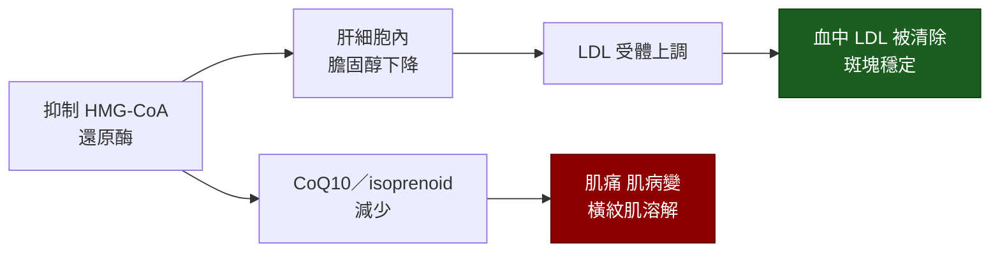

---
tags:
  - Med/Drug/Cardio
  - lipid-lowering
  - 禁忌
aliases:
  - Statin
  - statins
  - 他汀類
  - 史他汀
  - HMG-CoA 還原酶抑制劑
  - Atorvastatin
  - Rosuvastatin
  - Simvastatin
  - Pravastatin
  - Pitavastatin
  - Lovastatin
  - Fluvastatin
created: 2026-07-27
updated: 2026-07-27
status: 可用
source: 113-2 醫學(三) 1、114-2 醫學(三) 13 延伸；2018 AHA/ACC 膽固醇指引；各藥仿單
cssclass: clinical-note
drug_class: HMG-CoA 還原酶抑制劑（膽固醇合成抑制劑）
indication:
  - "[[CAD]]"
  - "[[ACS]]"
  - 家族性高膽固醇血症
  - 糖尿病的心血管預防
adverse_effect:
  - 肌肉症狀
  - 轉胺酶上升
  - 新發糖尿病
contraindication:
  - 急性肝衰竭或失代償性肝硬化（舊版仿單：活動性肝病或不明原因持續轉胺酶升高）
  - 哺乳（現行仿單為「不建議」而非絕對禁忌）
---

# Statin ｜ HMG-CoA 還原酶抑制劑 · 他汀類

> [!abstract] 一句話總覽
> 抑制膽固醇合成的**速率決定酵素 HMG-CoA 還原酶**，讓**肝細胞內**膽固醇下降，肝細胞因而**上調 LDL 受體**、把血中 LDL 抓回來清掉。它同時有**穩定斑塊、抗發炎**的多效性作用，因此屬於**改善預後**（降低死亡與心血管事件）的藥，而不只是「把數字修漂亮」。

> [!tip] 開藥速查
> **途徑／頻次**：口服 QD。**simvastatin、lovastatin、fluvastatin 半衰期短 → 晚上吃**；atorvastatin、rosuvastatin、pitavastatin 半衰期長 → **任何時間都可**
> **高強度只有兩個組合**：**atorvastatin 40–80 mg**、**rosuvastatin 20–40 mg**
> **腎功能不良**：rosuvastatin 在 CrCl ＜30（未透析）**起始 5 mg、上限 10 mg**；**atorvastatin 全程不需依腎功能減量；fluvastatin 輕至中度腎功能不全不需調整，但嚴重腎功能不全時仿單未研究 ＞40 mg／日，應謹慎並避免 XL 80 mg**
> **肝功能不良**：活動性肝病禁用
> **絕對不可**：急性肝衰竭／失代償性肝硬化、**simvastatin（與 lovastatin）併用 gemfibrozil、cyclosporine、danazol 或強效 CYP3A4 抑制劑**；哺乳期不建議使用

---

## 機轉 Mechanism

> [!tip] 降 LDL 的關鍵不是「合成變少」，是「受體變多」
> 直覺會以為 statin 靠減少合成把血脂拉下來，但真正把**血中** LDL 清掉的是**上調的 LDL 受體**。這一點解釋了兩件事：**同合子家族性高膽固醇血症**（LDL 受體幾乎完全失能）對 statin 反應差，因為沒有受體可以上調；而加上 **[[Ezetimibe]]**（減少腸道吸收）或 **[[PCSK9 inhibitor]]**（減少受體被降解）都能再加成，因為它們從不同方向推同一個受體機制。

> [!info] 機轉往兩個方向延伸
> **多效性 pleiotropic effect**：降低血管發炎（hs-CRP 下降）、改善內皮功能、使纖維帽變厚 → **穩定斑塊**。這是 [[ACS]] 病人不論當下 LDL 高不高，都在住院期間就開始高強度 statin 的理由——拿的是穩定斑塊的效果，不是等膽固醇慢慢降。
> **肌肉症狀**：HMG-CoA 還原酶下游還供應 **CoQ10 與 isoprenoid**，肌肉細胞對此特別敏感——副作用可以直接從機轉推出來，不必另外背。

![[assets/statin-cholesterol-synthesis.jpg|680]]
*膽固醇合成主路徑：acetyl-CoA → HMG-CoA → **HMG-CoA reductase（HMGCR）** → mevalonate → isoprenoid／squalene／lanosterol → cholesterol。Statin 的直接靶點就是 HMGCR，因此上游 HMG-CoA 無法有效進入 mevalonate pathway。Source: [Luo et al., *Front Cell Dev Biol* 2022, Figure 1](https://pmc.ncbi.nlm.nih.gov/articles/PMC8978673/)（CC BY 4.0）。*

![[assets/statin-ldlr-feedback.jpg|680]]
*肝細胞內 cholesterol 下降會啟動 SREBP2，提升 LDLR 表現，把血中 LDL 顆粒抓回肝細胞；同時也會上調 PCSK9，形成部分抵銷 LDLR 的回饋。這解釋 statin 為何降低 plasma LDL，也解釋 PCSK9 inhibitor 與 statin 的互補性。Source: [Lagace, *Front Pharmacol* 2017, Figure 1](https://pmc.ncbi.nlm.nih.gov/articles/PMC5468445/)（CC BY 4.0）。*

## 強度分級

| 強度 | LDL 降幅 | 藥與劑量 |
|---|---|---|
| **高強度 High** | **≥50%** | **Atorvastatin 40–80 mg**｜**Rosuvastatin 20–40 mg** |
| **中強度 Moderate** | **30–49%** | Atorvastatin 10–20 mg｜Rosuvastatin 5–10 mg｜**Simvastatin 20–40 mg**｜Pravastatin 40–80 mg｜Lovastatin 40–80 mg｜Fluvastatin XL 80 mg 或 Fluvastatin 40 mg BID｜Pitavastatin 1–4 mg |
| **低強度 Low** | **＜30%** | Simvastatin 10 mg｜Pravastatin 10–20 mg｜Lovastatin 20 mg｜Fluvastatin 20–40 mg |

*（版本陷阱：本表照 **2018 版 Table 3**，pitavastatin 1–4 mg 全屬中強度；2013 版則把 pitavastatin 1 mg 列為低強度，未指明版本時以 2018 版為準。）*

> [!warning] 高強度只有兩個藥，而且加量的邊際效益很小
> **simvastatin 80 mg 已不建議用於新病人**（高劑量時肌病變風險明顯上升），所以 simvastatin 最高只到中強度。看到「高強度」時腦中只該浮出 **atorvastatin 40–80** 與 **rosuvastatin 20–40** 這兩組。
> 劑量反應是**對數關係：劑量加倍，LDL 大約只再多降 6%**。所以想再多降 LDL，**加第二種機轉的藥**（[[Ezetimibe]] 再降約 20% 且不增加肌病變、[[PCSK9 inhibitor]]）遠比一直加 statin 劑量划算，副作用也少。

## 代謝途徑與各藥差異

| 代謝途徑 | 藥 | 意義 |
|---|---|---|
| **CYP3A4** | **Lovastatin、Simvastatin、Atorvastatin** | **怕葡萄柚汁、怕 macrolide、怕 azole 抗黴菌藥、怕 HIV 蛋白酶抑制劑、怕 amiodarone／verapamil／diltiazem** → 血中濃度上升 → **肌病變與橫紋肌溶解風險上升** |
| **CYP2C9** | Rosuvastatin、Fluvastatin | 不受葡萄柚影響；rosuvastatin 只有少部分經 CYP2C9，整體代謝很少 |
| **不主要經 CYP** | **Pravastatin**（走第二相 glucuronidation／sulfation）、**Pitavastatin** | **交互作用最少**，多重用藥或器官移植病人常選 |

> [!warning] 記法，以及問法一改答案就換人
> **「Lo-Sim-Ator 三兄弟怕葡萄柚」**——**Lo**vastatin、**Sim**vastatin、**Ator**vastatin 走 CYP3A4；剩下的 **Pra 與 Pita 最乾淨**。
> 問「**不是**走 CYP3A4」→ pravastatin、pitavastatin（rosuvastatin、fluvastatin 也不是）；問「走 **CYP2C9**」→ rosuvastatin、fluvastatin。
> 把葡萄柚換成 clarithromycin、itraconazole、HIV 蛋白酶抑制劑，講的都還是同一條 CYP3A4。

| 其他區分軸 | 分法 |
|---|---|
| **前驅藥**（要代謝後才有活性） | **Simvastatin、Lovastatin**（其餘為活性型） |
| **脂溶性 vs 水溶性** | 脂溶性（較易進入肌肉、可能與肌肉症狀相關）：Simvastatin、Lovastatin、Atorvastatin、Fluvastatin、Pitavastatin｜**水溶性（較侷限於肝臟）：Pravastatin、Rosuvastatin** |

## 適應症 Indications

| 適應症 | 角色 |
|---|---|
| **已有 [[CAD]]／[[ACS]]／缺血性中風／周邊動脈疾病**（臨床 ASCVD 的次級預防） | **高強度 statin，第一線**；已達最大耐受劑量而 LDL 仍 ≥70 mg/dL 的極高風險者 → 加 [[Ezetimibe]] → 再不夠加 [[PCSK9 inhibitor]] |
| **LDL ≥190 mg/dL** | **高強度 statin，不必算風險分數**；目標降幅 ≥50%；仍 ≥100 mg/dL 時加 [[Ezetimibe]] |
| **糖尿病、年齡 40–75 歲** | **中強度 statin，不必算風險分數**；合併多項危險因子時升到**高強度**、目標降幅 ≥50% |
| 心衰竭本身、洗腎本身 | **不是**開 statin 的理由——這兩族群的臨床試驗未顯示獲益（見 [[Heart failure]]） |

**一級預防（40–75 歲、LDL 70–189 mg/dL、無糖尿病）依 10 年 ASCVD 風險分層**

| 10 年 ASCVD 風險 | 分類 | 處置 |
|---|---|---|
| **＜5%** | 低 | 生活型態為主 |
| **5–7.4%** | 邊緣 | 有**風險增強因子**時可考慮中強度 statin |
| **7.5–19.9%** | 中 | **中強度 statin**；決策不明時可用**冠狀動脈鈣化分數（CAC）**幫忙 |
| **≥20%** | 高 | **高強度 statin**，目標降幅 ≥50% |

> [!info] 風險增強因子與 CAC
> **風險增強因子**：早發性心血管疾病家族史、LDL ≥160、代謝症候群、慢性腎病、慢性發炎疾病（類風濕性關節炎、乾癬、HIV）、早發停經或妊娠高血壓病史、三酸甘油酯持續 ≥175、hs-CRP ≥2.0、Lp(a) 升高、apoB 升高、ABI ＜0.9。
> **CAC = 0** → 可暫緩用藥（吸菸、糖尿病、早發家族史者除外）；**CAC ≥100 或 ≥75 百分位** → 開始用藥。

> [!info] 改善預後 vs 只緩解症狀——這是理解整組心臟用藥的分水嶺
> **改善預後（降死亡／事件）**：**高強度 statin**、[[Antiplatelet]]、ACEI／ARB（糖尿病、左心室功能不全、高血壓、慢性腎病時）、心肌梗塞後的 [[Beta blocker]]。**只緩解症狀**：鈣離子通道阻斷劑、長效硝化物、ivabradine、ranolazine、nicorandil。
> **statin 穩穩站在「改善預後」那一欄**，而且沒有「症狀好了就可以停」這回事——病人不會因為 LDL 降下來而「感覺比較好」，這正是順從性最容易掉的地方。**[[Beta blocker]] 兩欄都佔**，所以它是穩定心絞痛的預設第一線。

> [!note] 台灣健保另有一套依危險因子分層的 LDL 起始門檻與治療目標（心血管疾病、糖尿病、慢性腎病者門檻較低），**歷年修訂過數次，實際數值以現行公告為準**——指引與健保是兩套邏輯，不要拿健保門檻當學理判斷。

## 劑量與用法

| 情境 | 劑量 |
|---|---|
| **腎功能不良** | **rosuvastatin**：CrCl ＜30（未透析）**起始 5 mg、不超過 10 mg／日**；pravastatin 減量起始。**atorvastatin 全程不需依腎功能減量；fluvastatin 輕至中度腎功能不全不需調整，嚴重腎功能不全時應謹慎並避免 ＞40 mg／日與 XL 80 mg** |
| 肝功能不良 | 活動性肝病或不明原因持續轉胺酶升高：**不用**。穩定的脂肪肝**不是**禁忌，反而常獲益 |
| **亞洲人** | **rosuvastatin 在亞洲人的血中濃度約為白人的兩倍**，仿單建議**起始 5 mg** |
| 併用 gemfibrozil 或 cyclosporine 時 | rosuvastatin **上限 10 mg（gemfibrozil）／5 mg（cyclosporine）**；simvastatin **禁止**與這兩者併用 |

> [!warning] simvastatin 的劑量上限是一整組要背的數字
> 併用 **verapamil、diltiazem 或 dronedarone** → simvastatin 上限 **10 mg**；併用 **amiodarone、amlodipine 或 ranolazine** → 上限 **20 mg**；併用 **lomitapide** → 減半且上限 **20 mg**。
> 這組上限只存在於 simvastatin（與 lovastatin），因為它們最依賴 CYP3A4。

## 副作用 Adverse Effects

**肌肉症狀常見，但真正的橫紋肌溶解罕見**；轉胺酶輕度上升不少見，有臨床意義的肝損傷極罕見。

| 副作用 | 表現與要點 |
|---|---|
| **肌痛 myalgia**（有症狀、CK 正常） | 對稱性近端肌肉痠痛無力 |
| **肌病變 myopathy**（症狀＋CK 明顯上升） | 肌肉無力、CK ＞10 倍正常上限 |
| **橫紋肌溶解 [[Rhabdomyolysis]]** | 劇烈肌痛＋**茶色尿**＋急性腎損傷；很罕見但一發生就是急症 |
| **免疫媒介壞死性肌病變**（抗 HMGCR 抗體） | 極罕見。**停藥後症狀不但沒好還持續惡化**——這是它與一般肌痛最重要的區分點，需免疫抑制治療 |
| **轉胺酶上升** | 劑量相關，多半無症狀、常自行回復；出現黃疸、倦怠、右上腹痛才是真正的肝損傷 |
| **新發糖尿病** | 小幅增加，**高強度時較明顯**；空腹血糖／HbA1c 略升 |

> [!info] 肌肉症狀的光譜要分三層
> **肌痛（CK 正常）→ 肌病變（CK 上升）→ 橫紋肌溶解（CK 極高＋肌紅蛋白尿＋腎損傷）**：肌痛可以觀察、換藥或減量，橫紋肌溶解必須**立刻停藥、大量輸液、追蹤腎功能與電解質**。分層的關鍵動作只有一個：**有肌肉症狀就驗 CK**。

> [!warning] 新發糖尿病不是停藥的理由
> 高強度 statin 確實小幅增加新發糖尿病，但**同期間預防的心血管事件遠多於誘發的糖尿病**，且已有糖尿病者本來就是 statin 的適應症族群。正確處置是**繼續用藥並監測血糖**。

> [!note] 多數「statin 引起的肌肉痠痛」在盲性試驗中經不起檢驗
> 讓病人在不知情下輪替服用 statin 與安慰劑的試驗顯示，**兩期的肌肉症狀分數差異很小**。臨床意義：病人抱怨肌肉痠痛時，先排除運動、甲狀腺低下、維生素 D 缺乏、其他藥物，再考慮**停藥觀察後再挑戰**，不要一次就把整類藥判出局。

![[assets/statin-muscle-symptoms-management.jpg|720]]
*SAMS 處置分流：有症狀但 CK ＜4× ULN 者先短期停藥、排除次因並 rechallenge；CK ≥4× ULN 或疑 rhabdomyolysis 者要停藥至症狀與 CK／creatinine 正常，再以不同 statin、低劑量或間歇給藥重試。若 CK ＞10× ULN、肌紅蛋白尿或 AKI，視為急症而非一般「痠痛」。Source: [Stroes et al., *Eur Heart J* 2015, Figure 2](https://pmc.ncbi.nlm.nih.gov/articles/PMC4416140/)（CC BY-NC 4.0）。*

## 交互作用與監測

| 併用什麼 | 會發生什麼 | 怎麼處理 |
|---|---|---|
| **葡萄柚汁**（大量） | 抑制**腸道 CYP3A4** → **simvastatin／lovastatin／atorvastatin** 濃度上升 | 限制攝取，或改 **pravastatin／pitavastatin／rosuvastatin** |
| **強效 CYP3A4 抑制劑**：**macrolide（clarithromycin、erythromycin）**、azole 抗黴菌藥（itraconazole、ketoconazole、posaconazole、voriconazole）、**HIV／HCV 蛋白酶抑制劑** | 濃度數倍上升 → 肌病變／橫紋肌溶解 | 與 simvastatin／lovastatin **禁止併用**（短療程可**療程期間暫停** statin）；長期用藥改 **pravastatin 或 pitavastatin**，atorvastatin 需大幅減量。**azithromycin 不是有意義的 CYP3A4 抑制劑，可以併用** |
| **Amiodarone、verapamil、diltiazem** | 中度 CYP3A4 抑制 | **依上限減量**（見劑量段） |
| **Gemfibrozil** | 抑制 **glucuronidation 與 OATP1B1** → statin 暴露量大增 → **橫紋肌溶解風險最高的組合** | **避免併用**。真的需要 fibrate 時改 **fenofibrate**（見 [[Fibrate]]） |
| **Cyclosporine** | 抑制 OATP1B1 與 CYP3A4 → 暴露量倍增 | simvastatin **禁用**；rosuvastatin 上限 **5 mg** |
| **Colchicine** | 肌毒性相加 | 兩者都用時對肌肉症狀提高警覺 |
| **CYP3A4 誘導劑**（rifampin、carbamazepine、phenytoin、聖約翰草） | 濃度下降 → **降脂效果不足** | 換不走 CYP3A4 的藥或加量 |
| **Warfarin** | fluvastatin、rosuvastatin 可能使 **INR 上升** | 起始或調量後加測 INR |

**要追蹤的指標**：**起始前**測一次**轉胺酶（ALT／AST）**與血脂；**起始或調量後 4–12 週**複驗血脂，看的是**降幅**（高強度 ≥50%、中強度 30–49%）而不只是數值，之後**每 3–12 個月**一次（2018 膽固醇指引）；**[[ACS]] 病人另依 2025 ACC/AHA ACS 指引，於起始或調整降脂藥後 4–8 週複驗空腹血脂**。降幅明顯不足時先想**順從性**（最常見），再想劑量與是否需要加第二種藥。

> [!danger] 不要常規追蹤 CK 與肝功能
> **CK 與肝功能都不是例行監測項目**——只在**病人出現症狀**時才測。
> - **CK**：僅在**高風險族群**（既往 statin 不耐、家族肌肉病史、併用高風險藥物、甲狀腺低下）起始前測一次基礎值；之後**有肌肉症狀才測**。
> - **肝功能**：起始前測一次；之後**有肝毒性症狀（黃疸、倦怠、右上腹痛、茶色尿）才測**。
>
> 每三個月抽一次 CK 與肝功能「以防萬一」是**常見但不正確**的做法：無症狀的輕度上升會導致不必要的停藥，而 statin 是需要長期服用才有效的藥。

## 特殊族群

| 族群 | 注意事項 |
|---|---|
| **孕婦** | **實務上仍避免使用**：懷孕期間膽固醇是胎兒細胞膜與類固醇荷爾蒙合成所必需，而降 LDL 的獲益要數年才顯現，短期停藥幾乎無損失。**多數病人一確認懷孕就停藥**，計畫懷孕者提前停；開藥時同步討論避孕與懷孕計畫。極高風險的少數個案（如同合子家族性高膽固醇血症）可個別評估後續用 |
| **哺乳** | **不建議使用**——脂溶性藥物可分泌至乳汁，嬰兒正需要膽固醇合成髓鞘 |
| **老年** | **次級預防的獲益明確，年齡不是停藥理由**；但肌肉症狀與交互作用風險較高（多重用藥、腎功能下降），傾向**從中強度起始再往上調**。**單純一級預防**在 ≥75 歲的證據較弱，需個別權衡餘命與意願 |
| **腎功能不良／透析** | **rosuvastatin 要減量**（CrCl ＜30 未透析：起始 5 mg、上限 10 mg）；**atorvastatin 全程不需依腎功能減量**，是腎功能差時的方便選擇。**但已在透析的病人不必為了心血管預防而新開 statin**——這族群的試驗未顯示獲益 |
| 兒童 | 家族性高膽固醇血症約 **8–10 歲以後**可依各藥仿單起始，需專科評估與追蹤生長發育 |
| **甲狀腺低下** | **先矯正甲狀腺功能再評估血脂**——本身就會造成高膽固醇血症與肌肉症狀，未矯正就開藥會同時誤判療效與副作用 |

> [!note] 孕婦與哺乳的版本差異
> **舊版**把懷孕列為絕對禁忌、哺乳列為禁忌；**現行仿單已移除「所有孕婦絕對禁忌」的標示，哺乳也由「禁忌」下修為「不建議」**。
> 移除的是「一律禁止」，不是變成可以用——**實務與作答一律按「確認懷孕即停藥、哺乳期避免使用」處理**。

## 禁忌與陷阱

> [!danger] 絕對不可
> | 情境 | 絕對不可 | 為什麼 | 該做什麼 |
> |---|---|---|---|
> | **急性肝衰竭或失代償性肝硬化**（舊版仿單寫「活動性肝病／不明原因持續轉胺酶升高 ＞3×ULN」，現行美國仿單已改為此措辭；台灣仿單與多數教科書仍用舊版，兩者都要認得） | 起始或繼續用 statin | 肝臟合成與代謝功能已失代償，藥物暴露量不可預測、且會掩蓋原本的肝病病程 | 先查明並處理肝病病因，穩定後再評估重新開始。**穩定的脂肪肝、代償性肝硬化、單純輕度轉胺酶上升都不是禁忌** |
> | **正在使用 gemfibrozil** | 加上 **simvastatin 或 lovastatin**（仿單列為禁忌）；其餘 statin 為「應避免」而非禁忌 | gemfibrozil 抑制 glucuronidation 與 OATP1B1，statin 暴露量大增 → **橫紋肌溶解** | 需要 fibrate 時改用 **fenofibrate**；真的必須併用 rosuvastatin 時**起始 5 mg、上限 10 mg** |
> | **正在用 itraconazole、clarithromycin、HIV 蛋白酶抑制劑** | 併用 **simvastatin 或 lovastatin** | 強效 CYP3A4 抑制 → 血中濃度數倍上升 | 短療程可**暫停 statin**；長期用藥改 **pravastatin 或 pitavastatin** |
> | **正在用 cyclosporine** | 用 simvastatin | OATP1B1 被抑制，全身暴露量倍增 | 改用受影響較小的藥並嚴守上限（rosuvastatin 上限 **5 mg**） |
> | **哺乳中**（**現行仿單已由「禁忌」下修為「不建議」**，但實務與作答仍一律停藥） | 用任何 statin | 脂溶性藥物可分泌至乳汁，而嬰兒正需要膽固醇合成髓鞘 | 哺乳期先停藥；心血管風險極高者另行討論 |
> | **肌痛合併茶色尿、CK 大幅上升** | 「再觀察看看」而繼續給藥 | 可能已進展為橫紋肌溶解，會造成急性腎損傷與高血鉀 | **立即停藥**、驗 CK 與腎功能電解質、**大量輸液**（見 [[Rhabdomyolysis]]） |

> [!warning] 常見錯誤
> - **每三個月常規抽 CK 與肝功能追蹤**——指引不建議，**只在有症狀時測**。
> - 看到**無症狀的輕度 CK 上升就停藥**——運動、肌肉注射、種族差異都會讓 CK 偏高。要看的是「有沒有症狀」。
> - 以為所有 statin 都怕葡萄柚——怕的是 **lovastatin、simvastatin、atorvastatin**；**pravastatin、pitavastatin、rosuvastatin、fluvastatin 不走 CYP3A4**。把 **azithromycin 和 clarithromycin 混為一談**也是同一類錯誤。
> - **腎功能一差就全面停 statin**——要減量的是 **rosuvastatin 與 pravastatin**；**atorvastatin 全程不需依腎功能減量**。
> - 把 statin 當成「只是降數字的藥」而停藥——它是**改善預後**的藥，病人沒有症狀也不能停；**也不要因為新發糖尿病就停高強度 statin**。
> - 一有肌肉症狀就宣告「statin 不耐」而永久停藥——先排除甲狀腺低下等其他原因，再考慮**減量、換成親水性藥物（pravastatin、rosuvastatin）或改隔日給藥**。

## 相關連結

- [[CAD]]、[[PCI]] — 次級預防與術後長期用藥的骨幹，屬「改善預後」那一類
- [[ACS]] — 不論當下 LDL 高低，住院期間即開始高強度 statin
- [[Antiplatelet]] — 同屬改善預後，兩者常一起出現
- [[Beta blocker]] — 對照：改善預後與緩解症狀兩欄都佔
- [[Ezetimibe]] → [[PCSK9 inhibitor]] — statin 未達標時的第一、第二個加法
- [[Fibrate]] — gemfibrozil 是最危險的併用組合，fenofibrate 相對安全
- [[Rhabdomyolysis]] — 最嚴重的副作用，處置完全不同
- [[Heart failure]] — 對照：單純心衰竭並非開 statin 的理由
