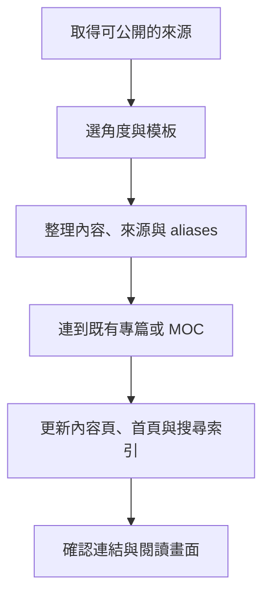

---
tags:
  - meta
  - learning
aliases:
  - 筆記持續新增流程
  - 新增筆記指南
  - Knowledge map workflow
created: 2026-11-05
updated: 2026-11-05
status: 可用
source: "依既有 CONTEXT 與 README 使用說明整理；本頁說明筆記流程，不新增醫學結論。"
---

# Knowledge map workflow ｜ 讓下一篇筆記接得進來

> [!abstract] 一句話總覽
> 新資料先決定角度，再依模板整理成有來源的專篇；用連結接回已有知識，更新首頁，讓下一次閱讀找得到它。

## 先決定放在哪裡

依照 [[CONTEXT]] 定義，同一份來源可以觸發不同角度的筆記。先找這次真正要回答的問題，再決定要更新已有專篇，還是建立新的筆記。

| 這次要整理的內容 | 放置位置 |
|---|---|
| 一個有名稱的病理狀態 | Disease |
| 尚未診斷的主訴與釐清流程 | Workup |
| 用來取得資訊的檢查 | Test |
| 藥品或藥理分類 | Drug |
| 用來改變病人狀態的處置或手術 | Intervention |
| 把多篇筆記串成一個閱讀入口 | MOC |

## 讓下一位讀者接得上

[[README 使用說明]] 已定義每種筆記的模板、aliases、整理狀態與來源欄位。新增時沿用這些欄位，中英文名稱才會都能被搜尋到。

> [!tip] 先找同義筆記
> 先用英文名、中文名與縮寫搜尋。已有同一概念就補在原篇，讓完整解釋有固定歸屬；其他頁面用連結指向它。

## 從筆記到網站

新增的專篇會出現在首頁與搜尋結果；已存在的 wikilink 會接到新頁面，反向連結也會一併更新。「待補」因此是持續成長的入口，而不是讓人點進 404 的連結。

## 這次做完，至少確認三件事

1. 用標題及一個中文 alias 都找得到新筆記。
2. 從另一篇既有筆記或索引能走到它，也能返回首頁。
3. 來源與整理狀態保留；需要查證的醫學內容有清楚標示，沒有把未核實的內容補成事實。

## 相關連結

- [[CONTEXT]] — 筆記系統的詞彙與邊界。
- [[README 使用說明]] — 結構、模板與連結方式。
- [[Cardiovascular reading route]] — 多個角度共用同一批專篇的閱讀入口。
