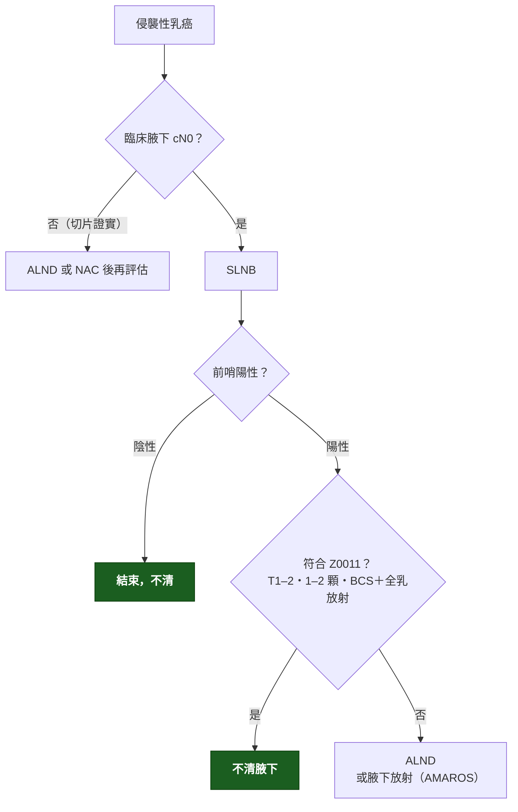

---
tags:
  - Clinical/Intervention/Breast
  - breast
  - 禁忌
aliases: [Axillary management, 腋下處置, Sentinel lymph node biopsy, SLNB, Axillary lymph node dissection, ALND, 前哨淋巴結切片, 腋下淋巴廓清, Z0011, AMAROS]
created: 2026-09-18
updated: 2026-09-18
status: 可用
source: 外科離站考三年教材《乳房外科 113–115 年》（113-2 Q42、114-1 Q42、115-1 Q48）；ACOSOG Z0011（Giuliano 2017 JAMA）；EORTC AMAROS（Donker 2014 Lancet Oncol）；NCCN Breast Cancer
services:
  - BreastSurgery
cssclass: clinical-note
indication:
  - "[[Breast cancer]]"
  - "[[DCIS]]"
contraindication:
complication:
  - "[[Lymphedema]]"
---

# Axillary management ｜ 腋下處置 · SLNB vs ALND

> [!abstract] 一句話總覽
> 腋下要回答的是**分期**（有沒有轉移）與**局部控制**（要不要清）。SLNB 用最少的解剖回答前者；ALND 只留給**高負荷**或**無法用放射取代**的情境。Z0011 與 AMAROS 把「前哨陽性就清」改寫成「前哨陽性，多數不用清」。

> [!tip] 30 秒行動卡
> **最該記的適應症**：cN0 侵襲癌 → SLNB；cN＋（切片證實）→ ALND 或先前導化療再評估
> **做之前一定要確認**：臨床／US 腋下狀態；是否 BCS＋全乳放射（決定 Z0011 是否適用）
> **絕對不可**：SLNB 陽性 ≥3 顆仍不處理腋下；mastectomy 病人前哨陽性直接套 Z0011

---

## 決策樹

## SLNB 與 ALND 的界線

| 情境 | 處置 | 依據 |
|---|---|---|
| cN0，SLN 陰性 | 不清 | SLNB 標準 |
| cN0，SLN 陽性 **1–2 顆**、T1–2、**BCS ＋ 全乳放射** | **不清** | Z0011：10 年存活與復發無差 |
| SLN 陽性 1–2 顆但 **mastectomy**（無全乳放射） | ALND，或腋下放射 | Z0011 不涵蓋；AMAROS：放射≈ALND 且淋巴水腫少一半 |
| SLN 陽性 **≥3 顆**、或 matted／明顯 extranodal extension | **ALND** | 超出 Z0011 |
| cN＋ 切片證實 | ALND；或 NAC 後若轉陰可考慮 targeted axillary dissection | — |
| 純 DCIS 做 BCS | 不做 | 無轉移潛能 |
| 純 DCIS 做 **mastectomy** | **SLNB** | 之後無法補做；upstaging 10–20% |
| Inflammatory breast cancer | NAC 後 mastectomy＋**ALND**，不做 SLNB | 淋巴路徑不可靠 |

> [!note] Z0011 的邏輯
> 全乳放射的切線野本身就涵蓋 level I–II 腋下，加上全身治療，殘餘腋下病灶被控制住；所以「不清」的前提是**有放射**。

## 操作概要

1. **SLNB**：乳暈下／腫瘤周圍注射 blue dye ± Tc-99m（或 ICG），找到藍／熱的淋巴結，通常取 1–4 顆。
2. **ALND**：清 level I–II（pectoralis minor 外側＋後方），level III 只在明顯侵犯時清。

## 腋下神經解剖（考點）

| 神經 | 支配 | 受損表現 |
|---|---|---|
| **Long thoracic n.** | Serratus anterior | **Winged scapula（翼狀肩胛）** |
| **Thoracodorsal n.** | Latissimus dorsi | **內收、內旋、伸展無力**；影響 LD flap |
| Intercostobrachial n. | 上臂內側感覺 | 麻木（最常見、常被犧牲） |
| Medial pectoral n. | Pectoralis major／minor | 胸肌萎縮 |

## 併發症

| 併發症 | SLNB | ALND |
|---|---|---|
| Lymphedema | ~5% | 20–25% |
| Seroma、肩部僵硬、感覺異常 | 少 | 常見 |

## 禁忌與陷阱

> [!danger] 絕對不可
> | 情境 | 絕對不可 | 為什麼 | 該做什麼 |
> |---|---|---|---|
> | Mastectomy ＋ SLN 陽性 | 直接套 Z0011 不處理 | Z0011 要求全乳放射 | ALND 或腋下放射 |
> | SLN ≥3 顆陽性 | 只做 SLNB | 腋下負荷高 | ALND |
> | 清腋下時 | 切斷 long thoracic／thoracodorsal n. | 功能缺損 | 沿 serratus 表面與 subscapular 血管旁保留 |

## 相關連結

- [[DCIS]] — mastectomy 時 SLNB 的理由
- [[Adjuvant therapy of breast cancer]] — 腋下狀態如何影響放射與化療
- [[Breast Surgery]] — MOC
