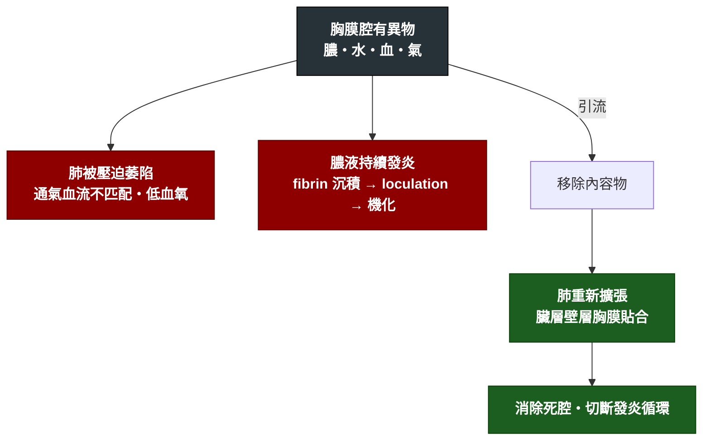

---
tags:
  - Med/Intervention/Resp
  - chest-tube
  - 禁忌
aliases:
  - Chest tube drainage
  - 胸管引流
  - Chest tube
  - Tube thoracostomy
  - Pigtail catheter
created: 2026-07-25
updated: 2026-07-25
status: 可用
source: 標準胸腔處置流程；引流門檻同 [[Pleural fluid analysis]]。案例來源：內科 OSCE 考古（膿胸引流的知情同意）
cssclass: clinical-note
indication:
  - "[[Empyema]]"
  - "[[Pneumothorax]]"
  - "[[Pleural effusion]]"
contraindication:
  - "[[Coagulopathy]]"
complication:
  - "[[Pneumothorax]]"
---

# Chest tube drainage ｜ 胸管引流 · Tube Thoracostomy

> [!abstract] 一句話總覽
> 把胸膜腔內不該存在的東西（膿、水、血、氣）導出來，讓被壓扁的肺重新擴張。**這是治療動作，不是診斷動作**——診斷靠 [[Pleural fluid analysis]]。

> [!tip] 30 秒行動卡
> **最該記的適應症**：**膿**（肉眼膿／培養陽性／**pH < 7.20**）、**氣**（tension pneumothorax → 先針刺減壓）、**血**（hemothorax）、**大量積液致呼吸窘迫**
> **做之前一定要確認**：**PT/INR、血小板**、CXR/超音波定位、同意書並說明併發症
> **絕對不可**：一次引流過多（≤ 1–1.5 L）、沿肋骨下緣進針

---

## 原理與目的

> [!note] 與 Test 的分界
> 取得資訊 → 那是 [[Pleural fluid analysis]]（診斷性胸腔穿刺）。
> 改變病人狀態 → 才是本篇。同一根針可能兩件事一起做，但**思考時要分開**：抽一點送檢是診斷，持續導出是治療。

## 適應症 Indications

| 適應症 | 判斷閾值／時機 |
|---|---|
| [[Empyema]] / complicated parapneumonic effusion | 肉眼膿｜Gram stain/culture 陽性｜**pH < 7.20**｜glucose **< 40** mg/dL｜LDH **> 1000** IU/L（任一） |
| Tension [[Pneumothorax]] | **臨床診斷即處置**——先針刺減壓，再放胸管。**不要等 CXR** |
| 一般氣胸 | 大量、症狀明顯、或需正壓通氣 |
| [[Hemothorax]] | 大量積血、持續出血 |
| 大量 [[Pleural effusion]] | 造成呼吸窘迫需緩解症狀 |
| 惡性胸水反覆積聚 | 需 pleurodesis 或長期導管 |

## 術前準備與評估

| 項目 | 內容 |
|---|---|
| 必查檢驗 | **PT/INR、aPTT、血小板**（任何侵入性處置前的底線）、CBC |
| 影像／定位 | [[Chest X-ray]] 確認側別與量；**胸部超音波導引**可降低併發症、看清 loculation |
| 同意書與風險說明 | **必須主動說明氣胸、hemothorax，並交代術後監測計畫**——病人事後才知道有風險等於沒有知情同意 |
| 停藥 | 抗凝血劑／抗血小板藥依風險評估決定是否停用與停多久 |
| 其他 | 確認插管側別（**wrong-site 是重大事故**）、局麻藥、監測設備 |

## 操作概要

*不是操作手冊，是「要知道會發生什麼」的程度。*

1. 病人半坐臥、患側手臂上舉抱頭。定位 **safe triangle**（腋前線＝胸大肌外緣、腋後線＝闊背肌前緣、下界＝乳頭水平線，約第 4–5 肋間）
2. 消毒、鋪單、局部麻醉至壁層胸膜
3. **沿肋骨上緣**進針／切開——避開肋骨下緣的肋間神經血管束
4. 鈍性分離進入胸膜腔，置入胸管（膿胸與血胸用較粗管；氣胸與單純積液可用 pigtail）
5. 接**水封瓶（water seal）**，觀察是否有氣泡（air leak）與水柱隨呼吸擺動（tidaling）
6. **術後必照 CXR** 確認位置與肺是否復張

> [!danger] 為什麼下界不能超過乳頭水平線
> 吐氣時橫膈膜會升到第 5 肋間高度。越過這條線 → **右側傷肝、左側傷脾**。
> 口訣：**寧可高一肋，不可低一肋。**

![[assets/chest-tube-safe-triangle.jpg]]
*患側手臂抬高後，以胸大肌外緣為前界、闊背肌前緣為後界、第 5 肋間附近為下界；實際切口依影像與觸診確認落在第 4–5 肋間。Source: [Williams & Lerner, “Managing complications of pleural procedures” Figure 2](https://pmc.ncbi.nlm.nih.gov/articles/PMC8411187/)（CC BY-NC-ND 4.0）。*

![[assets/chest-tube-rib-needle.jpg]]
*藍／紅／黃點代表肋間神經血管束，藏在每根肋骨下緣；因此針沿「下方肋骨上緣」通過，避開 VAN。若貼著上方肋骨下緣，正好會撞上神經血管束。Source: [Fraser et al., “The Sound of Safety: DIVOT” Figure 1](https://pmc.ncbi.nlm.nih.gov/articles/PMC12057478/)（CC BY 4.0）。*

![[assets/chest-drain-three-bottle.jpg]]
*三瓶系統由病人端依序進入集液瓶（右）→ 水封瓶（中）→ 抽吸控制瓶（左）；水封提供單向閥，最左瓶水柱高度限制負壓。持續冒泡提示 air leak，水柱隨呼吸上下為 tidaling。Source: [Christopher et al., Pleural effusion guidelines, Figure 4](https://pmc.ncbi.nlm.nih.gov/articles/PMC11093145/)（CC BY-NC-SA 4.0）。*

## 併發症 Complications

| 併發症 | 何時出現 | 怎麼發現 | 怎麼處理 |
|---|---|---|---|
| [[Pneumothorax]] | 術中／術後即刻 | 術後 CXR、突發喘 | 依大小觀察或調整胸管 |
| [[Hemothorax]]（傷及肋間動脈） | 術中／術後數小時 | 引流液變血性、Hb 下降、血壓下降 | 輸血、外科會診止血 |
| **Re-expansion pulmonary edema** | 引流後數十分鐘至數小時 | 引流當下劇咳／胸痛，之後喘、低血氧、患側浸潤 | **預防勝於治療**：單次 ≤ 1–1.5 L；出現症狀立即夾管 |
| 器官損傷（肝、脾、橫膈） | 術中 | 引流出膽汁／血、劇痛 | 影像確認、外科會診 |
| 感染（管路相關） | 數日後 | 發燒、穿刺處紅腫 | 換管、抗生素 |
| 皮下氣腫 | 術後 | 觸診捻髮感 | 多可自行吸收，需查漏氣原因 |
| 管路阻塞／脫位 | 任何時候 | 引流量突然歸零、水柱不擺動 | CXR 確認、沖洗或重置 |

## 術後監測

| 要盯的 | 頻率 | 異常閾值 |
|---|---|---|
| 引流量與性狀 | 每班記錄 | 突然大量血性；或量突然歸零（阻塞） |
| Air leak（水封瓶氣泡） | 每班 | 持續不停 → 懷疑支氣管肋膜瘻管 |
| Tidaling（水柱隨呼吸擺動） | 每班 | 消失 → 阻塞或肺已完全復張 |
| Vital signs、SpO₂ | 依病情 | 引流後喘或血氧下降 → 想 re-expansion edema |
| CXR | 術後即刻＋定期 | 肺未復張 → 考慮纖維溶解劑或 VATS |
| 發炎指標、體溫 | 每日 | 未改善 → 引流不足或抗生素涵蓋不當 |

> [!tip] 膿胸引流失敗的升階路徑
> 胸管引流不順／多房分隔 → **胸腔內纖維溶解劑（tPA + DNase）** → 仍失敗或已機化 → **VATS / 開胸 decortication**。

## 禁忌與陷阱

> [!danger] 絕對不可
> | 情境 | 絕對不可 | 為什麼 | 該做什麼 |
> |---|---|---|---|
> | 凝血功能異常未矯正 | 直接插管 | 出血、hemothorax | 先矯正 PT/INR 與血小板（緊急救命時除外） |
> | 大量胸水 | 單次引流超過約 1–1.5 L | Re-expansion pulmonary edema | 分次引流；病人劇咳或胸痛立即夾管 |
> | 進針 | 沿肋骨**下緣** | 肋間神經血管束在肋骨下緣 | 沿肋骨**上緣** |
> | 定位 | 低於乳頭水平線 | 吐氣時橫膈上升 → 右傷肝、左傷脾 | 維持在 safe triangle 內 |
> | 懷疑 tension pneumothorax | 為了等 CXR 而延遲減壓 | 靜脈回流受阻 → 數分鐘內心跳停止 | **先針刺減壓，再放胸管** |
> | 拔管 | 在深吸氣末拔除 | 空氣被吸入胸膜腔 → 氣胸復發 | 於**吐氣末或 Valsalva** 時拔除並立即封閉 |
> | 已機化的膿胸 | 反覆嘗試細管引流 | 硬殼包覆，細管無效且拖延手術時機 | 及早轉外科 decortication |

> [!warning] 常見錯誤
> - **沒事先跟病人說明氣胸／血胸風險**。
> - 沒確認側別。
> - 引流後沒照 CXR。
> - 引流量突然歸零就以為「好了」，其實是阻塞。

## 相關連結

- [[Empyema]] — 最主要適應症
- [[Pleural fluid analysis]] — 決定要不要引流的依據
- [[Pneumothorax]] — 適應症，同時也是併發症
- [[RUQ pain]] — 常見的主訴入口之一
- [[禁忌選項]]
