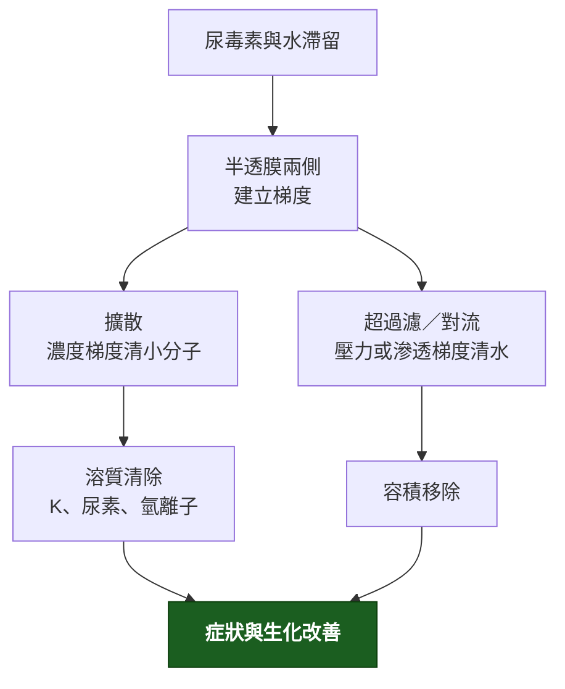

---
tags:
  - Med/Intervention/Nephro
  - 禁忌
aliases: [Dialysis, 透析, 洗腎, RRT, Renal replacement therapy, HD, Hemodialysis, 血液透析, PD, Peritoneal dialysis, 腹膜透析, AEIOU]
created: 2026-07-28
updated: 2026-07-28
status: 可用
source: 114-1 醫學(三) 24、114-2 醫學(三) 29、114-2 醫學(三) 30、114-1 醫學(三) 29 延伸；KDIGO 2012 AKI 指引（RRT 起始時機）；ISPD 腹膜炎指引（診斷門檻與治療原則）；IDEAL trial, NEJM 2010（透析起始時機）
cssclass: clinical-note
indication:
  - "[[AKI]]"
  - "[[CKD]]"
  - "[[Hyperkalemia]]"
complication:
  - "[[Peritonitis]]"
---

# Dialysis ｜ 透析 · Renal replacement therapy

> [!abstract] 一句話總覽
> 透析靠半透膜做兩件事，而且**這兩件事是獨立的兩條軸**：**擴散（濃度梯度）清溶質**、**超過濾／對流（壓力或滲透梯度）清水**——所以病人可以「洗得乾淨卻一直水腫」，也可以「不水腫但尿毒素降不下來」。**起始指徵永遠是「症狀 ＋ 頑固性」，不是任何一個 Cr 或 BUN 的數值。**

> [!tip] 30 秒行動卡
> **最該記的適應症**：**AEIOU** ── **A**cidosis（頑固性代謝性酸中毒）／**E**lectrolytes（頑固性高血鉀）／**I**ntoxication（可透析毒物）／**O**verload（頑固性容積過多、肺水腫）／**U**remia（心包膜炎、腦病變、出血傾向）。**每一項都要加上「保守治療無效」這個前提。**
> **做之前一定要確認**：**血管通路可不可用**、**乾體重與這次要拉多少水**、**血壓撐不撐得住**、**抗凝怎麼給**、**首次透析要不要降效率**。
> **絕對不可**：用 Cr 或 BUN 的**絕對數值**當指徵；在**未經藥物治療**的高血鉀直接推進透析室；**首次透析**就用高效率長時間把尿素快速降下來。

---

## 原理與目的

| **血液透析迴路** | **Dialyzer 內逆流交換** |
|---|---|
| ![[assets/dialysis-hemodialysis-circuit.png\|500]] | ![[assets/dialysis-dialyzer-countercurrent.jpg\|300]] |
| 血液由通路引出，經幫浦、壓力監測與 dialyzer，再通過 air detector 回到病人 | 血走 hollow fiber 內、透析液在外側反向流動，維持整段濃度梯度 |

*Source: [NIDDK Hemodialysis](https://www.niddk.nih.gov/health-information/kidney-disease/kidney-failure/hemodialysis)（NIH educational illustrations）。*

> [!note] 兩條軸要分開想
> **溶質清除靠擴散**（血流速、透析液流速、膜面積、透析時間決定）；**水分移除靠超過濾**（跨膜壓或滲透劑決定）。**兩者可以一好一壞**——看到「洗得乾淨卻一直水腫」就想腹膜**高通透**；看到「不水腫但尿毒素降不下來」就想**低通透**。把兩者混為一談是最常見的推理錯誤。

## 適應症 Indications

| 適應症 | 判斷閾值／時機 |
|---|---|
| **A**cidosis | **頑固性代謝性酸中毒**，補碳酸氫鈉無效或因容積無法給 |
| **E**lectrolytes | **頑固性高血鉀**（藥物治療後仍高或反覆）；亦含頑固性高血鈣、腫瘤溶解症候群的高血磷 |
| **I**ntoxication | **可透析毒物**：**分子小、蛋白結合低、分布體積小、水溶性**（甲醇、乙二醇、salicylate、lithium、metformin 造成的乳酸中毒） |
| **O**verload | **頑固性容積過多／肺水腫**，利尿劑無效 |
| **U**remia | **尿毒性心包膜炎、腦病變、出血傾向、頑固性噁心嘔吐** |
| [[CKD]] 的擇期起始 | **依症狀不依數字**：一般 **eGFR 5–10 且出現尿毒症狀**。IDEAL 試驗顯示早開始（eGFR 10–14）與晚開始（5–7）**存活率無差別** |

> [!danger] 「頑固性」三個字不能拿掉
> 「若併發肺水腫、高血鉀、代謝性酸中毒**則應立即透析**」是**過度的敘述**——正確版本是「**保守治療無效時**才透析」。同樣地，**沒有任何一個 Cr 或 BUN 數值本身可以當作指徵**：「Cr > 8 就該透析」「eGFR < 15 就應開始透析」都是錯的。
> 例外只有一個方向：**可透析毒物中毒**時，透析本身就是解毒手段，不必等「保守治療無效」。

## 兩種模式的取捨

| | **血液透析 (HD)** | **腹膜透析 (PD)** |
|---|---|---|
| 清除方式 | **間歇、快**（通常每週 3 次、每次 4 小時） | **連續、慢**（每日多次交換或夜間機器） |
| 通路 | **AVF ＞ AVG ＞ 導管** | 腹膜透析導管 |
| 血行動力學 | **較不穩，易發生透析中低血壓** | **較穩定**，適合心臟功能差者 |
| 殘餘腎功能 | 掉得較快 | **保留較久** |
| 主要併發症 | 低血壓、抽筋、失衡症候群、通路狹窄與感染 | **腹膜炎**、疝氣、透析液滲漏、**膜衰竭**、代謝負擔（葡萄糖） |
| 生活型態 | 每週到院 | **居家、自主性高**，但需病人或照顧者能操作 |

![[assets/dialysis-peritoneal-process.jpg|520]]
*PD 將透析液灌入腹腔，以腹膜微血管與透析液之間的梯度清除溶質與水，再把舊液引流出去。Source: [NIDDK Peritoneal Dialysis](https://www.niddk.nih.gov/health-information/kidney-disease/kidney-failure/peritoneal-dialysis)（NIH educational illustration）。*

> [!danger] 腹膜通透性與留滯時間必須「反向」設定
> 用 **peritoneal equilibration test (PET)** 分高／低通透。**高通透 → 短留滯；低通透 → 長留滯。**
> **為什麼高通透的人「留久了反而更腫」**：高通透膜對葡萄糖吸收快，**留太久葡萄糖被吸光、滲透梯度消失 → 水從腹腔回流到體內**，超過濾變成負的。所以**高通透病人適合夜間機器透析（CCPD／APD，短留滯多次）**；**低通透病人適合傳統 CAPD（長留滯）**。
> **滲透劑的選擇取決於留滯時間**：短留滯用葡萄糖就夠（梯度還在）；**最長的那一次留滯必須用 icodextrin**（葡萄糖已被吸光），且 **icodextrin 每天只用一次**。
> **icodextrin 的必考副作用**：代謝產物**麥芽糖會干擾使用 glucose dehydrogenase pyrroloquinoline quinone (GDH-PQQ) 試紙的血糖機，造成血糖被假性高估** → 病人可能被誤打胰島素而發生嚴重低血糖。**糖尿病 PD 病人用 icodextrin 前必須確認血糖機型號。**
> **不要長期依賴 4.25% 高濃度葡萄糖藥水**維持超過濾——會加速腹膜損傷與代謝負擔。「短期用」與「長期依賴」是兩件事。

## 術前準備與評估

| 項目 | 內容 |
|---|---|
| **血管通路** | **AVF 是首選**（感染與長期通暢率最好），但**成熟慢**：術後約 **6 週**評估（KDOQI 舊版 rule of 6s：血流 > 600 mL/min、直徑 > 6 mm、距皮 < 6 mm），**實際可穩定穿刺多需 2–3 個月**，故傳統建議**提前約 6 個月**建立；AVG 次之；**導管最差**（感染與中央靜脈狹窄） |
| **保護血管** | **預計做廔管那一側的手臂不可反覆抽血、打點滴、放 PICC**；避免鎖骨下靜脈導管（狹窄會讓同側廔管做不起來） |
| 乾體重與超過濾量 | 依體重變化與臨床容積狀態設定；**單次超過濾速率過快是透析中低血壓與抽筋的主因** |
| 抗凝 | 常規用 heparin；**出血風險高者改用無肝素透析或局部 citrate** |
| 首次透析 | **降低血流速與時間、分次進行**，避免失衡症候群 |
| 疫苗與代謝 | B 型肝炎疫苗；蛋白質攝取**上調至約 1.0–1.2 g/kg/day**（與透析前的限蛋白方向相反） |

| **AV fistula** | **AV graft** |
|---|---|
| ![[assets/dialysis-av-fistula.jpg\|300]] | ![[assets/dialysis-av-graft.jpg\|300]] |
| 直接把 artery 接到 vein；成熟較慢但感染少、通暢久，是長期首選 | 用人工血管連接 artery 與 vein；可較早使用，但感染與血栓較多 |

*Source: [NIDDK Hemodialysis – vascular access](https://www.niddk.nih.gov/health-information/kidney-disease/kidney-failure/hemodialysis)（NIH educational illustrations）。*

## 併發症 Complications

| 併發症 | 何時出現 | 怎麼發現 | 怎麼處理 |
|---|---|---|---|
| **透析中低血壓** | 透析中後段 | 血壓下降、噁心、抽筋、打呵欠 | 見下方 callout |
| **失衡症候群 (disequilibrium syndrome)** | **首次或前幾次透析** | **頭痛、噁心、意識改變、抽搐**（尿素降太快 → 腦水腫） | **預防為主：降低第一次透析的效率與時間**；發生時減慢或停止 |
| **抽筋** | 透析中後段 | 下肢肌肉痙攣 | 超過濾過快或低於乾體重所致；調整乾體重與超過濾速率 |
| 首次使用症候群 | 開始後數分鐘至一小時 | 胸背痛、搔癢、過敏樣反應 | 與膜生物相容性有關；換膜 |
| **通路併發症** | 任何時間 | 血流不足、腫脹、發燒、菌血症 | 狹窄需介入；**導管相關感染是透析病人菌血症的首位來源** |
| **腹膜炎（PD）** | 任何時間 | **透析液混濁 ＋ 腹痛 ± 發燒** | 見下方 callout |

> [!danger] 透析中低血壓：預防與處置是兩張不同的清單
> **所有預防措施都在做同一件事——讓血管收縮，或讓水從組織回到血管。** 把每個選項問一次「它讓血管收縮還是擴張」，答案自己浮出來。
> **第一線**：**降低透析液溫度（約 35–36°C）**、**避免透析中進食**（內臟血管會搶血）、**透析前暫停降血壓藥**、**控制超過濾速率與透析間體重增加**、midodrine。
> **次線（可考慮，別當常規）**：**先超過濾後透析（sequential／isolated UF）**——長期用會犧牲溶質清除；**提高透析液鈣濃度（1.25 → 1.5 mmol/L，即 2.5 → 3.0 mEq/L）**——機轉是提高心肌收縮力，但試驗結果不一致且犧牲鈣磷控制。
> **有害（擴張／降低血漿滲透壓）**：透析中進食、透析液加溫至體溫、醋酸鹽緩衝液、透析前服降壓藥、超過濾太快。
> **提高透析液鈉濃度確實能減少低血壓，但代價是口渴與透析間體重增加**——屬於「有條件的正確」，**不可常規使用**。
> **真的發生低血壓時**：**停止超過濾、頭低腳高（Trendelenburg）、給氧、快速輸注生理食鹽水 100–250 mL——這四件事同時做，不是照順序等**；血壓回升後再減速重啟超過濾。**降低透析液溫度是「預防復發」的措施，不是急救第一線。不是先給升壓劑。**

> [!danger] 腹膜炎：門檻、給藥途徑、拔不拔管
> **診斷門檻（ISPD 2022）**：下列**三項至少符合兩項**——**① 臨床表現（腹痛 and/or 透析液混濁）② 透析液白血球 > 100/μL（須在留置至少 2 小時後採檢）且多形核球 > 50% ③ 培養陽性**。APD 短循環留置不足 2 小時時，**看 PMN 百分比比看絕對白血球數可靠**。送**細胞計數 ＋ 革蘭氏染色 ＋ 培養**。
> **治療**：**腹腔內給予抗生素**（涵蓋**革蘭氏陽性與陰性**），**不是只給口服或靜脈**。**多數不需拔管**——需拔管的是頑固性、復發性、黴菌性、分枝桿菌性、腸道來源的腹膜炎。
> 診斷延遲的代價是**腹膜纖維化與膜衰竭**，等於失去這個治療模式。

## 透析中監測

| 要盯的 | 頻率 | 異常閾值／處置點 |
|---|---|---|
| 血壓 | 每 15–30 分鐘 | 收縮壓下降並伴症狀 → 停超過濾、平躺、給生理食鹽水 |
| 超過濾累積量 | 全程 | 超過設定或病人出現抽筋、低血壓 → 減速 |
| 通路 | 每次上針前後 | 震顫與雜音消失 → 疑血栓，立即評估 |
| 意識狀態 | 首次透析特別注意 | 頭痛、嘔吐、混亂 → 疑失衡症候群 |
| 透析後體重 | 每次 | 與乾體重的差距用來調整下次目標 |

## 禁忌與陷阱

> [!danger] 絕對不可
> | 情境 | 絕對不可 | 為什麼 | 該做什麼 |
> |---|---|---|---|
> | 高血鉀、肺水腫、酸中毒**尚未給藥物治療** | 直接推進透析室 | **指徵是「症狀 ＋ 頑固性」**，不是單一異常值 | 先跑保守治療（鈣穩定心肌、insulin ＋ glucose、排鉀、利尿、補碳酸氫鈉），無效再透析 |
> | 任何 Cr／BUN 數值 | 拿它當透析指徵（「Cr > 8」「eGFR < 15」） | **無單一數字可用**；IDEAL 顯示早開始無存活益處 | 依 **AEIOU 症狀**決定；擇期起始一般在 eGFR 5–10 且有症狀 |
> | **首次透析、BUN 很高** | 用高效率、長時間快速把尿素降下來 | **失衡症候群** → 腦水腫、抽搐 | **降低第一次的血流速與時間、分次進行** |
> | PD 病人透析液混濁、腹痛 | 只給口服抗生素或先觀察 | 腹膜炎延誤會造成**腹膜纖維化與膜衰竭** | 送**細胞計數與培養**，**腹腔內**給涵蓋 G(+)／G(−) 的抗生素 |
> | 使用 icodextrin 的糖尿病 PD 病人 | 憑 **GDH-PQQ 血糖機**數值打胰島素 | **麥芽糖造成假性高血糖** → 誤打胰島素 → **嚴重低血糖** | 確認血糖機型號，改用葡萄糖氧化酶法試紙 |
> | 預計做廔管的手臂 | 反覆抽血、打點滴、放 PICC、放鎖骨下導管 | 破壞血管與中央靜脈狹窄，**廔管做不起來** | **[[CKD]] G4 就開始保護非慣用手前臂**並轉介評估 |
> | 廣泛腹腔沾黏、未修補的腹壁疝氣、無法自我照顧且無照顧者 | 選擇 **PD** | 導管無法放置或滲漏／感染風險過高 | 改走 **HD**；PD 沒有絕對禁忌，但這幾項是相對禁忌中最硬的 |

> [!warning] 常見錯誤
> - **把「預防低血壓」與「已發生低血壓的處置」當同一張清單**——前者是降溫、禁食、先超過濾；後者是停超過濾、平躺、給生理食鹽水。
> - **透析中鼓勵進食以改善營養**——在營養的脈絡下對，在**預防低血壓**的脈絡下就是錯的。同一句話，看題目在問什麼。
> - **高通透腹膜延長留滯時間**——方向相反，會更水腫。**高通透用短留滯，最長那次用 icodextrin。**
> - **把水分移除與溶質清除混為一談**——兩條獨立的軸，可以一好一壞。
> - **忘記透析後蛋白質要上調**——未透析限制約 0.8 g/kg/day（KDOQI 2020 更嚴：0.55–0.80），**規則透析後上調至 1.0–1.2 g/kg/day**，方向相反。

## 相關連結

- [[AKI]] — AEIOU 在急性情境的判準；透析只是撐橋，不加速腎臟恢復
- [[CKD]] — 何時開始、四根支柱、血管通路的提早規劃與蛋白質方向的翻面
- [[Hyperkalemia]] — 「頑固性」的定義：藥物治療跑完仍高才算
- [[Anemia]] — 透析病人的 ESA 與鐵劑，以及 Hb 不追到正常的理由
- [[禁忌選項]] — 上表已收錄
