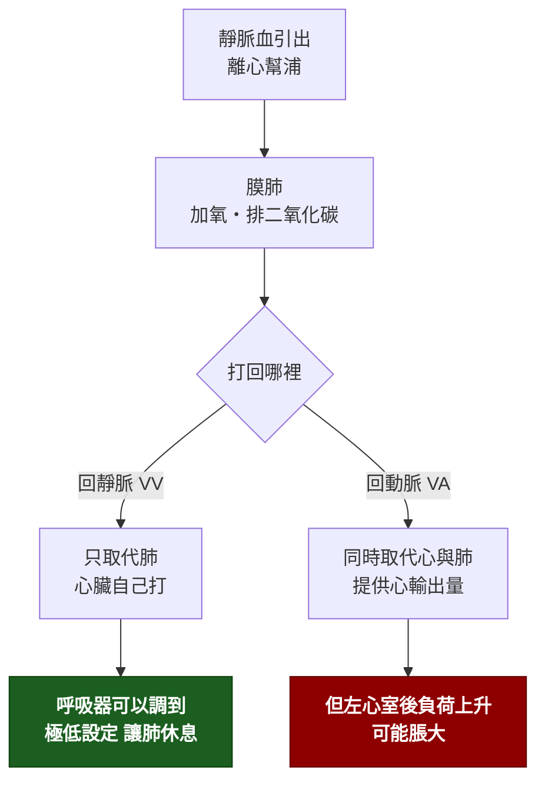

---
tags:
  - Med/Intervention/Resp
  - Med/Intervention/Cardio
  - emergency
  - 禁忌
aliases:
  - ECMO
  - Extracorporeal membrane oxygenation
  - 葉克膜
  - 體外膜氧合
  - VV-ECMO
  - VA-ECMO
  - ECLS
  - ECPR
created: 2026-07-28
updated: 2026-07-28
status: 可用
source: EOLIA（2018 NEJM，VV-ECMO 於重度 [[ARDS]]）；CESAR（2009）；2024 ATS ARDS 指引（對選定重度 ARDS 有條件建議 VV-ECMO，ESICM 2023 則為強烈建議）；ELSO 2021 成人 VA-ECMO 指引與 ECPR 共識；Harrison's
cssclass: clinical-note
indication:
  - "[[ARDS]]"
  - "[[Shock]]"
  - "[[Cardiac arrest]]"
contraindication:
  - "[[Coagulopathy]]"
complication:
  - "[[Stroke]]"
  - "[[Acute kidney injury]]"
---

# ECMO ｜ 體外膜氧合（葉克膜） · Extracorporeal Membrane Oxygenation

> [!abstract] 一句話總覽
> 把血引出體外、用膜肺換氣、再打回體內——**它不治療任何疾病，只是買時間**。所以決定要不要上 ECMO 的問題永遠不是「病人現在多重」，而是**「這個病有沒有可逆的可能，或有沒有出路（恢復、手術、移植）」**。沒有出路的 ECMO 只是把死亡延長成一個沒有人敢關機的困局。

> [!tip] 30 秒行動卡
> **最該記的適應症**：**VV** ＝ 肺壞了（**重度 [[ARDS]]**：P/F ＜50 ＞3 小時、P/F ＜80 ＞6 小時，或 pH ＜7.25 且 PaCO₂ ≥60 ＞6 小時）；**VA** ＝ 心臟壞了（心因性休克、無法脫離體外循環、ECPR）
> **做之前一定要確認**：**這個病可逆嗎？出路是什麼？**（恢復／手術／移植／或明確的撤除計畫）＋ 神經學狀態 ＋ 凝血功能
> **絕對不可**：在**不可逆且無出路**的病況上啟動；VA 股動脈插管而**不評估遠端肢體灌流**

---

## 原理與目的

> [!tip] VV 與 VA 的差別只有一句話：血打回靜脈還是動脈
> **VV（靜脈→靜脈）**：氧合過的血回到右心房，**仍然靠病人自己的心臟推出去**。因此**不提供任何循環支持**——病人若同時休克，VV 撐不住。
> **VA（靜脈→動脈）**：血直接打進主動脈，**同時取代心與肺**，但代價是**逆行血流增加左心室後負荷 → 左心室脹大、肺水腫**，可能需要 venting（IABP／Impella／中膈造口）。
> 判準：**只有氧合的問題 → VV；有幫浦的問題 → VA。** 選錯的典型後果是「重度 ARDS 合併休克只上 VV」或「單純呼吸衰竭卻上 VA，白白承擔血栓與肢體缺血風險」。

> [!note] 與 Test 的分界
> ECMO 從頭到尾都是為了**改變病人的狀態**（維持氧合與灌流），是純粹的 Intervention。它產生的數據（膜前後血氧、流量）是監測，不是診斷。

**ECMO 真正的治療價值在於「讓肺休息」**：上機後呼吸器可調到極低設定（低潮氣容積、低平原壓、低 FiO₂），**切斷呼吸器誘發肺損傷的惡性循環**——這才是它在 [[ARDS]] 降低死亡率的可能機轉，而不是把 PaO₂ 拉高本身。

## 適應症 Indications

| 型式 | 適應症 | 判斷閾值／時機 |
|---|---|---|
| **VV** | 重度 [[ARDS]]：已做足肺保護通氣（含俯臥）仍失敗 | **EOLIA 收案條件**：P/F ＜50 ＞3 小時｜P/F ＜80 ＞6 小時｜pH ＜7.25 且 PaCO₂ ≥60 ＞6 小時（呼吸次數已加到 35 且 Pplat ≤32） |
| **VV** | 頑固性高碳酸血症、嚴重氣漏、支氣管肋膜瘻管 | 無法在可接受壓力下通氣時 |
| **VV** | 肺移植前橋接（bridge to transplant） | **有移植資格**才成立——這就是「出路」 |
| **VA** | 心因性 [[Shock]]（急性心肌炎、大範圍 [[ACS]]、藥物中毒、頑固性心律不整） | 足量強心／升壓藥仍持續低灌流、乳酸高且器官衰竭進展。**IABP 不是必經步驟**（IABP-SHOCK II 陰性後，AMI 併心因性休克常規用 IABP 已降為不建議）。**猛爆性心肌炎預後最好（存活率約 55–78%），是最值得上的一群** |
| **VA** | 心臟手術後無法脫離體外循環 | 術中決策 |
| **VA（ECPR）** | 經篩選的心跳停止 | **病人選擇比技術重要**：目擊、**arrest→CPR ＜5 分鐘**、初始心律 VF/pVT（ELSO 亦納入 PEA）、**arrest→上機 ＜60 分鐘**、年齡 ＜70 歲、CPR 中 **EtCO₂ ＞10 mmHg** 或有生命徵象／間歇 ROSC。條件不符時效益極差 |
| **VA** | 大量肺栓塞或高風險介入的圍術期支持 | 見 [[Pulmonary embolism]] |

> [!warning] EOLIA 的結果要誠實記
> 60 天死亡率 **ECMO 組 35% vs 對照組 46%**，**p ＝ 0.09 未達統計顯著**；但對照組有 **28%（35/125）** 因難治性低血氧跨組接受救援 ECMO（平均在第 6.5 天），稀釋了差異——**這個 28% 就是「為什麼 p 值不顯著」的標準答案**。事後分析多半支持有效益。
> **2024 ATS 是「對選定的重度病人有條件建議、低證據等級」，ESICM 2023 卻給「強烈建議、中等證據等級」——兩大學會公開不一致，考題要看它問的是哪一本。** 早年的 CESAR（2009）比較的是「轉到 ECMO 中心」而非 ECMO 本身（介入組僅 76% 真的上機，對照組只有 70% 接受肺保護通氣 vs 介入組 93%），證據力更弱。
> 一句話：**ECMO 是「肺保護通氣＋俯臥都失敗之後」的選項，不是重度 ARDS 的第一步。**

> [!note] 台灣本土：使用密度偏高，而這件事本身有爭議
> 台灣的 ECMO 使用強度在國際上明顯偏高（健保資料庫 2000–2010 年，年使用量由 52 例增至 1,045 例，適應症以心血管疾病 68.7% 為主），健保有給付但耗材與併發症成本高。該研究自己下的結論值得記住：**使用量的成長與給付制度相關，而偏高的死亡率提示部分使用可能沒有帶來實質效益**。這正好呼應本篇的主軸——**問題從來不是「能不能上」，而是「上了之後的出路是什麼」**。

## 術前準備與評估

| 項目 | 內容 |
|---|---|
| **最重要的一項** | **可逆性與出路評估**——恢復？手術？移植？沒有任何一條時不該上機。這是決策，不是檢驗 |
| 神經學 | 上機前的意識與瞳孔紀錄；已知嚴重不可逆腦傷是禁忌 |
| 必查檢驗 | **CBC、PT/INR、aPTT、fibrinogen、D-dimer**、血型與備血、生化與乳酸、血液培養 |
| 影像／定位 | **超音波評估血管管徑與通暢度**；[[Echocardiography]]（看心室功能決定 VV 或 VA、找主動脈剝離與嚴重主動脈瓣逆流） |
| 抗凝準備 | unfractionated heparin（見 [[Heparin]]）；確認有無 heparin-induced thrombocytopenia 病史 |
| 同意書 | **必須說明出血、中風、肢體缺血、感染，以及「可能無法脫機」這件事**——家屬事前不知道撤除的可能性，是最常見的糾紛來源 |
| 團隊 | 灌流師、心臟外科或重症團隊、血庫；**是否轉診到 ECMO 中心要早決定，不要等到血壓掉了才轉** |

## 操作概要

1. **選型式**：純氧合問題 → **VV**；合併幫浦衰竭 → **VA**
2. **插管**：VV 常用**股靜脈引流 ＋ 頸內靜脈回輸**，或單一雙腔導管置於頸內靜脈；VA 常用**股靜脈引流 ＋ 股動脈回輸**（周邊）或直接主動脈與右心房插管（中央，多為術中）
3. **VA 周邊插管務必同時放遠端灌流導管**——股動脈被大口徑管子塞住，同側下肢會缺血（ELSO：可把下肢缺血率由 **25.4% 降到 9.7%**）
4. **啟動**：**「血流量管氧合、掃氣流量管 CO₂」——這才是彼此獨立的兩個旋鈕**。氧合主要由 **ECMO 血流量**決定（幫浦轉速，實質是「引流走的血佔心輸出量多少比例」）；**CO₂ 排除由 sweep gas 流量**決定（等同膜肺的分鐘通氣量）。掃氣的 FiO₂ 通常固定在 1.0，調它幾乎沒有效果
5. **抗凝**：靜脈 heparin 持續輸注，依 ACT 或 aPTT 調整；出血時可短暫停用
6. **上機後把呼吸器調到休息設定**：低潮氣容積、低平原壓、低 FiO₂、適度 PEEP 維持肺不塌
7. **每日評估脫機**：VV 看關掉 sweep gas 後自己的氣體交換；VA 看降流量時的心輸出量與 [[Echocardiography]]

![[assets/ecmo-vv-va-cannulation.svg|1000]]
*VV 與 VA 的插管路徑對照：VV 的回輸端若太靠近引流端會發生再循環；周邊 VA 的股動脈回輸血沿主動脈逆行，與左心室順行血流形成分水嶺。自製示意圖。*

## 併發症 Complications

| 併發症 | 何時出現 | 怎麼發現 | 怎麼處理 |
|---|---|---|---|
| **出血（最常見）** | 任何時候，插管處與消化道最常見 | Hb 下降、插管處滲血、血便 | 降低抗凝目標、補 fibrinogen 與血小板、局部止血 |
| **顱內出血或梗塞** | 數小時至數天 | 瞳孔、鎮靜中斷評估、影像 | **預後最壞的併發症之一**；立即停抗凝並評估撤除 |
| **acquired von Willebrand syndrome** | **上機數小時內**（剪切力使 vWF 高分子量多聚體流失，幾乎人人都有） | **黏膜出血、鼻出血、插管處持續滲血**；靠 **VWF:RCo/VWF:Ag ＜0.7** 與多聚體分析 | 降低剪切力、補 vWF 濃縮劑或 cryoprecipitate；**脫機後可逆** |
| **溶血** | 數天 | 血漿游離血紅素上升、尿色變深、LDH 上升 | 檢查幫浦頭與管路血栓、調整流量 |
| **管路／膜肺血栓** | 數天 | 膜前後壓差上升、氧合效率下降、D-dimer 上升 | 更換膜肺或整套管路 |
| **同側下肢缺血（VA 股動脈）** | 數小時 | 肢體溫度、脈搏、顏色；筋膜室症候群 | **預防為主：放遠端灌流導管**；已缺血需外科介入 |
| **Harlequin（南北）症候群｜differential hypoxia**（VA 周邊） | 心功能回復、肺仍很差時 | **右手 SpO₂ 低於左手與下肢**——上半身由自身心臟打出的缺氧血供應，分水嶺在主動脈弓。**確診靠右橈動脈血氣**，脈搏血氧只是篩檢 | 先改善自身的肺（提高呼吸器 FiO₂/PEEP）→ 加一條靜脈回輸（**VAV**）→ 改 VV → 或改**腋／鎖骨下動脈回輸** |
| **左心室脹大與肺水腫**（VA） | 數小時至數天 | 脈壓變窄、超音波看到左心室不動且脹、肺水腫惡化（嚴重時肺出血） | **venting**：IABP、Impella、中膈造口 |
| **再循環（VV）** | 上機後隨時 | 引流血過紅、膜前血氧偏高但病人仍低血氧 | 調整插管位置與流量 |
| **感染、[[Acute kidney injury]]、heparin-induced thrombocytopenia** | 數天 | 培養、尿量與 Cr、血小板下降 | 對症處理；HIT 改用非 heparin 類抗凝 |

## 術後監測

| 要盯的 | 頻率 | 異常閾值 |
|---|---|---|
| **右上肢 SpO₂ 與動脈血氣**（VA） | 持續 | 右手低於下肢 → **Harlequin**，代表上半身在缺氧 |
| 幫浦流量與轉速、管路抖動（chattering） | 持續 | 流量掉、管路抖 → **容積不足或引流管貼壁** |
| 膜前後壓差、膜後血氧 | 每班 | 壓差上升、氧合下降 → 膜肺血栓，準備換膜 |
| ACT／aPTT、血小板、fibrinogen、血漿游離血紅素 | 每 4–6 小時至每日 | 依出血與血栓風險動態調整 |
| **雙下肢脈搏、溫度、顏色**（VA 周邊） | 每班 | 任何不對稱 → 立即處理遠端灌流 |
| 神經學評估（每日中斷鎮靜） | 每日 | 新出現的局灶症狀 → 立即影像 |
| 呼吸器設定與胸部影像 | 每日 | 確認確實維持在「肺休息」設定 |
| **脫機可能性與家庭會議** | 每日 | **上機後就要開始談出路與界線**，不是等到走不下去才談 |

## 禁忌與陷阱

> [!danger] 絕對不可
> | 情境 | 絕對不可 | 為什麼 | 該做什麼 |
> |---|---|---|---|
> | **不可逆病況且無出路**（末期惡性腫瘤、末期肺纖維化但無移植資格、嚴重不可逆腦傷） | 啟動 ECMO | 只能延長瀕死，且事後撤除極其困難 | 安寧與家庭會議；**上機前就要定義撤除條件** |
> | **急性主動脈剝離且牽涉主要分支、尚未手術**；或**重度主動脈瓣逆流而預期左心室幾乎不會打** | 上周邊 **VA**-ECMO | 逆行血流灌進假腔；逆流灌爆不打的左心室 | 先影像確認；改中央或腋動脈插管、或其他支持。⚠ **剝離術後**反而是腋動脈回輸 VA-ECMO 的適應症之一，別記成「剝離一律不可」 |
> | VA 股動脈插管 | 不放**遠端灌流導管**、不查下肢脈搏 | 同側肢體缺血甚至截肢 | 常規放置並每班評估雙下肢 |
> | 心跳停止而**無目擊、無旁觀者 CPR、低血流時間長** | 為了「盡力」而上 ECPR | 神經學預後極差 | 依 ECPR 收案條件篩選（＜5 分鐘開始 CPR、＜60 分鐘上機） |
> | 已知 **heparin-induced thrombocytopenia** | 繼續用 heparin 抗凝 | 血栓惡化 | 改非 heparin 類：**bivalirudin**（目前 ECMO 上最常用）或 argatroban |
> | 重度 ARDS 而**尚未做足肺保護通氣與俯臥** | 直接上 ECMO | 跳過已證實有效、風險遠低的介入 | 先 6 mL/kg PBW ＋ Pplat ≤30 ＋ 俯臥 ≥16 小時（見 [[ARDS]]） |
> | **VA** 上機後左心室不打、脈壓變窄 | 只顧衝高流量 | 後負荷上升 → 左心室脹大、肺水腫 | **venting**（IABP／Impella／中膈造口） |
> | 活動性大出血或近期顱內出血 | 用常規抗凝目標 | 致命出血 | 降低甚至暫停抗凝（**相對禁忌，不是絕對**——現代管路可短時間無抗凝運轉） |

> [!warning] 常見錯誤
> - **把 ECMO 當治療**——它不治病，只換時間。**沒有出路就不該啟動**，這句話比任何參數都重要。
> - **重度 ARDS 合併休克卻選 VV**——VV 完全不提供循環支持。
> - **VA 病人只看左手或下肢血氧**——要看**右上肢**，那裡才反映腦部拿到的是哪一種血。
> - **VV-ECMO 病人低血氧就去調高掃氣 FiO₂**——膜後血早已飽和，正確動作是**提高 ECMO 血流量**；高碳酸血症才調 sweep gas 流量。
> - **把「氧合變漂亮」當成病情好轉**——ECMO 一定會讓數字變好看，肺本身可能毫無進展。
> - **把 IABP 當成上 VA-ECMO 前的必經步驟**——IABP-SHOCK II 之後它已不是常規。
> - **上機時才第一次跟家屬談撤除的可能**——同意過程就該說明「可能無法脫機」。
> - **跳過俯臥直接上 ECMO**——俯臥的死亡率效益比 ECMO 的證據更強、成本更低。

## 相關連結

- [[ARDS]] — VV-ECMO 的主要適應症；升級順序與 EOLIA 條件的完整脈絡在那一篇
- [[Mechanical ventilation]] — 上機後的「肺休息」設定；ECMO 的價值來自切斷 VILI
- [[Shock]] — VA-ECMO 的適應症來源；心因性休克的完整分流在那一篇
- [[Heparin]] — 抗凝主力與 HIT 的處理
- [[Echocardiography]] — 選型式、找禁忌、評估脫機都靠它
- [[Pulmonary embolism]] · [[ACS]] — 兩個常見的 VA-ECMO 情境
- [[禁忌選項]]
