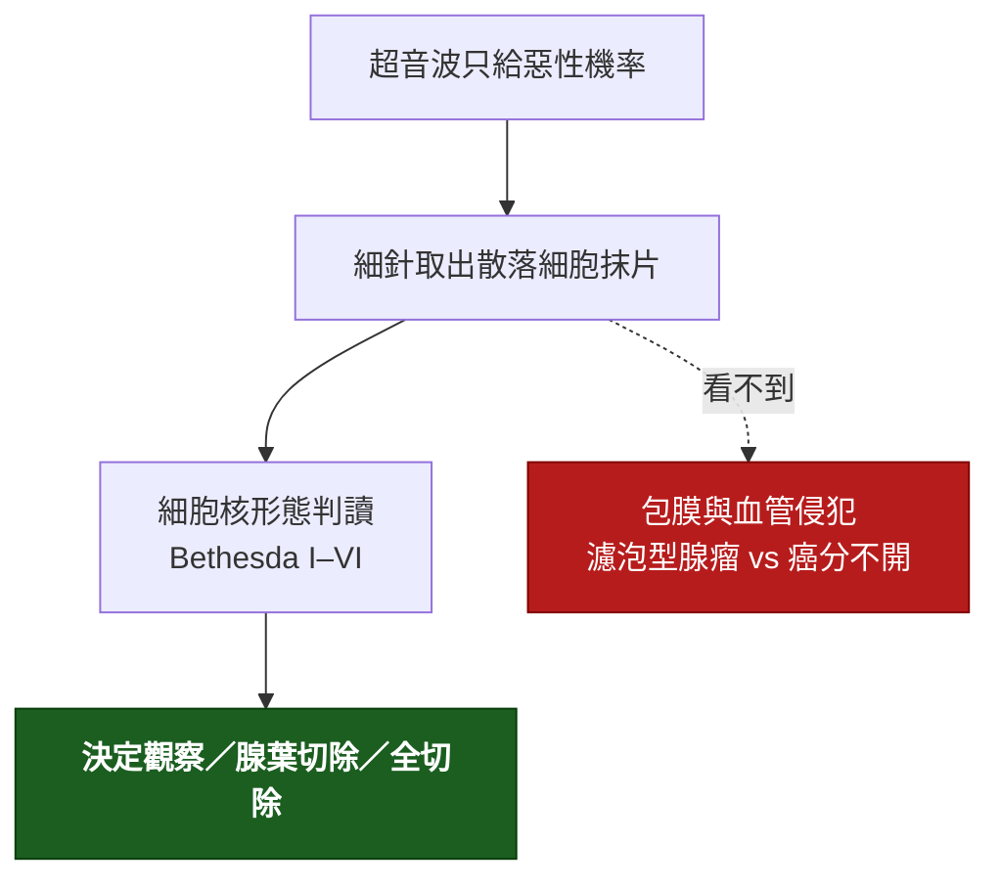

---
tags:
  - Med/Intervention/Endo
  - thyroid
  - 禁忌
aliases:
  - Fine-needle aspiration
  - FNA
  - FNAC
  - 細針抽吸
  - 細針穿刺細胞學
  - Thyroid FNA
  - 甲狀腺細針抽吸
  - US-guided FNA
created: 2026-09-18
updated: 2026-09-18
status: 可用
source: 外科離站考三年教材《內分泌外科 113–115 年》（115-2 Q42、113-2 Q40、114-2 Q39）；ATA 2015 成人甲狀腺結節與分化型甲狀腺癌指引（Rec 8–10 FNA 適應症、Rec 15–20 Bethesda 後處置）；Bethesda 2023 第三版；AAO-HNS 2017 成人頸部腫塊評估指引；SIR 2019 經皮影像導引處置的凝血功能共識（甲狀腺 FNA 屬低出血風險）
services:
  - ThyroidSurgery
  - Endo
  - ENT
cssclass: clinical-note
indication:
  - "[[Thyroid nodule]]（依超音波分層達大小門檻）"
  - "[[Neck mass]]（側頸可疑淋巴結）"
  - "[[Thyroid cancer]]（術前確診與分期）"
contraindication:
  - "TSH 低且掃描為熱結節（不需抽）"
  - "純囊性結節（不需抽）"
  - "搏動性腫塊（carotid body tumor）"
complication:
  - "結節內出血、血腫"
  - "Nondiagnostic 需重抽"
---

# Fine-needle aspiration ｜ 細針抽吸細胞學 · Thyroid FNA

> [!abstract] 一句話總覽
> FNA 是甲狀腺結節評估裡**唯一能把「惡性機率」變成「細胞學診斷」**的一步：門診、超音波導引、局部麻醉或不麻醉，用 23–27G 細針取細胞抹片，報告用 Bethesda 六類直接決定要不要開刀、切多少。什麼時候做，由「TSH 是否正常」加「超音波分層 × 大小」兩件事決定，不是看到結節就抽。

> [!tip] 30 秒行動卡
> **最該記的適應症**：TSH 正常或高 → 超音波分層 → **高／中度可疑 ≥1 cm、低度可疑 ≥1.5 cm、極低度可疑 ≥2 cm**；純囊性不抽；任何大小的可疑側頸淋巴結都抽並驗抽吸液 Tg。
> **做之前一定要確認**：TSH 已驗（低就先掃描，熱結節不抽）；有沒有抗凝藥；腫塊會不會搏動。
> **絕對不可**：搏動性腫塊、未驗 TSH 就抽、拿 Bethesda IV 的結果跟病人說「是良性」。

---

## 原理與目的

- **能看到的**：細胞核特徵。乳突癌靠核溝、核內假包涵體、毛玻璃核就能在抹片上診斷；髓質癌可加 calcitonin 免疫染色；淋巴瘤與未分化癌抹片可疑但常需核心切片。
- **看不到的**：包膜與血管。濾泡腺瘤與濾泡癌細胞形態完全相同，惡性唯一判準是腫瘤細胞穿透包膜或侵入血管，那是整顆腫瘤才有的結構（114-2 Q39）。所以 FNA 對濾泡型病灶最多報 Bethesda IV。
- **不是拿來做什麼的**：不是治療。囊腫抽液減壓是同一支針的另一個目的，見下方「治療性抽吸」。

> [!note] 與 Test 的分界
> 依本 vault 的定義，FNA 取得資訊，本質上是 Test；這裡依使用者要求以 Intervention 模板寫，強調適應症、術前準備、操作與併發症。判讀（Bethesda 各類的意義）主要寫在 [[Neck mass]] 與 [[Thyroid cancer]]，本篇只放「拿到報告下一步做什麼」。

## 適應症 Indications

### 前提：先驗 TSH

| TSH | 下一步 | 為什麼 |
|---|---|---|
| 低 | 核醫掃描；**熱結節不抽** | 自主分泌的熱結節幾乎不是癌，走甲亢治療（115-2 Q42） |
| 正常或高 | 直接超音波分層決定抽不抽 | 掃描沒有意義，冷結節多數仍良性、掃描不能排除惡性 |

### 甲狀腺結節：超音波分層 × 大小（ATA 2015）

| 超音波分層 | 典型影像 | 惡性風險 | FNA 門檻 |
|---|---|---|---|
| High suspicion | 實心低回音 + 微鈣化、不規則邊緣、taller-than-wide、甲狀腺外侵犯、邊緣鈣化中斷伴軟組織突出 | >70–90% | **≥1 cm** |
| Intermediate | 實心低回音、邊緣平滑 | 10–20% | **≥1 cm** |
| Low | 等／高回音實心；或部分囊性、實心部分偏心 | 5–10% | **≥1.5 cm** |
| Very low | 海綿樣；或部分囊性無可疑特徵 | <3% | **≥2 cm** 才考慮，觀察亦可 |
| Benign | 純囊性 | <1% | **不抽**（有症狀可治療性抽液） |

**門檻以外也要抽的情況**
- 任何大小的結節，只要**側頸有可疑淋巴結**：淋巴結一併抽，抽吸液驗 thyroglobulin（Tg 唯一的術前用法）。
- <1 cm 但有甲狀腺外侵犯、貼近氣管或喉返神經、或高風險病史（兒時放射線、家族史、MEN2、PET 意外攝取）：可提前抽。
- 多結節甲狀腺腫：**依每顆結節各自的分層與大小**決定，不是只抽最大顆。
- 追蹤中的結節：體積增加 >50% 或直徑兩個方向各增 >20%（且 ≥2 mm）、或出現新的可疑特徵 → 重抽。

**不需要抽的情況**
- 純囊性結節。
- 熱結節。
- 小於門檻且無高風險特徵的結節：超音波追蹤，間隔依分層 6–24 個月。
- 已確定要開刀的病灶（例如壓迫性甲狀腺腫要全切除）且結果不會改變術式：可省略。

### 頸部其他腫塊

| 腫塊 | FNA 角色 |
|---|---|
| 成人側頸無痛硬塊 | **第一線診斷工具**，取代切開切片（切開會破壞淋巴引流平面、影響日後頸部廓清） |
| 唾液腺腫塊 | 超音波 + FNA；腮腺不做切開切片 |
| 懷疑淋巴瘤、未分化癌 | FNA 可提示但常不夠，需核心切片或切除切片做免疫分型 |
| 搏動性腫塊 | **不抽**，先影像（carotid body tumor、動脈瘤） |
| 結核性淋巴結炎 | FNA 送抗酸染色、培養、PCR |

## 術前準備與評估

| 項目 | 內容 |
|---|---|
| 必查檢驗 | TSH（分岔點）；不需常規凝血功能，SIR 分類為低出血風險處置 |
| 影像／定位 | 頸部超音波已完成分層並標記目標結節與淋巴結；**超音波導引優先**於觸診導引，尤其 <1.5 cm、部分囊性、後位或觸不到的結節 |
| 同意書與風險說明 | 出血血腫、疼痛、nondiagnostic 需重抽（約一成）、極少見的針道播種與感染 |
| 停藥 | 一般**不需停** aspirin 或 clopidogrel；warfarin／DOAC 依機構規範，多數中心不停或短暫停用；INR 明顯過高者先矯正 |
| 病人準備 | 仰臥、頸下墊枕使頸部後仰；抽吸時請病人**不要吞嚥、不要說話** |

## 操作概要

1. **定位**：超音波找到目標結節，選擇避開頸動脈與氣管的進針路徑；混合性結節瞄準**實心部分**、微鈣化區或血流豐富處。
2. **消毒與麻醉**：酒精或 chlorhexidine；可皮下少量 lidocaine，也可不麻醉。
3. **進針**：23–27G 細針接 10 mL 空針（或不接空針的 capillary 技術），在超音波即時導引下進入結節，針尖全程可見。
4. **取樣**：針在結節內快速來回 5–10 秒、10–20 次（fanning），看到針座出現血或液體就停；每顆結節取 **2–5 針**，減少 nondiagnostic。
5. **抹片與固定**：立刻抹片，一半風乾（Diff-Quik）、一半 95% 酒精固定（Papanicolaou）；剩餘沖入液基細胞保存液。有條件時**現場快速評估（ROSE）**判斷細胞量夠不夠。
6. **加做**：懷疑髓質癌 → 抽吸液洗出液驗 calcitonin 或免疫染色；淋巴結 → 洗出液驗 thyroglobulin；Bethesda III／IV 預期時可留檢體做分子檢測。
7. **結束**：壓迫 5–10 分鐘，觀察有無血腫；門診可直接離開。

> [!todo] 📷 要插入圖片｜超音波導引進針的長軸（in-plane）示意
> **要能看到**：探頭、針與結節在同一平面，針尖在結節實心部分，頸動脈在畫面邊緣被避開。

### 治療性抽吸：同一支針的另一個目的

| 情境 | 做法 | 限制 |
|---|---|---|
| 有症狀的單純囊腫 | 18–21G 抽乾 | 復發率高；反覆復發可做酒精注射（ethanol ablation）或切除 |
| 出血性囊腫急性腫痛 | 抽液減壓 | 抽出液仍要送細胞學；囊壁若有實心部分要另抽實心部分 |

## 拿到 Bethesda 報告後的下一步

| 類別 | 名稱 | 惡性風險（2023，約） | 下一步 |
|---|---|---|---|
| I | Nondiagnostic | 13% | 超音波導引重抽（隔 ≥3 個月非必要，可直接重抽）；囊性且無可疑者可追蹤；兩次仍 I 且超音波可疑 → 手術 |
| II | Benign | 4% | 超音波追蹤：high suspicion 12 個月內重做超音波、low／intermediate 12–24 個月、very low 可 ≥24 個月；**不做 TSH 抑制** |
| III | AUS | 22% | 重抽、分子檢測、或診斷性腺葉切除，依超音波與病人偏好 |
| IV | Follicular neoplasm | 30% | 分子檢測或**診斷性腺葉切除**；抹片分不開腺瘤與癌 |
| V | Suspicious for malignancy | 74% | 手術；範圍比照惡性（113-2 Q40） |
| VI | Malignant | 97% | 手術；術前完成頸部超音波分期、必要時 CT；範圍見 [[Thyroid cancer]] |

## 併發症 Complications

| 併發症 | 何時出現 | 怎麼發現 | 怎麼處理 |
|---|---|---|---|
| 結節內出血、頸部血腫 | 當下到數小時 | 局部腫痛；極少數壓迫氣道 | 壓迫止血；氣道症狀立即評估 |
| 疼痛、迷走反射（暈厥） | 當下 | 冒汗、心跳慢 | 平躺、抬腿 |
| Nondiagnostic 檢體 | 報告出來 | Bethesda I | 重抽，超音波導引 + ROSE 可降低 |
| 感染 | 數天 | 紅腫熱痛 | 抗生素；甲狀腺膿瘍極少見 |
| 針道播種 | 極罕見 | 皮下結節 | 文獻極少，不影響適應症 |
| 抽吸後結節變化 | 數週 | 追蹤超音波出現梗塞、纖維化，可能誤判 | 病理科告知曾做 FNA |
| 誤穿氣管、頸動脈 | 當下 | 咳嗽、血腫 | 超音波導引可避免 |

## 術後監測

| 要盯的 | 頻率 | 異常閾值 |
|---|---|---|
| 穿刺處腫脹 | 離院前 10–15 分鐘 | 持續變大、吞嚥或呼吸不適 → 留觀 |
| 報告回覆 | 1–2 週 | Bethesda I 安排重抽；III–VI 排門診討論手術或分子檢測 |
| 良性者的超音波追蹤 | 依分層 12–24 個月 | 體積 >50% 或直徑兩向各 >20% 增大、新可疑特徵 → 重抽 |

## 禁忌與陷阱

> [!danger] 絕對不可
> | 情境 | 絕對不可 | 為什麼 | 該做什麼 |
> |---|---|---|---|
> | 搏動性頸部腫塊 | FNA | 出血、carotid body tumor | 先影像（超音波 Doppler、CT/MRA） |
> | TSH 未驗 | 直接抽 | 可能抽到熱結節，白抽且結果誤導 | TSH 低先掃描 |
> | 純囊性或熱結節 | 為「安心」而抽 | 惡性率極低，nondiagnostic 高 | 追蹤或治療性抽液 |
> | Bethesda IV | 跟病人說「良性」 | 濾泡癌抹片看不出來 | 分子檢測或診斷性腺葉切除 |
> | 側頸可疑淋巴結 | 只抽甲狀腺結節 | 漏掉轉移改變手術範圍 | 淋巴結一併抽 + 洗出液 Tg |
> | 成人側頸硬塊 | 切開切片取代 FNA | 破壞淋巴引流平面 | 先 FNA、找原發 |

> [!warning] 常見錯誤
> - 只抽最大顆，沒依每顆結節各自的超音波分層決定。
> - 混合性結節抽到囊液就收工，沒抽實心部分。
> - 針數不夠或抹片太厚，報告變 nondiagnostic。
> - 抽吸前先驗 thyroglobulin 想「篩」惡性；血清 Tg 在初評沒有用，只有淋巴結洗出液 Tg 有意義（115-2 Q42）。
> - 把「FNA 可疑惡性」直接等同全切除；範圍仍依大小、外侵、淋巴結決定（115-2 Q41）。

## 相關連結

- [[Neck mass]] — 什麼時候走到 FNA 這一步的完整流程
- [[Thyroid nodule]] — 良性結節的追蹤
- [[Thyroid cancer]] — Bethesda V／VI 之後切多少、RAI 與追蹤
- [[Thyroid ultrasound]] — 分層的定義
- [[Thyroid lobectomy]] — 診斷性腺葉切除
- [[Thyroid Surgery]] — MOC
