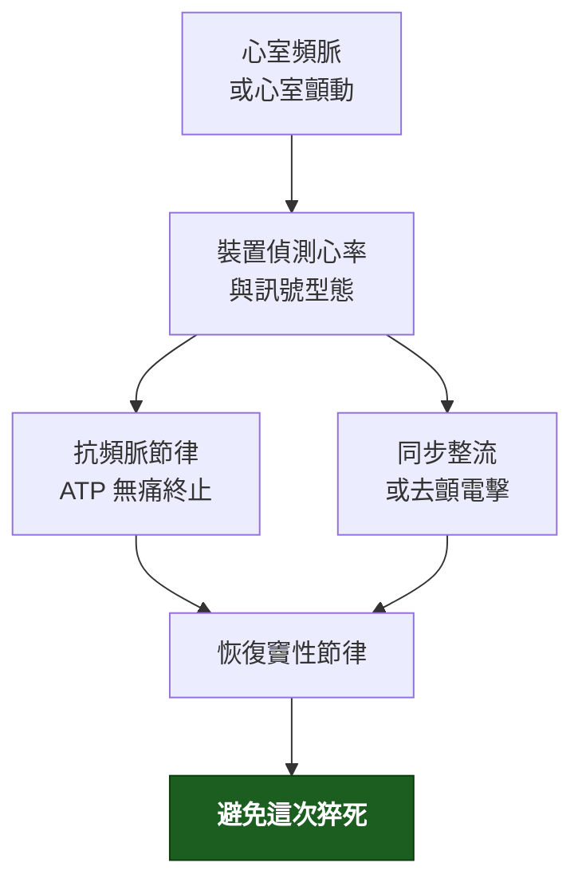

---
tags:
  - Med/Intervention/Cardio
  - device
  - 禁忌
aliases:
  - ICD
  - 植入式心律去顫器
  - Implantable Cardioverter-Defibrillator
  - 體內去顫器
created: 2026-07-26
updated: 2026-07-26
status: 可用
source: 113-1 醫學(三) 14、113-2 醫學(三) 10 延伸；MADIT-II、SCD-HeFT、DANISH、DINAMIT 試驗；AHA/ACC 心室性心律不整與猝死指引
cssclass: clinical-note
indication:
  - "[[Sudden cardiac death]]"
  - "[[Heart failure]]"
contraindication:
  - 可逆原因造成的 VT/VF
complication:
  - 不適當放電
  - 導線故障
---

# ICD ｜ 植入式心律去顫器 · Implantable Cardioverter-Defibrillator

> [!abstract] 一句話總覽
> 植入體內、持續監測心律的去顫器。偵測到心室頻脈或心室顫動就以**抗頻脈節律或電擊**終止它。它做的是**一件事**：把「這次會死」變成「這次不會死」。**它不治療底層心臟病**——這句話是所有 ICD 考題的核心。

> [!tip] 30 秒行動卡
> **最該記的適應症**：**次級預防**＝曾發生非可逆原因的 VT／VF 或心因性昏厥｜**初級預防**＝LVEF ≤30–35% 的心衰竭，且已過等待期
> **做之前一定要確認**：① **原因可不可逆**（可逆就不放）② **等待期過了沒**（MI 後 ≥40 天、血管再灌流後 ≥90 天）③ 預期存活與生活品質是否 ≥1 年
> **絕對不可**：對可逆原因造成的 VT／VF 植入 ICD

---

## 原理與目的

> [!note] 與 Test 的分界
> ICD 會**記錄**心律事件（這部分是取得資訊），但植入它的目的是**改變病人的結局**，所以歸 Intervention。
> 它記錄下來的心電圖資料在診斷上很有價值——心室性心律不整可透過**體表心電圖、植入裝置紀錄、或電生理檢查誘發**三條路確立診斷。

## 適應症 Indications

| 類別 | 適應症 | 判斷閾值／時機 |
|---|---|---|
| **次級預防**（已發生過） | VT／VF 造成的心跳停止存活者、血行動力不穩的持續性 VT、不明原因昏厥且電生理檢查誘發出 VT | **前提：非可逆原因** |
| **初級預防**（尚未發生） | 缺血性心肌病變 LVEF ≤30–35% ＋ NYHA II–III | **心肌梗塞後 ≥40 天、血管再灌流後 ≥90 天** |
| | 非缺血性擴張型心肌病變 LVEF ≤35% ＋ NYHA II–III | 需已接受 ≥3 個月最佳藥物治療 |
| | 遺傳性心律不整：長 QT 症候群、Brugada syndrome、兒茶酚胺敏感性多形性 VT | 依各症候群風險分層 |
| | **ARVC**（右心室心肌病變） | 依風險分層 |
| | 高風險 [[HCM]] | 見 HCM 猝死危險因子清單 |
| | **修補過的先天性心臟病出現自發性 VT** | 例如法洛氏四重症術後——疤痕相關折返；風險因子含 **QRS ＞180 ms**、5 歲後才修補、右心血行動力異常 |

> [!warning] 那兩個等待期是重點，而且有理由
> **MI 後 40 天內植入沒有存活好處**（DINAMIT、IRIS 試驗）——因為早期死亡多來自泵衰竭與再梗塞，不是可電的心律。而且 EF 在這段期間**還可能自己恢復**，太早放會讓不需要的人挨一刀。

## 術前準備與評估

| 項目 | 內容 |
|---|---|
| 必查檢驗 | LVEF（超音波或核醫）、電解質（尤其鉀、鎂）、腎功能、[[CBC]] |
| 一定要先排除 | **可逆原因**：急性心肌缺血、電解質異常、藥物（延長 QT 者）、甲狀腺功能異常 |
| 影像／定位 | 胸部 X 光；評估靜脈通路 |
| 同意書與風險說明 | 手術風險、**不適當放電的可能**、日後更換電池、開車與職業限制、末期時的關閉討論 |
| 停藥 | 依抗凝方案調整；多數情況 warfarin 可不中斷，DOAC 常暫停 1–2 次劑量 |

> [!danger] 預期壽命是適應症的一部分
> 預期存活 ＜1 年（且生活品質不佳）時，ICD 只會把「猝死」換成「較不好受的死亡方式」。這在腫瘤末期或極高齡多重共病者是實際的臨床判斷。

## 操作概要

1. 局部麻醉，在左（或右）鎖骨下做囊袋
2. 經鎖骨下或頭靜脈把導線送入右心室（必要時加右心房、冠狀竇導線）
3. 測試導線的感知與起搏閾值
4. 接上脈衝產生器、置入囊袋、縫合
5. 術後程式設定與（部分中心）去顫閾值測試

![[assets/icd-transvenous-cxr.jpg|420]]
*經靜脈 ICD：脈衝產生器位於左鎖骨下囊袋，導線經中心靜脈進入右心，末端固定在右心室心尖。Source: [Wikimedia Commons — Implantable cardioverter defibrillator chest X-ray](https://commons.wikimedia.org/wiki/File:Implantable_cardioverter_defibrillator_chest_X-ray.jpg)（CC BY 3.0）。*

![[assets/icd-subcutaneous-cxr.jpg|720]]
*S-ICD 側位片：產生器在左側胸壁皮下，導線沿胸骨旁走行，完全不進入血管或心腔；與上圖的 transvenous lead 形成關鍵對照。Source: [Wikimedia Commons — Subcutaneous ICD XRay](https://commons.wikimedia.org/wiki/File:Subcutaneous_ICD_XRay.jpg), PaulT（授權條款見來源頁）。*

> [!info] 皮下式 ICD（S-ICD）
> 導線完全在皮下、不進入血管與心臟 → **感染與導線併發症少**，適合年輕、需長期使用或血管通路困難者。
> 代價：**不能做抗頻脈節律（ATP）、不能做長期心搏過緩起搏、不能做心臟再同步治療**。

## 併發症 Complications

| 併發症 | 何時出現 | 怎麼發現 | 怎麼處理 |
|---|---|---|---|
| **不適當放電** | 任何時候 | 病人主訴被電但當時無症狀；裝置紀錄顯示 Afib 快速心室反應或訊號雜訊 | 重新程式設定、控制心室率、必要時換導線 |
| 囊袋血腫 | 術後數日 | 局部腫脹瘀青 | 壓迫；避免不必要的抗凝中斷 |
| **感染／心內膜炎** | 術後數週至數年 | 囊袋紅腫、發燒、菌血症 | **整套系統移除**＋抗生素——只給抗生素幾乎必復發 |
| 導線移位或斷裂 | 早期或多年後 | 感知／起搏異常、不適當放電 | 更換導線 |
| 氣胸、心臟穿孔 | 術中至術後 24 小時 | 胸痛、呼吸困難、低血壓 | 影像確認；引流或外科處置 |
| **電風暴**（24 小時內 ≥3 次放電） | 任何時候 | 反覆放電 | **緊急處理**：找誘因、抗心律不整藥、鎮靜、必要時電燒 |

## 術後監測

| 要盯的 | 頻率 | 異常閾值 |
|---|---|---|
| 傷口與囊袋 | 每日至出院、術後 1–2 週回診 | 紅、熱、滲液、張力性腫脹 |
| 裝置參數（感知、閾值、阻抗） | 出院前、之後每 3–12 個月或遠距監測 | 阻抗突變提示導線問題 |
| **放電事件** | 每次回診／遠距警示 | **任何一次適當放電都要當成臨床事件處理** |
| 電池餘量 | 每次回診 | 到達 ERI 即安排更換 |

## 這個處置改善了什麼、沒改善什麼

*這一節是 ICD 考題最集中的地方。*

| 問題 | 答案 |
|---|---|
| 降低**心律不整性猝死**？ | **是**——這是它唯一直接做到的事 |
| 降低**整體死亡率**？ | **在符合適應症的族群，是**（MADIT-II ↓31%、SCD-HeFT ↓23%） |
| 改善**心衰竭**本身？ | **否**——不減少心衰竭惡化與住院 |
| 改善症狀或運動耐受？ | **否** |

> [!danger] 適當放電是預後變差的訊號，不是「已經沒事了」
> SCD-HeFT 次分析顯示，接受過適當放電的病人**全因死亡風險顯著升高**，最常見的死因正是**心衰竭惡化**。放電代表底層心臟病在進展，應觸發完整的重新評估。

> [!warning] 「ICD 不降低整體死亡率」這句話講得太滿
> 在符合適應症的族群整體死亡率**是**會下降的。**沒有**整體死亡率好處的是三個特定情境：
> ① **心肌梗塞後 40 天內**（DINAMIT、IRIS）
> ② **現代藥物治療下的非缺血性擴張型心肌症**（DANISH 2016）
> ③ **可逆原因**造成的 VT／VF
> 這也正好解釋了那兩個等待期為什麼存在。

## 禁忌與陷阱

> [!danger] 絕對不可
> | 情境 | 絕對不可 | 為什麼 | 該做什麼 |
> |---|---|---|---|
> | VT／VF 由**可逆原因**造成（急性缺血、低血鉀、藥物延長 QT、電解質異常） | 直接植入 ICD | 矯正原因後不會再發，白挨一刀還帶終身併發症 | 矯正原因、觀察；仍反覆發作再評估 |
> | **心肌梗塞後 40 天內** | 植入 ICD 作初級預防 | 無存活好處；EF 可能自行恢復 | 等待期內用**穿戴式去顫背心**過渡 |
> | 裝置**感染** | 只給抗生素而不移除 | 生物膜使感染幾乎必然復發 | **整套系統移除**＋足療程抗生素 |
> | 預期存活 ＜1 年且生活品質不佳 | 植入 ICD | 只是改變死亡方式 | 安寧共照；已植入者討論**關閉去顫功能** |
> | 任何心室性心律不整發作當下 | 忙著分辨心律型態而延誤處置 | **初始治療目標是穩定血行動力學** | 不穩定 → 立即電擊整流 |

> [!warning] 常見錯誤
> - 把「ICD 降低心衰竭風險」當正確——**不降低**。
> - 反過來把「ICD 完全不降低整體死亡率」當正確——**在適應症族群是會降低的**，兩個方向都能出題。
> - 忘記 **40 天／90 天** 等待期，或把兩個數字對調。
> - 對可逆原因的 VT／VF 植入 ICD。
> - 把 ICD 與**心律調節器（pacemaker）** 混為一談：前者治過快、後者治過慢；ICD 內建起搏功能，反之不然。

## 相關連結

- [[HCM]] — 猝死危險因子決定要不要放 ICD
- [[Restrictive cardiomyopathy]] — 浸潤性心肌病變的心律不整風險
- [[Heart failure]] — 初級預防適應症的母體
- [[ECG]] — 診斷心室性心律不整的第一線工具
