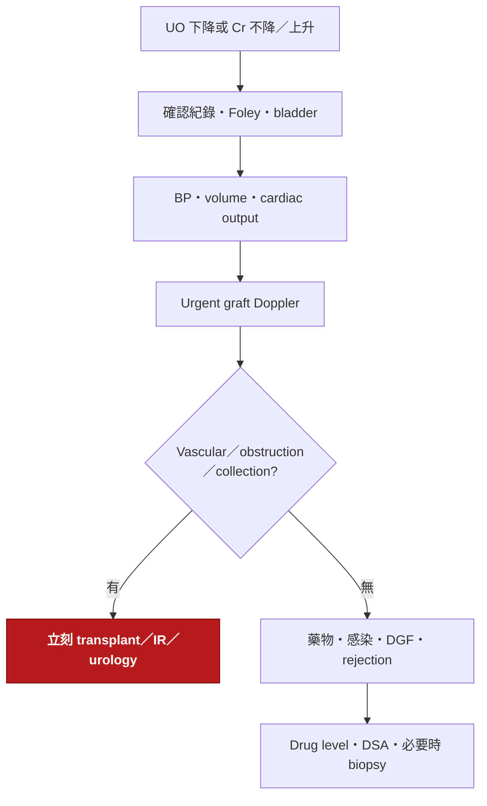

---
tags:
  - Clinical/Intervention/TransplantSurgery
  - Clinical/Intervention/Nephro
  - 禁忌
aliases:
  - Kidney transplant
  - Renal transplantation
  - 腎臟移植
  - 腎移植
created: 2026-08-03
updated: 2026-08-03
status: 可用
source:
  - "KDIGO 2020 Clinical Practice Guideline on the Evaluation and Management of Candidates for Kidney Transplantation"
  - "KDIGO 2017 Clinical Practice Guideline on the Evaluation and Care of Living Kidney Donors"
  - "KDIGO 2009 Clinical Practice Guideline for the Care of Kidney Transplant Recipients"
  - "UK Kidney Association 2017 Post-Operative Care in the Kidney Transplant Recipient"
services:
  - TransplantSurgery
  - Nephro
cssclass: clinical-note
subtype: operation
approach:
  - extraperitoneal
  - open
indication:
  - "[[CKD]]"
contraindication:
  - "[[Active infection]]"
  - "[[Active malignancy]]"
alternative:
  - "[[Dialysis]]"
complication:
  - "[[Delayed graft function]]"
  - "[[Kidney allograft rejection]]"
  - "[[Renal allograft vascular thrombosis]]"
  - "[[Urine leak]]"
---

# Kidney transplantation ｜ 腎臟移植 · Renal transplantation

> [!abstract] 一句話總覽
> 將 donor kidney 通常置於 recipient 的 **iliac fossa 腹膜外空間**，把 renal vein／artery 接到 iliac vessels、ureter 接到 bladder，以恢復腎功能；原生腎多半保留，真正的成敗取決於**合適的 donor–recipient 配對、順利再灌流、早期排除 technical failure，以及終身免疫抑制與追蹤**。

> [!tip] 30 秒行動卡
> **什麼情況該做**：適合接受移植的 kidney failure；可行時優先在透析前完成 **pre-emptive transplantation**。預期進展至 kidney failure 的 CKD G4–G5 應提早接受移植資訊與候選評估。
> **術前一定要確認**：recipient identity／consent、donor 與 graft、**ABO＋HLA／DSA／final crossmatch**、活動性感染與惡性腫瘤、心血管／iliac vessel 狀況、volume／K／最後一次透析、抗凝與 induction immunosuppression 計畫。
> **術後最先要盯**：**hourly urine output ＋ creatinine trend**、K／酸鹼、BP 與 graft perfusion、Hb／傷口／drain、fluid balance、免疫抑制劑與 drug interaction。
> **立刻叫 senior**：突然 oliguria／anuria、hemodynamic instability 或 Hb 快降、graft pain／swelling、Doppler perfusion 異常、疑似 urine leak／obstruction、嚴重 hyperkalemia 或 sepsis。

> [!warning] 這篇的邊界
> 這是**看懂 recipient operation 與術後第一線監測**的 hub。配對原理 → [[Kidney transplant compatibility]]；免疫抑制劑 → [[Kidney transplant immunosuppression]]；rejection → [[Kidney allograft rejection]]；graft function 變差的床邊分流 → [[Post-transplant graft dysfunction]]。

---

## 目的、關鍵解剖與原理

```text
Donor kidney placed in iliac fossa（通常 extraperitoneal）
├─ Renal vein   → recipient iliac vein
├─ Renal artery → recipient iliac artery
└─ Ureter       → bladder（ureteroneocystostomy）
```

| 項目 | 重點 |
|---|---|
| 病人的問題 | [[CKD]] 進展至 kidney failure，原生腎無法維持體液、電解質、酸鹼與內分泌功能 |
| 手術目標 | 建立穩定 graft inflow／outflow 與尿液引流，讓 donor nephron 接手腎功能 |
| Graft location | 多置於右或左 iliac fossa 的**腹膜外空間**；位置淺，方便 palpation、Doppler 與 biopsy |
| Venous anastomosis | donor renal vein 通常接 external iliac vein；短右 renal vein 或多條 vein 可能增加重建難度 |
| Arterial anastomosis | renal artery 可接 external／internal iliac artery；multiple renal arteries 可能需 back-table reconstruction 或多重吻合 |
| Urinary reconstruction | donor ureter 接 bladder（ureteroneocystostomy），是否放 ureteral stent 依術式與院內 protocol |
| Native kidneys | 多數保留；只有反覆感染、無法控制的出血／高血壓、巨大 polycystic kidneys、腫瘤或空間不足等特定理由才考慮 nephrectomy |
| Structures at risk | iliac vessels、ureteral blood supply、bladder、lymphatics、genitofemoral nerve；過度剝離 ureter 會增加 ischemia／leak／stricture |

> [!important] 手術成功有三條獨立軸
> **血流進得去**（arterial inflow）＋ **血流出得來**（venous outflow）＋ **尿排得出去**（ureter／bladder）。
> 術後 graft dysfunction 不能直接等同 rejection；最先要排的是 catheter、hemodynamics、vascular thrombosis／kinking 與 urinary obstruction／leak。

> [!todo] 📷 要插入圖片｜graft 位於 iliac fossa 的三個吻合處
> **要能看到**：renal artery／vein 接 iliac vessels、ureteroneocystostomy、native kidneys 留在原位。

## 適應症與手術時機

| 情境 | 手術門檻／時機 | 重點 |
|---|---|---|
| Pre-emptive transplant | 預期進展至 kidney failure、已完成完整評估且有合適 donor／allocation | 避免透析暴露；需提早在 CKD G4–G5 規劃，不是等到 emergent dialysis 才轉介 |
| 已接受 dialysis | kidney failure 且整體 transplant benefit 大於風險 | 透析年資本身不是拒絕移植的理由；評估 cardiovascular、infection、malignancy 與功能狀態 |
| Living-donor transplant | donor 自願、獨立評估、風險可接受且 compatibility／計畫允許 | 可排程、cold ischemia 較短；**donor safety 是獨立且優先的決策** |
| Deceased-donor transplant | wait-list candidate 收到可接受 organ offer | 時間敏感；需快速更新感染、心肺狀態、抗凝、K／volume 與 final crossmatch |
| Retransplantation | 前一 graft 失敗但仍有淨效益 | 常已 sensitized；DSA、crossmatch、解剖空間與舊 graft 處理更複雜 |

> [!note] 年齡不是單獨的禁忌
> 候選評估看的是**整體風險負擔與預期淨效益**，不能只用年齡、肥胖或單一共病一票否決。會使手術暫緩的問題應先治療／優化，再由 multidisciplinary transplant team 重新評估。

## 移植選項與替代方案

| 選項 | 適合誰 | 優點 | 代價／限制 |
|---|---|---|---|
| Living-donor kidney | 有自願且通過獨立評估的 donor | 可安排 pre-emptive、ischemia time 較短、器官資訊較完整 | 健康 donor 承擔手術與長期風險；倫理與 donor advocacy 不可從 recipient 角度省略 |
| Deceased-donor kidney | 符合 wait-list 與 allocation 條件 | 不讓健康 donor 承擔 nephrectomy | 等待時間不確定，器官品質與 ischemia exposure 差異大 |
| Paired exchange／incompatible pathway | 有 living donor 但 ABO／HLA 不相容者 | 增加找到相容 graft 的機會 | 需專門配對、desensitization／immunologic protocol；不可當一般相容移植處理 |
| [[Dialysis]] | 尚未能移植、等待中或不適合移植 | 可作 bridge 或長期 kidney replacement therapy | 不取代腎臟所有功能，治療負擔與長期 morbidity 較高 |
| Conservative kidney management | 不想或無法承受 dialysis／transplant 的病人 | 以症狀、生活品質與目標為中心 | 不提供 kidney replacement；需明確 shared decision-making 與緩和照護 |

## 術前評估與準備

### Recipient evaluation

| 面向 | 必須確認 | 會改變什麼決策 |
|---|---|---|
| 原發腎病 | diagnosis、進展速度、是否會在 graft 復發；是否仍有可逆病因 | transplant timing、復發風險、原病專一治療 |
| Immunologic | ABO、HLA typing、sensitizing events（pregnancy／transfusion／prior transplant）、cPRA、DSA、final crossmatch | 是否可直接移植、需 paired exchange／desensitization、rejection risk |
| Infection | 症狀與必要 screening；active infection 是否已治療，vaccination 是否完成 | 活動性感染通常先治療並延後移植；決定 CMV／PJP 等 prophylaxis |
| Malignancy | active cancer、既往癌症的治療與復發風險 | 是否需先完成治療／觀察；等待期依癌種、stage 與 team 決定 |
| Cardiopulmonary | functional capacity、CAD／HF／valve／pulmonary disease；需要時 [[Echocardiography]] 等 | 手術耐受度與是否先優化；不是每人無差別做所有心臟檢查 |
| Vascular anatomy | pulse、prior access／operation；iliac calcification／occlusion 風險，必要時 imaging | graft 放哪側、可否安全 clamp／anastomose、是否需 vascular reconstruction |
| Urologic | bladder capacity／emptying、reflux、recurrent UTI、尿路結構 | ureter implantation、是否先處理 obstruction／infection |
| Psychosocial | informed preference、adherence barriers、支持系統、藥物與追蹤能力 | 先介入可修正障礙；不能把社經因素當成未經評估的排除理由 |

### 當次手術前 final check

| 項目 | 床邊要知道的版本 |
|---|---|
| Donor／graft | living vs deceased、左右腎、arteries／veins 數目、organ injury、cold ischemia、感染與 serology 風險 |
| Compatibility | recipient／donor identity、ABO、HLA／DSA、**final crossmatch 已審核**；不相容只能走核准的專門 pathway |
| Dialysis／metabolic | 最後一次 dialysis、dry weight、目前 K、acid–base、volume；需要術前 dialysis 時避免過度 ultrafiltration 造成低灌流 |
| Medication | anticoagulant／antiplatelet、ACEi／ARB、糖尿病藥、既有 immunosuppression；逐一確認停用／續用計畫 |
| Blood／access | CBC、coagulation、type and screen／備血；可靠 IV access，必要時 invasive monitoring |
| Prevention | perioperative antibiotic、VTE prophylaxis、induction immunosuppression、CMV／PJP strategy 依 donor–recipient risk 與院內 protocol |
| Consent | graft nonfunction、dialysis、bleeding、vascular／urinary complication、rejection、infection、malignancy與終身免疫抑制 |

> [!danger] Crossmatch 是 go／no-go 資料
> 未確認相容性與 transplant team 核准前不可把器官接上。已知 positive crossmatch 並不是任何地方都永遠不能移植，但只能在**預先設計的 incompatible-transplant／desensitization protocol**下進行，不可臨場當成一般移植。

## 手術步驟概要

*只寫到能理解手術進度與併發症來源，不作為獨立操作指南。*

1. **Back-table preparation**：確認 graft、沖洗與保存狀況；辨識 renal arteries／veins／ureter，必要時重建多條血管。
2. **Recipient exposure**：下腹切口進入 extraperitoneal iliac fossa，暴露 iliac artery／vein，控制 lymphatics。
3. **Venous anastomosis**：donor renal vein 與 recipient iliac vein 吻合；確保沒有 tension、twist 或 kinking。
4. **Arterial anastomosis**：renal artery 與 iliac artery 吻合；術式依血管長度、數目、calcification 與既往手術調整。
5. **Reperfusion**：解除 clamps，確認 graft color／turgor、arterial pulse、venous drainage、hemostasis；是否立即產尿受 donor 與 ischemia 等多因素影響。
6. **Urinary reconstruction**：保持 ureter 周邊血供，完成 ureteroneocystostomy，視 protocol 放 stent。
7. **Closure**：再次確認血流、尿路與出血；是否放 drain 依 operative finding 與院內作法。

> [!important] 「再灌流後有尿」不是完整成功判準
> Immediate urine output 是好訊號，但不能取代 serial creatinine、electrolytes 與 graft perfusion。反過來，deceased-donor graft 可能不會立刻產尿；先按 [[Post-transplant graft dysfunction]] 排除可逆的 technical／hemodynamic 原因，不要直接貼 rejection。

> [!todo] 📷 要插入圖片｜extraperitoneal approach、vascular anastomoses 與 ureteroneocystostomy
> **要能看到**：graft 在 iliac fossa、artery／vein／ureter 三條連接，以及容易發生 thrombosis、kinking、leak 的位置。

## 術後路徑

| 時間 | 預期進程 | 要盯的 | 偏離路徑時想到什麼 |
|---|---|---|---|
| PACU／POD 0 | 維持 graft perfusion，確認尿路通暢與止血；開始／延續 induction、maintenance 與 prophylaxis plan | **hourly UO**、Foley patency、BP／perfusion、fluid balance、Cr／BUN、K／Na／HCO₃、Ca／Mg／P、CBC、drain／wound | hypotension／hypovolemia、bleeding、catheter obstruction、vascular thrombosis／kinking、hyperkalemia、urine leak |
| POD 1–3 | graft function 應以趨勢評估；逐步離床、進食與轉口服藥；可能仍需 dialysis | weight、I/O、Cr trend、electrolytes、drug level（依 regimen）、fever、graft exam；dysfunction 時 [[Transplant Doppler ultrasound]] | [[Delayed graft function]]、rejection、CNI toxicity、obstruction／leak、infection、volume overload／depletion |
| 出院前 | 生理穩定、用藥與追蹤可安全執行 | graft function 與電解質趨勢、BP／glucose、傷口與管路、完整 medication reconciliation、警訊與回診抽血計畫 | adherence barrier、drug interaction、未處理感染、管路或功能異常 |

> [!warning] 補液不能只靠「尿多少就 1:1 補多少」
> Early polyuria 可能造成 volume 與 electrolyte depletion，但機械式逐毫升補回也可能導致 overload。補液要同時看 BP、weight、exam、insensible loss、心臟功能與電解質，並遵循 transplant unit protocol。

### 管路、引流與日常照護

| 項目 | 正常預期 | 拔除／調整條件 | 異常警訊 |
|---|---|---|---|
| Foley catheter | 確保 bladder drainage、量 hourly UO，保護 ureteroneocystostomy | 時機依 anastomosis、bladder／urologic risk 與院內 protocol | 突然無尿先看 kink／clot／bladder；不要在未評估吻合處時反覆粗暴沖洗 |
| Ureteral stent | 若有，可降低早期尿路重建相關問題但增加感染／遺忘風險 | 依 transplant／urology 安排移除，出院文件必須寫明日期與 owner | fever、UTI、hematuria、migration；**最危險是無人追蹤而遺留** |
| Surgical drain | 少量 serosanguinous，趨勢下降 | 依量、性質、drain creatinine 與 surgeon 決定 | 明顯血液、突然增量、clear high-output fluid；drain creatinine 高於 serum 支持 urine leak |
| 傷口 | 疼痛與腫脹逐漸改善 | 依癒合與 wound plan | expanding swelling、持續滲血、erythema／purulence、dehiscence |
| 飲食／營養 | 清醒且腸胃功能允許後早期進食；配合 K、phosphate、glucose 調整 | 依噁心、ileus 與 metabolic status | aspiration risk、ileus、嚴重 electrolyte shift |
| 活動／VTE prevention | 早期離床、呼吸訓練；mechanical／pharmacologic prophylaxis 個別化 | 依出血風險與 mobility | unilateral leg swelling、hypoxemia、出血 |

## Graft dysfunction：值班時的第一條路



| 問題 | 先做什麼 | 不能漏掉 |
|---|---|---|
| 真的是 oliguria／anuria？ | 確認時間、I/O、Foley kink／clot、bladder scan | 把 catheter obstruction 誤認 graft failure |
| Perfusion 夠嗎？ | BP／MAP trend、volume、bleeding、cardiac status | 過度 ultrafiltration、sepsis、low cardiac output |
| 血管與尿路通嗎？ | **低門檻 urgent graft Doppler**；看 hydronephrosis／collection，必要時進一步影像 | renal artery／vein thrombosis、kinking、obstruction、urine leak |
| 有藥物或代謝問題嗎？ | medication reconciliation、CNI level、K／acid–base | azole／macrolide 等 interaction、nephrotoxin、嚴重 hyperkalemia |
| 是 graft parenchymal problem 嗎？ | 依 transplant team 評估 DSA、viral studies 與 [[Kidney allograft biopsy]] | ischemic injury／DGF、T-cell–mediated或 antibody-mediated rejection、原病復發 |

> [!danger] Abrupt anuria 是 vascular／technical emergency，直到證明不是
> 不要等隔天 creatinine，也不要先用「可能 rejection」解釋。立即確認 catheter 與 hemodynamics，同步聯絡 transplant surgeon 並取得 urgent graft perfusion imaging；早期 thrombosis 的 salvage window 很短。

## 併發症與 must-call thresholds

| 時間／機制 | 併發症 | 怎麼發現 | 立即處理／何時叫 senior |
|---|---|---|---|
| Immediate · vascular | renal artery／vein thrombosis、kinking、anastomotic bleeding | sudden anuria／oliguria、graft pain／swelling、hypotension、Hb 下降、Doppler perfusion 異常 | **立即 transplant surgeon**；resuscitation＋urgent Doppler／OR pathway，不等 routine round |
| Immediate · metabolic | hyperkalemia、acidosis、volume overload／depletion | serial lab、ECG、weight／I/O、BP／lung exam | 先穩定致命異常；需要時 [[Dialysis]]，不能因「剛移植」而延誤 |
| Early · graft | [[Delayed graft function]]／ischemia-reperfusion injury | graft 未如預期恢復、Cr 不降、仍需 dialysis | 排除 perfusion／obstruction；支持治療、避免 nephrotoxin，依 team 決定 biopsy |
| Early · urinary | ureteral obstruction、ischemic stricture、[[Urine leak]] | UO 下降、hydronephrosis、peri-graft collection、drain output／creatinine | transplant／urology／IR；依原因 stent、nephrostomy、drainage 或 repair |
| Early · immunologic | [[Kidney allograft rejection]] | Cr 上升常比發燒／疼痛敏感；DSA／biopsy 分型 | 排除 technical cause；若可行在治療前取得 biopsy，治療依 rejection phenotype |
| Early／late · collection | hematoma、lymphocele、abscess | graft／leg swelling、疼痛、感染、obstruction；ultrasound／CT | hemodynamic compromise、infection 或 graft／ureter compression 時升級處理 |
| Late · vascular／urinary | transplant renal artery stenosis、ureteral stricture | resistant HTN、graft dysfunction、bruit、hydronephrosis | Doppler／進一步 vascular or urologic evaluation |
| Late · systemic | infection、malignancy／PTLD、CNI toxicity、DM／CVD、原病復發 | 症狀＋protocol surveillance＋graft trend | 聯絡 transplant team調整免疫抑制與針對性診療，不能只處理單一數字 |

## 免疫抑制地圖

*這裡只記角色；劑量、target trough、減量與感染 prophylaxis 寫在 [[Kidney transplant immunosuppression]]，並以院內 protocol 為準。*

| 階段 | 常見角色 | 核心風險／監測 |
|---|---|---|
| Induction | lymphocyte-depleting agent 或 IL-2 receptor antagonist，依 immunologic risk | infusion reaction、cytopenia、infection；不是每人同一 regimen |
| Maintenance | calcineurin inhibitor（常見 tacrolimus）＋ antimetabolite（常見 mycophenolate）＋ corticosteroid 的風險調整組合 | trough／renal function、K／Mg、CBC、glucose、GI toxicity、infection、drug interaction |
| Rejection treatment | 依 biopsy phenotype 區分 T-cell–mediated 與 antibody-mediated pathway | **先分型再升級免疫抑制**；治療與感染風險同步上升 |

> [!warning] Creatinine 上升時不要 reflexively 加大 immunosuppression
> Hemodynamic、vascular、obstructive、infectious、drug-toxic 與 rejection 都會讓 graft function 變差。若臨床允許，先取得足以分型的證據；KDIGO 建議在治療 acute rejection 前做 biopsy，除非 biopsy 會明顯延誤必要治療。

## 出院與長期追蹤

| 項目 | 重點 |
|---|---|
| 出院條件 | hemodynamically stable、graft／dialysis plan 明確、electrolytes 可控制、能口服用藥、傷口／管路安全、follow-up 已安排 |
| Medication reconciliation | 每顆 immunosuppressant 的名稱、時間與漏服處理；確認所有 interaction、prophylaxis、BP／DM 藥；不得自行停藥 |
| 監測 | 頻繁 Cr／electrolytes／CBC／drug level，之後按風險逐步拉長；BP、glucose、lipid、proteinuria、infection／malignancy surveillance |
| 管路 owner | Foley、drain、ureteral stent 的移除條件、日期與負責團隊必須寫清楚 |
| 回院警訊 | 少尿、發燒、嘔吐無法服藥、graft／傷口疼痛腫脹、呼吸困難、水腫、明顯血壓或體重變化 |
| 長期目標 | 保存 graft function、避免 rejection 與 infection、降低 cardiovascular／malignancy burden、維持 adherence 與生活品質 |

## 禁忌與陷阱

> [!danger] 絕對不可
> | 情境 | 絕對不可 | 為什麼 | 該做什麼 |
> |---|---|---|---|
> | 活動性未控制感染，或尚未完成 multidisciplinary clearance 的 active malignancy | 把 immunosuppression 與移植照常推進 | 免疫抑制會放大感染／腫瘤風險，危及 recipient 與 graft | 先治療／控制，依感染、癌種與 stage 由 transplant team 重評時機 |
> | Final compatibility／crossmatch 尚未確認，或 positive crossmatch 卻沒有核准的 incompatible protocol | 當一般相容移植直接進行 | 可能發生立即或早期嚴重 antibody-mediated injury | 暫停並由 HLA lab＋transplant team 完成 go／no-go 決策 |
> | 術後突然 anuria／graft swelling／Doppler perfusion 異常 | 等隔天 creatinine、只先補液觀察或直接當 rejection | vascular thrombosis／kinking 是 time-critical，延誤可能失去 graft salvage 機會 | 同步查 Foley／hemodynamics，立即通知 surgeon＋urgent perfusion imaging／exploration pathway |
> | 發燒、leukopenia 或感染 | 未聯絡 transplant team 就自行停掉全部 immunosuppression | 可能引發 rejection；不同藥的調整邏輯與半衰期不同 | 先做嚴重度與感染評估，由 transplant／ID 團隊調整個別藥物與抗感染治療 |

> [!warning] 常見錯誤
> - **有尿＝graft 正常**：錯；看 creatinine trend、electrolytes 與 perfusion。
> - **沒尿＝rejection**：錯；先查 Foley、BP／volume、vascular與obstruction。
> - **Creatinine 高＝多補液**：錯；volume depletion、overload、cardiac dysfunction與obstruction都可能存在。
> - **Tacrolimus level 正常＝沒有 toxicity**：錯；level 是線索，不是單獨診斷，且抽血時間與交互作用會影響判讀。
> - **移植後不會再 dialysis**：錯；DGF、嚴重 hyperkalemia／acidosis／overload 時仍應依適應症透析。
> - **所有感染都只靠減免疫抑制**：錯；先找病原與 source control，藥物調整必須與 rejection risk 一起決定。

## 資料來源與適用範圍

- [KDIGO 2020 — Evaluation and Management of Candidates for Kidney Transplantation](https://kdigo.org/guidelines/transplant-candidate/)：candidate referral、整體風險評估與共病處理。
- [KDIGO 2017 — Evaluation and Care of Living Kidney Donors](https://kdigo.org/guidelines/living-kidney-donor/)：living donor 的獨立評估、風險溝通與長期照護。
- [KDIGO 2009 — Care of Kidney Transplant Recipients](https://kdigo.org/wp-content/uploads/2017/02/KDIGO-2009-Transplant-Recipient-Guideline-English.pdf)：graft monitoring、immunosuppression、rejection、infection 與長期照護。
- [UK Kidney Association — Post-Operative Care in the Kidney Transplant Recipient](https://www.ukkidney.org/health-professionals/guidelines/post-operative-care-kidney-transplant-recipient)：early／late postoperative care 的實務架構。

> [!warning] 指引年代與在地化
> KDIGO transplant-recipient guideline 仍是官方 reference，但內容基於較早期證據；drug regimen、trough target、prophylaxis、fluid replacement、Doppler／biopsy trigger 與管路拔除時間應以**目前院內 transplant protocol**為準。

## 相關連結

- [[CKD]] — 原疾病與 kidney failure 進展
- [[Dialysis]] — 等待移植、DGF 或 graft failure 時的 kidney replacement therapy
- [[Kidney transplant compatibility]] — ABO、HLA、cPRA、DSA 與 crossmatch
- [[Transplant Doppler ultrasound]] — 早期 graft perfusion 與 obstruction 評估
- [[Kidney allograft biopsy]] — rejection／injury 分型
- [[Kidney transplant immunosuppression]] — induction、maintenance、drug level 與 toxicity
- [[Kidney allograft rejection]] — T-cell–mediated vs antibody-mediated rejection
- [[Post-transplant graft dysfunction]] — oliguria 或 creatinine 上升的完整床邊流程
- [[Transplant Surgery]] — 移植外科 MOC
