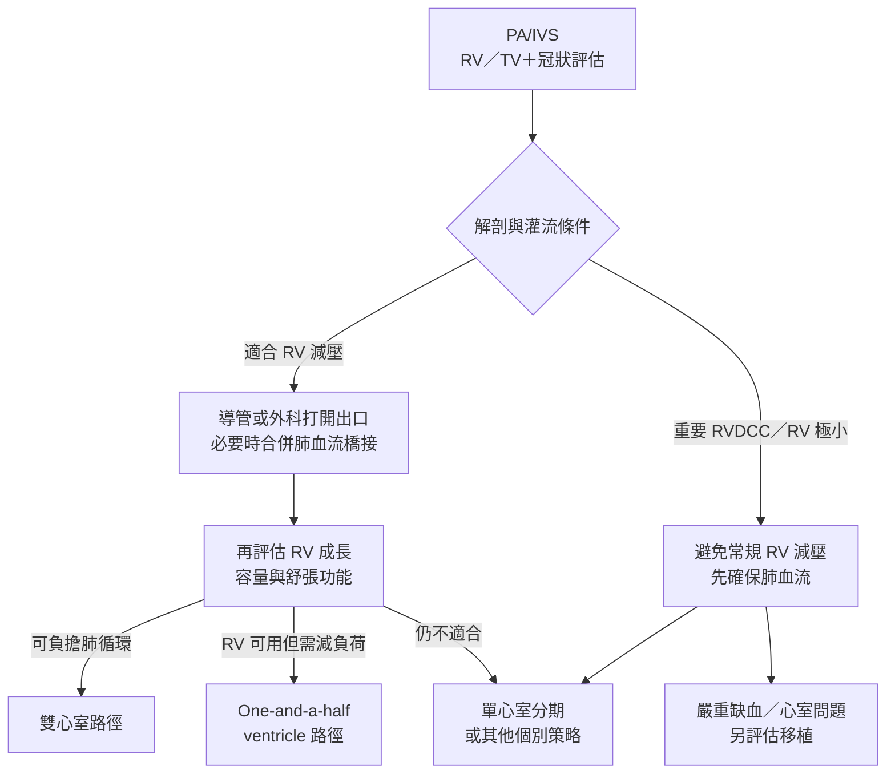
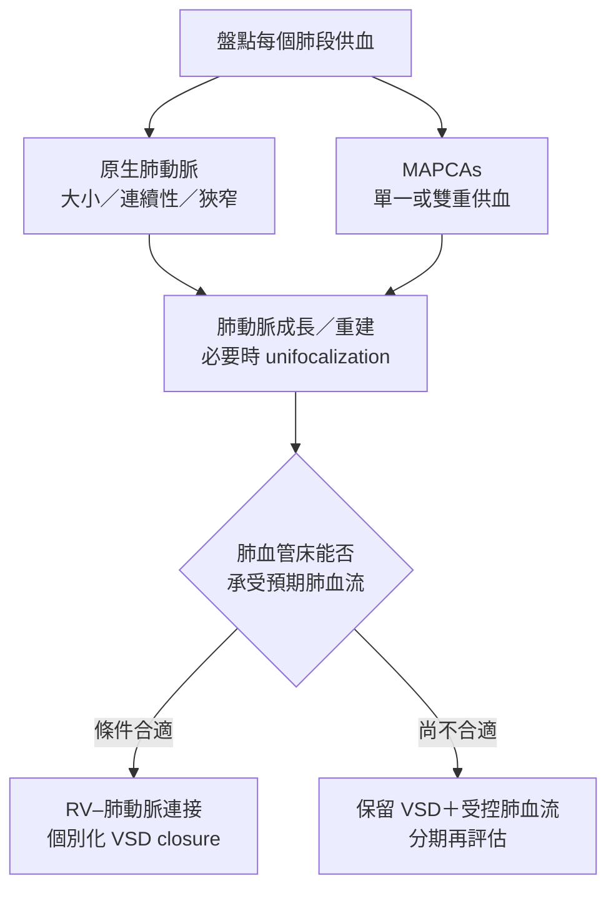

---
tags:
  - Clinical/Intervention/Pediatrics
  - Clinical/Intervention/CardiacSurgery
  - congenital-heart-disease
  - 禁忌
aliases:
  - 肺動脈閉鎖介入與手術
  - Pulmonary atresia repair
  - PA IVS intervention
  - PA VSD repair
created: 2026-10-14
updated: 2026-10-14
status: 可用
source:
  - "AHA: Pediatric cardiac catheterization and intervention statement, 2011"
  - "Giglia et al.: RV-dependent coronary circulation, Circulation 1992"
  - "Sukhavasi et al.: PA/IVS intended strategies, JTCVS 2022"
  - "Stanford Children's: Pulmonary artery reconstruction and unifocalization"
  - "Queensland NeoMedQ: Alprostadil, 2026-05-29"
services:
  - Pediatrics
  - Cardio
  - CardiacSurgery
cssclass: clinical-note
subtype: operation
approach:
  - transcatheter
  - open
  - staged palliation or repair
indication:
  - "[[Pulmonary atresia]]"
contraindication:
  - "RV decompression without adequate coronary assessment in PA/IVS"
alternative:
  - individualized biventricular or one-and-a-half ventricular pathway
  - staged single-ventricle palliation
  - selected heart transplantation
complication:
  - myocardial ischemia
  - shunt or stent obstruction
  - residual pulmonary artery obstruction
  - low cardiac output
---

# Pulmonary atresia intervention ｜ 肺動脈閉鎖的介入與手術

> [!abstract] 一句話總覽
> 先建立足夠肺血流、保護冠狀灌流，再依 **右心室能否使用**及**肺血管床能否承受血流**，選擇導管／外科重建、雙心室路徑或分期緩和治療；沒有一種「pulmonary atresia correction」適用全部病童。

> [!tip] 30 秒行動卡
> **什麼情況要介入**：肺血流不足、依賴動脈導管、房間交通受限或需建立後續循環；新生兒嚴重缺氧／灌流惡化需立即心臟與加護團隊處理。
> **術前一定要確認**：心室中隔有無缺損、right ventricle（RV）／tricuspid valve（TV）大小與功能、冠狀動脈、各肺段供血；不能只看肺動脈瓣。
> **術後最先要盯**：肺血流通路、心肌缺血、全身灌流與節律；血氧改善不等於心輸出足夠。
> **立刻叫 senior**：血氧較基線突降、乳酸上升／尿量下降、低血壓、新心律或心電圖變化、手術後持續呼吸惡化。

## 目的、關鍵解剖與原理

**[[Pulmonary atresia]] 的病型必須先分清楚：** pulmonary atresia with intact ventricular septum（PA/IVS）＝心室中隔完整；pulmonary atresia with ventricular septal defect（PA/VSD）＝合併 ventricular septal defect（VSD）。Major aortopulmonary collateral arteries（MAPCAs）是主要主動脈－肺動脈側枝。

| 要解決的問題 | 治療真正改變什麼 | 必須保護 |
|---|---|---|
| 肺血流不足 | 維持／新建體循環到肺的路徑，或建立 RV 前向肺血流 | 全身與冠狀灌流，避免肺血流過多 |
| PA/IVS 的可用 RV | 打開肺動脈瓣／流出道後，讓 RV 有機會承擔肺循環 | 冠狀循環與小、僵硬 RV 的容量耐受 |
| PA/VSD＋MAPCAs 的分散肺血源 | 重建可連接的肺動脈樹，再判斷能否分隔體肺循環 | 各肺段唯一血源、肺門血管與鄰近氣道 |

解剖原圖與血流見 [[Pulmonary atresia#心臟解剖：閉鎖之外，還要看中隔與肺血流]]；下方流程圖是循環與決策示意，不代表個別病童的實際解剖。[^aha][^stanford]

## 術前穩定：先維持肺血流與灌流

Right atrium（RA）＝右心房；patent ductus arteriosus（PDA）＝開放性動脈導管。

| 問題 | 處置與監測 |
|---|---|
| 懷疑／確認導管依賴性肺血流 | **Prostaglandin E₁（PGE₁；alprostadil）持續靜脈輸注**，依院內新生兒體重劑量與兒童心臟團隊調整；同步確認替代肺血流計畫 |
| PGE₁ 輸注安全 | 專用管路、幫浦與連續心肺監測；不可 bolus 或沖洗藥物管路；監測呼吸暫停、血壓與體溫，備妥呼吸支持 |
| 缺氧／酸中毒／低灌流 | Airway、breathing、circulation 評估；按病況給氧、調整通氣及循環支持，追蹤血壓、blood gas／lactate、尿量與血糖 |
| 容量與餵食 | 依灌流及肺血流決定液體與營養；不是發紺就一律大量補液，也不能只追求正常血氧數字 |
| PA/IVS 房間交通受限 | 心臟團隊評估是否需 balloon atrial septostomy 或外科擴大房間交通，改善 RA 回流至左心；不能取代肺血流通路 |
| MAPCAs 供血較多／不均 | 評估肺血流過多、心衰竭及各肺段壓力；PGE₁ 僅對有用且導管依賴的肺血流通路有角色 |

初始穩定是介入前的橋接，不能取代解剖診斷。[^pge][^texas][^stanford]

## PA/IVS：先判斷 RV 減壓是否安全

> [!danger] 不能因為「出口堵住」就直接打開
> **Right ventricle-dependent coronary circulation（RVDCC）** 表示部分心肌灌流依賴 RV 壓力與異常冠狀交通。減壓可能導致心肌缺血／梗塞；介入前必須釐清冠狀動脈起源、狹窄／閉鎖與灌流範圍，通常涉及專家心導管及血管攝影。
> **Sinusoids／ventriculocoronary connections 本身不等於 RVDCC**；也不能因為看到交通就直接排除所有雙心室可能性。[^coronary][^cath]

*圖 1｜流程代表專家評估後的可能路徑，不是只依 RV 尺寸決定。冠狀循環未釐清者須先完成評估，不直接分派到任何終點；路徑也可能隨後續功能評估調整。[^strategy][^coronary]*

| 選項 | 適合誰／改變什麼 | 限制與後續 |
|---|---|---|
| **導管肺動脈瓣穿孔＋balloon valvuloplasty** | 選定膜性閉鎖、出口與 RV 合適且冠狀循環允許減壓者；建立 RV 前向肺血流 | 非所有閉鎖都能穿孔；有穿孔傷害、tamponade、殘餘狹窄／逆流風險，仍可能需 PDA stent 或 shunt。[^cathetrisk] |
| **外科 valvotomy／right ventricular outflow tract（RVOT）重建** | 需要外科打開或擴大出口、且適合 RV 減壓者 | 同樣受冠狀循環限制；不是用外科就可迴避 RVDCC 風險 |
| **Biventricular pathway** | RV／TV 與功能足以承擔肺循環，且冠狀條件允許 | 需追蹤 RV 舒張功能、流出道及瓣膜；開通出口不等於立刻可停所有橋接 |
| **One-and-a-half ventricle pathway** | 選定 RV 可承擔部分但非全部靜脈回流者：保留 RV 至肺通路，加 bidirectional Glenn，將上腔靜脈回流直接送到肺動脈 | 需適合的肺血管與血行動力學；不是所有邊界 RV 都適用 |
| **Single-ventricle staged palliation** | RV 嚴重不足或重要 RVDCC 等不適合雙心室路徑者；先肺血流橋接，再依條件規劃 Glenn／Fontan | 是分期改道，**不是解剖完整矯正**；RVDCC 的缺血風險不因進入此路徑而消失。[^fontan] |
| **Heart transplantation 評估** | 嚴重冠狀依賴／心肌缺血或心室問題的選定病童 | 依整體可行性與專家團隊決定，並非所有 RVDCC 的固定處置 |

Glenn 將上腔靜脈連到肺動脈；Fontan 進一步將下腔靜脈／肝靜脈回流導向肺循環，肺血流主要靠靜脈壓驅動。**年齡、TV z score 或 RV 大小都不能單獨取代完整評估。**[^cath][^strategy][^onehalf][^aha]

## 肺血流橋接：PDA stent 與外科 shunt

| 選項 | 血從哪裡來 | 主要取捨 |
|---|---|---|
| **PDA stent** | 主動脈 → 原有 PDA → 肺動脈 | 須有可處理的導管與肺動脈解剖；注意導管痙攣、分支受影響、血栓／再狹窄及再介入 |
| **Modified Blalock–Thomas–Taussig（mBTT）shunt** | 鎖骨下／頭臂動脈 → 人工血管 → 肺動脈 | 建立可控肺血流；注意阻塞、肺血流過多與全身灌流下降 |
| **Central shunt** | 升主動脈 → 中央／重建肺動脈 | 選定肺動脈成長或重建策略的一部分；仍需平衡體肺血流 |

橋接可出現在不同最終路徑之前；不能從「做過 shunt」推定之後一定是 Fontan。與 [[TOF correction#暫時性 Palliation：如何撐到完整矯正]] 的通路概念相通，但 PA/IVS 必須另加冠狀循環評估。[^aha][^stanford]

## PA/VSD ± MAPCAs：先整合肺血管，再判斷能否關 VSD

*圖 2｜Unifocalization 將需要保留供血的 MAPCAs 與可用原生肺動脈整合為肺血管樹。是否同期關 VSD，須看重建後壓力、血流與 RV 可承受負荷；沒有適用所有中心／病童的固定數值。[^stanford]*

| 重建動作 | 看懂手術時要抓的重點 |
|---|---|
| **Native pulmonary artery rehabilitation／plasty** | 促進可用原生肺動脈成長或解除狹窄；不是所有 PA/VSD 都有 MAPCAs 或都需要 unifocalization |
| **Unifocalization** | 依肺段供血將必要側枝納入共同肺動脈通路；雙重供血側枝是否處理需個別決定，不能盲目全部結紮 |
| **RV–pulmonary artery conduit／RVOT reconstruction** | 建立 RV 至重建肺動脈的通路；是否用 conduit 依閉鎖範圍與解剖決定 |
| **VSD closure** | 當肺血管床可接受預期血流時分隔體肺循環；過早關閉可能造成 RV 高壓與衰竭，因此可分期 |

這條路徑與 [[TOF correction]] 的共同目標是建立 RV 肺血流並處理 VSD，但肺動脈／側枝的重建常是額外核心。不能僅把典型 TOF 的跨瓣環補片直接套用。[^stanford]

## 術前評估與準備

| 項目 | 會改變什麼決策 |
|---|---|
| [[Echocardiography]]：中隔、RV／TV、瓣膜、房間交通、PDA | RV 可用性、血流橋接與房間交通是否需介入 |
| 冠狀動脈攝影／適當影像 | PA/IVS 能否安全減壓；不能以正常血氧或較大 RV 取代 |
| PA/VSD 的肺段血流地圖及壓力／血流評估 | 可保留肺段、側枝處理與是否同期 VSD closure |
| 體重、營養、器官灌流、感染、血球／凝血、電解質與備血 | 麻醉、心導管或 cardiopulmonary bypass（CPB，體外循環）風險與支持安排 |
| 既有 shunt／stent、用藥與近期影像 | 通路是否仍必要、抗血小板／抗凝計畫與銜接；不自行中斷 |

## 手術／介入步驟概要

1. 確認當前循環、冠狀安全與肺段供血，再選擇導管、外科或分期策略。
2. PA/IVS：若適合減壓，建立 RV 出口並評估實際肺血流；如不足，保留或新增橋接。若不適合減壓，依所選路徑建立肺血流。
3. PA/VSD：完成必要的肺動脈／側枝重建；依重建後的生理條件決定 RV–肺動脈連接與 VSD closure 的時點。
4. 結束前確認肺血流、冠狀與心室功能、殘餘阻塞及全身灌流；後續支持依實際循環調整。

以上用於觀摩辨認階段，不是穿孔、吻合或配藥的操作指引。[^cath][^stanford]

## 術後路徑與必須立即回報的異常

| 階段／情境 | 要盯的 | 偏離時先想到什麼 |
|---|---|---|
| 介入／手術後早期 | 脈搏血氧飽和度（SpO₂）趨勢、血壓、lactate、尿量、electrocardiogram（ECG）、心臟超音波 | 低肺血流與低心輸出可同時存在；需直接確認新通路與心室功能 |
| RV 減壓後低血壓、ECG 改變或心室功能下降 | **立即回報心肌缺血可能** | 冠狀灌流受影響、心律問題；不可只當作一般術後恢復 |
| Shunt／stent 後血氧突降 | **立即啟動心臟／加護團隊** | 通路血栓／阻塞、分支肺血流問題；不能直接當作 [[TOF]] 的 tet spell |
| 血氧提高但乳酸上升／尿量下降 | 全身灌流與肺血流平衡 | 肺血流過多、全身低灌流或心室功能問題 |
| Unifocalization 後呼吸惡化、肺部陰影／血性分泌物 | 氧合、肺部影像與出血 | 再灌流肺損傷、肺血流不均或出血；需立即床邊評估 |
| 出院前 | 可接受且穩定的氧合／灌流、餵食、影像與用藥計畫 | 明確寫出個人基線、返院警訊與下一次介入評估時間 |

穿孔或心臟手術後若灌流急遽惡化，也須排除 [[Cardiac tamponade]]；不能等待隔日檢查才處理。[^cathetrisk][^reperfusion]

## 長期追蹤

| 路徑 | 追蹤重點 |
|---|---|
| 雙心室／one-and-a-half | RV 大小與舒張／收縮功能、肺動脈瓣逆流／狹窄、冠狀缺血與運動耐受 |
| RV–肺動脈 conduit／重建肺動脈 | Conduit 不會隨兒童生長，可能退化／狹窄；分支肺動脈也可能再狹窄，需個別安排再介入 |
| Glenn／Fontan | 靜脈與肺循環條件、血栓、心律、心室及肝臟等問題；不是手術完成就不再追蹤 |
| 所有病童 | 生長與餵食、心臟影像／節律、抗血小板或抗凝計畫、感染性心內膜炎預防評估，銜接成人先天性心臟照護 |

追蹤與下一階段時點依病型與術後生理決定，不寫成所有病童都相同的月齡表。[^aha][^longterm]

## 禁忌與陷阱

> [!danger] 絕對不可
> | 情境 | 絕對不可 | 為什麼 | 該做什麼 |
> |---|---|---|---|
> | PA/IVS 尚未釐清冠狀循環 | 逕行 RV 減壓／瓣穿孔 | 可能失去心肌灌流 | 先完成專家解剖與血管攝影評估 |
> | 肺血流仍依賴 PDA | 自行停 PGE₁／關閉 PDA | 可急劇缺氧 | 確認替代通路後由團隊轉換 |
> | PGE₁ 藥物管路 | Bolus 或沖洗造成意外推注 | 呼吸暫停、低血壓等風險 | 專用幫浦與管路，持續監測 |
> | MAPCA 供血未盤點 | 逕行關閉可能的唯一肺段血源 | 肺段失去灌流 | 確認單一／雙重供血與重建計畫 |
> | PA/VSD 肺血管床尚未證實能承受負荷 | 為了「做完矯正」而強行關 VSD | RV 可能承受過高後負荷 | 保留分期策略並重新評估 |

> [!warning] 常見錯誤
> - 把 RVDCC 和「有 sinusoids」畫上等號。
> - 把 one-and-a-half 與 Fontan 當成同一種循環；前者仍保留有功能的 RV 支持部分肺血流。
> - 把 shunt／PDA stent 當成完整修補，或把 PA/VSD 當成一定要立即關 VSD。

## 相關連結與來源

- [[Pulmonary atresia]] — 病型、解剖與診斷
- [[TOF]] · [[TOF correction]] — 典型肺動脈狹窄型的比較
- [[TGA]] · [[TGA correction]] — 大血管連接異常的另一種治療邏輯
- [[Pediatric heart disease]] — 小兒心臟病入口

[^aha]: [American Heart Association：Pulmonary Atresia](https://www.heart.org/en/health-topics/congenital-heart-defects/about-congenital-heart-defects/pulmonary-atresia)，檢視日期 2026-07-31；肺血流橋接、Glenn／Fontan 與長期照護。
[^texas]: [Texas Children’s：Pulmonary Atresia](https://www.texaschildrens.org/content/conditions/pulmonary-atresia)；初始治療與房間交通介入。
[^pge]: [Queensland NeoMedQ：Alprostadil](https://www.health.qld.gov.au/__data/assets/pdf_file/0016/1025071/nmq-alprostadil.pdf)，NMedQ26.058-V2-R31，2026-05-29；持續輸注、專用管路與監測。
[^coronary]: [Giglia et al.：Diagnosis and management of RVDCC in PA/IVS](https://pubmed.ncbi.nlm.nih.gov/1423965/)，Circulation 1992；原始研究，強調冠狀交通與依賴的差異。現代個案須由專家重新評估，不能直接套用舊研究的選術界線。
[^cath]: [AHA scientific statement：Indications for cardiac catheterization and intervention in pediatric cardiac disease](https://www.ahajournals.org/doi/10.1161/CIR.0b013e31821b1f10)，2011；選定 PA/IVS 肺動脈瓣介入須有合適解剖並排除 RVDCC。另參 [PICS 等學會 2023 心導管共識](https://pmc.ncbi.nlm.nih.gov/articles/PMC11307799/)之評估與安全原則。
[^strategy]: [Sukhavasi et al.：PA/IVS—Intended strategies](https://pubmed.ncbi.nlm.nih.gov/35414413/)，JTCVS 2022；依 RV／TV 與冠狀循環選擇路徑的原始世代研究。
[^onehalf]: [Surgical treatment of complex cardiac anomalies: the one and one half ventricle repair](https://academic.oup.com/ejcts/article/22/3/431/400815)，EJCTS 2002；保留 RV 支持部分肺循環的手術系列。
[^stanford]: [Stanford Children’s：Pulmonary artery reconstruction](https://www.stanfordchildrens.org/en/services/pulmonary-artery-reconstruction/treatment.html)及[PA/VSD／MAPCAs 外科策略](https://www.stanfordchildrens.org/content/dam/sch/content-public/services/pdf/service/pulmonary-artery-reconstruction/surgical-management-of-pulmonary-atresia-with-ventricular-septal-defect-and-major-aortopulmonary-collateral.pdf)；肺段供血、unifocalization 與重建後 VSD closure 的判斷。
[^reperfusion]: [Maskatia et al.：Pulmonary reperfusion injury after unifocalization](https://www.stanfordchildrens.org/content/dam/sch/content-public/services/pdf/service/pulmonary-artery-reconstruction/pulmonary-reperfusion-injury-after-the-unifocalization-procedure-for-tetralogy-of-fallot.pdf)，JTCVS 2012；術後肺損傷的原始研究。
[^longterm]: [Wright et al.：Long-term outcomes after intervention for PA/IVS](https://pmc.ncbi.nlm.nih.gov/articles/PMC6571047/)，Heart 2019；長期循環終點與再評估需求。
[^fontan]: [Elias et al.：Fontan survivors with PA/IVS remain at risk of myocardial ischaemia](https://pubmed.ncbi.nlm.nih.gov/29444216/)，EJCTS 2018；RVDCC 的持續缺血風險。
[^cathetrisk]: [Petit et al.：Technical factors and complications of transcatheter RV decompression](https://pubmed.ncbi.nlm.nih.gov/29909817/)，Cardiol Young 2018；多中心原始研究，心臟穿孔與後續再介入風險。
