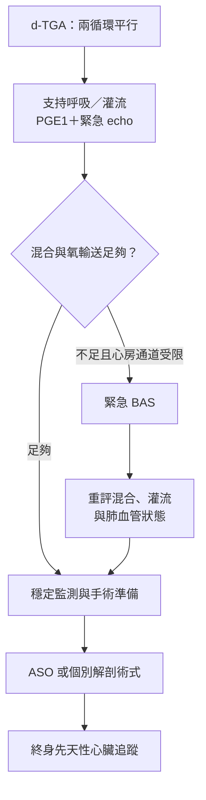

---
tags:
  - Clinical/Intervention/Pediatrics
  - Clinical/Intervention/CardiacSurgery
  - congenital-heart-disease
  - 禁忌
aliases:
  - TGA repair
  - Arterial switch operation
  - ASO
  - Jatene operation
  - 大動脈轉位矯正手術
  - 動脈轉位手術
  - Balloon atrial septostomy
  - BAS
created: 2026-10-14
updated: 2026-10-14
status: 可用
source:
  - "EACTS/AEPC: TGA with intact ventricular septum guideline, 2017"
  - "Texas Children's Hospital Handbook: Transposition of the Great Arteries"
  - "AHA: d-Transposition of the Great Arteries, reviewed 2026-04-15"
  - "Cincinnati Children's: Transposition of the Great Arteries, 2025-07"
  - "Queensland NeoMedQ: Alprostadil, 2026-05-29"
  - "OpenAnesthesia: d-TGA; operative illustrations from C.S. Mott Children's Hospital"
services:
  - Pediatrics
  - Cardio
  - CardiacSurgery
cssclass: clinical-note
subtype: operation
approach:
  - open
  - cardiopulmonary bypass
indication:
  - "[[TGA]]"
contraindication: []
alternative:
  - individualized repair for complex anatomy or late presentation
complication:
  - coronary insufficiency
  - neo-aortic regurgitation
  - pulmonary artery stenosis
  - low cardiac output
---

# TGA correction ｜ 大動脈轉位的術前支持與矯正

> [!abstract] 一句話總覽
> 對典型 **d-transposition of the great arteries（d-TGA）**，先讓兩個平行循環有足夠混合，再以 **arterial switch operation（ASO）** 重接大動脈與冠狀動脈，恢復由 **left ventricle（LV）負責體循環**的串聯血流。

> [!tip] 30 秒行動卡
> **先救什麼**：呼吸、全身灌流及混合；**prostaglandin E₁（PGE₁）維持導管，受限心房通道＋混合不足 → 緊急 balloon atrial septostomy（BAS）**。
> **什麼時候修補**：新生兒期；TGA with intact ventricular septum（TGA/IVS）的專業指引建議生後最初數日至 3 週，多數中心提早安排，依病況調整。[^guideline]
> **術前一定要確認**：冠狀動脈、LV 準備度、VSD／流出道阻塞、主動脈弓，以及 BAS／PGE₁ 後的氧輸送。
> **術後立刻回報**：新發 ST 變化、心室壁運動異常、心室功能下降或灌流突然變差，要排除**冠狀動脈灌流問題**。[^handbook]

疾病與血流解剖見 [[TGA]]。本篇以 d-TGA 為主；ccTGA／l-TGA 的 double switch 是另一套個別規劃，不能只套 ASO。

## 術前先穩定：Mixing before switching

*圖 3｜BAS 不是每例必經；是否做取決於心房交通與實際混合。若 BAS 後仍持續嚴重缺氧／休克，必須立即找原因並升級支持，不是照流程等候擇期手術。*

| 問題 | 術前支持 | 監測與界線 |
|---|---|---|
| 維持可用的混合通道 | 持續 IV PGE₁（alprostadil）維持 patent ductus arteriosus（PDA），同步 echo 評估 | 留意呼吸暫停與低血壓；用專用管路與輸注幫浦，**不可 bolus／沖洗藥物管路**。劑量依新生兒醫囑與反應調整。[^pge] |
| 心房混合受限 | 評估緊急 BAS，不能只不斷加氧或等待 PGE₁ | PDA 開放不保證能彌補受限 ASD／PFO |
| 低氧輸送／休克 | 呼吸支持、維持適當循環容量與灌流，依病況使用加護支持 | 合看 lactate、酸鹼、尿量、末梢灌流與血氧；避免只把 SpO₂ 正常化當目標 |
| 轉送與呼吸道 | 由新生兒／兒童心臟團隊規劃 | 不因正在用 PGE₁ 就一律插管；有呼吸暫停、呼吸衰竭或不穩定者另作處理 |
| BAS 後 | 重評是否仍需 PGE₁，若可減量，監測下逐步調整 | 不自行突然停藥；部分病人仍需要 PDA，且可有 rebound hypoxemia |
| 餵食與營養 | 穩定後個別安排餵食；低灌流、呼吸不穩或即將處置者另訂計畫 | 依循環及腸道灌流狀態，不能一律禁食或一律照常餵食 |

依 EACTS／AEPC 的穩定治療原則與院內實際生理調整；PGE₁ 的管路與副作用規範參考 NeoMedQ。[^guideline][^pge]

## BAS：把心房混合通道打開

**Balloon atrial septostomy（Rashkind procedure）** 是導管橋接處置：在影像導引下擴大心房中隔交通，讓肺靜脈回來的含氧血更容易進入體循環。它沒有改變 Ao／PA 的錯誤連接。[^aha]

| 項目 | 重點 |
|---|---|
| 主要適應情境 | ASD／PFO 受限，混合不足而缺氧或灌流不佳；是否需預先處理依個案與中心計畫 |
| 看懂操作的程度 | 血管進入 → 導管跨過心房交通 → 以球囊擴大 → 超音波確認交通與血流 |
| 成效判讀 | 心房交通變得足夠，且氧輸送／灌流改善；不能只看「洞已變大」 |
| 主要風險 | 心律不整、血管／心房損傷、穿孔與心包填塞 |
| 術後仍缺氧 | 重新看 ASD、PDA、pulmonary hypertension、心輸出與其他病變；不能假設只需再加氧 |

導管細節由兒童心臟介入團隊執行；不是一般 bedside 穿刺操作。[^cincinnati][^anatomy]

## ASO：完整矯正後的解剖

![[assets/tga-arterial-switch-mott.jpg|620]]

*圖 4｜Arterial switch 後：**① pulmonary artery 接回 right ventricle（RV）；② aorta 接回 LV**。原圖：University of Michigan Health／C.S. Mott Children’s Hospital；取自 [OpenAnesthesia 圖 4](https://www.openanesthesia.org/keywords/d-transposition-of-the-great-arteries/)，未修改。*

| 要完成的重建 | 血流／解剖結果 |
|---|---|
| **大動脈重新接合** | **LV → Ao，RV → PA**；恢復肺循環與體循環串聯 |
| **Coronary transfer** | 冠狀動脈開口重新植入 neo-aortic root，確保心肌血流；是關鍵風險所在 |
| **原瓣膜／根部角色改變** | 原 pulmonary valve 成為 neo-aortic valve；原 aortic valve 成為 neo-pulmonary valve |
| 處理伴隨交通／病變 | 依術式處理 ASD、VSD、PDA 或主動脈弓等，不能假定所有病人完全相同 |

> [!important] Switch 的是什麼？
> ASO 主要重接**瓣膜上方的大血管與冠狀動脈開口**，瓣膜根部仍接在原來的心室。不是把兩個心室互換，也不是把整顆瓣膜跟著遠端血管搬走。[^cincinnati]

## 適應症與時機：何時不能直接套標準 ASO

| 情境 | 方向 |
|---|---|
| 典型 d-TGA／IVS，LV 可負荷體循環 | 新生兒期 primary ASO；無法維持混合／灌流時可能需更緊急處理 |
| d-TGA＋可處理的 VSD／主動脈弓病變 | 依解剖合併修補，時機與技術個別規劃 |
| 延遲就診、LV 失去足夠壓力負荷 | 評估 LV 質量、形狀與功能；可能需分期 LV training 或其他支持，**不能只用日齡判定可否 ASO** |
| d-TGA＋VSD＋顯著 LV outflow tract obstruction（LVOTO） | ASO 未必合適；可能改採 Rastelli 等重建，取決於 VSD 與流出道／冠脈解剖 |
| ccTGA／l-TGA | 另評估合併 VSD、流出道、systemic RV／三尖瓣與傳導問題；部分個案考慮 double switch |

手術時機的專業指引主要針對 **TGA/IVS**；複雜型與延遲就診者不能直接套同一日齡規則。[^guideline][^handbook][^aha-l][^complex]

## 不同 Switch 與替代術式

![[assets/tga-atrial-switch-mott.jpg|520]]

*圖 5｜Atrial switch 的 baffle 改變心房內的血流去向；**大動脈仍原位，RV 仍負責體循環**。原圖：University of Michigan Health／C.S. Mott Children’s Hospital；取自 [OpenAnesthesia 圖 3](https://www.openanesthesia.org/keywords/d-transposition-of-the-great-arteries/)，未修改。*

| 術式 | 改哪裡 | 體循環由誰負責／後續重點 |
|---|---|---|
| **Arterial switch（Jatene）** | 大動脈與冠脈連接 | **LV**；注意冠脈、neo-aortic valve／root 與肺動脈狹窄 |
| **Atrial switch（Mustard／Senning）** | 心房內 baffle：體靜脈 → LV／PA；肺靜脈 → RV／Ao | **RV**；注意 systemic RV failure、三尖瓣逆流、baffle 狹窄／漏與心律不整。多見於既往手術病人，現今僅選定情境 |
| **Rastelli**（選定 TGA＋VSD＋LVOTO） | 心內通道使 LV 經 VSD 通往 Ao，另以 RV–PA conduit 供應肺血流 | **LV**；要追蹤心內通道與 conduit，可能需再次介入 |

Atrial switch 可以改善循環，但與 ASO 的解剖、長期負荷不同。Rastelli 等複雜型重建依個別解剖選擇，不能只看到 TGA 名稱就決定。[^aha][^handbook][^complex]

## 術前評估與手術步驟概要

| 評估項目 | 為什麼會改變決策 |
|---|---|
| [[Echocardiography]]：心房交通、VSD、PDA、瓣膜、心室、弓部 | 確認混合及需要一併修補的病變 |
| **冠狀動脈開口與走向** | 影響 coronary transfer；必要時補充影像，由專科評估 |
| **LV 準備度** | 延遲就診者尤其重要，避免突然承擔體循環後衰竭 |
| 呼吸、血氧／灌流、lactate、器官功能 | 判斷穩定程度及術後支持需求 |
| 血球／電解質／腎功能／凝血、備血、感染與營養 | 規劃體外循環、止血與復原 |

1. 全身麻醉、胸部進路，建立 **cardiopulmonary bypass（CPB）**。
2. 在適當位置分離大動脈，準備冠狀動脈開口的移植。
3. 重建 neo-aorta 與 coronary connections；依解剖常以 **Lecompte maneuver** 將肺動脈分支置於主動脈前方，完成肺動脈重建。
4. 處理相關中隔交通／伴隨病變；離開 CPB 前後評估冠狀動脈灌流、心室功能、瓣膜及吻合處血流。[^handbook][^anatomy]

> [!note] 為什麼術後看冠脈這麼重要？
> 冠脈已移植，若扭折、拉扯或吻合處受阻，可能造成心肌缺血。**低心輸出＋新發 ST 變化或局部壁運動異常**必須立即評估；不能先假設只是一般術後疲弱。[^handbook]

## 術後路徑與 must-call thresholds

| 階段 | 要盯的 | 立即回報／升級 |
|---|---|---|
| 加護初期 | ECG、心室功能、血壓／灌流、lactate、尿量、引流與出血 | 新發 ST 變化、壁運動異常、lactate 持續上升、低心輸出、嚴重心律不整或疑似 [[Cardiac tamponade]] |
| 穩定後 | 依心肺狀態減少呼吸／循環支持，調整液體與營養 | 無法減少支持、灌流不佳、肺水腫、餵食不耐或殘餘病變 |
| 出院前 | Echo／ECG 與臨床狀態作基準，藥物、餵食與傷口照護，確定回診 | 症狀或影像疑似冠脈／吻合處問題需先處理 |
| 長期 | 心室、neo-aortic valve／root、肺動脈與冠脈；依需要安排額外影像／功能測試 | 昏厥、胸痛、運動能力下降或新心律不整，不能以「小時候修好了」忽略 |

復原時程與管路移除依實際生理調整，不固定以術後第幾天作唯一門檻；所有 repaired TGA 都需終身先天性心臟追蹤。[^aha]

## 禁忌與陷阱

> [!danger] 絕對不可
> | 情境 | 絕對不可 | 為什麼 | 該做什麼 |
> |---|---|---|---|
> | 受限心房通道、嚴重混合不足 | 只持續加氧／加 PGE₁ 而延後介入評估 | 混合瓶頸可能仍在 | 緊急兒童心臟介入與 echo 評估 |
> | BAS 後仍需導管支持 | 自行立即停 PGE₁ | 可能反彈性缺氧 | 由心臟團隊確認並監測調整 |
> | ASO 後疑似冠脈灌流不足 | 當作一般低心輸出而延後解剖評估 | 可能有可處理的冠脈問題 | 立即通知先天性心臟外科／加護團隊 |

## 相關連結與來源

- [[TGA]] — 疾病與原始解剖
- [[Pediatric heart disease]] · [[Cardiac Surgery]] — 索引
- [[TOF correction]] · [[Pulmonary atresia intervention]] — 其他發紺心臟病的治療路徑

[^guideline]: [EACTS／AEPC：TGA with IVS 指引](https://www.heartuniversity.org/wp-content/uploads/EACTS-AEPC-2017-Guidelines-Management-of-Transposition-of-the-Great-Arteries-with-Intact-Ventricular-Septum.pdf)，2017，§4–5；穩定、BAS、PGE₁ 調整與 ASO 時機。
[^handbook]: [Texas Children’s Hospital Handbook：Transposition of the Great Arteries](https://www.texaschildrens.org/sites/default/files/uploads/documents/heart/Transposition%20of%20the%20Great%20Arteries.pdf)，ch.14，pp.95–104；LV training、ASO、手術與監測原則。
[^aha]: [AHA：d-TGA](https://www.heart.org/en/health-topics/congenital-heart-defects/about-congenital-heart-defects/d-transposition-of-the-great-arteries)，檢視日期 2026-04-15；BAS、兩種 switch 與追蹤。
[^aha-l]: [AHA：l-TGA／ccTGA](https://www.heart.org/en/health-topics/congenital-heart-defects/about-congenital-heart-defects/l-transposition-of-the-great-arteries)，檢視日期 2026-04-15；個別治療與 double switch。
[^cincinnati]: [Cincinnati Children’s：TGA](https://www.cincinnatichildrens.org/health/t/transposition)，2025-07；BAS 與 ASO 後瓣膜角色。
[^pge]: [Queensland NeoMedQ：Alprostadil](https://www.health.qld.gov.au/__data/assets/pdf_file/0016/1025071/nmq-alprostadil.pdf)，2026-05-29；給藥管路與心肺監測。
[^anatomy]: [OpenAnesthesia：d-TGA](https://www.openanesthesia.org/keywords/d-transposition-of-the-great-arteries/)；圖 3、4 原作者為 University of Michigan Health／C.S. Mott Children’s Hospital，並有 BAS 風險與 ASO 解剖說明。
[^complex]: [Adult Congenital Heart Association：TGA after arterial switch or Rastelli procedure](https://www.achaheart.org/media/3276/tga-switch-rastelli.pdf)；Rastelli 的心內通道與 RV–PA conduit，以及術後追蹤。
