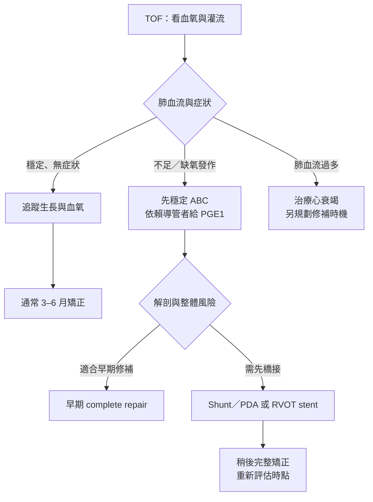
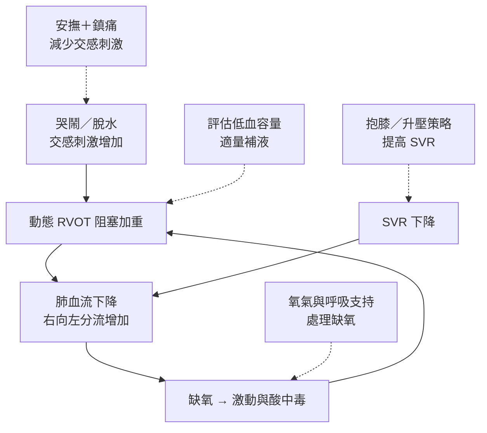
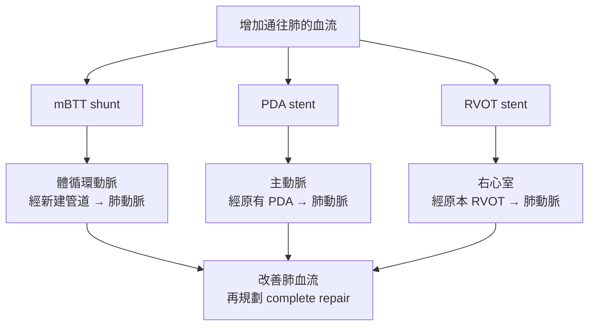

---
tags:
  - Clinical/Intervention/CardiacSurgery
  - Clinical/Intervention/Pediatrics
  - congenital-heart-disease
  - 禁忌
aliases:
  - TOF repair
  - Tetralogy of Fallot repair
  - TOF total correction
  - TOF complete repair
  - 法洛氏四重症矯正手術
  - TOF 術前支持與姑息手術
created: 2026-10-14
updated: 2026-10-14
status: 可用
source:
  - "AATS 2022 Expert Consensus, published 2023"
  - "ACC TOF Clinical Practice Algorithm, updated 2026-04-12"
  - "PIER: Hypercyanotic spells guideline, version 2.0, 2025"
  - "Queensland NeoMedQ: Alprostadil, 2026-05-29"
  - "AHA and Texas Children's Hospital: TOF treatment and illustrations"
  - "Children's Hospital Los Angeles: TOF repair"
  - "University of Basel New Media Center: CHD Diagrams, TOF repair illustrations 151, 156, 158"
services:
  - CardiacSurgery
  - Cardio
  - Pediatrics
cssclass: clinical-note
subtype: operation
approach:
  - open
  - cardiopulmonary bypass
  - transatrial-transpulmonary or limited transventricular
indication:
  - "[[TOF]]"
contraindication: []
alternative:
  - staged palliation followed by complete repair
complication:
  - pulmonary regurgitation
  - residual RVOT obstruction
  - residual VSD
  - arrhythmia
---

# TOF correction ｜ 法洛氏四重症矯正與術前支持

> [!abstract] 一句話總覽
> **Complete／total repair＝關閉 ventricular septal defect（VSD）＋解除 right ventricular outflow tract obstruction（RVOTO）**；術前先確保肺血流與全身灌流，必要時用藥、分流或支架作為通往矯正的橋接。

> [!tip] 30 秒行動卡
> **什麼情況該做**：典型 [[TOF]] 均需手術評估；穩定無症狀者常於 **3–6 個月**矯正。缺氧、tet spell 或依賴導管供應肺血流者，需提早處理。[^aats]
> **術前一定要確認**：阻塞層次、肺動脈瓣環與分支大小、**冠狀動脈是否跨過 RVOT**、動脈導管／既有分流、平常血氧與發作史。
> **術後最先要盯**：全身灌流、右心室功能、節律、出血及殘餘阻塞。
> **立刻叫 senior**：持續缺氧或意識改變、灌流惡化；分流／支架後突發低血氧；術後低心輸出、明顯心律不整或疑似 tamponade。

本篇以 **TOF with pulmonary stenosis** 為主。[[Pulmonary atresia]]／major aortopulmonary collateral arteries（MAPCAs）等複雜型需另外評估，見 [[Pulmonary atresia intervention]]，不能直接套用下列標準路徑。RV／LV＝right／left ventricle；PA＝pulmonary artery。

## 適應症與手術時機

*圖 3｜先判斷生理狀態，再決定一期矯正或分期。疑似 tet spell 即需立即住院評估；不是等下一次發作。[^aats][^algorithm]*

**有症狀的新生兒可選 primary repair 或 palliation。** 早產、低出生體重、小／不連續肺動脈、重大遺傳／其他器官異常或敗血症等，會影響是否先橋接；不能只憑年齡或單一血氧數字決定。[^aats]

## 矯正前的穩定與支持

| 情境 | 處置重點 | 為什麼／監測 |
|---|---|---|
| 肺血流足夠、病況穩定 | 追蹤血氧趨勢、餵食與體重；維持適當水分，處理發燒／疼痛 | 避免脫水與哭鬧誘發動態阻塞；不必每人常規氧療或住院 |
| **Duct-dependent pulmonary flow** | **Alprostadil＝prostaglandin E₁（PGE₁）持續靜脈輸注**，銜接介入 | 維持 patent ductus arteriosus（PDA）供應肺血流；監測呼吸暫停、低血壓與體溫 |
| 缺氧／急性惡化 | 氧氣與 ABC 評估，同時找肺血流受阻原因 | 心內右向左分流時，給氧反應可能有限；不能只追求血氧數字正常 |
| 動態阻塞／反覆 spells | 心臟團隊可選擇 propranolol 作暫時控制，並重新評估手術時機 | **非所有 TOF 的常規預防藥**；預防效益證據有限，不可用來延後必要介入 |
| 肺血流過多的 pink TOF | 依心衰竭與容量狀態處理 | 與肺血流不足不同，不能一律補液或增加肺血流 |

藥物選擇需對應當下生理；長期 beta-blocker 預防與急性 tet spell 救治是不同問題。[^acc][^pier]

> [!note] PGE₁ 劑量與給藥安全
> **Queensland NeoMedQ 2026** 的新生兒起始範圍為 **0.01–0.02 microgram/kg/min＝10–20 nanogram/kg/min**，持續 IV infusion；由兒童心臟團隊依反應調整，該專論要求超過 0.02 microgram/kg/min 前先諮詢。
> **不可 bolus，也不可沖洗輸注管路造成意外 bolus**；使用專用輸注管路與連續心肺監測，備妥呼吸道支持。這是可追溯的參考劑量，實際開立仍依院內新生兒醫囑與病況。[^pge]

## 缺氧發作 Tet spell 的急救

**發作線索：** 突然比平常更發紺、呼吸急促／激動，RVOT 雜音變小或消失；出現嗜睡、意識下降或昏厥代表嚴重惡化。不要誤認成「哭累睡著」。[^pier]

*圖 4｜實線是惡性循環；虛線指向要介入的環節。SVR＝systemic vascular resistance；**SVR 下降可直接增加右向左分流，不必先引起 RVOT 收縮。** 藥物與呼吸道處置由監測下的醫療團隊執行。[^rch]*

| 順序／情境 | 行動 | 要注意 |
|---|---|---|
| **立即並行** | 呼救、ABCDE、安撫與減少刺激；**knee–chest position**；給氧、監測 SpO₂／ECG／血壓 | 抱膝可提高 SVR；急性發作可給高濃度氧氣，但不能等待氧氣單獨奏效 |
| 建立血管通路 | 評估灌流、血糖與 blood gas；若有低血容量／preload 不足，等張液體 **10 mL/kg 分次給並重評** | 不因發紺就盲目大量補液；合併心衰竭時尤其需謹慎 |
| 發作持續 | 監測下鎮痛／鎮靜，例如 morphine；必要時由心臟／加護團隊使用 **beta-blocker** 或 **phenylephrine** | 前者減輕動態阻塞、後者提高 SVR；監測呼吸、心搏與血壓，依院內體重劑量流程 |
| 持續惡化／對治療無反應 | 專家呼吸道處置、插管與通氣，緊急心臟介入／手術評估 | 誘導時避免 SVR／preload 驟降；必要時以機械循環支持救援 |
| 發作解除後 | **即使初次、已緩解，疑似 tet spell 仍需立即住院評估可能介入** | 找誘因並檢討修補／橋接時機；恢復原本血氧不代表後續風險消失 |

急救策略依 PIER 2025，住院評估原則依 ACC 2026 流程；嚴重病例不需逐格等待才啟動兒童加護與心臟團隊。[^pier][^algorithm]

## 暫時性 Palliation：如何撐到完整矯正

此處 **palliation 是增加肺血流的橋接處置**，不是末期安寧照護；VSD 與主要心內解剖仍未完整修補。

*圖 5｜三種橋接的差異是「血從哪裡來、走哪條路」。沒有可用導管時不能直接套用 PDA stent；RVOT stent 也需要可跨越的合適解剖。*

| 方式 | 適合的情境／路徑 | 主要取捨 |
|---|---|---|
| **Modified Blalock–Thomas–Taussig（mBTT）shunt**，亦稱 mBT shunt | 以人工血管連接 subclavian／innominate artery 與 pulmonary artery，建立體循環至肺的血流 | 可橋接不適合立即修補者；留意分流血栓／狹窄、肺血流過多與肺動脈變形 |
| **PDA stent** | 以支架維持既有導管通路；須有適合的導管及肺動脈解剖 | 可減少對持續 PGE₁ 的依賴；有狹窄／阻塞與再介入風險 |
| **RVOT stent** | 支撐原本右心室至肺動脈的通道，增加 antegrade flow | 需考量後續取出與重建，跨瓣環時可能影響保瓣策略 |
| 選擇性 balloon pulmonary valvuloplasty | 阻塞以瓣膜層次為主、且其他解剖適合時 | 顯著漏斗部阻塞會影響成功率；並非完整治療，也不能保證避免日後 TAP |

橋接選擇由解剖、體重、共病與中心經驗決定，沒有一種方式適用所有新生兒。球囊擴張的限制見 CCRC 原始研究。[^aats][^acc][^balloon]

## Complete repair：完整矯正究竟修什麼

![[assets/tof-repair-and-shunt-aha.png|800]]

*圖 6｜**左：complete repair；右：暫時 shunt，VSD 仍在。** 左圖的 **Patch** 指 VSD patch，**Repair** 指流出道修補。圖檔取自 [Texas Children’s Hospital：TOF](https://www.texaschildrens.org/content/conditions/tetralogy-fallot)；AHA 同款[矯正與分流圖](https://www.heart.org/en/health-topics/congenital-heart-defects/about-congenital-heart-defects/tetralogy-of-fallot)。原圖未修改，對照 [[TOF#心臟解剖：先找出四項異常|TOF 圖 1]] 閱讀。*

| 核心動作 | 要達成的結果 |
|---|---|
| **① VSD patch closure** | 隔開兩心室的分流通道，讓 **LV 的血導向主動脈** |
| **② Relief of RVOTO** | 切除造成阻塞的漏斗部肌束，依瓣膜／瓣環／肺動脈狀況修整或擴大，讓 **RV 的血通往肺** |

上述是 complete repair 的兩項核心目標。[^aha]

> [!important] 四項異常，為什麼主要只有兩項修補目標？
> VSD patch 重建 LV → aorta 的通道，**通常不需要把騎跨的主動脈搬走**；解除右心室壓力負荷後，RVH 可逐步改善。切除的是**造成流出道阻塞的肌束**，不是把整個肥厚右心室壁切薄。

### RVOT 與肺動脈瓣的術式選擇

| 術式                          | 適用條件                             | 主要代價                                      |
| --------------------------- | -------------------------------- | ----------------------------------------- |
| **Valve-sparing repair**    | 瓣膜／瓣環可保留，且能充分解除阻塞                | 減少 pulmonary regurgitation（PR），但須避免留下重要狹窄 |
| **Transannular patch（TAP）** | 瓣環過小、無法充分保留時，補片跨過瓣環擴大 RVOT       | 有利於解除阻塞，但常造成明顯 PR，長期需注意 RV 容量負荷           |
| **RV–PA conduit**           | 部分複雜流出道、肺動脈閉鎖或冠狀動脈走向限制原生 RVOT 重建 | 導管會退化／狹窄，也不會隨兒童成長；未來可能需再介入                |

在能充分解除阻塞的前提下盡量保瓣、減少 ventriculotomy；不是「所有 TOF 都用 TAP」，也不是不計殘餘狹窄地勉強保瓣。[^aats][^acc]

**三種術式的解剖對照**

| 保瓣修補示例 | 跨瓣環補片 TAP | RV–PA conduit |
|---|---|---|
| ![[assets/tof-valve-sparing-basel.png\|300]] | ![[assets/tof-transannular-patch-basel.png\|300]] | ![[assets/tof-rv-pa-conduit-basel.png\|300]] |

*圖 7｜由左至右對應上表三種術式；三圖中的 **2 都是 VSD patch**。比較重點是肺動脈瓣環是否保留，以及 RV → PA 之間是否使用導管。原圖完整保留，未裁切或改標。[^rvot-images]*

- **左圖：保瓣修補示例。** 原生肺動脈瓣／瓣環保留，**1** 為 RVOT 阻塞肌束切除處，**2** 為 VSD 補片。原圖呈現「未使用跨瓣環補片」的修補；其他保瓣術式仍可能需要瓣膜整形或瓣環上／下方補片，**保瓣不等於完全不用補片**。[^rvot-technique]
- **中圖：TAP。** **3** 是跨越肺動脈瓣環、縫在流出道前方的擴大補片，與心室中隔的 **2** 不同；解除阻塞後，需留意 PR。[^rvot-technique]
- **右圖：RV–PA conduit。** **3** 是含生物瓣的導管，建立右心室至肺動脈的通道；**2** 仍是 VSD 補片。這張圖示範含瓣導管的配置。[^rvot-images]

圖源：[University of Basel · New Media Center／CHD Diagrams](https://www.congenital-heart-disease.ch/cite)，採 [CC BY-NC-ND 4.0](https://creativecommons.org/licenses/by-nc-nd/4.0/) 授權；中文說明置於原圖之外。

## 術前評估與手術步驟概要

| 術前確認                                             | 如何影響手術                                    |
| ------------------------------------------------ | ----------------------------------------- |
| [[Echocardiography]]：VSD、瓣環、RVOT、左右肺動脈、PDA／shunt | 選擇修補方式，確認肺血流來源                            |
| 冠狀動脈走向；必要時加做斷層影像                                 | **跨 RVOT 的 coronary artery** 會限制切開／重建位置   |
| 體重、營養、血氧／灌流、感染、器官功能                              | 決定立即矯正或先橋接，安排麻醉與加護支持                      |
| 血球、電解質／腎功能、凝血與備血；相關遺傳異常                          | 規劃體外循環與輸血；疑 22q11.2 deletion 時另評估低血鈣與免疫問題 |

1. 全身麻醉與胸部進路，建立 **cardiopulmonary bypass（CPB）**。
2. 依解剖選擇進路、修補 VSD，解除漏斗部與瓣膜／瓣環／肺動脈的阻塞。
3. 已有暫時分流／支架者，依需要移除或處理；不是固定全部採同一操作。
4. 脫離 CPB 前後以影像與血行動力學檢查殘餘 VSD、RVOT 阻塞、瓣膜功能及心室功能。[^aats][^chla]

## 術後路徑與必須立即回報的異常

| 階段 | 監測重點 | 立即回報 |
|---|---|---|
| 加護初期 | 灌流／lactate 趨勢、尿量、RV 功能、容量、ECG、出血與引流 | 低心輸出、持續快速心律或心搏過緩、灌流惡化、疑似 [[Cardiac tamponade]] |
| 穩定後 | 依呼吸與血行動力狀況減少支持、恢復餵食；echo 評估殘餘病變 | 無法減少支持、低血氧、持續靜脈鬱血或明顯殘餘阻塞 |
| 長期 | PR、RV 大小／功能、殘餘狹窄、心律與運動耐受 | 昏厥、持續心悸、運動能力下降；需重新評估殘餘病變與心律風險 |

早期 RV 可能因原有肥厚而較僵硬；術後支持依個別恢復調整。長期以 echo、ECG／Holter、cardiac MRI 等追蹤，必要時再做 pulmonary valve intervention。[^chla][^acc]

## 禁忌與陷阱

> [!danger] 絕對不可
> | 情境 | 絕對不可 | 為什麼 | 該做什麼 |
> |---|---|---|---|
> | 依賴 PDA 供應肺血流 | 未有替代血流就自行停 PGE₁／關閉 PDA | 肺血流可驟減 | 由心臟團隊規劃轉換 |
> | PGE₁ 輸注 | Bolus／沖洗藥物管路 | 呼吸暫停、血壓變化風險 | 專用管路、輸注幫浦與監測 |
> | Shunt／stent 後突然發紺 | 當作平常 tet spell 而延後評估 | 可能是通路血栓／阻塞 | 立即啟動心臟與加護團隊 |

> [!warning] 常見錯誤
> - 只關 VSD 卻留下嚴重 RVOTO，會使 RV 排出血液更困難；兩項矯正需一起規劃。
> - 把 PGE₁ 當成所有 tet spell 的解答；它的重點是**維持有用的動脈導管**。
> - 將 palliation 寫成 complete repair，或將手術後「不再發紺」當成已無長期風險。

## 相關連結與來源

- [[TOF]] — 四項解剖異常、病生理與診斷
- [[Echocardiography]] · [[Pediatric heart disease]] · [[Cardiac Surgery]] — 影像與科別索引
- [[Shock]] · [[Cardiac tamponade]] · [[ECMO]] — 惡化時相關主題

[^aats]: [AATS 2022 Expert Consensus：Management of infants and neonates with TOF](https://pubmed.ncbi.nlm.nih.gov/36522807/)，JTCVS 2023；修補時機、高風險病童、保瓣與殘餘阻塞原則。
[^acc]: [ACC：Unrepaired and repaired TOF clinical practice algorithm](https://www.acc.org/latest-in-cardiology/articles/2024/10/30/13/20/clinical-practice-algorithm-for-the-follow-up-of-unrepaired-and-repaired-tof)，更新 2026-04-12；生理分流、介入選擇、beta-blocker 證據限制與追蹤。
[^algorithm]: [ACC：TOF 前後修補流程圖](https://www.acc.org/-/media/Non-Clinical/Images/Latest-in-Cardiology/Articles/2024/10/ACPC-EA-TOF-Algorithm.pdf)，2026 修訂，p. 1：疑似 hypercyanotic spell 需立即住院評估可能介入。
[^pier]: [PIER：Medical management of hypercyanotic spells](https://www.piernetwork.org/guidelines-hypercyanotic-tetralogy-fallots.html)，version 2.0，2025-01；依 ABCDE 與治療反應升級。
[^pge]: [Queensland NeoMedQ：Alprostadil](https://www.health.qld.gov.au/__data/assets/pdf_file/0016/1025071/nmq-alprostadil.pdf)，NMedQ26.058-V2-R31，2026-05-29；劑量、給藥與監測。
[^chla]: [Children’s Hospital Los Angeles：TOF repair](https://www.chla.org/treatments/tetralogy-fallot-repair)；手術內容、術前評估與術後 RV 照護。
[^aha]: [AHA：Tetralogy of Fallot](https://www.heart.org/en/health-topics/congenital-heart-defects/about-congenital-heart-defects/tetralogy-of-fallot)，檢視日期 2026-07-30；temporary operation 與 complete repair。圖檔見 [Texas Children’s Hospital](https://www.texaschildrens.org/content/conditions/tetralogy-fallot)。
[^balloon]: [CCRC：Outcomes Following Balloon Pulmonary Valvuloplasty in Symptomatic Neonates With TOF](https://pmc.ncbi.nlm.nih.gov/articles/PMC11307412/)；原始多中心研究，選定個案的橋接成效與限制。
[^rch]: [Royal Children’s Hospital：Cyanotic episodes in congenital heart disease](https://www.rch.org.au/clinicalguide/guideline_index/Cyanotic_episodes_in_congenital_heart_disease/)；低肺血流、SVR 下降與缺氧發作機制。
[^rvot-images]: University of Basel New Media Center，CHD Diagrams：左圖 [TOF repair without transannular patch（圖 151）](https://www.congenital-heart-disease.ch/heart-operation/151)、中圖 [TOF repair with transannular patch（圖 156）](https://www.congenital-heart-disease.ch/heart-operation/156)、右圖 [TOF repair with conduit and bioprosthesis valve（圖 158）](https://www.congenital-heart-disease.ch/heart-operation/158)。原圖及標號依[圖庫公開圖說](https://www.congenital-heart-disease.ch/backend/json/opillustrationen)核對；[圖庫授權與引用方式](https://www.congenital-heart-disease.ch/cite)。存取日期：2026-10-14。
[^rvot-technique]: Vanderlaan RD, Barron DJ. [Optimal Surgical Management of Tetralogy of Fallot](https://pmc.ncbi.nlm.nih.gov/articles/PMC10755770/). CJC Pediatr Congenit Heart Dis. 2023;2:352–360. Figure 2 與「Complete Surgical Repair of ToF」：TAP、保瓣修補，以及保瓣時仍可使用主肺動脈／漏斗部補片。
