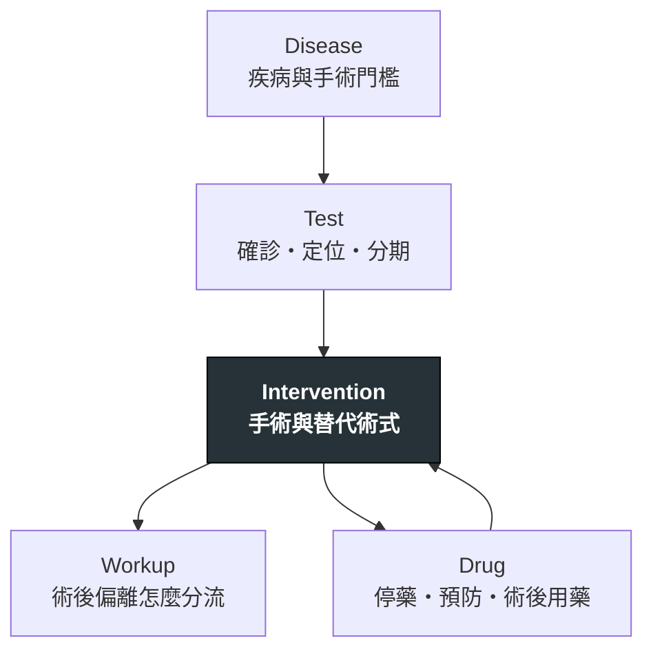

---
tags:
  - Clinical/MOC/Surgery
aliases:
  - 外科輪訓索引
  - Surgery Rotation MOC
created: 2026-08-03
updated: 2026-08-03
status: 可用
services:
  - Surgery
cssclass: clinical-note
---

# 🔪 外科輪訓 · Surgery Rotation

> [!abstract] 這份索引怎麼用
> 外科不是另一套疾病庫，而是把同一個疾病沿著**能不能開、怎麼開、開完盯什麼**重新排序。疾病留在 Disease、手術留在 Intervention、術後異常從 Workup 進入；本頁只負責把四個 service 串起來。

> [!tip] 每個新 case 先問四句
> **為什麼要開？**　適應症與替代方案
> **術前缺什麼？**　影像、分期、生理儲備、停藥與備血
> **手術改變了什麼？**　解剖、血流、壓力或器官功能
> **術後哪個偏離最危險？**　must-call threshold

---

## 四站入口

| Service | 一眼主軸 | 入口 |
|---|---|---|
| 移植外科 | recipient／donor → graft → rejection／infection | [[Transplant Surgery]] |
| 心臟外科 | pump／valve／vessel → operation → hemodynamics | [[Cardiac Surgery]] |
| 神經外科 | lesion／localization → pressure → neurologic trajectory | [[Neurosurgery]] |
| 甲狀腺外科 | diagnosis／risk → extent of surgery → airway／Ca／voice | [[Thyroid Surgery]] |
| 乳房外科 | mass／imaging → benign vs malignant → breast＋axilla → receptor-driven adjuvant | [[Breast Surgery]] |

## 同一批知識怎麼互連

## 跨科共通能力

| 能力 | 應落在哪一種筆記 | 第一批候選 |
|---|---|---|
| 術前風險與用藥 | Test／Drug | [[Preoperative assessment]]、[[Perioperative antithrombotic management]] |
| 術後生命徵象偏離 | Workup | [[Postoperative hypotension]]、[[Postoperative fever]]、[[Postoperative tachycardia]] |
| 出血與輸血 | Workup／Intervention | [[Postoperative bleeding]]、[[Massive transfusion]] |
| 尿量與腎功能 | Workup／Disease | [[Oliguria]]、[[AKI]] |
| 疼痛、活動與營養 | Drug／Intervention | [[Postoperative analgesia]]、[[Early mobilization]]、[[Enteral nutrition]] |
| 管路與引流 | Intervention | [[Surgical drain management]]、[[Chest tube drainage]] |

## 本輪收集箱

> [!warning] 只暫存主題，不記病人身分
> 每天下班前把可泛化的內容拆回五角度；姓名、病歷號、生日、床號與可辨識日期不進 vault。

- [ ] 移植外科：
- [ ] 心臟外科：
- [ ] 神經外科：
- [ ] 甲狀腺外科：

## 相關連結

- [[CONTEXT]] — 五角度、Case 與深度歸屬
- [[禁忌選項]] — 全 vault 的絕對禁忌彙整
