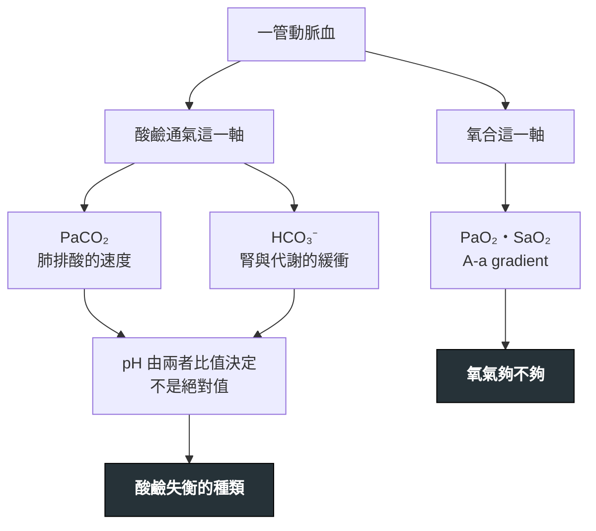

---
tags:
  - Med/Test/General
  - Med/Test/Resp
  - ABG
  - 禁忌
aliases:
  - ABG
  - 動脈血液氣體分析
  - 血氧分析
  - Arterial blood gas analysis
  - 酸鹼判讀
  - Acid-base
created: 2026-07-27
updated: 2026-07-27
status: 可用
source: Winter's formula；albumin 校正 anion gap；Berlin ARDS 定義；CLSI 檢體處理建議
cssclass: clinical-note
modality: lab
compare_with:
  - "[[VBG]]"
  - "[[Pulse oximetry]]"
  - "[[Capnography]]"
  - "[[Electrolytes]]"
  - "[[Urine indices]]"
---

# Arterial blood gas ｜ 動脈血液氣體分析 · Arterial Blood Gas

> [!abstract] 一句話總覽
> 一管動脈血同時回答**兩個彼此獨立的問題**：**① 氧合夠不夠**（PaO₂、SaO₂、A-a gradient）、**② 酸鹼與通氣正不正常**（pH、PaCO₂、HCO₃⁻）。這兩件事**必須分開判**——把它們攪在一起（例如「SpO₂ 100% 所以呼吸沒問題」）是臨床上最常見、也最致命的 ABG 錯誤。

> [!tip] 判讀速查
> **正常範圍**（室內空氣、海平面）：**pH 7.35–7.45**｜**PaCO₂ 35–45 mmHg**｜**HCO₃⁻ 22–26 mEq/L**｜**PaO₂ 80–100 mmHg**｜SaO₂ 95–100%｜**base excess (BE) −2 ～ +2**
> **決策切點**：pH <7.35 = acidemia、>7.45 = alkalemia｜anion gap (AG) **>12** 算升高（依實驗室）｜A-a gradient 正常上限 ≈ **(年齡/4) + 4**｜P/F ratio **≤300** 進入 ARDS 範圍
> **紅旗值**：**pH <7.20 或 >7.60**（本身就會致命）｜**PaO₂ <60 mmHg** ＝呼吸衰竭｜**PaCO₂ >50 且 pH <7.35** ＝急性通氣衰竭｜HCO₃⁻ <10｜P/F ≤100
> **絕對不可**：用正常的 SpO₂ 排除 **CO 中毒**；用正常的 SpO₂ 說「通氣夠」；看到慢性阻塞性肺病人的 PaCO₂ 高就插管而不看 pH

---

## 原理 Principle

血氣機真正**直接測量**的只有三個電極值：**pH、PaCO₂、PaO₂**。HCO₃⁻ 與 BE 是**算出來的**，所以與血清生化的 total CO₂ 會有小幅差異。

酸鹼那一軸的核心是 **Henderson–Hasselbalch**：血中 pH 由 **HCO₃⁻ 與 PaCO₂ 的「比值」**決定，**不是任何一個的絕對值**。由此直接推出三件事：

> [!important] 從「pH 看比值」推出的三件事
> **① pH 正常不等於沒有酸鹼失衡。** 分子分母可以同時大幅偏移而比值不變——混合型障礙就藏在這裡，所以第 2～5 步一步都不能跳。
> **② 肺與腎的反應速度差好幾個數量級。** 肺調 PaCO₂ 以**分鐘**計，腎調 HCO₃⁻ 要**數小時起跳、3–5 天才完成**；這個時間差就是「**急性 vs 慢性**」兩套代償公式的由來。
> **③ BE 是「把呼吸因素扣掉之後」的代謝性成分**，用來快速看出代謝端偏多少，不能單獨下診斷。

![[assets/oxyhemoglobin-dissociation-curve.png|620]]
*Oxyhemoglobin dissociation curve 的平台與陡坡：PaO₂ 約 60 mmHg 時 SaO₂ 約 90%，再往下便進入「PaO₂ 小幅下降、SaO₂ 快速墜落」的區段。酸中毒、PaCO₂↑、體溫↑、2,3-DPG↑使曲線右移、利於組織釋氧；相反條件與 fetal Hb／COHb 使曲線左移。注意：**CO 中毒同時減少可用 Hb 位點，pulse oximeter 仍可能顯得正常**。Source: [Ratznium, Wikimedia Commons](https://commons.wikimedia.org/wiki/File:Oxyhaemoglobin_dissociation_curve.png)（public domain）。*

## 什麼時候做

- 當你想回答「**這個病人的氧合到底夠不夠、還是只是 SpO₂ 看起來還好**」時
- 當你想回答「**他還喘得動嗎**」——需要 **PaCO₂ 與 pH** 來決定要不要上非侵襲性通氣或插管時
- 當病人有**不明原因的呼吸急促**：呼吸快可能是在代償代謝性酸中毒，不是原發肺問題
- 當生化看到 **HCO₃⁻ 或 AG 異常**，需要知道呼吸端有沒有第二個障礙時
- 當**意識改變**而找不到原因（見 [[Delirium]]）——CO₂ 麻醉、嚴重酸中毒、CO 中毒都在這裡
- 當**休克或高乳酸**，需要量化灌流不足與酸鹼負荷時（見 [[Shock]]）
- **中毒**：疑似水楊酸、甲醇、乙二醇——酸鹼型態本身就是診斷線索

## 怎麼做 / 病人準備

| 項目 | 內容 |
|---|---|
| **部位（首選）** | **橈動脈**——表淺、好定位、**易壓迫止血**、且手掌有尺動脈側枝循環。其次 brachial、femoral |
| Allen test | 傳統上在橈動脈穿刺前做，但**證據薄弱**：從未被證實能預測穿刺後的手部缺血。**不要當成安全保證**，也不該僅因結果「異常」就放棄採檢——真正的禁忌是**該肢體循環明顯不良**（見禁忌表） |
| 抗凝 | 用**預先塗佈的乾燥肝素**針筒。**液體肝素過量會稀釋檢體** → PaCO₂ 與 HCO₃⁻ 假性下降、電解質失真 |
| 氣泡 | **抽完立刻排掉、立刻封口**。氣泡的 PO₂ ≈150、PCO₂ ≈0，會把檢體往那個方向拉 |
| 時效與冰浴 | **塑膠針筒：室溫、30 分鐘內上機，不要冰**——低溫下血球耗氧變慢、加上氧氣經管壁往內擴散 → **PaO₂ 假性升高**。**要冰浴就必須換成玻璃針筒**：「預期延遲超過 30 分鐘」是換玻璃針筒的理由，不是把塑膠針筒拿去冰的理由。**例外：100% O₂ shunt test 等高 PaO₂ 檢體**，塑膠針筒在室溫下 PaO₂ 掉得極快，要用玻璃針筒＋冰水＋盡快上機 |
| 止血 | 拔針後**確實加壓 5 分鐘**；抗凝／抗血小板治療中要更久 |
| **一定要記錄** | **FiO₂（或氧氣流速）與體溫**。沒有 FiO₂ 就算不出 A-a gradient，也算不出 P/F ratio——這是最常被漏掉的一格 |
| 病人狀態 | 疼痛、哭喊、換氣過度會讓 PaCO₂ **真的**掉下來。等病人穩定再抽，否則數字代表的是當下那 30 秒 |

## 判讀 Interpretation

### ① 判讀六步驟（本篇的招牌）

![[assets/acid-base-interpretation-algorithm.jpg|760]]
*酸鹼判讀骨架：先驗證資料、看 pH，再用 PaCO₂ 與 HCO₃⁻／SBE 定位呼吸性或代謝性原發障礙；「checking secondary response」就是把實測代償與預期公式比較，不足或過頭都代表 mixed disorder；有高 AG 代謝性酸中毒再走 Δ/Δ。正常 pH 也不能停，因為兩個相反方向的障礙可能互相抵消。Source: [Pióro et al., *J Clin Med* 2021, Figure 2](https://pmc.ncbi.nlm.nih.gov/articles/PMC8038584/)（CC BY 4.0）。*

1. **看 pH** → pH <7.35 是 **acidemia**、>7.45 是 **alkalemia**。pH 在正常範圍**不能收工**——可能是完全代償，也可能是兩個方向相反的障礙互相抵消。
2. **看 PaCO₂ 與 HCO₃⁻，判原發障礙**：哪一個往「能解釋這個 pH」的方向偏，哪一個就是原發（下表）。
3. **算代償是否足夠**（第 ② 節的公式表）。代償**不足或過頭**都代表**還有第二個原發障礙**。
4. **只要有代謝性酸中毒 → 算 anion gap**，並依白蛋白校正（第 ③ 節）。
5. **AG 升高 → 算 delta-delta（ΔAG/ΔHCO₃⁻）**，找出躲在後面的第二種代謝性障礙（第 ④ 節）。
6. **對照臨床**。數字與病人對不上時，**先懷疑檢體不是動脈血、有氣泡、或延遲送檢**，再懷疑病人。

| 原發障礙 | pH | 原發變化 | 代償方向 |
|---|---|---|---|
| **代謝性酸中毒** | ↓ | **HCO₃⁻ ↓** | PaCO₂ ↓（過度換氣，分鐘級） |
| **代謝性鹼中毒** | ↑ | **HCO₃⁻ ↑** | PaCO₂ ↑（換氣抑制） |
| **呼吸性酸中毒** | ↓ | **PaCO₂ ↑** | HCO₃⁻ ↑（腎，數天） |
| **呼吸性鹼中毒** | ↑ | **PaCO₂ ↓** | HCO₃⁻ ↓（腎，數天） |

> [!tip] 一眼分呼吸性 vs 代謝性
> **PaCO₂ 與 HCO₃⁻ 同方向動 ＝ 單純障礙 ＋ 代償**（例：兩個都低 → 代謝性酸中毒代償中，或呼吸性鹼中毒代償中，用 pH 分）。
> **兩者反方向動 ＝ 一定是混合型障礙**（例：HCO₃⁻ 低而 PaCO₂ 高 → 代謝性酸中毒 ＋ 呼吸性酸中毒併存，這是心跳停止與瀕死呼吸的典型型態）。

### ② 代償公式表 —— 本篇最不能背錯的一格

| 原發障礙 | 預期代償 |
|---|---|
| **代謝性酸中毒** | **Winter's formula：預期 PaCO₂ ＝ 1.5 × HCO₃⁻ ＋ 8 ± 2** |
| **代謝性鹼中毒** | HCO₃⁻ 每上升 1 mEq/L → **PaCO₂ 上升約 0.7 mmHg** |
| **急性**呼吸性酸中毒 | PaCO₂ 每上升 10 mmHg → **HCO₃⁻ 上升 1 mEq/L** |
| **慢性**呼吸性酸中毒 | PaCO₂ 每上升 10 mmHg → **HCO₃⁻ 上升 3–4 mEq/L** |
| **急性**呼吸性鹼中毒 | PaCO₂ 每下降 10 mmHg → **HCO₃⁻ 下降 2 mEq/L** |
| **慢性**呼吸性鹼中毒 | PaCO₂ 每下降 10 mmHg → **HCO₃⁻ 下降 4–5 mEq/L** |

> [!important] 代償的兩條鐵律——這比背公式更重要
> **① 代償幾乎不會矯正過頭，通常也不會把 pH 完全拉回正常**（代謝性酸中毒代償到底，pH 仍停在 7.35 以下）。所以**如果「代償」讓 pH 越過中線跑到另一邊，那不是代償，是第二個原發障礙。**
> **唯一例外：慢性呼吸性鹼中毒**——它是唯一可以把 pH 完全代償回正常範圍的酸鹼障礙（高海拔適應、懷孕、慢性肝病）。看到「pH 正常 ＋ PaCO₂ 低 ＋ HCO₃⁻ 低」先想它，不要直接判成兩個原發障礙。
> **② 實測值超出預期區間 → 一定存在第二種原發障礙。** 代謝性酸中毒實測 PaCO₂ **高於** Winter's 預期 → 併有**呼吸性酸中毒**（病人喘不動了，這是要插管的訊號）；**低於**預期 → 併有**呼吸性鹼中毒**（例：[[Salicylate poisoning]] 同時刺激呼吸中樞）。

> [!tip] 換算 pH 的口訣（快速床邊估算）
> **急性**：PaCO₂ 每變化 10 mmHg，pH 反向變 **0.08**；**慢性**：只變 **0.03**。看到 PaCO₂ 70 而 pH 只有 7.33 → **高度指向慢性**滯留（急性的預期 pH 約 7.16）。少數例外是**急性呼吸性酸中毒疊在原有代謝性鹼中毒上**，靠病史與 HCO₃⁻ 是否超過慢性代償預期（24 ＋ 3.5×3 ≈ 34.5）來分。

> [!note] 呼吸代償有天花板
> 代償靠「少呼吸」，但低通氣造成低血氧、低血氧驅動又逼病人呼吸——所以在**沒有原發肺病**的前提下，代謝性鹼中毒的代償很少讓 **PaCO₂ 超過 55 mmHg**。看到代謝性鹼中毒併 PaCO₂ 75，那不是「代償很好」，是合併呼吸性酸中毒。

### ③ Anion gap 與白蛋白校正

**AG ＝ Na⁺ − (Cl⁻ ＋ HCO₃⁻)**，正常約 **8–12 mEq/L**（各實驗室不同，現代離子選擇電極的正常區間偏低，有的是 3–11——用自家的值）。

> [!danger] 低白蛋白會把 AG 藏起來
> **白蛋白本身就是最大宗的未測量陰離子**：白蛋白低 → AG 天生就低 → 真的有酸堆積時，AG 看起來「正常」。重症、肝硬化、腎病症候群的病人幾乎都低白蛋白，這一格漏掉就整條路走錯。
> **校正後 AG ＝ 實測 AG ＋ 2.5 ×（4.0 − 白蛋白 g/dL）**。例：albumin 2.0 g/dL、實測 AG 11（看起來正常）→ 11 ＋ 2.5 × 2 ＝ **16，是升高的**。

### ④ Delta-delta（ΔAG / ΔHCO₃⁻）

**ΔAG ＝ 實測 AG − 12**；**ΔHCO₃⁻ ＝ 24 − 實測 HCO₃⁻**。用意：高 AG 酸中毒每產生 1 個未測量陰離子，理論上就消耗 1 個 HCO₃⁻。**兩者不成比例 ＝ 還有第二種代謝性障礙。**

> [!warning] 分母基準要前後一致
> 「AG 是否升高」的門檻與 ΔAG 的減數，**必須用同一個基準值**。國考／教科書一律用 **12**（正常 AG 8–12）；臨床若你的實驗室 ISE 正常 AG 是 3–11，就**兩處都改用自家中位數**，不要一邊用 11 判升高、一邊減 12。另外 ΔAG 要用**白蛋白校正後**的 AG 來算。

| ΔAG/ΔHCO₃⁻ | 代表 |
|---|---|
| **<0.4** | 幾乎是純**正常 AG（高血氯型）代謝性酸中毒** |
| **0.4–0.8** | 高 AG 酸中毒 **＋ 正常 AG 酸中毒**併存 |
| **0.8–2.0** | 單純的高 AG 代謝性酸中毒 |
| **>2.0** | 高 AG 酸中毒 **＋ 合併代謝性鹼中毒**（或慢性呼吸性酸中毒墊高的 HCO₃⁻ 底線） |

> [!warning] 這一步不算，就會漏掉「嘔吐到脫水的 [[DKA]]」
> DKA 病人同時大量嘔吐 → 高 AG 酸中毒 ＋ 代謝性鹼中毒，**pH 與 HCO₃⁻ 可以看起來沒那麼糟**，但酮酸負荷是真的——只有 delta-delta 會把這件事叫出來。
> 反向也一樣：大量生理食鹽水輸液後酮酸清掉，卻變成**高血氯型酸中毒**、HCO₃⁻ 遲遲不回升——這不是治療失敗。

### ⑤ 病因分類表

| 分類 | 病因 |
|---|---|
| **高 AG 代謝性酸中毒** 口訣 **GOLD MARK** | **G**lycols（乙二醇 ethylene glycol、丙二醇 propylene glycol）／**O**xoproline（5-oxoproline，長期使用 acetaminophen）／**L**-lactate（[[Shock]]、[[Sepsis]]、腸缺血）／**D**-lactate（短腸症、細菌過度增生）／**M**ethanol／**A**spirin（[[Salicylate poisoning]]）／**R**enal failure（尿毒，見 [[Acute kidney injury]]、[[Dialysis]]）／**K**etoacidosis（[[DKA]]、酒精性、飢餓性） |
| **正常 AG（高血氯型） 代謝性酸中毒** | **腸道流失 HCO₃⁻**：腹瀉、小腸／胰臟廔管、輸尿管腸道改道 **腎臟**：renal tubular acidosis (RTA)——**第 1 型（遠端）低血鉀＋尿 pH > 5.5**、**第 2 型（近端）低血鉀＋酸中毒穩定後尿 pH < 5.5**、**第 4 型（低醛固酮）高血鉀＋尿 pH < 5.5**（**只有第 4 型是高血鉀，這是最快的分型線索**）／acetazolamide／早期腎衰竭 **醫源性**：**大量 0.9% 生理食鹽水**（氯負荷）、全靜脈營養 |
| **代謝性鹼中毒** **依尿氯 (urine Cl⁻) 分兩型** | **Chloride-responsive（尿 Cl⁻ <20 mEq/L）**：嘔吐、鼻胃管引流、利尿劑**停用後**、post-hypercapnia、大量流汗（囊性纖維化）→ **給生理食鹽水就會好** **Chloride-resistant（尿 Cl⁻ >20 mEq/L）**：原發性醛固酮增多症、Cushing、**嚴重低血鉀**、Bartter／Gitelman、甘草、**正在使用中的利尿劑** → 給食鹽水無效，要處理病因與補鉀 |
| **呼吸性酸中毒**（通氣不足） | 中樞抑制（鴉片、鎮靜劑、腦幹病灶）／神經肌肉（Guillain–Barré、重症肌無力、ALS、高位頸髓）／胸壁與呼吸肌（肥胖低通氣、脊柱側彎、疲乏）／**氣道與肺**（[[COPD]] 急性惡化、嚴重氣喘、末期肺實質病變） |
| **呼吸性鹼中毒**（換氣過度） | 疼痛、焦慮／**低血氧驅動**（任何低氧原因）／[[Sepsis]] 早期／肺栓塞／肝衰竭／懷孕（progesterone）／**水楊酸**（直接刺激呼吸中樞）／中樞神經病灶／機械通氣設定過強 |

> [!tip] 正常 AG 酸中毒：用 urine anion gap 分「腸道 vs 腎臟」
> **UAG ＝ (尿 Na⁺ ＋ 尿 K⁺) − 尿 Cl⁻**，是 **NH₄⁺ 排泄量的間接指標**。**負值（NeGUTive）→ 腎臟正常在排酸 → 病因在腸道**（腹瀉）；**正值 → 腎臟排酸失能 → RTA。**
> **完整的失效情境、urine osmolal gap 的算式與切點 → [[Urine indices]]**（深度歸屬：血液端在本篇，尿端在那篇）。同理，上表代謝性鹼中毒那一格的**尿氯**判讀細節也在那裡。

### ⑥ 氧合這一軸（與上面完全獨立）

> [!important] 先問「A-a gradient 正不正常」，一題就把五個機制切成兩堆
> **PAO₂ ＝ FiO₂ ×（大氣壓 − 水蒸氣壓）− PaCO₂ / R**；室內空氣、海平面、R ＝ 0.8 → **PAO₂ ≈ 150 − PaCO₂ / 0.8**
> **A-a gradient ＝ PAO₂ − PaO₂**，正常上限 ≈ **(年齡/4) ＋ 4**。**它會隨年齡上升**——用固定的「>10 就異常」去判 80 歲病人，會製造一堆假陽性。

| 低血氧機制 | A-a gradient | 給氧會不會改善 | 典型情境 |
|---|---|---|---|
| **V/Q mismatch**（最常見） | **升高** | **會，而且明顯** | [[COPD]]、氣喘、[[Pneumonia]]、肺栓塞 |
| **Shunt** | **升高** | **不會／改善極有限** ← 關鍵鑑別 | 肺泡完全塌陷或積滿（ARDS、肺葉實變、肺水腫）、心內右到左分流、動靜脈畸形 |
| **Hypoventilation** | **正常** | 會（但**只改善缺氧，不改善 PaCO₂**，甚至可能惡化） | 鴉片／鎮靜劑過量、神經肌肉無力、肥胖低通氣症候群、高位頸髓損傷 |
| **Diffusion limitation** | 升高 | 會 | 間質性肺病；**運動時才顯現** |
| **吸入氧分壓低** | **正常** | 會（給氧即解） | 高海拔、氧氣管路脫落 |

> [!important] 為什麼 shunt 給氧不改善——最反直覺、也最實用的一點
> Shunt 的血**完全沒接觸到通氣中的肺泡**，FiO₂ 開到 100% 這部分血還是沒被氧合過；它與已氧合的血混合後，因為血紅素接近飽和、**解離曲線在高段是平的**，多加的那點溶解氧補不回來。
> **床邊操作**：給高流量氧後 PaO₂／SpO₂ **幾乎不動 → 想 shunt**（ARDS、大範圍實變、心內分流），治療重點是**開放肺泡（PEEP、俯臥）或處理分流**，不是繼續加 FiO₂；V/Q mismatch 則給氧就會漂亮地上來。

**P/F ratio ＝ PaO₂ / FiO₂**（FiO₂ 用小數，如 0.5）。正常 >400。ARDS（Berlin）分級：**輕度 200–300、中度 100–200、重度 ≤100**，且需 **PEEP ≥5 cmH₂O**。P/F 的價值是**跨 FiO₂ 比較**——單看 PaO₂ 無法比較「FiO₂ 0.3 的 80」與「FiO₂ 1.0 的 80」。2023 新全球定義另可用 SpO₂/FiO₂ ≤ 315 取代 P/F、並納入 HFNO ≥ 30 L/min 的病人。

## 干擾與偽陽性

| 會讓結果失真的因素 | 往哪個方向偏 |
|---|---|
| **檢體有氣泡** | **PaO₂ 假性升高**（當實際 PaO₂ <150 時）、**PaCO₂ 假性下降**、pH 假性上升 |
| **液體肝素過量**（稀釋） | PaCO₂ ↓、HCO₃⁻ ↓、電解質（尤其 K⁺、Ca²⁺）失真；pH 受影響較小 |
| **送檢延遲（室溫放太久）** | 血球持續代謝：**PaO₂ ↓、PaCO₂ ↑、pH ↓**、lactate ↑ |
| **白血球或血小板極高**（白血病、WBC > 100 ×10⁹/L；血小板 > 1,000 ×10⁹/L） **leukocyte larceny** | **PaO₂ 假性下降**（血球在管內持續耗氧）。線索：**病人不喘、SpO₂ 正常，但 ABG 顯示嚴重低血氧**——這時候要相信 SpO₂。處置：**① 床邊立刻上機（最有效）→ ② 需延遲時改玻璃針筒＋冰浴**；不要把塑膠針筒拿去冰，那會反向造成 PaO₂ 假性升高 |
| **塑膠針筒冰浴或冰浴過久** | 氧氣經管壁擴散進入 → **PaO₂ 假性升高**；正常範圍 PaO₂ 的檢體最明顯 |
| **誤抽到靜脈血** | PaO₂ 明顯偏低、PaCO₂ 偏高、pH 偏低 → 會被誤判成呼吸衰竭。線索：血色暗、不搏動、數值與臨床完全對不上 |
| 病人哭喊、疼痛、過度換氣 | PaCO₂ **真的**下降——不是誤差，但不代表病人的基礎狀態 |
| 嚴重低體溫未校正 | 機器在 37°C 測量：實際病人體內 pH 偏高、PaCO₂ 偏低 |

## 與相關檢查的取捨

| 檢查 | 優點 | 缺點 | 什麼時候選它 |
|---|---|---|---|
| **ABG（本篇）** | 唯一同時給氧合＋酸鹼＋通氣的完整答案 | 侵入性、痛、需壓迫止血、有血管併發症 | 需要知道**真實 PaO₂**、或需要精準的 PaCO₂／pH 來決定插管與否 |
| **VBG** | 好取、可與抽血一併完成、併發症少 | 見右欄 | **只要問題是酸鹼**（DKA、腎衰竭、篩檢酸中毒）→ VBG 幾乎都夠 |
| **Pulse oximetry（SpO₂）** | 連續、非侵入、即時 | **完全不反映通氣**（PaCO₂）；**COHb → SpO₂ 假性偏高**、**MetHb → SpO₂ 卡在約 85%**（與實際濃度脫鉤，5% 與 40% 都讀 85%）；兩者共同線索是 **saturation gap**（ABG 算出的 SaO₂ 正常，co-oximetry 實測低）；灌流差、低體溫、深色指甲油、嚴重貧血時失準 | 常規監測與趨勢，**不能拿來排除通氣衰竭或中毒** |
| **Capnography（EtCO₂）** | 連續看**通氣趨勢**、確認氣管內管位置、CPR 品質指標 | EtCO₂ 與 PaCO₂ 之間有死腔造成的落差；**休克、肺栓塞、低心輸出時落差擴大** | 鎮靜監測、插管確認、通氣趨勢；不取代單次精準值 |
| **血清電解質算 AG** | 不必動脈穿刺就能算出 AG，還附帶 Na／K／Cl／albumin | **沒有 pH 與 PaCO₂** → 判不出代償、判不出呼吸性成分 | 一定要與血氣搭配；它是第 4、5 步的原料來源 |
| **Co-oximetry（血液）** | **確診 COHb 與 MetHb 的標準**（多波長直接實測，不是推估） | 需要特定機型 | 疑似 CO 中毒、疑似 methemoglobinemia、SpO₂ 與臨床對不上時。**篩檢可用非侵入式 pulse CO-oximetry（SpCO／SpMet），異常仍要抽血確認** |

> [!danger] VBG 可以取代 ABG 的部分、與絕對不能取代的部分
> **pH**：靜脈值大約低 **0.02–0.05**，相關性足以臨床使用（DKA 用 VBG 追 pH 已是標準做法）。**HCO₃⁻**：靜脈值**略高 1–2 mEq/L**，趨勢可以直接用。
> **PCO₂**：靜脈值偏高且**個體差異極大** → **只能篩檢，不能精算**。實用切點：**< 45 mmHg 幾乎可排除高碳酸血症；> 45 就補 ABG**。**休克狀態下 VBG 與 ABG 會脫鉤，一律用 ABG。**
> **PO₂：不能用來評估肺氧合。** 靜脈血的 PO₂ 反映的是組織已經把氧用掉之後的殘量，與肺的氧合能力無關；**要氧合資訊，只有 ABG 或 SpO₂。** 但靜脈血氧另有用途：**ScvO₂／SvO₂** 是氧輸送 vs 氧消耗是否平衡的指標，見 [[Shock]]。

## 禁忌與陷阱

> [!danger] 絕對不可
> | 情境 | 絕對不可 | 為什麼 | 該做什麼 |
> |---|---|---|---|
> | 疑似 **CO 中毒**（火場、燒炭、瓦斯熱水器、頭痛＋噁心的一家人） | 因為 **SpO₂ 正常／100%** 就排除 | Pulse oximeter 把 **COHb 誤判成氧合血紅素**；一般 ABG 算出的 SaO₂ 也是「推估值」，同樣看不出來 | **Co-oximetry 直接測 COHb**；立刻給高濃度氧，必要時高壓氧 |
> | 意識改變、鎮靜過度、神經肌肉無力、[[COPD]] 惡化 | 用正常的 **SpO₂ 判定「通氣夠」** | SpO₂ 只講氧合。在給氧狀態下 **PaCO₂ 可以飆到 100 而 SpO₂ 仍 100%**，病人已經在 CO₂ 麻醉 | 驗 **PaCO₂ 與 pH**（VBG 篩檢也可）；見 [[Delirium]] |
> | **慢性 CO₂ 滯留者**看到 PaCO₂ 70 | 只看 PaCO₂ 就急著插管 | 慢性代償者的 baseline 本來就高、HCO₃⁻ 也高；**急性惡化的指標是 pH，不是 PaCO₂ 的絕對值** | 看 **pH 與 HCO₃⁻**：pH 接近正常＋HCO₃⁻ 高 ＝ 慢性。急性惡化先試 **非侵襲性通氣** |
> | 同側有**動靜脈廔管／人工血管**、繞道血管、或末梢循環極差、感染的肢體 | 在該肢體採動脈血 | 廔管一旦受損，洗腎病人失去命脈（見 [[Dialysis]]）；缺血肢體穿刺可造成組織壞死 | **換對側或換部位**；問題若是酸鹼，直接改 **VBG** |
> | AG 升高的代謝性酸中毒 | **不算 delta-delta 就結案** | 會漏掉合併的**代謝性鹼中毒**（嘔吐、鼻胃管、利尿劑）或正常 AG 酸中毒 | 一律算 **ΔAG/ΔHCO₃⁻**，>2 想合併鹼中毒、<0.8 想合併正常 AG 酸中毒 |
> | 低白蛋白的重症或肝硬化病人 | 直接用**未校正**的 AG 判定「AG 正常」 | albumin 每低 1 g/dL，AG 會被壓低約 **2.5** | 用**校正 AG ＝ 實測 AG ＋ 2.5 ×（4 − albumin）** |
> | 嚴重凝血異常、正在溶栓或全量抗凝 | 在**無法有效壓迫**的部位（如 femoral）穿刺 | 出血止不住、可能形成腹膜後血腫 | 選**橈動脈**並延長壓迫時間；能用 VBG 就用 VBG |

> [!warning] 常見錯誤（上表沒收的）
> - **急性／慢性呼吸性障礙的公式記反**：急性變化小（HCO₃⁻ 1 或 2）、慢性變化大（3–4 或 4–5）。**腎臟要好幾天才動得起來。**
> - **忘了低血氧本身也會造成呼吸性鹼中毒**——過度換氣不一定是焦慮，先排除缺氧與 [[Sepsis]]（見 [[Dyspnea]]）。
> - **代謝性鹼中毒沒驗尿氯**——分不出 chloride-responsive 與 resistant，就不知道該不該給生理食鹽水。

## 相關連結

- [[Dyspnea]] · [[Delirium]] — 主訴層入口
- [[Shock]] · [[Heart failure]] · [[Anemia]] — 氧輸送與灌流
- [[COPD]] · [[Pneumonia]] — 呼吸性酸中毒、V/Q
- [[DKA]] · [[Salicylate poisoning]] · [[Acute kidney injury]] · [[Dialysis]] — 高 AG 酸中毒
- [[Hypercalcemia]] — milk-alkali
- [[禁忌選項]] — 上表已收錄
