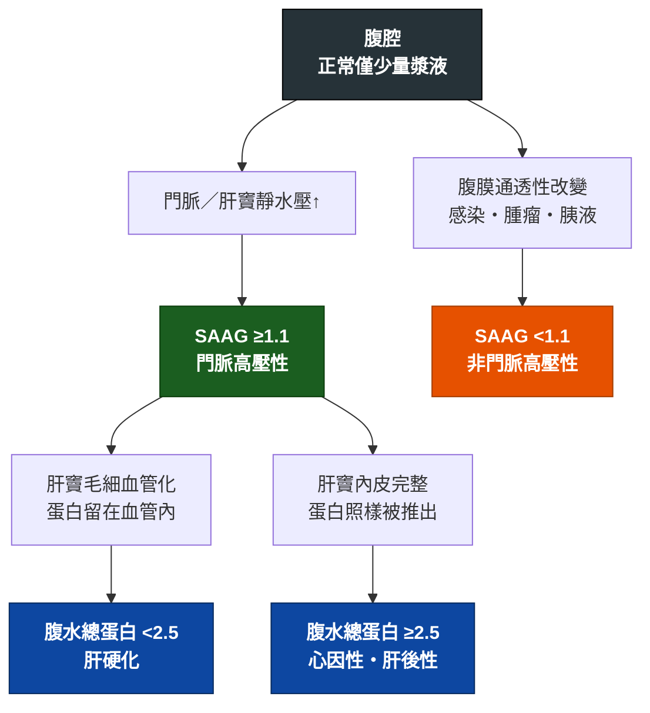

---
tags:
  - Med/Test/GI
  - ascitic-fluid
  - paracentesis
  - SAAG
  - 禁忌
aliases:
  - Ascitic fluid analysis
  - 腹水分析
  - Diagnostic paracentesis
  - 診斷性腹腔穿刺
  - SAAG
created: 2026-07-27
updated: 2026-07-28
status: 可用
source: "114-2 醫學(三) 22 延伸；AASLD Practice Guidance on Ascites, SBP and Hepatorenal Syndrome、Harrison's Principles of Internal Medicine、StatPearls Paracentesis"
cssclass: clinical-note
modality: lab
compare_with:
  - "[[Pleural fluid analysis]]"
---

# Ascitic fluid analysis ｜ 腹水分析 · Diagnostic paracentesis

> [!abstract] 一句話總覽
> 抽腹水做兩件事：**① 這包水是不是門脈高壓來的（SAAG）**，決定病因方向；**② 這包水有沒有感染（PMN ≥250/mm³）**，決定要不要立刻下抗生素。超音波只能告訴你「有水」，**只有腹水本身能告訴你「是什麼水」**。

> [!tip] 判讀速查
> **第一步 SAAG（serum-ascites albumin gradient）＝ 血清 albumin − 腹水 albumin，同日抽**
> **≥ 1.1 g/dL ＝ 門脈高壓**｜**< 1.1 g/dL ＝ 非門脈高壓**（**沒有灰色地帶**，算出 1.0 就是非門脈高壓）
> **第二步（只在 SAAG ≥1.1 時做）腹水總蛋白**：**< 2.5 g/dL → 肝硬化**｜**≥ 2.5 g/dL → 心因性／肝後性**
> **紅旗值**：腹水 **PMN ≥ 250/mm³ → SBP**，不等培養，立刻第三代 cephalosporin
> **高風險值**：腹水總蛋白 **< 1.5 g/dL** → SBP 高風險族群，評估初級預防

---

## 原理 Principle

> [!note] 這一節是本篇存在的理由
> [[Cirrhosis]]、[[SBP]]、[[Jaundice]] 等頁面只會寫「安排診斷性腹腔穿刺」與判讀結論；**原理只寫在這裡一次**。

> [!tip] 為什麼 SAAG 取代了「漏出液／滲出液」二分法、又比腹水總蛋白準
> 舊做法把胸水的邏輯直接搬過來，用**腹水總蛋白 ≥2.5 g/dL** 當 exudate。問題在於**兩個腔室的主要病理根本不同**：胸水常見的是**通透性**改變（血管破洞，蛋白跟著漏），量比值有意義；腹水最常見的是**壓力**上升——肝竇靜水壓把水擠進腹腔，腹膜完全沒破洞。**通透性的指標拿來量壓力，當然不準。**
> SAAG 走的是 Starling 定律：平衡時**膠體滲透壓差 ≈ 靜水壓差**，所以血清與腹水的 albumin 濃度差就是門脈壓的間接讀數——它叫 gradient（梯度）而不是 level，正是這個意思。
> 而腹水總蛋白是**絕對值**，會被血清白蛋白水準整個拖著跑：血清 albumin 2.0 的肝硬化病人腹水蛋白必然低、血清 albumin 4.3 的右心衰竭病人腹水蛋白必然高——**病因還沒判斷，數字已被血清水準決定**。SAAG 是減法，等於在算式裡就把血清水準扣掉了。附帶好處：利尿劑或引流讓腹水濃縮時兩邊**等比例變動**，SAAG 相對穩定，總蛋白卻會漂。

![[assets/liver-sinusoid-capillarization.jpg|820]]
*正常肝竇左側可見 fenestrated LSEC、quiescent hepatic stellate cell（HSC）與稀疏 ECM；纖維化後 LSEC 去窗孔化、形成 basement membrane，HSC 活化並沉積 ECM，構成 sinusoidal capillarization。這層屏障使蛋白較不易進入 Disse space 與腹水。Source: [Liver Sinusoidal Endothelial Cells in Liver Fibrosis](https://pmc.ncbi.nlm.nih.gov/articles/PMC5331310/), Fig. 1。*

## 什麼時候做

*寫「決策情境」，不要列疾病清單——那清單無上限，會爆炸。*

- 當你想回答「**這包腹水是什麼原因造成的、有沒有感染**」的時候
- **新發生的腹水一律先抽**；**已知肝硬化腹水的病人只要住院，不論有無症狀都該做一次診斷性穿刺**（SBP 可以完全沒有腹痛與發燒）
- 已知腹水的病人出現 [[Fever]]、腹痛、腹部壓痛、[[Hepatic encephalopathy]] 惡化、腎功能惡化、白血球上升、或不明原因 [[Shock]]
- 大量腹水造成呼吸窘迫、腹壁張力痛時，順道取檢體（此時的抽液本身屬 Intervention 範疇）

> [!info] 反查
> 想知道「哪些疾病會用到我」→ 看右側 Backlinks 面板。

> [!note] 深度寫在別處
> 肝硬化的機轉與嚴重度分級（Child-Pugh／MELD）、腹水的長期治療（限鈉、spironolactone 與 furosemide 併用）寫在 [[Cirrhosis]]。
> **治療性大量腹水引流（large-volume paracentesis）是 Intervention 的角度**——那篇問「怎麼抽、抽多少、refractory ascites 怎麼辦」；**本篇只問「抽出來的這包水在說什麼」**。

## 怎麼做 / 病人準備

| 項目 | 內容 |
|---|---|
| 姿勢 | 平躺、床頭稍抬；液量少時可稍向穿刺側傾（左側臥），讓液體聚到左下腹 |
| 穿刺點 | **左下腹**：anterior superior iliac spine（ASIS）內上方約 **3–5 cm**、**腹直肌鞘外側**。**為什麼不選右邊**：右下腹的 caecum 位置固定且常脹氣；左側 sigmoid 可移動、腹壁較薄、液池通常較深 |
| 一定要避開 | **腹直肌鞘**（內有 inferior epigastric artery）、**手術疤痕**（下方常有腸沾黏被固定）、可見的腹壁靜脈曲張（caput medusae） |
| 導引 | 超音波先確認液池與深度（[[Abdominal ultrasound]]）；進針用 **Z-track**（皮膚拉偏再進針）減少滲漏 |
| 術前 | 排空膀胱；**不需常規矯正 PT/INR 或血小板**（見下方反直覺一節） |
| 送檢項目 | 外觀、**細胞數＋分類**（EDTA 管）、**albumin、total protein**、Gram stain、細菌培養；視情況加 glucose、LDH、amylase、ADA、抗酸染色＋結核培養、triglyceride、cytology |
| 培養怎麼送 | **床邊直接把腹水各 10 mL 打進有氧／厭氧血液培養瓶**；送到實驗室才接種會讓敏感度大幅下降 |
| 同時抽血 | **血清 albumin**（同一天、最好同時）——沒有血清值就算不出 SAAG |

> [!danger] 最常見的操作失誤
> **忘了同時抽血清 albumin**。SAAG 是減法，只送腹水等於白抽一次；隔幾天才補抽也不行，因為期間血清 albumin 會變。

> [!note] 順帶記：大量抽液後的 albumin 補充門檻
> 單次抽出 **< 5 L** → 不需常規補；**≥ 5 L** → **每抽出 1 L 補 6–8 g albumin**，預防 post-paracentesis circulatory dysfunction。診斷性穿刺只抽 30–50 mL，不涉及此門檻；治療性引流的細節見 [[Cirrhosis]]。

![[assets/ascites-paracentesis-landmarks.svg|900]]
*左下腹穿刺示意：選 ASIS–臍連線外側 1/3 附近、避開腹直肌與 inferior epigastric vessels；先以超音波找最大液體袋，再用 Doppler 排除血管。右圖顯示腹壁層次、斜行針路與 Z-track 的皮膚位移；Z-track 並非超音波導引的替代品。依 [Diagnostic and therapeutic abdominal paracentesis](https://pmc.ncbi.nlm.nih.gov/articles/PMC10099762/) 與 [Z-track technique and post-paracentesis leak](https://pmc.ncbi.nlm.nih.gov/articles/PMC9724473/) 重繪。*

## 判讀 Interpretation

### 第一步：SAAG ＝ 血清 albumin − 腹水 albumin

| SAAG | 意義 | 常見病因 |
|---|---|---|
| **≥ 1.1 g/dL** | **門脈高壓** | [[Cirrhosis]]、酒精性肝炎、[[MASLD]] 相關肝硬化、右心衰竭（[[Heart failure]]）、[[Constrictive pericarditis]]、[[Budd-Chiari syndrome]]、大量肝轉移、猛爆性肝衰竭、myxedema |
| **< 1.1 g/dL** | 非門脈高壓 | 腹膜癌轉移（peritoneal carcinomatosis）、結核性腹膜炎、胰源性腹水（[[Acute pancreatitis]]）、膽汁性腹水、nephrotic syndrome、serositis |

> [!warning] 1.1 這個門檻沒有灰色地帶
> - 算出 **1.0 就是非門脈高壓**，算出 **1.1 就是門脈高壓**。不四捨五入、不「接近」。
> - **SAAG 是梯度，不是絕對值**。血清 albumin 很低 ≠ 門脈高壓——低白蛋白血症把兩邊一起拉低，梯度不一定變大。「血中 albumin 只有 2.8，看起來很像肝硬化」是最典型的誤導。
> - 兩管必須**同一天抽**；正在輸 albumin 的病人，血清值是被墊高的。

### 第二步：腹水總蛋白（**只有 SAAG ≥1.1 時才有分辨力**）

| 腹水總蛋白 | 指向 | 機轉 |
|---|---|---|
| **< 2.5 g/dL** | **肝硬化** | 肝竇 **capillarization（毛細血管化）**：內皮窗孔消失＋基底膜生成，蛋白**漏不出去** |
| **≥ 2.5 g/dL** | **心因性（右心衰竭、[[Constrictive pericarditis]]）或肝後性（[[Budd-Chiari syndrome]]）** | 肝竇內皮**尚完整**（本來就是高通透性），壓力一升高蛋白**照樣被推出來** |

> [!warning] 這一步最常被跳過
> 順序不能顛倒：**SAAG < 1.1 時看總蛋白毫無意義**，因為那一群病因彼此的總蛋白都偏高，分不開。
> 而只算 SAAG 就收手，會把「SAAG 1.7 ＋ 總蛋白 3.0」的**右心衰竭腹水**當成肝硬化——這兩個病的治療完全不同方向（一個是利尿＋限鈉，一個要處理右心與心包）。臨床上血清 BNP／NT-proBNP 明顯升高也支持心因性。

### 第三步：有沒有感染

| 腹水 PMN | 培養 | 名稱 | 處置 |
|---|---|---|---|
| **≥ 250/mm³**（AASLD 原文寫 ＞250，EASL 與多數教材寫 ≥250；實務無差異） | 陽性 | **SBP（spontaneous bacterial peritonitis）** | 立刻抗生素 |
| **≥ 250/mm³** | 陰性 | culture-negative neutrocytic ascites（CNNA） | **預後與 SBP 相同，一樣治** |
| < 250/mm³ | 陽性 | bacterascites | 有症狀 → 治療；無症狀 → 重抽再決定 |
| < 250/mm³ | 陰性 | 無腹水感染 | 找別的感染源 |

### SBP vs Secondary bacterial peritonitis（分不出來會死人）

| | **SBP（原發性）** | **Secondary（腸穿孔／腹內膿瘍）** |
|---|---|---|
| 病原 | **單一菌種**：E. coli、Klebsiella、Streptococcus | **多菌種**，常含厭氧菌或黴菌 |
| 腹水生化 | 總蛋白低、glucose 正常、LDH 不高 | **總蛋白 > 1 g/dL、glucose < 50 mg/dL、LDH > 血清正常上限**（三者符合其二即高度懷疑） |
| 追蹤反應 | 抗生素 48 小時後 PMN 明顯下降 | PMN 不降或反升 |
| 處置 | 抗生素 ＋ albumin | **立刻腹部 CT ＋ 外科會診**，光給抗生素治不好 |

### SBP 的經驗性治療與 albumin

| 項目 | 內容 |
|---|---|
| 第一線 | **第三代 cephalosporin**（cefotaxime 或 ceftriaxone），社區型感染首選 |
| 升階時機 | 院內感染、近期使用過抗生素、當地抗藥性高 → 涵蓋 ESBL |
| **絕不使用** | aminoglycoside——肝硬化病人腎毒性風險特別高 |
| **Albumin 給法** | **AASLD 2021／EASL：所有 SBP 都應給**（1.5 g/kg D1 ＋ 1 g/kg D3）。**獲益最明顯者：Cr ＞1 mg/dL 或 BUN ＞30 mg/dL 或 total bilirubin ＞4 mg/dL** |
| Albumin 劑量 | **Day 1：1.5 g/kg**（診斷後 6 小時內）＋ **Day 3：1 g/kg**，目的是預防 AKI 與 hepatorenal syndrome |
| 預防 | **初級**：腹水總蛋白 **< 1.5 g/dL** ＋ 進階肝／腎功能不良者；**次級**：得過一次 SBP → 長期口服預防性抗生素 |

### 其他送檢項目在說什麼

| 檢驗 | 切點／發現 | 指向 |
|---|---|---|
| **Cytology** | 陽性 | 腹膜癌轉移。注意 hepatocellular carcinoma 造成的腹水多半是門脈高壓性，**cytology 常為陰性** |
| **Amylase** | **> 1000 U/L**（且遠高於血清） | 胰源性腹水：[[Acute pancreatitis]]、pseudocyst 破裂、胰管斷裂；腸穿孔亦可升高 |
| **ADA ＋ 抗酸染色／結核培養** | ADA **＞40 U/L**（文獻切點散在 32–40，40 最常用）、淋巴球為主 | 結核性腹膜炎。**非肝硬化者多為 SAAG ＜1.1；但合併肝硬化時 SAAG 可 ≥1.1，且 ADA 敏感度只剩約 30%——ADA 正常不能排除** |
| **Triglyceride** | **> 200 mg/dL**、外觀乳白 | 乳糜腹水（chylous ascites）：淋巴瘤、腹部術後淋巴管損傷、肝硬化 |
| Glucose / LDH | glucose < 50 mg/dL、LDH 高 | 往 secondary peritonitis 或惡性腹水想 |
| Bilirubin | 腹水 bilirubin > 血清 | 膽汁性腹水（膽道或腸穿孔），見 [[RUQ pain]] |
| RBC | > 50,000/mm³ 為肉眼血性 | 外傷、HCC 破裂、穿刺劃破血管 |

![[assets/ascitic-fluid-appearance.svg|900]]
*腹水 gross appearance 四連對照。外觀只提供方向：混濁／膿樣仍以 PMN 與培養確認感染；乳白優先驗 triglyceride、必要時 chylomicrons；血性加看 RBC／hematocrit 並依情境送 cytology。依 [Ascitic Fluid Analysis in the Differential Diagnosis of Ascites](https://pmc.ncbi.nlm.nih.gov/articles/PMC4521252/) 的外觀判讀原則重繪。*

## 干擾與偽陽性

*這一節最常被跳過，也最常害人。*

| 會讓結果失真的因素 | 往哪個方向偏 |
|---|---|
| 血清與腹水 albumin **不同天抽**、或**正在輸注 albumin** | 血清端被墊高或已變動 → **SAAG 假性升高**。兩管必須同日 |
| 極度低白蛋白血症（血清 albumin ＜1.1 g/dL，約占肝硬化腹水的 ＜1%） | 數學上不可能算出 ≥1.1 → **SAAG 假性偏低、假性「非門脈高壓」**。重抽常轉為高 SAAG |
| **血性腹水**（穿刺劃破血管或 HCC 破裂） | 血中白血球混入 → **PMN 假性升高**。校正：**每 250 顆 RBC 扣掉 1 顆 PMN** |
| 檢體放太久才做細胞計數 | 白血球溶解 → **PMN 假性偏低**，漏掉 SBP |
| 培養在實驗室才接種，或抽腹水**之前**已給抗生素 | **培養假陰性**（但 PMN ≥250 仍要治） |
| 利尿劑治療中 | 利尿使腹水濃縮，**總蛋白可顯著上升**（約 2/3 病人），第二步可能被誤導向心因性；**SAAG 相對不受影響** |
| **高球蛋白血症**（血清 globulin ＞5 g/dL） | 腹水 globulin 也高 → **SAAG 假性偏低**（約占 1%） |
| **乳糜腹水**（脂質干擾 albumin 檢測） | **SAAG 假性偏高** |
| **低血壓／休克** | 門脈壓一併下降 → **SAAG 假性偏低**；血壓回穩後重抽常轉為高 SAAG |

## 與相關檢查的取捨

| 檢查 | 優點 | 缺點 | 什麼時候選它 |
|---|---|---|---|
| **本篇（腹水分析）** | 唯一能定病因、唯一能判定有無感染 | 侵入性；有出血、腸穿孔、滲漏風險 | 新發腹水、肝硬化腹水住院、疑似感染 |
| [[Abdominal ultrasound]] | 快、無創、可即時導引穿刺 | **只能說「有水」**，說不出是什麼水 | 確認腹水存在、穿刺前定位 |
| 血液培養 | SBP 常合併菌血症，可補抓病原 | 陰性不能排除 SBP | 懷疑 SBP 時**同時**送 |
| 腹部 CT | 找穿孔、膿瘍、腫瘤、肝靜脈阻塞 | 輻射、顯影劑腎毒性 | 懷疑 secondary peritonitis 或病因不明 |
| 超音波心圖 | 抓右心衰竭與 constrictive pericarditis | 對腹腔本身無資訊 | **SAAG ≥1.1 但總蛋白 ≥2.5** 時 |

> [!tip] 和胸水的邏輯對照（配合 compare_with）
> | | [[Pleural fluid analysis]] | 本篇（腹水） |
> |---|---|---|
> | 第一步問什麼 | 漏出／滲出（Light's criteria，**比值**） | 是否門脈高壓（SAAG，**減法**） |
> | 背後的生理 | **通透性**有沒有改變 | **壓力**高不高 |
> | 感染／嚴重度門檻 | **pH < 7.20** → 考慮引流 | **PMN ≥ 250/mm³** → 立刻抗生素 |
> | 主要處置方向 | **把水引出來** | **把菌殺掉**（引流只是症狀治療） |
> | 抽太多會怎樣 | 一次 > 1–1.5 L → re-expansion pulmonary edema | 一次 ≥ 5 L 未補 albumin → 循環功能失調 |
> | 凝血功能異常 | 術前查並矯正 PT/INR 與血小板 | **不常規矯正**（見下） |

## 禁忌與陷阱

> [!tip] 反直覺：腹水穿刺**不必**常規矯正凝血功能
> 這是**與胸水最不一樣的一點**，也最容易被直覺帶偏。
> 肝硬化的 PT/INR 延長**不代表容易出血**：肝臟同時減產促凝與抗凝因子，兩邊一起掉，**INR 在這裡量不出真正的出血風險**。實際嚴重出血極罕見，而預防性輸 FFP 或血小板從未被證明能降低它。
> 因此指引明確**不建議**穿刺前常規輸 FFP／血小板，也**沒有訂出任何 INR 或血小板的門檻值**。
> 唯一該退一步的情境：臨床上明顯的 **DIC** 或 hyperfibrinolysis。
> 反過來說，因為「INR 2.8 不敢抽」而延誤 SBP 診斷，才是真正會害死病人的那個決定。

> [!danger] 絕對不可
> | 情境 | 絕對不可 | 為什麼 | 該做什麼 |
> |---|---|---|---|
> | 肝硬化腹水病人發燒／腹痛／腦病變或腎功能惡化 | 先給抗生素觀察、不抽腹水 | SBP 靠腹水 PMN 診斷；先給藥會讓培養轉陰、也沒了診斷依據 | **先做診斷性穿刺**，取完檢體立刻開始經驗性抗生素 |
> | 腹水 PMN ≥ 250、培養尚未回報 | 等培養報告再決定要不要治 | CNNA 預後與 SBP 相同，延遲抗生素會拉高死亡率 | **PMN ≥ 250 就開始第三代 cephalosporin** |
> | 腹水 glucose < 50、LDH 高、總蛋白 > 1、多菌種 | 當成 SBP 只給抗生素 | 這是 secondary peritonitis（穿孔／膿瘍），不處理源頭治不好 | 立刻腹部 CT ＋ 外科會診 |
> | SBP 合併 Cr > 1／BUN > 30／bilirubin > 4 | 只給抗生素、省略 albumin | 少了 albumin，AKI 與 hepatorenal syndrome 風險明顯上升 | Day 1 albumin 1.5 g/kg ＋ Day 3 1 g/kg |
> | 肝硬化病人的腹腔感染 | 用 aminoglycoside 當經驗性用藥 | 此族群腎毒性風險特別高，可能推向需要 [[Dialysis]] | 第三代 cephalosporin |
> | 選穿刺點 | 扎在手術疤痕上、腹直肌鞘上、或明顯腹壁靜脈曲張處 | 疤痕下方常有腸沾黏被固定；腹直肌鞘內有 inferior epigastric artery | 左下腹 ASIS 內上方、腹直肌鞘外側，超音波導引 |
> | 只送腹水 | 忘記同時抽血清 albumin | SAAG 是減法，算不出來 | 穿刺當日同時抽血 |

> [!warning] 常見錯誤
> - 看到「血中 albumin 很低」就認定是肝硬化腹水——**SAAG 是梯度不是絕對值**
> - 算完 SAAG 就收手，跳過第二步——SAAG ≥1.1 但**總蛋白 ≥2.5 是心因性／肝後性**，不是肝硬化
> - 因為 INR 延長就不敢穿刺、先叫 FFP——延誤診斷的傷害遠大於出血風險
> - 培養瓶沒在床邊接種，導致培養假陰性，被誤判成「沒有感染」
> - 血性腹水直接讀 PMN、沒做 RBC 校正，把不存在的 SBP 治了一輪
> - 忘記 [[Edema]] 與腹水並存時要想右心衰竭，只往肝臟找；也忘了送 ADA 與抗酸染色，漏掉結核性腹膜炎

## 相關連結

- [[Cirrhosis]] — 最常見的病因；機轉、分級與長期治療寫在那裡
- [[SBP]] — PMN ≥250 之後的完整處置；[[Hepatic encephalopathy]] 常是它的首發表現
- [[Pleural fluid analysis]] — 對照組：同樣是「抽一包水」，但問的問題不同
- [[Heart failure]] · [[Constrictive pericarditis]] · [[Budd-Chiari syndrome]] — SAAG ≥1.1 但總蛋白 ≥2.5 的去處
- [[Abdominal ultrasound]] — 上游影像與穿刺導引
- [[禁忌選項]]
