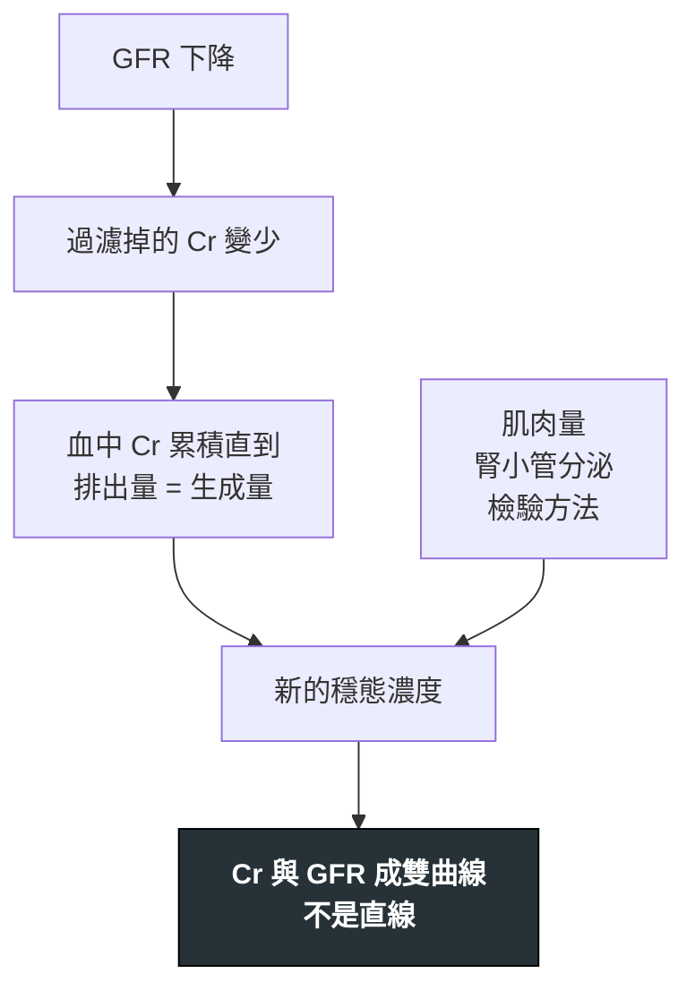

---
tags:
  - Med/Test/Nephro
  - Med/Test/General
  - 禁忌
aliases:
  - Creatinine
  - Cr
  - BUN
  - eGFR
  - GFR
  - Cystatin C
  - Renal function test
  - Blood urea nitrogen
  - Creatinine clearance
  - CrCl
  - 肌酸酐
  - 血中尿素氮
  - 腎絲球過濾率
  - 腎功能指標
created: 2026-07-29
updated: 2026-07-29
status: 可用
source: KDIGO 2024 CKD Guideline；KDIGO 2012 AKI Guideline（2026 改版出版程序中）；CKD-EPI 2021 (NEJM)；NKF-ASN Task Force on Race and eGFR 2021；台灣腎臟醫學會 114.07.11 eGFR 公式公告；ACR/NKF 2020 顯影劑共識
cssclass: clinical-note
modality: lab
compare_with:
  - "[[Urine indices]]"
  - "[[UPCR UACR]]"
  - "[[24h urine collection]]"
---

# BUN / Cr / eGFR ｜ 腎功能指標 · Renal Function Tests

> [!abstract] 一句話總覽
> 這三個數字**沒有一個真的在量腎功能**——它們量的是「代謝廢物在血中堆到多高」,再**反推**過濾率。所以每一個都可以在 GFR 完全沒變的情況下自己動:BUN 隨蛋白負荷與血容量動、Cr 隨肌肉量與腎小管分泌動、eGFR 只在 Cr **穩定**時才有定義。判讀的核心不是查表,是**先問這個數字有沒有被非腎因素推動**。

> [!tip] 判讀速查
> **正常範圍**(皆依實驗室):**BUN 8–20 mg/dL**(部分實驗室報 7–20 或 6–24)｜**Cr 男 0.7–1.3、女 0.6–1.1 mg/dL**｜**eGFR ≥90 mL/min/1.73m²**｜cystatin C 約 0.6–1.0 mg/L
> **決策切點**:**eGFR <60** 持續 3 個月 ＝ [[CKD]]｜**Cr ↑≥0.3 mg/dL / 48h** 或 **≥1.5× baseline / 7天** ＝ [[AKI]]｜**BUN/Cr >20** 偏 prerenal 或消化道出血
> **紅旗值**:Cr **每日上升 >1.5 mg/dL**(想 rhabdomyolysis／severe ATN)｜Cr 上升 ＋ 寡尿 ＋ 高血鉀 ＝ 評估透析｜eGFR **<15**
> **絕對不可**:在 **Cr 還在動**的時候用 eGFR 調藥物劑量;看到老人 Cr 1.0「正常」就當腎功能正常

---

## 原理 Principle

*它到底在量什麼?為什麼這個數字能反映那件事?*

三者都是「**產生速率固定 → 靠腎排掉 → 血中濃度反映清除能力**」的間接推論。問題出在每一個前提都可以被打破。

| | 從哪來 | 腎怎麼處理 | 前提被打破時 |
|---|---|---|---|
| **Creatinine** | 肌肉中 creatine／phosphocreatine 非酵素性脫水環化,**產量正比於肌肉量** | 自由過濾、幾乎不再吸收,但**約 10–15% 由近端腎小管分泌**(OCT2／MATE) | 肌肉量變 → 基準線整條位移;分泌被藥物擋住 → Cr 升但 GFR 沒動 |
| **Urea (BUN)** | 肝臟尿素循環處理胺基酸的氮,**產量正比於蛋白負荷與分解代謝** | 自由過濾,但約 **40–50% 被再吸收**(缺水時可 **>65%**),再吸收量隨 ADH 與慢流速**增加** | 低血容量、腸胃道出血、類固醇 → BUN 不成比例上升 |
| **Cystatin C** | **所有有核細胞恆定分泌**,與肌肉量無關 | 自由過濾後被近端腎小管**完全再吸收並代謝**(所以尿中測不到,不能算清除率) | 甲狀腺功能、類固醇、發炎、惡性腫瘤會改變產量 |

> [!important] 為什麼是雙曲線,以及為什麼這件事最重要
> 穩態下 **生成量 = 排出量 = GFR × [Cr]**。生成量固定,所以 **[Cr] ∝ 1／GFR**。
>
> | GFR | 對應 Cr(概念值) | 這一格掉了多少腎 |
> |---|---|---|
> | 120 → 60 | 0.7 → **1.4** | **掉一半**,Cr 才剛碰到正常上限 |
> | 60 → 30 | 1.4 → 2.8 | 再掉一半 |
> | 30 → 15 | 2.8 → 5.6 | 再掉一半 |
>
> 兩個推論:
> **① 高 GFR 區間,Cr 幾乎不動**——這段叫 **creatinine-blind range**,早期腎損傷靠 Cr 完全看不到,要靠 [[UPCR UACR|白蛋白尿]]。
> **② Cr 從 0.7 升到 1.3,報告不會標紅字,但已經少了將近一半腎。** 這是這篇最該記住的一句話。
> (而且如果這個變化發生在 48 小時內,依 KDIGO 它同時已經是 **AKI stage 1**。)

> [!note] 這一節是本篇存在的理由
> [[AKI]]、[[CKD]] 擁有**分期與處置**;本篇擁有**量測端**——Cr／BUN／eGFR 的生成邏輯、公式選擇、失效條件、干擾因素**只寫在這裡一次**。

## 什麼時候做

- 當你想回答「**這個病人現在的排泄能力大概在哪一格**」時
- 當你要**開一個經腎排除的藥**、或用顯影劑之前
- 當你需要**回頭比對 baseline** 判斷這次是急性還是慢性時
- 任何不明原因的:噁心倦怠、水腫、高血壓、貧血、電解質異常
- **追蹤**已知 CKD 的下降斜率(斜率比單點數值更有意義)

> [!warning] 只驗一次 Cr 幾乎沒有用
> 單點 Cr 不能區分「一直都這樣」與「昨天開始壞掉」。**Cr 的價值在斜率**,所以第一件事永遠是去翻舊資料找 baseline。

> [!info] 反查
> 想知道「哪些疾病會用到我」→ 看右側 Backlinks 面板。

## 怎麼做 / 病人準備

| 項目 | 內容 |
|---|---|
| 檢體 | 血清／血漿,一般生化管 |
| 病人準備 | 一般不需空腹;**避免前一天大量吃肉或補充 creatine** |
| 檢驗方法 | **Jaffe(鹼性苦味酸)** 便宜但易受干擾;**酵素法**較專一 → 干擾因素完全不同,見下 |
| 追蹤 | 同一家實驗室、同一種方法才能比趨勢 |
| AKI 的頻率 | 不穩定時 **每 12–24 小時**;等 24 小時才追一次會錯過分期 |

## 判讀 Interpretation

### ① 先問三個問題,再看數字

1. **Cr 穩定嗎?** 不穩定 → **eGFR 沒有意義**,只能看變化速率(分期見 [[AKI]])
2. **這個人的肌肉量正常嗎?** 不正常 → Cr 的「正常範圍」對他不適用
3. **有沒有藥物在擋腎小管分泌?** 有 → Cr 上升不代表 GFR 下降

> [!danger] 最常見的誤判:老人的「正常」Cr
> 80 歲、45 kg、女性,Cr **1.0 mg/dL** → 報告不會標紅字,但 eGFR 約 **50**,已是 **G3a**。
> 她的肌肉量只有年輕男性的一半,所以生成量只有一半,同樣的 GFR 會停在一半的 Cr。
> **後果是實際的**:這個人拿到全劑量的 DOAC、NSAID、metformin,而沒有人覺得有問題。

### ② eGFR 公式怎麼選

| 公式 | 估的是 | 現在的角色 |
|---|---|---|
| **CKD-EPI 2021 (Cr)** | eGFR,mL/min/**1.73m²** | **台灣與美國現行標準**。變數只有 Cr、年齡、性別;**2021 版移除了 race 係數** |
| **CKD-EPI cystatin C／Cr-cysC 合併** | 同上,較不受肌肉量影響 | eGFRcr 不可靠時的**確認工具**(KDIGO 2024 建議) |
| **MDRD** | eGFR | 舊版,在 GFR >60 區間**低估**,已不建議用於報告 |
| **Cockcroft-Gault** | **CrCl**,單位 mL/min,**未做體表面積標準化** | 過時但**沒有退休**——大量藥物仿單的劑量調整依據仍是它 |
| **Bedside Schwartz／CKiD U25** | 兒童與青少年 eGFR | 兒科用;**CKiD U25**(1–25 歲、依年齡性別)較新,涵蓋 Schwartz 處理不好的青春期到成年過渡 |

> [!important] 台灣已正式改用 CKD-EPI 2021
> **台灣腎臟醫學會 114.07.11 公告**:國內 eGFR 建議採用 **2021 CKD-EPI**,並已與**健保署達成共識**。此前(113.10.28 公告)國內長期使用的是 **4 項變數 MDRD**,期間有新舊公式並存的雙軌過渡。
> **實際影響**:同一個 Cr 值,換公式後 eGFR 會變——**所有以 eGFR 為門檻的健保給付規定、CKD 照護收案、藥物劑量調整都在重新對齊**。看到跨年度的 eGFR 趨勢,先確認是不是同一個公式算的。

> [!note] KDIGO 沒有強制全球都用 CKD-EPI
> KDIGO 2024 的寫法是「用**該地區驗證最好**的公式」,明文允許 CKD-EPI、**EKFC(歐洲)** 或區域修正式。
> 所以「現行標準是 CKD-EPI 2021」這句話在台灣與美國成立,但若題目是以 KDIGO 層級提問,答案是「取決於地區驗證」。

> [!tip] Cockcroft-Gault 是少數值得背的公式
> $$\text{CrCl} = \frac{(140 - \text{age}) \times \text{weight (kg)}}{72 \times \text{Scr}} \times 0.85\ (\text{女性})$$
> 因為 **DOAC、aminoglycoside、vancomycin 等藥的減量門檻是用 CrCl 訂的**,不是 eGFR。在體重極端的人身上兩者可以差到一個劑量級距。
> *(不確定性:原始公式用實際體重;肥胖者該用實際／理想／調整體重,不同來源建議不同,臨床上多用調整體重。要精準時查該藥仿單。)*

> [!warning] mL/min/1.73m² vs mL/min:別直接拿去算藥
> eGFR 報告是**體表面積標準化**後的值,方便跨人比較與分期。
> 要算個別病人的**實際清除能力**:`absolute GFR = eGFR × BSA ÷ 1.73`。
> 對 45 kg 的老太太(BSA ≈1.4)與 110 kg 的壯漢(BSA ≈2.3),這個轉換會把答案改變 **20–30%**。

### ③ eGFR 公式不適用的情境

*公式是從穩定門診族群回歸出來的,離開那個母體就會失準。*

| 情境 | 偏差方向 | 該怎麼辦 |
|---|---|---|
| **AKI／Cr 還在動** | 完全無效(還沒到穩態,**必定低估**傷害程度) | 用 KDIGO 分期看變化量,不看 eGFR |
| **肌少症、老人、截肢、長期臥床** | **高估** GFR | 加驗 cystatin C |
| **健美、高肌肉量、補 creatine** | **低估** GFR | 看趨勢,或 cystatin C |
| **嚴重肝硬化** | **大幅高估**(肝生成 Cr 減少 ＋ 分泌增加 ＋ 水腫稀釋) | 高度警覺;[[Hepatorenal syndrome]] 的嚴重度常被低估 |
| **懷孕** | 公式未驗證;正常懷孕 GFR 上升 → Cr 應**低於**未孕值 | 孕婦 Cr 0.9 就要當異常查 |
| **兒童／青少年** | 成人公式不適用 | Bedside Schwartz;**CKiD U25**(1–25 歲)較新且涵蓋過渡期 |
| **捐腎評估、化療劑量** | 精度不足 | measured GFR(iohexol、⁵¹Cr-EDTA、DTPA) |

### ④ 分期不寫在這裡

> [!note] 深度歸屬
> **KDIGO AKI 分期表** → [[AKI]]｜**CKD 的 G × A 兩軸熱區圖與邊界值規則** → [[CKD]]。
> 那兩篇已經寫得比這裡細,本篇只保留**與「量測」本身有關**的三件事:

**① AKI 期間 eGFR 沒有定義。** 分期只能用 Cr 的**變化量**與尿量,不能用 eGFR——公式假設穩態。

**② 尿量那一軸在非寡尿性 AKI 完全失效。** 寡尿通常領先 Cr 上升約 12–24 小時(經驗值,不是驗證過的固定區間),但 ICU 相當比例的 AKI 從頭到尾尿量正常,這一軸永遠不會亮。**不能只靠尿量把關。**

**③ AKI 與 CKD 之間還有 AKD。** 時間軸是 **AKI(≤7 天)→ AKD(acute kidney disease,≤3 個月)→ CKD(>3 個月)**。「eGFR <60 但還沒滿 3 個月」不是無名地帶,它叫 AKD。

> [!info] 指引狀態:KDIGO AKI 改版出版程序中(2026)
> 2012 版**仍是現行指引**,Cr 與尿量的數字在新版**沒有改變**。與本篇直接相關的結構變動:
> - **三軸分期 C / U / B**(creatinine／urine output／**biomarker**),例如「stage C1 U1 B0」;可能出現 **C0/U0/B1** 的 subclinical AKI
> - **cystatin C ≥1.5× baseline(7 天內)** 成為 Cr 不可靠時的**替代功能判準**——這一條把 cystatin C 從「輔助」升級成「定義的一部分」
> - 尿量改用**理想體重**計算
>
> *(狀態:尚未正式發布。國考短期內仍以 2012 版為準。)*

### ⑤ BUN/Cr ratio:粗糙但免費

| Ratio | 偏向 | 機轉 |
|---|---|---|
| **>20** | **Prerenal**,或**上消化道出血** | 低血容量 → ADH↑ ＋ 流速慢 → urea 再吸收增加;或腸道吸收血紅素蛋白 → 氮負荷 |
| **10–20** | 正常區間 | |
| **<10** | **Intrinsic renal**,或肝衰竭、營養不良、透析後 | 尿素生成本身減少 |

> [!warning] 這個比值的可信度低於它的知名度
> 它有**三個獨立的分子來源**(血容量、蛋白負荷、肝功能)和**兩個分母干擾**(肌肉量、藥物)。
> 遇到需要真的分辨 prerenal vs ATN,請用尿端指標 → [[Urine indices]]。BUN/Cr 只適合當第一眼的方向感。

### ⑥ Cystatin C:什麼時候值得加驗

**加驗的時機**——eGFRcr 與臨床印象對不起來,且答案會改變處置:

- 肌肉量極端(肌少、截肢、健美、癱瘓)
- eGFR 落在 **45–59** 這種「決定要不要貼 CKD 標籤」的灰區
- 要開治療窗窄的藥(化療、抗生素劑量)

**它自己的干擾**:

| 讓 cystatin C **升高** → eGFRcys 假性偏低(看起來腎比較差) | 讓 cystatin C **降低** → eGFRcys 假性偏高 |
|---|---|
| **甲狀腺功能亢進**、**高劑量類固醇**、全身性發炎、惡性腫瘤、肥胖、吸菸 | **甲狀腺功能低下** |

*(所以「cystatin C 的干擾都往同一個方向」是錯的——甲狀腺是雙向的鏡像對。)*

> [!tip] eGFRcr 與 eGFRcys 差很多,本身就是資訊
> 兩者落差大常見於重症、肝硬化、惡病質。此時 **eGFRcr-cys 合併式**比任何單一式準,是 KDIGO 2024 偏好的處理。

### ⑦ 急性還是慢性?

*Cr 2.5,沒有舊資料。這是每次值班都會遇到的問題。*

| 傾向慢性 | 傾向急性 |
|---|---|
| 腎臟超音波**體積縮小、皮質變薄** | 腎臟大小正常或偏大 |
| **貧血**(EPO 不足) | Hb 正常 |
| **低血鈣 ＋ 高血磷 ＋ PTH 升高** | 鈣磷大致正常 |
| 病人沒有症狀 | 噁心、倦怠、尿量改變 |

> [!danger] 「腎變小 ＝ 慢性」有一整排例外
> 以下即使末期,腎臟仍然**不小甚至變大**——看到大腎**不能**排除慢性:
> **DM 腎病變**｜**Amyloidosis**｜**多囊腎(PKD)**｜**HIV 腎病變(HIVAN)**｜**Multiple myeloma / cast nephropathy**｜**慢性阻塞性腎病變(水腎)**｜**浸潤性疾病(淋巴瘤、白血病)**
> 反過來,CKD 病人也會**急性惡化(AKI on CKD)**,不是二選一。

## 干擾與偽陽性

*這一節最常被跳過,也最常害人。*

### 讓 Cr 升高但 GFR 沒有變的藥

*機轉:阻斷近端腎小管的 OCT2／MATE 分泌通道。*

| 藥 | 典型情境 |
|---|---|
| **Trimethoprim**(TMP-SMX) | 開藥後數天 Cr 升 0.1–0.4 mg/dL |
| **Cimetidine**、famotidine(較弱) | 舊藥,但仍是經典考點 |
| **Dolutegravir、bictegravir、rilpivirine、cobicistat** | HIV 治療起始後;bictegravir(Biktarvy)現在比 dolutegravir 更常見 |
| **Abemaciclib、ribociclib**(CDK4/6i) | 乳癌治療起始後。已證實 **iohexol 實測 GFR 與 cystatin C 都沒變** |
| **Pyrimethamine** | 經典 MATE 抑制劑 |
| **Ranolazine、dronedarone** | dronedarone 有 ≥10% 的可逆 Cr 上升 |
| **Tepotinib、capmatinib**;高劑量 salicylate | |

> [!note] Fenofibrate 是這一格的**干擾項**
> 它也會讓 Cr 上升,但機轉**不是**單純阻斷分泌(可能涉及真實的 GFR 影響)。看到 fenofibrate 就自動歸類成「假性上升」是錯的。

> [!tip] 反向利用:cimetidine 可以拿來「校正」CrCl
> 既然 CrCl 因腎小管分泌而高估 GFR,那**先給 cimetidine 把分泌擋掉**再收 24 小時尿,CrCl 就會逼近真實 GFR。
> 這是歷史上的標準做法,現在被 measured GFR 取代,但仍是常見考點。

> [!tip] 怎麼認出「假性 Cr 上升」
> **① 上升幅度小且很快到達新平台**(不是持續爬升)｜**② BUN 完全沒動**｜**③ 尿量、尿液檢查、電解質都正常**｜④ 停藥後回到原點。
> 對照組:真的 AKI 會**持續**上升,而且 BUN 通常一起動。

### 檢驗方法本身的干擾

| 因素 | 方向 | 條件 |
|---|---|---|
| **Ketone(acetoacetate)** — DKA | Cr **假性升高** | **Jaffe 法** |
| 部分 **cephalosporin** | Cr 假性升高 | Jaffe 法 |
| 高 **bilirubin** | Cr **假性降低** | 兩種方法皆可能 |
| **Flucytosine** | Cr 假性升高(可 **>60%**) | 酵素法中的 **creatinine iminohydrolase** 法;sarcosine oxidase 法不受影響 |

> [!warning] 不確定性聲明
> 干擾的方向與程度**因試劑與儀器而異**,上表是常見方向。臨床上遇到「數字與病人對不起來」,**打電話問檢驗科用什麼方法**比查書快。

### 讓 BUN 動而 GFR 沒動

| 往上 | 往下 |
|---|---|
| **上消化道出血**(最重要) | 肝衰竭(尿素循環壞掉) |
| 高蛋白飲食、TPN、腸道營養 | 嚴重營養不良 |
| **類固醇、tetracycline**(促分解代謝) | **懷孕**(血容量↑、GFR↑) |
| 分解代謝狀態:感染、燒傷、外傷 | SIADH(稀釋) |
| 脫水、心衰(ADH 高、流速慢) | |

## 與相關檢查的取捨

| 檢查 | 優點 | 缺點 | 什麼時候選它 |
|---|---|---|---|
| **血清 Cr ＋ eGFR** | 便宜、即時、指引與分期都用它 | 盲區大、受肌肉量影響、AKI 時無效 | **預設值** |
| **Cystatin C／合併式** | 不受肌肉量影響 | 貴、非普及、受發炎與類固醇干擾 | eGFRcr 不可靠或處於灰區時 |
| **24h CrCl** | 同時得到蛋白量與 Cr 排泄量 | 收集誤差大;因腎小管分泌**高估 GFR 約 10–20%**(低 GFR 時更多) | 極端體型;懷疑收集不全時可用總 Cr 量檢核 |
| **Measured GFR**(iohexol、DTPA) | 真正的標準 | 貴、慢、需核醫 | 捐腎評估、精算化療劑量 |
| **[[UPCR UACR]]** | 抓 Cr 完全看不到的早期損傷 | 不反映過濾率 | **一定要一起看**,分期的另一軸 |
| **[[Urine indices]]** | 分辨 prerenal vs intrinsic | 受利尿劑、CKD 干擾 | Cr 上升且需要知道**為什麼** |

## 禁忌與陷阱

> [!danger] 絕對不可
> | 情境 | 絕對不可 | 為什麼 | 該做什麼 |
> |---|---|---|---|
> | Cr 正在上升的 AKI | 用當下的 eGFR 調藥物劑量 | 未達穩態,eGFR **必定高估**殘餘腎功能 → 藥物過量 | 假設 GFR 很低,保守給藥,追連續 Cr |
> | eGFR **<30** | 給 metformin | lactic acidosis 風險 | 停藥;**30–45 不可起始**,已在用者評估減量 |
> | eGFR **30–59** ＋ 要打顯影劑 | 不停 metformin 就直接檢查 | 顯影後若 AKI,metformin 蓄積 | 檢查前 **48 小時停**,48 小時後**重驗 eGFR** 再恢復(eGFR ≥60 者不需事前停,打當下停、48 小時後恢復即可) |
> | 急性腎功能惡化中 | 繼續 **NSAID** | 阻斷前列腺素依賴的入球小動脈擴張,拿掉最後的代償 | 停掉,而且不要用「只吃幾天」說服自己 |
> | 老人 Cr「正常」 | 用全劑量經腎排除的藥 | 肌肉量低 → Cr 正常但 eGFR 可能 <50 | 一律算 eGFR 或 CrCl,不看 Cr 原始值 |
> | eGFR **<30** 或正在 AKI ＋ 要打靜脈顯影劑 | 未評估就直接打、也不給預防性輸液 | 這一段 eGFR 才是風險確實升高的族群 | 評估檢查必要性;給**等張生理食鹽水**預防;盡量減量 |
> | 只有一次 Cr 異常 | 診斷 CKD | CKD 的定義包含「**持續 3 個月**」 | 3 個月後重驗再定義 |

> [!important] RASi 與 SGLT2i 不屬於上面那張表——這是最容易記錯的一格
> 直覺是「腎不好就停 ACEi／ARB／SGLT2i」,**KDIGO 2024 的方向剛好相反**:
> - **ACEi／ARB:即使 eGFR 掉到 30 以下,穩定狀態仍建議繼續用**
> - **SGLT2i:eGFR 掉到 20 以下仍可合理繼續**(PP 3.7.1);起始後那個**預期中的 eGFR 初期下降(dip)不是停藥理由**
> - **Sick day 暫停只適用於「急性脫水性疾病」**(嘔吐腹瀉、發燒無法進食)的那幾天
>
> 指引特別點名的實際傷害是:**暫停之後忘記恢復**。所以停的當下就要寫下什麼時候復用。

> [!note] 顯影劑腎病變的風險被高估了(ACR/NKF 2020)
> 早年研究缺乏對照組,且把「打完顯影劑後發生的 AKI(CA-AKI)」與「顯影劑造成的 AKI(CI-AKI)」混為一談。
> 現行共識:**靜脈**顯影劑造成 AKI 的風險被**誇大**;預防性輸液的適應症收斂到 **eGFR <30 或已有 AKI**,**30–44 視個案考慮**,更高就不需要。
> 不要因為 eGFR 50 就拒絕一個必要的 CT——延誤診斷的傷害通常更大。

> [!warning] 常見錯誤
> - **把 Cr 從 0.7 升到 1.3 當成「還在正常範圍」**——那是掉了將近一半的 GFR,而且發生在 48 小時內就已經是 AKI stage 1
> - **只追 Cr 不追尿量**——尿量早 12–24 小時給答案
> - **拿 eGFR(/1.73m²)直接當 CrCl 去查藥物仿單**——單位不同,極端體型會差一個劑量級距
> - **TMP-SMX 開了三天 Cr 升 0.3 就診斷 AKI 並停藥**——先看 BUN 有沒有動、尿液檢查正不正常
> - **肝硬化病人 Cr 0.9 就說腎沒事**——這個族群的 Cr 系統性偏低,0.9 可能已經是明顯腎損傷
> - **忘記問 baseline**——沒有 baseline,AKI 分期無法成立,而多數病人的舊資料就在系統裡

## 相關連結

- [[AKI]] — 分期用本篇的 Cr 變化量與尿量;病因分類寫在那篇
- [[CKD]] — 分期用本篇的 eGFR × [[UPCR UACR|白蛋白尿]] 兩軸
- [[Urine indices]] — Cr 升高之後,「為什麼升」由尿端指標回答
- [[UPCR UACR]] — 分母的尿 creatinine 為什麼恆定,原理寫在本篇
- [[Dialysis]] — 透析時機看症狀與併發症,**不是看 Cr 數字**
- [[Arterial blood gas]] — 腎衰竭合併的代謝性酸中毒判讀在那篇
- [[Multiple Myeloma]] — 老人不明腎衰竭的必查鑑別;腎臟大小可正常
