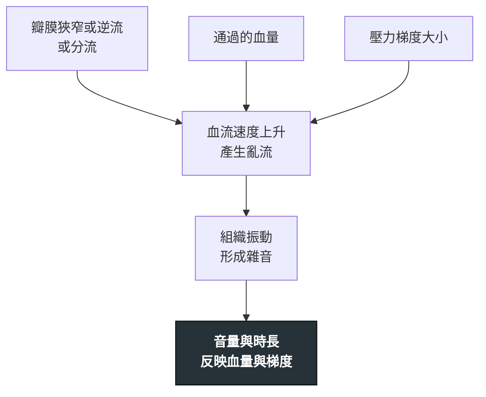

---
tags:
  - Med/Test/Cardio
  - PE
aliases:
  - 心臟聽診
  - 心雜音
  - Heart murmur
  - Murmur maneuvers
  - Carvallo sign
created: 2026-07-26
updated: 2026-07-26
status: 可用
source: 113-1 醫學(三) 11 延伸；Harrison's 心血管理學檢查章
cssclass: clinical-note
modality: PE
compare_with:
  - "[[Echocardiography]]"
---

# Cardiac auscultation ｜ 心臟聽診與心雜音 · Cardiac Auscultation

> [!abstract] 一句話總覽
> 用聽診器把**血流經過異常結構產生的亂流**轉成聲音。它不能取代超音波，但它能在**十秒內**告訴你「該不該去做超音波」，而且是**唯一能在床邊即時做誘發試驗**的工具——這才是心雜音真正的價值。

> [!tip] 判讀速查
> **描述一個雜音的五件事**：位置 · 時間點（收縮／舒張／連續） · 強度（Levine 1–6） · 音調與音色 · 傳導方向
> **決策切點**：**所有舒張期雜音**、**連續性雜音**、**強度 ≥3/6 的收縮期雜音**、**任何合併症狀的雜音** → 一律安排 [[Echocardiography]]
> **紅旗**：新出現的雜音 ＋ 發燒（想感染性心內膜炎）；新出現的雜音 ＋ 胸痛或休克（想腱索斷裂、乳頭肌斷裂、心室中膈破裂、主動脈剝離）

---

## 原理 Principle

*它到底在量什麼？為什麼這個聲音能反映那件事？*

> [!note] 這一節是本篇存在的理由
> 上式的 **D 與 E** 就是所有 maneuver 題的答案：**改變流過病灶的血量或壓力梯度，就改變音量**。
> 疾病頁只寫「聽到什麼雜音」，**變化規則只寫在這裡一次**。

## 什麼時候做

- 當你想回答「**這個病人的呼吸困難／胸痛／暈厥，是不是瓣膜或分流造成的**」時
- 當你想回答「**已知的瓣膜病變是不是惡化了**」時（音量、時長、傳導範圍的變化）
- 當你需要在床邊**區分兩個雜音相似的病**時（例如 [[Aortic stenosis]] vs [[HCM]]）——這是聽診勝過超音波的唯一場合：**即時、可誘發**

## 怎麼做 / 病人準備

| 項目 | 內容 |
|---|---|
| 部位 | 四個標準區：RUSB（右上胸骨旁第二肋間）、LUSB（左上胸骨旁第二肋間）、LLSB（左下胸骨緣第四肋間）、心尖（左鎖骨中線第五肋間） |
| 聽診器面 | **膜面**聽高頻（大部分收縮期雜音、AR）；**鐘面輕觸**聽低頻（MS 的隆隆聲、S3、S4） |
| 姿勢 | **左側躺**放大心尖低頻音（MS、S3）；**坐起前傾並吐氣末閉氣**放大 AR |
| 必做動作 | 至少做 **Valsalva／站立** 與 **蹲下**，以及**注意呼吸相** |

![[assets/cardiac-auscultation-areas.png|520]]
*胸壁聽診點（面向病人）：藍＝aortic（右第 2 肋間）、黃＝pulmonic（左第 2 肋間）、青＝Erb point（左第 3 肋間）、紅＝tricuspid（左下胸骨緣）、綠＝mitral apex（左第 5 肋間鎖骨中線）。這些是聲音傳導最佳處，不是瓣膜的解剖位置。Source: [Wikimedia Commons — Heart sounds auscultation areas](https://commons.wikimedia.org/wiki/File:Heart_sounds_auscultation_areas.svg)（public domain）。*

## 判讀 Interpretation

### 依時間點分類

| 時相 | 音色 | 代表 |
|---|---|---|
| 全收縮期（holosystolic，音量平均） | 風吹聲 | MR、TR、VSD |
| 收縮中期（漸強漸弱 crescendo-decrescendo） | 粗糙 | AS、PS、[[HCM]] |
| 收縮末期（前有喀嚦聲 click） | 咻咻聲 | MVP |
| 舒張早期（漸弱 decrescendo） | 高頻風吹聲 | **AR**、PR（Graham-Steell） |
| 舒張中期 | **低頻隆隆聲** | **MS**、TS；Austin-Flint（重度 AR 造成） |
| 連續性（跨過 S2） | 機械聲、像火車過山洞 | **PDA** |

> [!tip] 唯一的低頻雜音是舒張中期的隆隆聲
> 聽到低頻隆隆 → 用鐘面、左側躺、心尖 → 想 **MS**。

### 強度 Levine 分級

| 級 | 定義 |
|---|---|
| 1 | 很難聽到，要專心才聽得出來 |
| 2 | 一般環境下可輕易聽到 |
| 3 | 大聲但**摸不到震顫** |
| **4** | **摸得到震顫（palpable thrill）**——3 與 4 的分界就在這裡 |
| 5 | 聽診器只輕觸胸壁就聽得到 |
| 6 | 聽診器離開胸壁仍聽得到 |

## 誘發試驗：這一節是本篇的核心

*所有 maneuver 題都由下表推出。*

| 動作                    | 血行動力改變         | 變**大**聲                | 變**小**聲            |
| --------------------- | -------------- | ---------------------- | ------------------ |
| 蹲下 Squatting          | 前負荷 ↑（併後負荷 ↑）  | AS、MS、AR、MR、TR、VSD     | **HOCM、MVP**       |
| 握拳 Handgrip           | **體循環**後負荷 ↑   | AR、MR、VSD              | **HOCM、MVP**、AS    |
| Valsalva、突然站起         | 前負荷 ↓          | **HOCM、MVP**           | AS、MS、AR、MR、TR、VSD |
| Amyl **nitrite**      | 後負荷 ↓          | **HOCM、MVP**、AS        | AR、MR、VSD          |
| **吸氣（Carvallo sign）** | 右心回流 ↑、左心前負荷 ↓ | **所有右心雜音**：TR、TS、PS、PR | 左心雜音略減             |

> [!tip] 只要記三句話
> **① 血多就大聲**——對所有雜音成立。
> **② HOCM 與 MVP 永遠相反**——因為它們是「心室愈小、病灶愈嚴重」。
> **③ 右心看呼吸**——吸氣變大就是右心（Carvallo）。

> [!warning] 吸氣不能歸進「前負荷↑」
> 吸氣只增加**右心**回流；同時血液滯留肺循環，**左心前負荷反而下降**，所以吸氣時左心雜音（AS、MS、AR、MR）**略減**。把吸氣跟蹲下放在一起會自相矛盾。

> [!info] 拼字
> 是 amyl **nitrite**（亞硝酸戊酯），不是 nitrate（硝酸鹽，完全不同的化合物）。

## 干擾與偽陽性

| 會讓結果失真的因素 | 往哪個方向偏 |
|---|---|
| 高心輸出狀態（發燒、貧血、甲亢、懷孕） | 產生**功能性收縮期雜音**，容易誤判為器質性病變 |
| 嚴重的瓣膜狹窄伴心輸出量低下 | 雜音**變小甚至消失**——「安靜的 AS」反而更危險 |
| 肥胖、肺氣腫、大量心包積液 | 心音整體變遠、雜音被低估 |
| 心房顫動 | 逐拍血量不同，雜音強度忽大忽小 |
| 心搏過速 | 舒張期被壓縮，舒張期雜音難以辨認 |

> [!danger] 雜音變小不等於病情變好
> 重度 AS 或重度 MR 到晚期，心輸出量下降會讓雜音**減弱**。要用症狀與超音波判斷，不能用音量。

## 與相關檢查的取捨

| 檢查 | 優點 | 缺點 | 什麼時候選它 |
|---|---|---|---|
| **本篇 聽診** | 即時、零成本、**可做誘發試驗** | 高度依賴操作者；無法定量 | 第一線篩檢；床邊區分 AS 與 HOCM |
| [[Echocardiography]] | 定量嚴重度、看結構與功能 | 需儀器與時間 | **任何舒張期／連續性／≥3 級收縮期雜音，或有症狀者** |
| [[ECG]] | 提供心室肥厚、心律等旁證 | 不能診斷瓣膜病 | 併行 |

## 禁忌與陷阱

> [!danger] 絕對不可
> | 情境 | 絕對不可 | 為什麼 | 該做什麼 |
> |---|---|---|---|
> | 聽到**任何舒張期雜音** | 當作功能性雜音而不追 | 舒張期雜音**幾乎都是病理性的** | 一律安排超音波 |
> | 疑似重度 AS 或 HOCM 阻塞 | 為了誘發雜音而讓病人反覆用力 Valsalva | 可能誘發低血壓或暈厥 | 在監測下小心進行；有暈厥病史者直接做超音波 |
> | 新雜音 ＋ 發燒 | 只當作病毒感染觀察 | 感染性心內膜炎會迅速破壞瓣膜 | 抽血培養 ＋ 超音波 |

> [!warning] 常見錯誤
> - 把 **TR 在吐氣時變大** 記成正確——右心雜音是**吸氣**變大（Carvallo）。
> - 把 amyl nitrite 的方向記成跟握拳一樣——它是**後負荷↓**，跟握拳相反。
> - 只在心尖聽而沒有用鐘面、沒讓病人左側躺，於是漏掉 MS。
> - 只在休息時聽 HOCM，沒做 Valsalva，於是把阻塞型判成非阻塞型。

## 相關連結

- [[HCM]] — 與 AS 最常互當錯誤選項；靠 maneuver 反應分開
- [[Aortic stenosis]] — 蹲下變大、雜音在 RUSB 並傳向頸部
- [[Echocardiography]] — 聽到紅旗雜音後的下一步
- [[Chest pain]] — 由主訴進入的路徑
