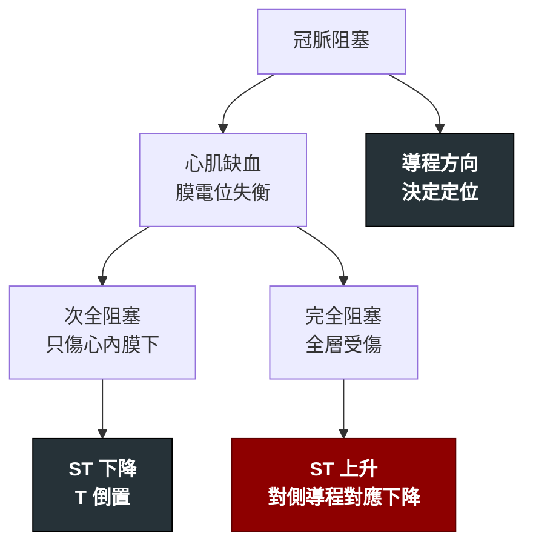

---
tags:
  - Med/Test/Cardio
  - 禁忌
aliases:
  - EKG ischemia
  - ECG ischemia
  - 心電圖缺血判讀
  - STEMI criteria
  - STEMI equivalent
  - STEMI mimics
  - Sgarbossa
  - de Winter
  - Wellens
  - OMI
created: 2026-07-26
updated: 2026-07-26
status: 可用
source: 2018 Fourth Universal Definition of MI；2025 ACC/AHA ACS Guideline；ACC STEMI-equivalent 統整；Smith-modified Sgarbossa criteria (2012)
cssclass: clinical-note
modality: 電生理
compare_with:
  - "[[Troponin]]"
  - "[[Echocardiography]]"
  - "[[Coronary angiography]]"
---

# EKG ischemia ｜ 心電圖缺血判讀 · Ischemic ECG Interpretation

> [!abstract] 一句話總覽
> 在 [[ACS]] 裡，12-lead EKG 只有一個任務：回答「**冠狀動脈現在是不是急性完全阻塞、需要立刻通血管**」。ST 段上升只是這個問題的**代理指標**——它會漏（所以要認 **STEMI equivalent**），也會假陽性（所以要認 **STEMI mimics**）。

> [!tip] 判讀速查
> **決策切點**：新出現的 J 點 ST 上升，**≥2 個相鄰導程**——一般導程 **≥1 mm**；V2–V3 例外（男 ≥40 歲 **≥2 mm**、男 <40 歲 **≥2.5 mm**、女性任何年齡 **≥1.5 mm**）；V7–V9 **≥0.5 mm**
> **紅旗**：符合任一 **STEMI equivalent** → 等同 STEMI，**立刻啟動導管室**，不等 troponin
> **時間紀律**：接觸病人 **10 分鐘內**完成第一張；症狀持續而初始正常 → 每 **15–30 分鐘** 重做；一定要調**舊 EKG** 對照

---

## 原理 Principle

*它到底在量什麼？為什麼這個數字能反映那件事？*

冠脈血流由心外膜往心內膜灌注，**心內膜是灌流的最遠端**。缺血讓細胞膜無法維持正常離子梯度，產生損傷電流，在心電圖上表現為 ST 段偏移；**偏移的方向由缺血的深度決定，偏移出現在哪些導程由缺血的位置決定**。

> [!note] 這一節是本篇存在的理由
> [[CAD]] 與 [[ACS]] 只寫「做 EKG」與判讀**結論**；**判讀的閾值、型態、鑑別全部只寫在這裡一次**。

> [!important] OMI／NOMI：為什麼「STEMI」這個名字本身是問題
> STEMI 這個標籤描述的是**心電圖現象**，但我們真正想分類的是**有沒有急性完全阻塞（occlusion MI, OMI）**。
> 兩者不完全重合：約有相當比例的完全阻塞**不符合** STEMI 的 mm 閾值（就是下面的 equivalent 清單），而部分符合閾值的其實不是阻塞（mimics）。
> 記住這句話，下面兩張表就不是零散的例外清單，而是同一個問題的兩面。

![[assets/subendocardial-ischemia-st-vector.jpg|560]]
*上半是正常傳導，下半是心內膜下缺血：缺血區造成細胞外電位差與 injury current，投影到體表後形成 ST–T 改變；圖中同時把心肌橫切面、電位分布、體表位置與 12 導程波形對上。Source: [Okada et al., *Cardiovasc Eng Technol* 2020, Figure 2](https://pmc.ncbi.nlm.nih.gov/articles/PMC10717899/)（CC BY 4.0）。*

![[assets/ecg-limb-lead-directions.png|720]]
*肢體導程的正極「視線」：I 看左側、II／III／aVF 看下壁、aVL 看高側壁、aVR 從右上方看心臟；ST injury vector 朝向正極時抬高、背離時下降。Source: [Wikimedia Commons — Limb leads of EKG](https://commons.wikimedia.org/wiki/File:Limb_leads_of_EKG.png)（CC BY-SA 4.0）。*

## 什麼時候做

- 當你想回答「**這個病人現在有沒有急性冠脈完全阻塞**」時 → 立刻、10 分鐘內
- 當病人有胸痛、上腹痛、新發呼吸困難、不明原因冒冷汗、暈厥、心搏過速或不明原因低血壓時
- 當症狀持續而第一張正常時 → **重複做**（單張正常不能排除）
- 當疑似後壁或右心室梗塞時 → 加做 **V7–V9** 與 **V4R**

> [!info] 反查
> 想知道「哪些疾病會用到我」→ 看右側 Backlinks 面板。

## 怎麼做 / 病人準備

| 項目 | 內容 |
|---|---|
| 標準 12 導程 | 電極位置錯誤是假陽性／假陰性的常見來源，尤其 V1–V2 貼太高會製造假的 ST 上升與 Brugada 樣型態 |
| **V7–V9**（後壁） | V7 左後腋線、V8 左肩胛骨中線、V9 左脊椎旁，與 V6 同高。閾值 **≥0.5 mm**（男 <40 歲 ≥1 mm） |
| **V4R**（右心室） | 右鎖骨中線第 5 肋間。下壁梗塞一律要看 |
| 記錄時機 | 記下「**做這張時病人痛不痛**」——Wellens 只在不痛時看得到，動態變化只有在比對時才有意義 |
| 舊 EKG | 判斷 LBBB／Q 波／ST 上升是否為「**新的**」，這一步常決定要不要進導管室 |

## 判讀

### ① 梗塞定位與犯罪血管

| 導程群 | 部位 | 常見犯罪血管 | 要特別做什麼 |
|---|---|---|---|
| **II, III, aVF** | 下壁 | RCA（約 8 成）或 LCx | III 上升 > II 且 I／aVL 對應性下降 → 傾向 RCA。**必看 V4R**，並警覺心搏過緩與 AV block |
| V1–V2 | 中膈 | LAD 近端中膈枝 | — |
| V3–V4 | 前壁 | LAD | — |
| V5–V6 | 心尖／低側壁 | LAD 遠端或 LCx | — |
| **I, aVL** | 高側壁 | LCx 或第一對角枝 | 型態可以很不明顯，看 III 有沒有對應性下降 |
| V1–V4 全部 ＋ I／aVL | 前壁廣泛 | **LAD 近端** | 面積大、易休克與心衰 |
| **V1–V3 ST 下降＋高 R 波** | **後壁**（鏡像） | LCx 或 RCA | **必做 V7–V9**（見下方 equivalent） |
| **V1 上升（V1 > V2）或 V4R 上升** | 右心室 | RCA 近端 | 幾乎都伴下壁梗塞。**禁硝酸鹽**（見禁忌表） |
| **aVR 上升 ＋ 廣泛 ST 下降** | 左主幹／三條血管／廣泛心內膜下缺血 | LM、LAD 近端或 3VD | **高風險，但不是 STEMI equivalent**（見下方） |

### ② 演變時序

| 階段 | 型態 |
|---|---|
| 數分鐘–數十分鐘 | **Hyperacute T wave**（寬、對稱、底寬的高 T）——比 ST 上升更早 |
| 數十分鐘–數小時 | ST 段上升，對側導程出現**對應性下降** |
| 數小時–數天 | R 波振幅下降，**病理性 Q 波**出現，ST 開始回落 |
| 數天 | ST 回到基線，**T 波倒置** |
| 數週–數月 | Q 波多半永久留下；T 倒置可持續或恢復。**ST 持續不回落** → 想左心室膨大 |

> [!warning] ST 上升的高度不代表梗塞大小
> 影響 mm 數的因素太多（體型、電極位置、心肌厚度、缺血時間）。決定預後的是**總缺血時間**與**梗塞範圍**，不是 mm。

### ③ STEMI equivalent —— 不符合 mm 閾值，但要當 STEMI 處理

> [!danger] 這張表是本篇最該背的一格
> 每一條的意義都是「**急性完全阻塞**」，但**幅度或導程分佈不符合 mm 閾值**。看到 → 立刻啟動導管室，不等 troponin。

| 型態 | 心電圖長相 | 意義／犯罪血管 | 處置 |
|---|---|---|---|
| **後壁梗塞**（posterior OMI） | **V1–V3 水平型 ST 下降 ≥0.5 mm**（V2–V3 最深）＋ 高／寬 R 波 ＋ **直立**的 T 波 | LCx 或 RCA；標準 12 導程只看到「鏡像」 | 加做 **V7–V9**（≥0.5 mm 上升確認）→ 當 STEMI 處理 |
| **Hyperacute T wave** | 寬、**對稱**、底部寬「胖」的高聳 T 波，QT 稍長，**先於** ST 上升出現 | 最早期的完全阻塞 | 與高血鉀的「窄、尖、帳篷狀」T 波分開 → serial EKG，別放回家 |
| **de Winter pattern** | V1–V6 自 J 點起的**上斜型 ST 下降 1–3 mm** ＋ **高聳對稱 T 波**，常伴 aVR 輕度上升 | **LAD 近端完全阻塞** | 直接當 STEMI 啟動導管室 |
| **LBBB 或心室節律起搏** | 不能只憑 LBBB。用 **modified（Smith）Sgarbossa**，符合**任一條**即可： ① 任一導程**同向** ST 上升 ≥1 mm ② V1–V3 任一導程**同向** ST 下降 ≥1 mm ③ 任一導程**同時**滿足：反向 ST 上升 **≥1 mm** 且 **ST/S ≤ −0.25** | 符合 → 急性阻塞 | 當 STEMI 處理 |
| **高側壁梗塞**（South African flag sign） | **I、aVL、V2** 輕微 ST 上升 ＋ **III 對應性 ST 下降**（三處在心電圖上排成南非國旗的形狀） | 第一對角枝；幅度小、最容易被漏 | 拿 III 當對照；符合就**當 STEMI 啟動** |
| **Aslanger pattern** | **只有 III 有 ST 上升**（II 與 aVF 沒有）＋ V4–V6 任一 ST 下降且 T 波正向 ＋ **V1 的 ST 高於 V2** | 下壁 OMI **合併多條血管病變**；不符合「≥2 個相鄰導程」所以會被漏 | 當 STEMI 處理 |

> [!important] 不是 STEMI equivalent，但同樣不能等
> | 型態 | 心電圖長相 | 意義 | 處置 |
> |---|---|---|---|
> | **Wellens syndrome** | V2–V3（可延伸）：**Type A** 雙相 T 波（先正後負）／**Type B** 深而對稱的倒置 T 波。**只在不痛的時候看得到**；R 波保留、無 Q 波、troponin 正常或僅微升 | **LAD 近端重度狹窄「已自發再通」**——是**再灌流**型態，不是進行中的阻塞，但隨時會再塞 | 住院 ＋ 緊急冠脈評估。**絕對不可做運動壓力測試** |
> | **aVR ST 上升 ＋ 廣泛 ST 下降** | aVR（±V1）上升 ≥1 mm，其他多數導程 ST 下降 | 左主幹／三條血管／廣泛心內膜下缺血 | **緊急侵入性評估**；**不是溶栓的對象** |
>
> **這兩條的分類近年變過，考試與教科書常不一致**：
> **Wellens** 在許多複習資料裡仍被列為 STEMI equivalent；把它放在這裡的理由是它反映的是「已經打通」而非「正在塞住」，處置是**緊急導管**而非**立刻再灌流**。
> **aVR 上升** 在 2013 ACC/AHA STEMI 指引中曾被列為 equivalent，之後的共識文件已將它移出（它多半是廣泛心內膜下缺血而非單一血管完全阻塞）。若題目或病歷引用舊指引，要知道差異在哪。

> [!danger] Shark fin／giant R wave —— 不是 equivalent，是「被看漏的 STEMI」
> QRS–ST–T 融合成單一巨大三角波，ST 上升幅度**遠超過**閾值。它之所以被漏，是因為長得像寬 QRS 心律或 VT，不是因為幅度不夠。
> 常代表大面積完全阻塞、瀕臨心因性休克 → 立即再灌流並準備循環支持。

![[assets/ecg-posterior-mi-mirror.jpg|560]]
*後壁 MI 的鏡像：V1–V3 出現水平 ST depression、異常高 R 與正向 T；把紙面前後翻轉去想，就會變成後壁的 ST elevation／Q wave。*

![[assets/ecg-hyperacute-t.jpg|560]]
*Hyperacute T：T 波基底寬、體積大且與 QRS 不成比例，常伴 J point 輕度上移；重點不是只看「高」，而是看肥厚、對稱性與局部導程分布。*

![[assets/ecg-de-winter.jpg|560]]
*De Winter：胸前導程 J point 下降，接著呈上斜型 ST depression 並銜接高聳對稱 T 波，常伴 aVR 輕度上升。*

![[assets/ecg-modified-sgarbossa.jpg|620]]
*LBBB／paced rhythm：下排依序示範 concordant STE、V1–V3 concordant STD，以及過度 discordant STE；modified Sgarbossa 用 `ST/S ≤ −0.25` 判斷第三型，不再只用固定 5 mm。以上四圖 Source: [Mattu et al., *Turk J Emerg Med* 2025, Figures 1–3, 5](https://pmc.ncbi.nlm.nih.gov/articles/PMC11774428/)（CC BY-NC-SA 4.0）。*

![[assets/ecg-south-african-flag.jpg|760]]
*South African flag sign：I、aVL、V2 的 ST elevation，加上 III 的 reciprocal ST depression；上圖把國旗斜帶疊在相應導程，下圖紅箭頭標出實際偏移。Source: [Cohen et al., *Cureus* 2025, Figure 1](https://pmc.ncbi.nlm.nih.gov/articles/PMC12040377/)（CC BY 4.0）。*

### ④ STEMI mimics —— 有 ST 上升，但不是急性阻塞

| 型態 | 心電圖長相 | 怎麼分開 |
|---|---|---|
| **良性早期再極化**（BER） | 年輕健康人；V2–V5 **凹型** ST 上升、J 點有 notch／slur、T 波高聳但**比例協調**、**不演變** | serial EKG 不變；與 LAD 阻塞難分時用 Smith 4-variable formula |
| **LVH** | 高電壓、V1–V3 凹型 ST 上升伴**深 S 波**、側壁 ST 下降＋T 倒置 | 看電壓標準、無動態演變、比對舊 EKG |
| **[[Pericarditis]]／心肌炎** | **廣泛**凹型 ST 上升（**不符合單一血管分佈**）、**PR 段下降**、Spodick's sign（TP 段下斜）、V6 的 ST/T >0.25、**無對應性 ST 下降**（唯一例外是 **aVR 與 V1**，這兩個導程反而出現 ST 下降與 PR 上升） | **在其他導程看到對應性下降就要當 MI 處理**；心肌炎 troponin 明顯升高 |
| **Brugada pattern** | V1–V2 rSR' ＋ 下斜型 ST 上升（Type 1 coved 型） | 問猝死家族史；確認 V1–V2 電極沒貼太高 |
| **高血鉀** | T 波**窄、尖、帳篷狀**、P 波變平、QRS 變寬，可造成 pseudo-STEMI | **立刻驗 K**。與 hyperacute T 的「寬而胖」區分 |
| **[[Takotsubo]]** | 前壁 ST 上升，接著出現深而廣泛的 T 倒置 ＋ QT 明顯延長；有壓力事件 | 冠脈通暢 ＋ 心尖球狀化；多半要靠導管與超音波才分得開 |
| **左心室膨大**（舊梗塞） | **持續** ST 上升伴深 Q／QS 型、**T 波無動態變化** | 比對舊 EKG；前壁 T／QRS 振幅比偏低傾向膨大 |
| **[[Pulmonary embolism]]** | V1–V4 T 倒置 ＋ III 導程異常（S1Q3T3）、右心負荷、心搏過速 | 少見真正 ST 上升；看低血氧與右心室擴大 |

### ⑤ 非 ST 上升的缺血型態

| 型態 | 意義 |
|---|---|
| 水平或下斜型 **ST 下降 ≥0.5 mm** | 心內膜下缺血；≥2 個相鄰導程有意義。若合併 aVR 上升 → 想左主幹／3VD |
| 對稱的 **T 波倒置 ≥1 mm** | 缺血；深而對稱的 T 倒置在 V2–V3 → 想 Wellens |
| **動態變化**（同一病人前後張不同） | 比單張的絕對型態更有價值——這是 serial EKG 的全部意義 |

## 與相關檢查的取捨

| 檢查 | 回答什麼 | 什麼時候不夠用 |
|---|---|---|
| **EKG** | 「**現在**有沒有急性完全阻塞」——秒級、可重複 | 對非阻塞性缺血不敏感；LCx／後壁是沉默區；LBBB／起搏／LVH 會干擾判讀 |
| [[Troponin]] | 「心肌**有沒有壞死**」——但要 1 小時以上才有動態，且不告訴你阻塞在哪 | 不能用來決定「要不要現在進導管室」 |
| [[Echocardiography]] | 節段運動異常、EF、機械性併發症、mimics（Takotsubo、心包填塞、右心負荷） | 操作者依賴；小範圍缺血可能看不出來 |
| [[Coronary angiography]] | 解剖 gold standard，且同時是治療 | 侵入性；不能拿來當篩檢 |

> [!info] 三者的分工
> **EKG 決定時間軸**（現在進導管室嗎），**troponin 決定診斷標籤**（UA 還是 NSTEMI），**超音波決定機制與併發症**。互相不能替代。

## 禁忌與陷阱

> [!danger] 絕對不可
> | 情境 | 絕對不可 | 為什麼 | 該做什麼 |
> |---|---|---|---|
> | 疑似 ACS 但第一張 EKG 正常 | 據此排除 ACS 讓病人回家 | LCx 與後壁是心電圖沉默區；初始正常的 ACS 不少 | **serial EKG** ＋ serial [[Troponin]] ＋ 加做 V7–V9／V4R |
> | 看到 ST 上升 | 為了等 troponin 結果才啟動導管室 | STEMI **不需要** troponin 才能診斷，每 30 分鐘延遲讓一年死亡相對風險 ↑約 7.5% | 立刻啟動，見 [[ACS]] 時間窗 |
> | **Wellens pattern** | 安排運動壓力測試 | LAD 近端重度狹窄，增加需氧可能誘發完全阻塞 | 住院 ＋ 緊急冠脈評估 |
> | **aVR ST 上升 ＋ 廣泛 ST 下降** | 當成 STEMI 給溶栓 | 這通常是廣泛心內膜下缺血而非單一血管完全阻塞，溶栓無益且增加出血 | 緊急侵入性評估 |
> | 下壁 ST 上升且 V1／V4R 也上升（右心室梗塞） | 給硝酸鹽或大劑量嗎啡 | 右心室依賴前負荷 → 循環崩潰 | 快速輸液；見 [[ACS]] 禁忌表 |
> | 廣泛 ST 上升合併撕裂痛、兩側血壓不對稱 | 直接抗栓／溶栓 | 主動脈剝離波及右冠口可造成下壁 ST 上升 | 先 CTA |

> [!warning] 常見錯誤
> - **沒調舊 EKG**——「新的」LBBB／Q 波／ST 上升這個判斷常決定要不要進導管室
> - 沒加做 **V7–V9** 與 **V4R**
> - 把 V1–V3 的 ST **下降**只當成「心內膜下缺血」，漏掉它其實是後壁梗塞的鏡像
> - 把 **hyperacute T** 誤認為高血鉀（或反之）——寬而胖 vs 窄而尖
> - 只憑「有 LBBB」就當 STEMI equivalent（要用 modified Sgarbossa）
> - de Winter 型態因為「沒有 ST 上升」而被放行。**靜止型**（原始描述的那種）不會自己演變成 ST 上升，等就是等到梗塞完成；也有**演變型**會隨 LAD 阻塞／自發再通而與前壁 ST 上升互相轉換。兩型都代表 LAD 近端阻塞，處置相同
> - 電極位置錯誤（V1–V2 貼太高）製造假的 ST 上升與 Brugada 樣型態
> - 用 ST 上升的 mm 數估梗塞大小

## 相關連結

- [[ACS]] — 看到這些型態之後要做什麼：分流決策樹與再灌流時間窗
- [[CAD]] — 名詞地圖與 MI 五個 Type
- [[Troponin]] — 另一條軸：心肌有沒有壞死
- [[Chest pain]] — 主訴層的 can't-miss
- [[EKG]] — 心電圖的系統性基礎讀法（**尚未建立**；建立後本篇應改為它的子題）
- [[Echocardiography]]、[[Coronary angiography]]、[[Pericarditis]]、[[Takotsubo]]
