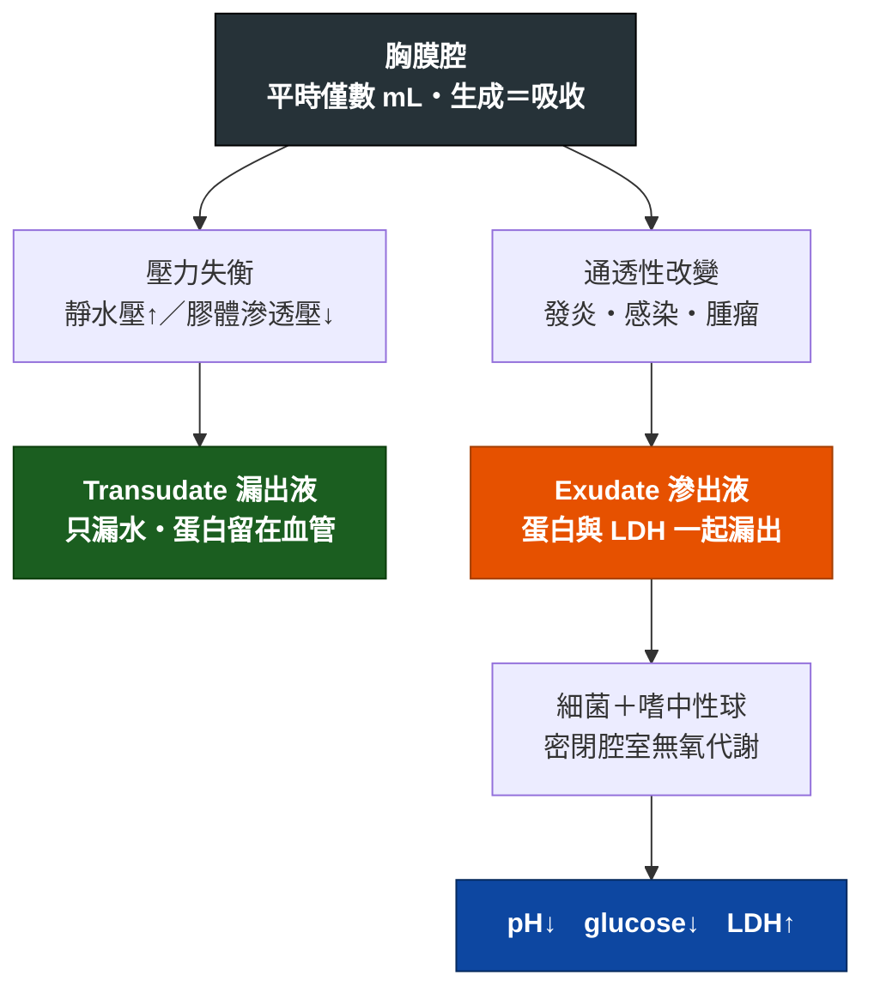

---
tags:
  - Med/Test/Resp
  - pleural-fluid
  - thoracentesis
  - 禁忌
aliases:
  - Pleural fluid analysis
  - 胸水分析
  - Thoracentesis
  - 胸腔穿刺
  - Light's criteria
created: 2026-07-25
updated: 2026-07-25
status: 可用
source: Light's criteria 與 parapneumonic 引流門檻查證自 StatPearls / MDCalc / ATS（見文中）
cssclass: clinical-note
modality: lab
compare_with:
  - "[[Chest X-ray]]"
---

# Pleural fluid analysis ｜ 胸水分析 · Thoracentesis

> [!abstract] 一句話總覽
> 抽出胸水做兩件事：**① 是漏出液還是滲出液（Light's criteria）**，決定病因方向；**② 這包水需不需要引流**，決定處置。影像只能告訴你「有水」，**只有胸水能告訴你「是什麼水」**。

> [!tip] 判讀速查
> **Exudate（Light's，任一項成立即是）**：胸水/血清 **protein > 0.5**｜胸水/血清 **LDH > 0.6**｜胸水 **LDH > 血清 LDH 正常上限的 2/3**
> **要引流的紅旗**：肉眼膿｜Gram stain/culture 陽性｜**pH < 7.20**｜glucose **< 40** mg/dL｜LDH **> 1000** IU/L
> **TB 胸膜炎**：**ADA > 40 U/L** ＋ 淋巴球為主

---

## 原理 Principle

> [!note] 這一節是本篇存在的理由
> [[Empyema]]、[[RUQ pain]] 等頁面只會寫「安排胸腔穿刺」與判讀結論；**原理只寫在這裡一次**。

> [!tip] Light's criteria 為什麼是這三條
> 全都在問同一件事：**蛋白質類的大分子有沒有跟著水一起漏出來**。
> 血管只是「被擠出水」→ 大分子留在血管內 → 比值低（transudate）；
> 血管「破了洞」→ protein 與 LDH 一起跑出去 → 比值高（exudate）。
> 三條是 **or** 不是 and——**任一項成立就算 exudate**。設計上刻意偏向高敏感度，寧可錯抓也不放過。

![[assets/pleura-anatomy.jpg]]
*壁層胸膜貼胸壁、臟層胸膜包肺，兩者之間是潛在的 pleural cavity；與上方 Mermaid 合看，可把「壁層端生成 → 淋巴回收失衡 → 重力依賴處（肋膈角）積液」接起來。Source: [OpenStax Anatomy and Physiology, Figure 22.14](https://openstax.org/books/anatomy-and-physiology/pages/22-2-the-lungs)（CC BY-NC-SA 4.0）。*

## 什麼時候做

*寫「決策情境」，不要列疾病清單——那清單無上限，會爆炸。*

- 當你想回答「**這包胸水是什麼性質、要不要引流**」的時候
- CXR 看到明顯胸水且**病因不明**時
- 已知肺炎但出現胸水，需區分 uncomplicated / complicated / 膿胸時
- 大量胸水造成呼吸窘迫，需**治療性**抽液時（此時同時也是 [[Chest tube drainage]] 的範疇）

> [!info] 反查
> 想知道「哪些疾病會用到我」→ 看右側 Backlinks 面板。

> [!warning] 什麼時候可以不做
> 典型雙側胸水 ＋ 明確心衰竭表現 ＋ 利尿劑有效 → 可先治療觀察。
> 但**單側、發燒、疼痛、或治療無反應** → 一定要抽。

## 怎麼做 / 病人準備

| 項目 | 內容 |
|---|---|
| 姿勢 | 坐姿前傾趴桌；無法坐則側臥患側朝下 |
| 穿刺點 | 叩診濁音區下緣，肋骨**上緣**進針（避開肋骨下緣的神經血管束）；**超音波導引可降低氣胸風險** |
| 術前必查 | **PT/INR、血小板**（任何侵入性處置前的底線）、CXR 定位 |
| 送檢項目 | 外觀、細胞數＋分類、**protein、LDH、glucose、pH**、Gram stain、細菌培養、抗酸染色＋結核培養、**ADA**、細胞學（懷疑惡性時）、amylase（懷疑食道破裂／胰臟疾病） |
| 同時抽血 | **血清 protein、LDH**——沒有血清值就算不出 Light's criteria |

> [!danger] 最常見的操作失誤
> **忘了同時抽血清 protein 與 LDH**。Light's criteria 是比值，只送胸水等於白抽一次。

![[assets/thoracentesis-position.jpg]]
*胸腔穿刺常讓病人坐直、前傾伏桌，使肋間隙打開；超音波確認液體與安全路徑後再下針。Source: [Wikimedia Commons — Thoracentesis](https://commons.wikimedia.org/wiki/File:Thoracentesis.jpg), NHLBI（public domain）。*

![[assets/chest-tube-rib-needle.jpg]]
*橫剖面定位：神經血管束位於肋骨下緣，針要貼著下方肋骨的上緣進入胸膜腔。Source: [Fraser et al., “The Sound of Safety: DIVOT” Figure 1](https://pmc.ncbi.nlm.nih.gov/articles/PMC12057478/)（CC BY 4.0）。體表位置可再與 [[Chest tube drainage]] 的 safe triangle 圖對照。*

## 判讀 Interpretation

### 第一步：Transudate 還是 Exudate（Light's criteria）

| 項目 | Exudate 的門檻 |
|---|---|
| 胸水 protein / 血清 protein | **> 0.5** |
| 胸水 LDH / 血清 LDH | **> 0.6** |
| 胸水 LDH | **> 血清 LDH 正常上限的 2/3** |

**任一項成立 → Exudate。三項全不成立 → Transudate。**

| 結果 | 常見病因 | 下一步 |
|---|---|---|
| **Transudate** | [[Heart failure]]、肝硬化、[[Nephrotic syndrome]] | 治療原發病，通常不需引流 |
| **Exudate** | 感染（[[Pneumonia]]、[[Empyema]]、[[Tuberculosis]]）、惡性、[[Pulmonary embolism]]、自體免疫（SLE serositis） | 往下做第二步 |

### 第二步：這包 exudate 要不要引流

| 指標 | 切點 | 判讀 |
|---|---|---|
| 外觀 | 肉眼膿 | **膿胸，立刻引流** |
| Gram stain / culture | 陽性 | Complicated，引流 |
| **pH** | **< 7.20** | **最敏感**，一般視為插胸管適應症 |
| Glucose | **< 40 mg/dL**（部分文獻 < 60） | Complicated |
| LDH | **> 1000 IU/L** | Complicated |

> [!warning] 灰色地帶與文獻分歧
> - **pH 7.2–7.3**：不確定區。建議連續追蹤胸水 pH ＋ 臨床觀察再決定。
> - **Glucose 切點**：StatPearls 用 **< 40 mg/dL**；較早文獻用 **< 60 mg/dL 搭配 pH 7.2–7.3 視為即將形成膿胸**。**請跟你的課本核對**——目前主流採 < 40。
> - pH 下降**早於** glucose 下降、也早於 LDH 上升，所以 pH 是最早的警訊。

### 第三步：細胞分類與特殊標記

| 發現 | 指向 |
|---|---|
| 嗜中性球為主 | 急性細菌感染、parapneumonic |
| **淋巴球為主 ＋ ADA > 40 U/L** | **結核性胸膜炎** |
| 淋巴球為主 ＋ ADA 不高 | 惡性、慢性 |
| 嗜酸性球 > 10% | 氣胸、血胸、藥物、寄生蟲 |
| 血性 | 惡性、肺栓塞、外傷 |
| Amylase 高 | 胰臟疾病、**食道破裂** |
| 細胞學陽性 | 惡性胸水 |

> [!note] ADA 的細節
> 常用切點 **40 U/L**，高盛行區敏感度約 88–91%、特異度 85–93%。
> ADA 隨年齡下降，有研究建議 **≤55 歲用較高切點、>55 歲用較低切點**；屬進階調整，一般仍以 40 U/L 為準。
> 低盛行區 ADA 的價值主要在**排除**（正常則 TB 很不可能）。

## 干擾與偽陽性

| 會讓結果失真的因素 | 往哪個方向偏 |
|---|---|
| **已用利尿劑的心衰竭病人** | Transudate 被濃縮 → protein/LDH 上升 → **假性 exudate**。此時改看**血清−胸水 albumin gradient > 1.2 g/dL** 支持 transudate |
| 檢體暴露空氣、延遲送檢 | **pH 假性升高**（CO₂ 逸散）→ 低估嚴重度。應以**血液氣體分析針筒**收集、冰浴、立刻送 |
| 用 lidocaine 局麻污染檢體 | pH 假性下降 |
| 穿刺時劃破血管 | 血性外觀假象；可比對胸水/血液 Hct 分辨真血胸 |
| 檢體放太久 | 細胞溶解 → LDH 假性升高 |

## 與相關檢查的取捨

| 檢查 | 優點 | 缺點 | 什麼時候選它 |
|---|---|---|---|
| **本篇（胸水分析）** | 唯一能定性、定病因、決定引流 | 侵入性、有氣胸/出血風險 | 病因不明、或需判斷是否引流 |
| [[Chest X-ray]] | 快、無創、第一線 | **只能說「有水」**，無法分辨性質 | 初步篩檢與追蹤 |
| [[Chest ultrasound]] | 看 loculation 最佳、可即時導引穿刺、無輻射 | 依操作者經驗 | 穿刺前定位、評估分隔 |
| [[Chest CT]] | 看 pleural thickening、split pleura sign、找肺內病灶 | 輻射、需搬動病人 | 引流失敗、懷疑惡性或膿瘍 |

## 禁忌與陷阱

> [!danger] 絕對不可
> | 情境 | 絕對不可 | 為什麼 | 該做什麼 |
> |---|---|---|---|
> | 凝血功能異常／血小板過低未矯正 | 直接穿刺 | 出血、hemothorax | 先查並矯正 PT/INR 與血小板 |
> | 大量胸水 | 單次抽出過多（一般 ≤ 1–1.5 L） | Re-expansion pulmonary edema | 分次引流，過程中出現胸痛或咳嗽即停 |
> | 穿刺進針 | 沿肋骨**下緣**進針 | 肋骨下緣有肋間神經血管束 | 沿肋骨**上緣**進針 |
> | 送檢 pH | 用一般試管、延遲送檢 | CO₂ 逸散使 pH 假性升高，低估嚴重度 | 血液氣體針筒、冰浴、立即送檢 |
> | 只送胸水 | 忘記同時抽血清 protein/LDH | Light's criteria 是比值，算不出來 | 穿刺同時抽血 |

> [!warning] 常見錯誤
> - CXR 有水就下 empyema 診斷——沒抽水只能寫 `susp.`
> - 利尿劑治療中的心衰竭病人被誤判成 exudate（用 albumin gradient 補救）
> - 忘記送抗酸染色與 ADA，漏掉結核

## 相關連結

- [[Empyema]] — 引流門檻的臨床應用
- [[RUQ pain]] — 本檢查在此主訴流程中的位置
- [[Chest tube drainage]] — 判定要引流之後的處置
- [[Chest X-ray]] — 上游影像
- [[禁忌選項]]
