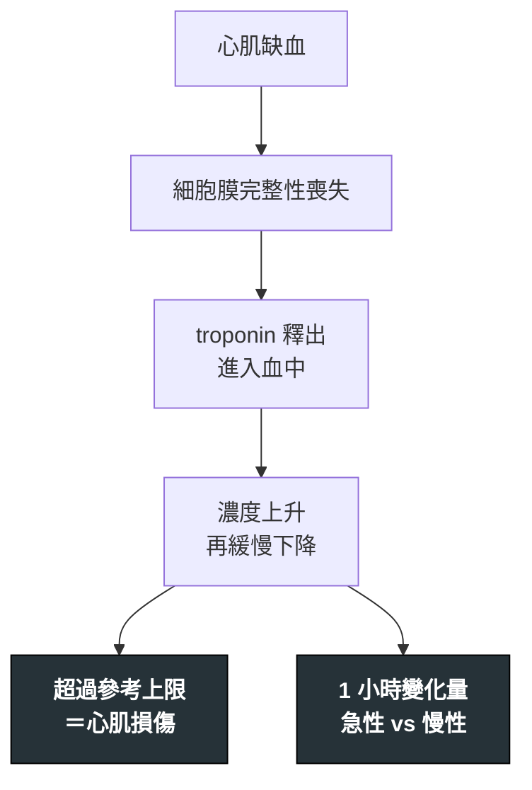

---
tags:
  - Med/Test/Cardio
  - 禁忌
aliases:
  - Troponin
  - hs-cTn
  - hs-Troponin
  - cTnI
  - cTnT
  - 心肌旋轉蛋白
  - 高敏感度心肌旋轉蛋白
  - Cardiac troponin
  - Myocardial injury
created: 2026-07-26
updated: 2026-07-26
status: 可用
source: 2018 Fourth Universal Definition of MI；2025 ACC/AHA ACS Guideline；ESC 0/1h hs-cTn algorithm
cssclass: clinical-note
modality: lab
compare_with:
  - "[[EKG ischemia]]"
  - "[[Echocardiography]]"
  - "[[BNP]]"
---

# Troponin ｜ 心肌旋轉蛋白 · Cardiac Troponin

> [!abstract] 一句話總覽
> hs-cTn 測的是「**心肌細胞有沒有死掉**」，**不是**「為什麼死掉」。它是把 UA 與 NSTEMI 分開的那條軸（見 [[CAD]]）。但**單獨一個數字既不能診斷也不能排除 [[ACS]]**——要看**動態變化（delta）＋ 缺血的臨床證據**。

> [!tip] 判讀速查
> **診斷切點**：> 該 assay 的 **99th percentile URL**（各廠牌、cTnI 與 cTnT、男女的數字都不同——用自家實驗室的值）
> **決策**：**0 小時 ＋ 1 小時**兩點（依 assay 也可 0/2h、0/3h）→ rule-out／observe／rule-in 三分區
> **紅旗**：明顯 rise/fall ＋ 缺血證據 = 心肌梗塞。**症狀發作 <1–2 小時內的「陰性」不可信**，必須重驗
> **絕對不可**：因為 troponin 陰性就放走一個 ST 上升的病人；或因為 troponin 陽性就一律當 Type 1 MI 給雙抗

---

## 原理 Principle

*它到底在量什麼？為什麼這個數字能反映那件事？*

Troponin I 與 T 是**心肌專一**的收縮調節蛋白，正常時鎖在肌小節裡。心肌細胞死亡（膜完整性喪失）→ troponin 釋放到血液。「高敏感度（hs）」的定義是：在**超過 50% 的健康人**身上都能測到可量化的濃度——正是因為測得到基礎值，才有辦法比較「**1 小時後變了多少**」。

> [!note] 這一節是本篇存在的理由
> [[CAD]] 與 [[ACS]] 只寫「驗 troponin」與判讀**結論**；**動力學、切點、非 ACS 升高原因只寫在這裡一次**。

> [!important] 「高敏感度」買到的是速度，代價是特異性
> 敏感度上升 → 排除變快（1 小時就能安全放行一部分人），但**陽性的原因變多**。
> 所以 hs 時代的關鍵技能從「有沒有超標」轉移到「**這個上升是不是急性的、是不是缺血造成的**」。

![[assets/troponin-hs-vs-conventional.png|850]]
*右圖直接比較偵測門檻：hs-cTn 的低門檻（黃線）比 contemporary assay（藍線）早約 4–5 小時跨過；最左側尚未跨線就是「太早抽」的盲區。99th percentile 是 assay／參考族群特異的臨床決策線，不是所有試劑都固定同一數值。Source: [Kim et al., *Scientific Reports* 2023, Figure 1](https://www.nature.com/articles/s41598-023-45050-1)（CC BY 4.0）。*

![[assets/troponin-kinetics.png|640]]
*完整動力學：再灌流後峰值更早、更尖；未再灌流時上升較慢、維持較久。綠線是 assay cut-off 的示意，實務上急性心肌梗塞仍要看「超過第 99 百分位」且有 rise/fall 與缺血證據。Source: [Wikimedia Commons — AMI bloodtests engl](https://commons.wikimedia.org/wiki/File:AMI_bloodtests_engl.png), Mikael Häggström（CC BY-SA 3.0）。*

## 什麼時候做

- 當你想回答「**這個病人的心肌有沒有壞死**」時
- 疑似 [[ACS]]（與 [[EKG ischemia|EKG]] 同時開，但**不能為了等它而延遲再灌流**）
- 需要區分 UA 與 NSTEMI，或需要客觀證據支持缺血診斷時
- 已知 troponin 會升高的重症（敗血症、肺栓塞、心衰惡化）中，用來**量化心肌受累程度與風險**——不是用來診斷 ACS

> [!danger] 什麼時候**不要**等它
> **有 ST 上升或任一 STEMI equivalent 時。** STEMI 的診斷完全靠 EKG ＋ 臨床，troponin 只是事後確認。等結果＝延遲再灌流。

> [!info] 反查
> 想知道「哪些疾病會用到我」→ 看右側 Backlinks 面板。

## 怎麼做 / 病人準備

| 項目               | 內容                                                                                                                                                                                                                            |
| ---------------- | ----------------------------------------------------------------------------------------------------------------------------------------------------------------------------------------------------------------------------- |
| 採樣時機             | **0 小時**（到院時）＋ **1 小時**（或 0/2h、0/3h，依 assay 的官方演算法）                                                                                                                                                                           |
| 一致性              | **同一台儀器、同一個 assay**。cTnI 與 cTnT 的數字**不可互換比較**                                                                                                                                                                                 |
| 病人準備             | 不需空腹、不需停藥                                                                                                                                                                                                                     |
| 症狀時間             | 記錄「症狀發作到抽血」的時數——這是判讀「早期陰性」能不能信的唯一依據                                                                                                                                                                                           |
| **干擾（方向不同，別記反）** | **假性升高**：巨大 troponin 複合體（macrotroponin）、嗜異性抗體。 **假性降低**：**biotin**（保健食品常見高劑量）會干擾 streptavidin–biotin 系統的 assay，包括 Roche hs-cTnT——這是製造**假陰性**的風險，FDA 有專門警示。**溶血**在 Roche 與 Ortho 平台上也讓 cTnT 回收率**下降**（方向依 assay 而異，不是一律升高） |

## 判讀

### ① 三分區演算法（0/1h）

| 分區 | 意義 | 下一步 |
|---|---|---|
| **Rule-out** | 0 小時極低值（且症狀已持續足夠久），或 0 小時偏低**且** 1 小時變化量極小 | 若臨床風險也低 → 可考慮出院前的進一步分層 |
| **Observe**（灰色區，人數最多） | 介於兩者之間 | **再驗 3 小時（或更久）** ＋ serial EKG ＋ 臨床分數；必要時影像 |
| **Rule-in** | 0 小時明顯升高，**或** 1 小時變化量大 | 當 NSTE-ACS 處理，走 [[ACS]] 的風險分層與導管時機 |

> [!warning] 切點必須用自家 assay 的官方數字
> 舉例（**ESC 0/1h，hs-cTnT，Elecsys**）：rule-out 為 0h <5 ng/L 且症狀 >3 小時，或 0h <12 ng/L 且 Δ1h <3 ng/L；rule-in 為 0h ≥52 ng/L 或 Δ1h ≥5 ng/L。
> **這組數字不能套用到 hs-cTnI 或其他廠牌**——不同 assay 的切點可以差一個數量級。查你們醫院檢驗科公布的演算法。

> [!danger] 演算法不能取代臨床判斷
> 0/1h 演算法的 rule-out 是設計來搭配**低臨床風險**使用的。持續胸痛、動態 EKG 變化、或高風險分數的病人，**不能單憑 troponin 放行**。

### ② 心肌損傷 vs 心肌梗塞 —— 最重要的一格

| | 定義 | 處置方向 |
|---|---|---|
| **心肌損傷**（myocardial injury） | troponin > 99th percentile。**急性**＝有 rise/fall；**慢性**＝持續偏高但無明顯變化 | 找原因；不等於要抗栓 |
| **心肌梗塞**（MI） | 急性心肌損傷 **＋ 至少一項缺血證據**：症狀、新的缺血性 EKG 變化、新病理性 Q 波、影像顯示新的節段運動異常、導管見血栓 | 依 Type 決定（見下） |

> [!important] 缺了「缺血證據」就只是損傷，不是梗塞
> 敗血症病人 troponin 500 ng/L 且無胸痛、無 EKG 變化 → 那是**急性心肌損傷**，處置是治敗血症。
> 直接標上「NSTEMI」並給雙抗＋抗凝，只會增加出血而不解決病因。

### ③ Type 1 vs Type 2：陽性之後必答的問題

| | Type 1 | Type 2 |
|---|---|---|
| 機制 | 斑塊破裂／侵蝕 ＋ 血栓 | **供需失衡**，無急性斑塊事件 |
| 典型情境 | 休息時胸痛、動態 ST-T 變化 | 快速心律不整、嚴重貧血、休克／低血壓、敗血症、高血壓危症、嚴重低血氧 |
| Troponin 幅度 | 通常較高、rise/fall 明顯 | 常較低，但可以很高 |
| 處置 | 抗栓 ＋ 血管重建（見 [[ACS]]） | **治病因**（控心律、輸血、抗生素、升壓）；抗栓益處不明而出血風險真實 |

完整的五個 Type（含 PCI／CABG 相關）在 [[CAD]]。

### ④ 非 ACS 的 troponin 升高

> [!note] 這張表的用途是「陽性之後不要慣性反射」
> 這些不是「假陽性」——心肌**真的**受損了，只是原因不是斑塊破裂。

| 類別 | 原因 |
|---|---|
| **心臟結構／功能** | 急性心衰惡化、心肌炎、心包心肌炎、[[Takotsubo]]、瓣膜疾病（尤其重度 AS）、浸潤性疾病（amyloidosis）、心臟移植排斥 |
| **心律與電** | 快速心房顫動／SVT／VT、電擊或去顫後 |
| **醫療處置** | [[PCI]]、電生理消融、心臟手術、心臟撞擊傷 |
| **循環／呼吸** | [[Pulmonary embolism]]、肺高壓、敗血症與各類休克、嚴重呼吸衰竭、**主動脈剝離** |
| **全身** | 嚴重貧血、橫紋肌溶解伴心肌受累、大範圍燒燙傷、中風與顱內出血、化療心毒性、極端耐力運動 |
| **慢性穩定升高** | **CKD**（尤其 hs-cTnT）、慢性心衰、左心室肥厚 → 基礎值高但 **delta 小** |

> [!tip] 慢性升高 vs 急性事件靠 delta 分開
> CKD 病人的 troponin 本來就高。判準不是「有沒有超標」，而是「**這次比他的基礎值高多少**」。
> 所以在這類病人身上，**兩點抽血比單點更關鍵**，而且如果有舊值就一定要調出來比。

### ⑤ MINOCA

troponin ＋、符合 MI 定義，但導管顯示冠脈**無明顯阻塞（<50%）**。機制包括斑塊侵蝕／破裂但已自溶、**自發性冠脈剝離（SCAD）**、冠脈栓塞、微血管功能失調。
診斷前必須排除「MINOCA 的假面」——[[Takotsubo]]、心肌炎，這些處置完全不同。

> [!note] 冠脈痙攣被歸在哪一格？兩份權威文件不一致
> **第四版 MI 全球定義**把心外膜血管痙攣列為 **Type 2 MI**（供需失衡）。
> **AHA 的 MINOCA 聲明**則接受心外膜痙攣可以是 **MINOCA** 的機制之一。
> 這不是筆記寫錯，是文獻本身重疊。實務上不影響處置——痙攣的治療都是 **CCB ＋ 硝酸鹽 ＋ 戒菸**，且**不可單獨用 beta blocker**（見 [[CAD]]）。若要在報告或答題中歸類，就標明你依據的是哪一份文件。

## 與相關檢查的取捨

| 檢查 | 回答什麼 | 為什麼不用它取代 troponin |
|---|---|---|
| **CK-MB** | 心肌損傷，但特異性與敏感度都不如 hs-cTn；上升晚、回落快 | 已不作為第一線；**回落快這一點**在懷疑「再梗塞」時還有一點殘餘價值 |
| Myoglobin／LDH／AST | 完全非專一 | 已淘汰 |
| [[EKG ischemia]] | 「**現在**有沒有急性完全阻塞」——秒級 | 決定要不要立刻進導管室的是 EKG，不是 troponin |
| [[Echocardiography]] | 節段運動異常、EF、機械性併發症、mimics | 提供 MI 定義所需的「影像缺血證據」；也用來排除 Takotsubo、心包填塞 |
| [[BNP]] | 心室壁張力（心衰），不是壞死 | 兩者常同時升高但意義不同 |

> [!info] 三者的分工
> **EKG 決定時間軸**（現在進導管室嗎），**troponin 決定診斷標籤**（UA 還是 NSTEMI），**超音波決定機制與併發症**。互相不能替代。

## 禁忌與陷阱

> [!danger] 絕對不可
> | 情境 | 絕對不可 | 為什麼 | 該做什麼 |
> |---|---|---|---|
> | EKG 有 ST 上升或任一 STEMI equivalent | 等 troponin 結果才啟動導管室 | STEMI 的診斷不需要 troponin；每 30 分鐘延遲讓一年死亡相對風險 ↑約 7.5% | 立刻啟動；見 [[ACS]] |
> | 症狀發作 **<1–2 小時**就抽的單次陰性 | 據此排除 ACS 放病人回家 | 濃度還沒上升到可偵測 | 依 assay 的官方時程**重驗**，並 serial EKG |
> | 持續胸痛或動態 EKG 變化 | 單憑 troponin rule-out 出院 | 演算法的 rule-out 是為**低臨床風險**設計的 | 收住院觀察，走 [[ACS]] 分層 |
> | 敗血症／快心律／嚴重貧血造成的 troponin 升高 | 直接標 NSTEMI 並給雙抗＋抗凝 | 這是 Type 2 或急性心肌損傷，抗栓益處不明但出血風險真實 | 治病因；必要時心臟科會診 |
> | CKD 病人基礎 troponin 偏高 | 因為「他本來就高」而不驗第二次 | 慢性升高與急性事件靠 **delta** 分開 | 一定要兩點，並調舊值對照 |
> | 用不同 assay／不同醫院的數值 | 直接互相比較算 delta | cTnI 與 cTnT、不同廠牌的數字不可互換 | 同一 assay 重抽 |

> [!warning] 常見錯誤
> - 把 troponin 當成「ACS 的篩檢工具」到處開——陽性率高但特異性低，會製造一連串不必要的處置
> - 只看「有沒有超標」，不看 rise/fall
> - 把 troponin 陰性當成「心臟沒問題」——主動脈剝離、肺栓塞、不穩定心絞痛都可以是陰性
> - 忘記問「症狀是什麼時候開始的」，導致無法判讀早期陰性
> - 沒把「這是 Type 1 還是 Type 2」明確寫進病歷，後手接的人只看到「NSTEMI」三個字

## 相關連結

- [[ACS]] — troponin 陽性之後的分流、風險分層與導管時機
- [[CAD]] — 名詞地圖（UA vs NSTEMI 這條軸）、MI 五個 Type
- [[EKG ischemia]] — 另一條軸：有沒有急性完全阻塞
- [[Chest pain]] — 主訴層的 can't-miss 與第一批 order
- [[Echocardiography]]、[[Takotsubo]]、[[Pulmonary embolism]]、[[BNP]]
