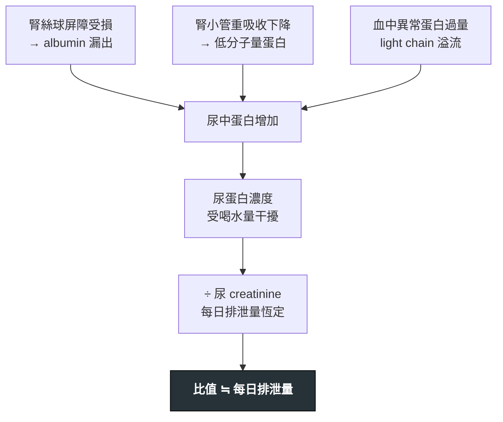

---
tags:
  - Med/Test/Nephro
  - 禁忌
aliases:
  - UPCR
  - UACR
  - ACR
  - PCR
  - urine protein-to-creatinine ratio
  - urine albumin-to-creatinine ratio
  - 尿蛋白肌酸酐比
  - 尿白蛋白肌酸酐比
  - 蛋白尿定量
  - albuminuria
  - proteinuria
created: 2026-07-27
updated: 2026-07-27
status: 可用
source: KDIGO 2024 CKD Guideline；KDIGO 2021 Glomerular Diseases；ADA Standards of Care
cssclass: clinical-note
modality: lab
compare_with:
  - "[[Urine dipstick]]"
  - "[[24h urine collection]]"
  - "[[BUN Cr eGFR]]"
  - "[[Urine indices]]"
---

# UPCR / UACR ｜ 尿蛋白（白蛋白）肌酸酐比

> [!abstract] 一句話總覽
> 兩者都是用**尿 creatinine 當內部標準去校正尿液稀釋度**，把一泡隨機尿換算成「大約等於每日排多少」。差別只在分子：**UACR 只測 albumin，UPCR 測總蛋白**——所以 UACR 抓**早期腎絲球**傷害，UPCR 抓**大量或非白蛋白**蛋白尿（light chain、tubular）。

> [!tip] 判讀速查
> **正常**：UACR <30 mg/g；UPCR <150 mg/g
> **決策切點**：UACR **30** → 開始治療與風險分層；UACR **300**（＝UPCR 500）→ 轉介腎臟科
> **紅旗值**：UPCR **>3000–3500 mg/g** ＝ nephrotic range；蛋白尿 ＋ 血尿／RBC cast ＝ 腎炎，不能等門診
> **絕對不可**：只憑**一次**數值就診斷 CKD 或啟動長期用藥；老人不明蛋白尿只驗 UACR 就結案（漏 myeloma）

---

## 原理 Principle

*它到底在量什麼？為什麼這個數字能反映那件事？*

隨機尿的蛋白**濃度**沒有意義——喝兩公升水就會被稀釋一半。但成人每天排出的 creatinine 量相當固定（男 20–25、女 15–20 mg/kg/day，約 **1 g/day**），所以把蛋白濃度除以同一泡尿的 creatinine 濃度，稀釋倍數就被消掉了。

因為分母約 1 g，**mg/g creatinine 的數字可以直接當成「mg/day」讀**。UACR 700 mg/g ≒ 每天漏 700 mg albumin。

> [!important] 為什麼低值區一定要用 UACR
> 正常人每天排 <150 mg 總蛋白，其中 albumin **只佔 <30 mg**，其餘是 Tamm-Horsfall（uromodulin）與低分子量蛋白。
> 也就是說，早期腎絲球傷害讓 albumin 從 10 mg 漲到 100 mg 時，**總蛋白還埋在正常背景雜訊裡，UPCR 完全看不出來**。
> 反過來，蛋白尿一大（>1 g/day），albumin 佔總蛋白約 60–70%，兩者就大致成比例了——這時用便宜的 UPCR 追蹤即可。

> [!note] 這一節是本篇存在的理由
> [[CKD]]、[[DKD]]、[[Nephrotic syndrome]] 只寫「驗 UACR」與判讀**結論**；**單位、切點、干擾因素只寫在這裡一次**。

> [!warning] 單位陷阱：mg/g vs mg/mmol
> 台灣多用 **mg/g**，歐洲與部分文獻用 **mg/mmol**。
> **mg/mmol × 8.84 = mg/g**（1 mmol creatinine = 113 mg）。
> 所以 A2 起點 30 mg/g ＝ 3.4 mg/mmol，指引常寫成「3 mg/mmol」。看到個位數的切點，先確認單位再驚訝。

## 什麼時候做

- 當你想回答「**這個腎有沒有在漏蛋白、漏多少**」時
- 已知 CKD 風險族群的**定期篩檢**：DM、HTN、CVD、痛風、腎病家族史、長期 NSAID
  - T2DM：**診斷當下**開始，之後每年一次；T1DM：**病程滿 5 年**後開始
- Dipstick 出現蛋白 → **必須換算成 ratio 才有數字可追蹤**（dipstick 只給濃度）
- 不明原因 [[Edema|水腫]]、泡泡尿、eGFR 下滑
- 已知蛋白尿病人的**治療反應追蹤**（同一種 test、同一個時間點，才能比）

> [!info] 反查
> 想知道「哪些疾病會用到我」→ 看右側 Backlinks 面板。

## 怎麼做 / 病人準備

| 項目 | 內容 |
|---|---|
| 檢體 | **晨起第一泡尿（first morning void）為佳**；隨機 spot 尿可接受但變異較大 |
| 為什麼要晨尿 | 避開**姿勢性蛋白尿**與日夜變異；夜間平躺的尿最能代表基礎值 |
| 病人準備 | 前 **24 小時避免劇烈運動**；避開發燒、急性感染、月經期；先確認沒有 UTI |
| 確認持續性 | **3–6 個月內驗 3 次，2 次異常**才算「持續性」，才能拿來定義 CKD |
| 時效 | 新鮮尿最好；室溫久放蛋白會降解、細菌會改變 pH |

## 判讀 Interpretation

### KDIGO 白蛋白尿分級（A1 / A2 / A3）

| 分級 | UACR (mg/g) | UPCR (mg/g) | 24h albumin | Dipstick 約略 | 意義 |
|---|---|---|---|---|---|
| **A1** | <30 | <150 | <30 mg | 陰性～trace | 正常至輕度增加 |
| **A2** | 30–300 | 150–500 | 30–300 mg | trace～1+ | **中度**增加（舊稱 microalbuminuria） |
| **A3** | >300 | >500 | >300 mg | ≥1+ | **重度**增加（舊稱 macroalbuminuria） |

> [!note] 「micro / macroalbuminuria」已被 KDIGO 淘汰
> 因為 micro- 讓人誤以為「只是一點點、不重要」。實際上 A2 就已經是**心血管與腎臟預後獨立惡化因子**。現在一律講 moderately / severely increased albuminuria。

### 關鍵閾值

| 數值 | 代表 | 下一步 |
|---|---|---|
| UACR ≥30（持續） | 腎損傷標記成立 → 符合 [[CKD]] 定義之一 | 分期（GFR × Albuminuria 熱區圖）、啟動 [[ACEi ARB\|RAASi]] |
| UACR ≥300 / UPCR ≥500 | A3，快速進展與 ESRD 高風險 | **轉介腎臟科** |
| UPCR >3000–3500 | **Nephrotic range**（≒ >3.5 g/day） | 查 albumin、血脂、抗凝風險；考慮腎切片 |
| 蛋白尿 ＋ dysmorphic RBC／RBC cast | **腎炎症候群**，非單純蛋白尿 | 急件；查 ANCA、anti-GBM、補體、ANA |
| 數週內 UPCR 暴增 ＋ Cr 上升 | 疑 **RPGN** | 當天處理，不要排一個月後回診 |
| 正常但臨床仍懷疑 | 可能是稀釋尿、或非白蛋白蛋白尿 | 改驗晨尿；加驗 UPCR 與 urine immunofixation |

> [!danger] UACR 與 UPCR 對不起來 → 想 light chain
> 經驗法則：**UACR ÷ UPCR < 0.4**（albumin 佔比異常低）代表漏出的**不是** albumin，指向 tubular proteinuria 或 **overflow（myeloma light chain、Bence Jones protein）**。
> Dipstick 與 UACR 都用免疫／白蛋白專一原理，**對 light chain 幾乎全盲**。
> 老人 ＋ 不明腎衰竭 ＋ 貧血 ＋ 高血鈣 → 一定要開 **UPCR 與 urine immunofixation / serum free light chain**。
> *（0.4 這條線是臨床經驗法則而非硬性指引切點，用來觸發思考，不用來下診斷。）*

## 干擾與偽陽性

*這一節最常被跳過，也最常害人。*

| 會讓結果失真的因素 | 往哪個方向偏 | 為什麼 |
|---|---|---|
| **肌肉量大**（年輕男性、健身、creatine） | **低估** | 分母尿 Cr 高 → 比值被稀釋 |
| **肌肉量低**（老人、惡病質、截肢、女性） | **高估** | 分母尿 Cr 低 |
| 高蛋白飲食、吃肉後 | 低估 | 尿 Cr 上升 |
| 24 小時內劇烈運動 | 暫時性高估 | 運動性蛋白尿，48 小時內回復 |
| 發燒、急性感染、心衰、癲癇後 | 暫時性高估 | 功能性蛋白尿 |
| **UTI、血尿、月經、陰道分泌物** | 假性升高 | 蛋白來源不是腎絲球 |
| **姿勢性蛋白尿**（<30 歲，通常 <1 g/day） | 白天高、夜間正常 | 良性；用日／夜分段尿確認 |
| 極度稀釋尿（尿 Cr 很低） | 兩個方向都可能，誤差被放大 | 分母太小 |
| **Light chain（Bence Jones）** | UACR、dipstick **假陰性** | 非白蛋白，測不到 |
| 鹼性尿 pH >8、極濃縮尿、chlorhexidine | **Dipstick** 假陽性 | 蛋白誤差原理被干擾 |

> [!warning] 一次異常什麼都不是
> 上表半數以上是**暫時性**因素。所以指引才要求 3–6 個月內 2/3 次異常。
> 拿一張急診發燒時抽的 UACR 去診斷 DKD，是很常見也很沒必要的錯誤。

## 與相關檢查的取捨

| 檢查 | 優點 | 缺點 | 什麼時候選它 |
|---|---|---|---|
| **UACR** | 靈敏度最高、預後預測最強、指引與臨床試驗都用它 | 貴一點；測不到 light chain | **篩檢與治療決策的預設值**：DM、HTN、CKD 分期 |
| **UPCR** | 便宜、涵蓋所有蛋白 | 低值區被背景蛋白淹沒 | 已知大量蛋白尿的追蹤、腎絲球腎炎、疑 myeloma／tubular |
| **Dipstick** | 即時、床邊、幾乎免費 | 只給**濃度**不給量；對 light chain 全盲；假陽／假陰多 | 初篩、急診第一手；**陽性一定要接 ratio** |
| **24h 尿** | 傳統 gold standard，同時得到 CrCl | 收集誤差大、病人常收不全、慢 | ratio 與臨床嚴重不符時；極端肌肉量者 |

> [!tip] 24 小時尿收得對不對，用 creatinine 檢查
> 總 creatinine 量應落在 男 20–25、女 15–20 mg/kg/day。差太多＝沒收全，那張報告的蛋白量也不能信。

## 治療決策上的角色

*為什麼這個數字值得追——它直接決定用藥。*

- **RAASi（ACEi / ARB）**：UACR ≥30 ＋ HTN 或 DM 即開始，加到最大耐受劑量
- **SGLT2i**：CKD 合併白蛋白尿的核心用藥（DAPA-CKD 收案 UACR 200–5000 mg/g；EMPA-KIDNEY 放寬到 ≥200 或低 eGFR）
- **Finerenone**：T2DM 合併 CKD、UACR ≥30（FIDELIO／FIGARO）
- **GLP-1 RA**：semaglutide 在 T2DM 合併 CKD 有腎臟終點效益（FLOW）
- **追蹤目標**：白蛋白尿下降 **≥30%** 與較佳腎預後相關
  - *需注意：這是 **surrogate endpoint**，「數字降下來」不等於一定改善硬終點，但目前是最被接受的短期指標。*

## 禁忌與陷阱

> [!danger] 絕對不可
> | 情境 | 絕對不可 | 為什麼 | 該做什麼 |
> |---|---|---|---|
> | 單次 spot 異常 | 直接診斷 CKD／DKD 或啟動長期用藥 | 半數干擾因素是暫時性的 | 3–6 個月內驗 3 次取 2 次異常 |
> | 老人不明腎衰竭 ＋ 蛋白尿 | 只驗 UACR 就結案 | UACR 與 dipstick 對 light chain 全盲 → 漏 [[Multiple myeloma]] | 加驗 UPCR ＋ urine immunofixation ／ serum free light chain |
> | Dipstick 陰性 | 說「沒有蛋白尿」 | 稀釋尿、light chain 都會假陰性 | 臨床有疑慮就直接開 UACR |
> | 蛋白尿 ＋ 血尿／RBC cast | 當成單純蛋白尿排一個月後追蹤 | 這是腎炎，可能 RPGN，數週內不可逆 | 當天啟動免疫學檢查、聯絡腎臟科 |
> | 有 UTI 或月經中 | 拿這次結果當基準值 | 蛋白來源不在腎絲球 | 治療完、經期過後重驗 |

> [!warning] 常見錯誤
> - **拿 dipstick 的 1+ 當「量」在追蹤**——1+ 只是 ≈30 mg/dL 的**濃度**，喝水多寡就能讓它跳一格
> - **UACR 與 UPCR 混著追蹤**：這次驗 UACR、下次驗 UPCR，趨勢完全沒有意義
> - **忘記換算單位**就說「3 mg/mmol 很低」（＝30 mg/g，已經是 A2 起點）
> - **年輕健壯男性 UACR 25 mg/g 就放心**——他的尿 Cr 可能有 2 g/day，真實排泄量接近兩倍
> - **只看白蛋白尿不看 eGFR**：KDIGO 風險是兩軸熱區圖，A3 ＋ G1 的風險可高於 A1 ＋ G3a

## 相關連結

- [[CKD]] — 分期用 GFR × Albuminuria 兩軸；本篇提供其中一軸
- [[Edema]] — 水腫鑑別中，腎性的分支由這裡量化
- [[Nephrotic syndrome]] — UPCR >3000–3500 是入場券
- [[Dialysis]] — 蛋白尿是進展速度的預測因子，不是透析指徵
- [[BUN Cr eGFR|Creatinine]] — 分母的來源；肌肉量如何影響它、eGFR 公式怎麼選，寫在那篇
- [[Urine indices]] — 同樣用尿 creatinine 校正稀釋度的一整組指標（FeNa、UAG 等）
