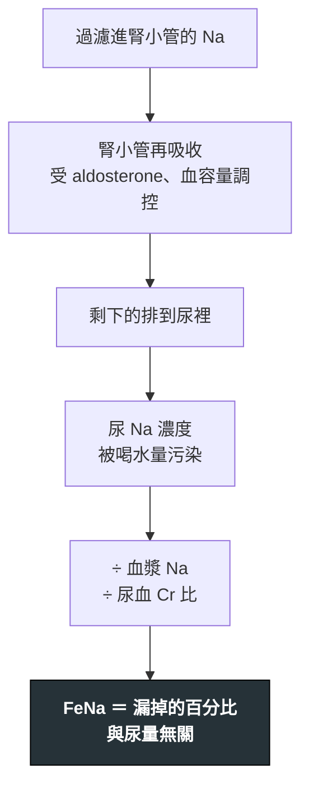

---
tags:
  - Med/Test/Nephro
  - 禁忌
aliases:
  - FeNa
  - FeUrea
  - Urine sodium
  - Urine Na
  - Urine chloride
  - Uosm
  - Urine osmolality
  - TTKG
  - Urine anion gap
  - UAG
  - Urine osmolal gap
  - FeUric acid
  - FeUA
  - Urine K/Cr ratio
  - Fractional excretion
  - 尿液電解質
  - 尿液滲透壓
  - 分率排泄
  - 尿液陰離子間隙
created: 2026-07-29
updated: 2026-07-29
status: 可用
source: KDIGO 2012 AKI Guideline；Kamel & Halperin, Afr J Nephrol 2017（TTKG → urine K/Cr）；AJKD Core Curriculum 2025 (RTA)；Carvounis 2002 Kidney Int (FeUrea)
cssclass: clinical-note
modality: lab
compare_with:
  - "[[BUN Cr eGFR]]"
  - "[[Arterial blood gas]]"
  - "[[UPCR UACR]]"
---

# Urine indices ｜ 尿液衍生指標 · Urine Chemistry & Derived Indices

> [!abstract] 一句話總覽
> 這一整組指標**沒有一個能單獨判讀**。尿 Na 30 是高是低?不知道——要看血漿 Na 多少、腎在做什麼。它們全部是**配對**:把尿的濃度除以血的濃度,消掉「這泡尿有多濃」這個變數,剩下的就是**腎小管的行為**。所以這篇問的其實只有一個問題:**腎現在以為身體缺什麼?**

> [!tip] 判讀速查
> **血容量**:urine Na **<20** ＝ 在保鈉｜**FeNa <1%** ＝ prerenal、**>2%** ＝ ATN｜用利尿劑改看 **FeUrea <35%**｜**Uosm >500** ＝ 濃縮力保留
> **鹼中毒**:urine Cl **<20** ＝ saline-responsive(嘔吐、利尿劑後)、**>20** ＝ saline-resistant
> **酸中毒**:urine AG **負** ＝ 腸道失鹼(腹瀉)、**正** ＝ 腎排酸失能([[RTA]])｜酸中毒時 urine osmolal gap **<150** ＝ NH₄⁺ 排不出去(正常反應應 **>200**)
> **紅旗**:FeNa <1% 但病人明明不缺水 → 想 rhabdomyolysis、顯影劑、[[Hepatorenal syndrome]]
> **絕對不可**:**先給輸液或利尿劑,再留尿液電解質**

---

## 原理 Principle

*它到底在量什麼?為什麼這個數字能反映那件事?*

尿液的**濃度**幾乎只反映喝了多少水。要把它變成資訊,必須除掉稀釋度。這組指標用了三種除法,分別對應三種問題。

| 除法 | 做出來的東西 | 在問 |
|---|---|---|
| 尿濃度 ÷ 血漿濃度,再用 **creatinine 校正過濾量** | **分率排泄 FE**(FeNa、FeUrea) | 過濾進來的這個東西,**最後漏掉了百分之幾** |
| 尿中陽離子總和 − 陰離子 | **urine anion gap** | 尿裡有多少**看不見的 NH₄⁺** |
| 實測滲透壓 − 算出來的滲透壓 | **urine osmolal gap** | 同上,但**更可靠** |

> [!important] 為什麼要用 creatinine 當分母的分母
> 我們真正想知道的是「**過濾進來多少 Na、排出去多少 Na**」,但沒人知道過濾量。
> Creatinine **過濾後幾乎不再吸收**,所以「尿 Cr ÷ 血 Cr」就等於**這段腎小管把水濃縮了幾倍**,也就是過濾量的代理。
> $$\text{FeNa} = \frac{U_{Na} \times P_{Cr}}{P_{Na} \times U_{Cr}} \times 100\%$$
> **記法**:分子分母都是「尿的那個 ÷ 血的那個」,Na 在上、Cr 在下——**要排的東西在上,參考物在下**。同一個結構套到任何物質都成立(FeUrea、FePO₄、FeK 都是這樣算的)。

> [!note] 這一節是本篇存在的理由
> [[AKI]]、[[CKD]]、[[Hyponatremia]] 只寫判讀**結論**;**公式、切點、失效條件只寫在這裡一次**。

> [!warning] 深度邊界:血液端不寫在這裡
> **serum anion gap、白蛋白校正、Winter's formula、delta-delta、代償公式** → 全部在 [[Arterial blood gas]]。
> 本篇只負責**尿端**。判讀一個酸鹼問題的正確順序是:先在 ABG 那篇定位是什麼型的酸鹼異常,**再**來這篇問「腎的反應對不對」。

## 什麼時候做

- 當 [[BUN Cr eGFR|Cr 上升]],而你需要知道**為什麼升**——是灌流不足還是腎小管壞了
- 當你要決定**「這個人該給水還是該利尿」**,而理學檢查說不清楚
- 當低血鈉／高血鈉,你需要知道**腎有沒有在該濃縮的時候濃縮**
- 當**代謝性酸中毒 AG 正常**,要分辨腸道失鹼 vs [[RTA]]
- 當**代謝性鹼中毒**,要分辨補生理食鹽水有沒有用
- 當低血鉀／高血鉀,要分辨是**腎在漏**還是腎外原因

> [!info] 反查
> 想知道「哪些疾病會用到我」→ 看右側 Backlinks 面板。

## 怎麼做 / 病人準備

| 項目 | 內容 |
|---|---|
| 檢體 | **隨機 spot 尿即可**,不需要收 24 小時 |
| 關鍵條件 | **必須同時抽一套血**(Na、K、Cl、Cr、urea、osmolality),否則分率算的是兩個時間點,沒有意義 |
| 時機 | **在給輸液、利尿劑、bicarbonate 之前留**——這是本篇最實際的一句話 |
| 要記錄 | 最後一次利尿劑的**時間**;有沒有在打點滴;有沒有嘔吐或腹瀉 |
| 送檢 | 尿液滲透壓與電解質可一般送檢;**滲透壓要實測,不能只靠比重估** |

> [!danger] 錯過的檢體補不回來
> 急診常見流程:病人 Cr 高 → 先掛兩瓶點滴 → 想到要驗尿液電解質。
> 此時腎小管**已經開始排掉你剛給的鈉**,FeNa 會被推高,prerenal 被誤判成 ATN。
> **留尿只要 10 mL、幾秒鐘,先留再說。**

## 判讀 Interpretation

### ① 血容量這一軸

*問題:腎覺得身體缺不缺水?*

| 指標 | 「腎覺得缺」(prerenal) | 「腎小管壞了」(ATN) |
|---|---|---|
| **Urine Na** | **<20** mEq/L | **>40** mEq/L |
| **FeNa** | **<1%** | **>2%** |
| **FeUrea**(用利尿劑時) | **<35%** | **>50%** |
| **Uosm** | **>500** mOsm/kg | **<350**(接近等滲 ≈300) |
| **Urine/Plasma Cr 比** | >40 | <20 |

> [!tip] 這五條說的是同一件事
> 缺水時,aldosterone 與 ADH 都上升 → **鈉被抓回來(尿 Na 低)、水被抓回來(Uosm 高)**。
> 腎小管壞死時,它**兩件事都做不到** → 鈉漏出去、尿液停在等滲透壓。
> 所以不需要背五組數字,只要記住 **prerenal ＝ 腎還有能力而且正在努力;ATN ＝ 腎沒能力了**。

> [!warning] FeNa 只在**寡尿性** AKI 有意義
> 原始研究做的是 oliguric AKI。非寡尿性 AKI 的 FeNa 判別力大幅下降,不要硬套。

### ② FeNa 的失效表(本篇的招牌)

*FeNa 的名氣遠大於它的可信度。以下兩張表比切點本身重要。*

**FeNa <1% 但**不是**單純缺水**:

| 情境 | 為什麼 |
|---|---|
| **Rhabdomyolysis**、**血紅素尿** | 色素造成血管收縮,灌流下降但腎小管初期完好 |
| **顯影劑腎病變** | 同上,強烈腎血管收縮 |
| **[[Hepatorenal syndrome]]**、心腎症候群 | 總水量過多,但**有效循環容積**極低 → 腎的行為與缺水一樣 |
| **急性腎絲球腎炎** | 病灶在腎絲球,腎小管功能正常 → 照樣保鈉 |
| **早期尿路阻塞** | 尚未破壞腎小管 |
| **急性間質性腎炎(AIN)** | 部分病例仍保有保鈉能力,FeNa 可低可高,判別力差 |
| 敗血症早期 | |

**FeNa >2% 但**其實**是缺水**:

| 情境 | 為什麼 |
|---|---|
| **正在用利尿劑**(最常見) | 藥直接逼腎排鈉 → 改用 **FeUrea** |
| **基礎 CKD** | 殘存腎元每個都在超量排鈉,baseline FeNa 本來就 >2% |
| **Bicarbonaturia**(嘔吐、代謝性鹼中毒) | HCO₃⁻ 帶著 Na⁺ 一起走 → 改看 **urine Cl** |
| 腎上腺功能不全 | aldosterone 不足,保不住鈉 |
| 老人 | 濃縮與保鈉能力隨年齡下降 |

> [!danger] FeNa <1% 不等於「可以放心灌水」
> 這是本篇最重要的臨床安全點。Rhabdomyolysis 的確要積極輸液,但 **HRS 與心腎症候群的 FeNa 也 <1%,對他們大量輸液會直接惡化**。
> **FeNa 回答的是「腎在想什麼」,不是「該給什麼」。** 治療決策要回到臨床全貌。

> [!note] FeUrea 的適用界線
> FeUrea 的價值只在**一個情境**:病人在用利尿劑,而你仍想知道血容量。
> 它自己的弱點:urea 再吸收受 ADH 影響,所以在 SIADH、高蛋白負荷、腸胃道出血時同樣會失真。它是補丁,不是升級版。

### ③ 代謝性鹼中毒:看 Cl,不要看 Na

*先在 [[Arterial blood gas]] 確認是代謝性鹼中毒,再進來這一格。*

| Urine Cl | 分類 | 常見原因 | 治療意義 |
|---|---|---|---|
| **<20** mEq/L | **Saline-responsive**(氯反應型) | **嘔吐／鼻胃管引流**、利尿劑**停藥後**、post-hypercapnia | 給生理食鹽水 ＋ 補鉀就會好 |
| **>20** mEq/L | **Saline-resistant** | **原發性醛固酮過多**、Cushing、**Bartter／Gitelman**、利尿劑**使用中**、嚴重缺鉀 | 給食鹽水沒用,要處理原因 |

*(切點的不確定性:部分來源用 <25 或 >40 分界,灰區確實存在。20 是最通行的二分點,落在 20–40 之間時不要硬判,回頭看病史。)*

> [!important] 為什麼嘔吐病人的 urine Na 會騙人
> 嘔吐 → 失去 HCl → 血中 HCO₃⁻ 上升並超過再吸收上限 → **HCO₃⁻ 漏進尿裡**。
> HCO₃⁻ 是陰離子,必須**拖一個陽離子(Na⁺、K⁺)一起走**才能維持電中性。
> 結果:病人明明嚴重脫水,**尿 Na 卻可以 >40**。
> **Cl⁻ 沒有這個機制**,它單純反映血容量 → 這種時候 **urine Cl 才是真話**。

### ④ 鉀:TTKG 已經退場,但考試還在考

$$\text{TTKG} = \frac{U_K / P_K}{U_{osm} / P_{osm}}$$

| TTKG | 解讀 |
|---|---|
| **>7**(高血鉀時應 >10) | 腎在排鉀 → 高血鉀的原因**不在腎** |
| **<3**(低血鉀時) | 腎在保鉀 → 低血鉀的原因**不在腎**(腸胃道流失、細胞內移動) |
| 高血鉀但 TTKG **低** | **醛固酮不足或阻抗** → type 4 [[RTA]]、[[Hypoaldosteronism]] |
| 低血鉀但 TTKG **高** | **腎在漏鉀** → 利尿劑、醛固酮過多、Bartter／Gitelman |

> [!warning] TTKG 的假設已被它的提出者本人放棄
> TTKG 的分母是為了「還原」皮質集尿管末端的鉀濃度,前提是**該處之後不再有溶質被再吸收**。
> 但髓質集尿管每天**再吸收約 600 mmol 的 urea**、帶走約 2 L 的管腔體積,這個假設不成立 → **Kamel 與 Halperin(公式作者)已公開表示不再使用 TTKG,改推 urine K/Cr ratio**(*Afr J Nephrol* 2017)。
> *(措辭精確度:這是作者自己改變立場的論文,**不是期刊撤稿**。寫「Halperin 撤回」會被抓語病。)*
> **實務替代**:
> - **Urine K/Cr ratio** — 低血鉀時 **>13 mEq/g Cr** 提示腎在漏鉀
> - **24 小時尿鉀** — 低血鉀時 **>25–30 mEq/day** 提示腎性流失
>
> 使用建議:**國考仍可能考 TTKG 的判讀方向**,方向記住即可;臨床寫病歷用 urine K/Cr。

### ⑤ 酸:urine anion gap

*適用條件:**AG 正常(hyperchloremic)的代謝性酸中毒**。AG 升高的酸中毒不要用這個。*

$$\text{UAG} = (U_{Na} + U_K) - U_{Cl}$$

| UAG | 解讀 | 機轉 |
|---|---|---|
| **負值**(如 −30) | **腎外失鹼 → 腹瀉** | 腎正常反應:大量排 NH₄⁺,NH₄⁺ 拖著 Cl⁻ 出去 → U_Cl 超過 (Na+K) |
| **正值**(如 +20) | **腎排酸失能 → [[RTA]]** | NH₄⁺ 排不出來 → Cl⁻ 也就不多 |

> [!tip] 記法:**NEG-UT-IVE**
> **NEGative ＝ GUT**(腸道)。負值指向腹瀉,正值指向腎臟。
> 背後只有一句話:**UAG 是 NH₄⁺ 的影子**。你量不到 NH₄⁺,但它帶正電,會把等量的 Cl⁻ 拉進尿裡,所以 Cl⁻ 多出來多少,NH₄⁺ 就有多少。

> [!danger] UAG 的六個失效情境 → 改用 osmolal gap
> **A. 有其他未測陰離子**(UAG 假性偏**正** → 把腸道原因誤判成 RTA):
> - **Ketoacidosis**(β-hydroxybutyrate 帶著 Na⁺ 走)
> - **吸入甲苯／強力膠**(hippurate)
> - **Penicillin 類大劑量**
> - **Bicarbonaturia**(type 2 proximal RTA 給鹼之後)
>
> **B. 兩個方向相反的陷阱**:
> - **近端(type 2)RTA 的 UAG 可以是負值** → 看起來像腹瀉,分不出來
> - **低血容量尚未矯正**會把 UAG 拉高(假陽性)→ **先補液再驗**
>
> 換句話說:UAG 兩個方向都會騙人。灰區或高風險時直接用 osmolal gap。

### ⑥ 酸:urine osmolal gap(比 UAG 可靠)

$$\text{計算 } U_{osm} = 2(U_{Na} + U_K) + \frac{U_{urea\ nitrogen}}{2.8} + \frac{U_{glucose}}{18}$$
$$\text{Gap} = \text{實測 } U_{osm} - \text{計算 } U_{osm}$$

- Gap 主要由 **NH₄⁺ 鹽**構成,**Gap ÷ 2 ≈ 尿中 NH₄⁺ 濃度**

**判讀切點(限「正在代謝性酸中毒」的情況下)**:

| Gap | 意義 |
|---|---|
| **>200** mOsm/kg | NH₄⁺ 排泄**反應適當** → 腎沒問題,酸是**從腸道漏**的 |
| **<150** mOsm/kg | NH₄⁺ 排泄**不足** → 腎排酸失能 → **[[RTA]]** |
| 150–200 | 灰區,需結合 UAG、血鉀、尿 pH 一起判 |

> [!danger] 別把「正常值」當成「切點」
> 沒有酸中毒的正常人,urine osmolal gap 本來就落在 **10–100 mOsm/kg**——這個數字**不是**判讀閾值。
> 判準是「**在酸中毒的壓力下,腎有沒有把 NH₄⁺ 拉上來**」。所以 gap 120 在健康人是正常,在酸中毒病人身上代表**反應失敗 → RTA**。
> 用 100 當切點會把這一類病人判成「腸道原因」,方向完全相反。

> [!warning] 兩個算式陷阱
> **① ÷2.8 是給 urea *nitrogen*(BUN,mg/dL)用的。** 若報告給的是尿 **urea**(非氮),要 **÷6.0**。搞混會差兩倍,gap 直接失真。
> **② `2×(Na+K)` 假設 Cl⁻ 是唯一陪同的陰離子**——這正是 UAG 失效的同一個假設。有明顯 bicarbonaturia 或大量有機酸時,較嚴謹的寫法是把陰離子逐項列出:`Na + K + Cl + HCO₃ + urea/2.8 + glucose/18`。

> [!note] 什麼時候一定要用 osmolal gap 而不是 UAG
> ① 上面四個 UAG 失效情境 ② UAG 落在 −10 ～ +10 的灰區 ③ 判讀結果會決定要不要長期補鹼。
> 代價:需要**實測**尿液滲透壓與尿素,不是每家急診都能立刻拿到。

### ⑦ 尿液濃縮:Uosm 單獨判讀的兩個場合

| 情境 | Uosm | 意義 |
|---|---|---|
| **低血鈉** | **<100** mOsm/kg | ADH 被正確抑制 → 原發性多喝水、低溶質攝取(beer potomania) |
| | **>100** | ADH 在作用 → 接著看 urine Na 與血容量(完整鑑別見 [[Hyponatremia]]) |
| **高血鈉／多尿** | **>700–800** | 濃縮力正常 → 缺水是攝取不足或腎外流失 |
| | **<300** | 濃縮力喪失 → [[Diabetes insipidus]] 範疇 |
| | 300–700 | 部分性缺損、滲透性利尿、利尿劑 |

> [!warning] 尿比重不能代替滲透壓
> 比重被**分子重量**影響:顯影劑、glucose、蛋白質會把比重推高,但對滲透壓貢獻小。
> 打過顯影劑的病人比重可以 >1.040 而滲透壓平平。要判讀濃縮力,**開實測滲透壓**。

### ⑧ 同一個公式的其他用法

*FE 的結構可以套到任何自由過濾的物質,以下兩個值得會。*

| 指標 | 切點 | 用在哪 |
|---|---|---|
| **FeUric acid** | **<7%** ＝ 有效血容量不足;**>12%** ＝ SIADH／腎失尿酸 | **低血鈉的鑑別**。優點:**在用利尿劑時仍可用**,補上 FeNa 的空缺。低尿酸血症＋高 FeUA 是 SIADH 的經典組合 |
| **FeK** | 隨血鉀變動,無單一切點 | 概念與 urine K/Cr 重疊,實務上多用後者。知道結構即可 |

> [!tip] 低血鈉＋正在吃利尿劑 → 想到 FeUric acid
> 這是常被跳過的一步:thiazide 造成的低血鈉與 SIADH 在 Uosm、urine Na 上長得很像,FeNa 也被藥物污染。
> FeUA 是這個情境下少數還能用的指標。

## 干擾與偽陽性

| 因素 | 影響哪個指標 | 方向 |
|---|---|---|
| **利尿劑(近 24–48 小時)** | urine Na、FeNa、urine Cl、TTKG | 全部往「腎在漏」的方向偏 |
| **已經開始輸液** | urine Na、FeNa | 假性升高 → prerenal 被誤判為 ATN |
| **基礎 CKD** | **所有分率指標** | baseline 本來就高,切點全部失效 |
| **Bicarbonaturia** | urine Na↑、UAG 假性偏正 | 用 urine Cl 與 osmolal gap 取代 |
| **顯影劑** | 尿比重、滲透壓 | 比重假性升高 |
| **Glucosuria、mannitol** | Uosm、FeNa | 滲透性利尿 → 稀釋判讀 |
| **高蛋白負荷、腸胃道出血** | FeUrea | 假性升高 |
| **SIADH** | FeUrea | urea 再吸收改變 → 失真 |
| 尿液久放 | 滲透壓、pH、NH₄⁺ | 細菌分解 urea → NH₄⁺ 假性上升 |

> [!warning] 一句話總結所有干擾
> **這組指標假設「腎小管沒有被外力介入」。** 只要有利尿劑、輸液、鹼、或既有 CKD,先問這個假設還在不在,再看數字。

## 與相關檢查的取捨

| 檢查 | 優點 | 缺點 | 什麼時候選它 |
|---|---|---|---|
| **FeNa** | 便宜、快、教科書標準 | 失效情境長到需要一整張表;非寡尿時無效 | 寡尿性 AKI、**未用利尿劑** |
| **FeUrea** | 利尿劑下仍可用 | 受 ADH、蛋白負荷干擾 | 只在用利尿劑時 |
| **Urine Cl** | 不受 bicarbonaturia 干擾 | 只在酸鹼問題有用 | **代謝性鹼中毒**、嘔吐病人的血容量 |
| **Urine AG** | 只要三個常規電解質 | 有其他未測陰離子就失效 | AG 正常的酸中毒,第一線 |
| **Urine osmolal gap** | 直接估 NH₄⁺,最可靠 | 要實測滲透壓與尿素 | UAG 失效或灰區時 |
| **[[BUN Cr eGFR]]** | 量的是**過濾**能力 | 不告訴你原因 | 一定要一起看 |
| **尿沉渣鏡檢** | **muddy brown cast 對 ATN 的意義大於任何分率指標** | 需要人看、費時 | 每一個 AKI 都該做 |

> [!tip] 如果只能選一個
> **選尿沉渣。** 在 prerenal vs ATN 這件事上,muddy brown granular cast 的判別力優於 FeNa,而且不受利尿劑影響。FeNa 是輔助,不是主角。

## 禁忌與陷阱

> [!danger] 絕對不可
> | 情境 | 絕對不可 | 為什麼 | 該做什麼 |
> |---|---|---|---|
> | 尚未留尿液電解質 | 先打點滴或利尿劑 | 介入後的數值反映的是你的處置,不是病人的狀態 | **先留 10 mL 尿,再開醫囑** |
> | 病人在用利尿劑 | 用 FeNa 判斷血容量 | 藥物直接推高尿鈉 | 改用 **FeUrea <35%** |
> | 嘔吐／鼻胃管引流 | 用 urine Na 判斷血容量 | bicarbonaturia 拖走 Na⁺ | 改看 **urine Cl <20** |
> | FeNa <1% | 一律當成缺水大量輸液 | HRS、心腎症候群的 FeNa 也 <1%,輸液會惡化 | 結合臨床、超音波、病史再決定 |
> | AG **升高**的酸中毒 | 算 urine anion gap | UAG 只適用於 AG 正常型 | 回 [[Arterial blood gas]] 先分型 |
> | 有 ketoacidosis 或吸膠 | 用 UAG 判斷 RTA | 未測陰離子讓 UAG 假性偏正 | 改用 **urine osmolal gap** |
> | 已知 CKD G4–5 | 套用標準切點 | baseline 分率本來就偏高 | 這組指標在此族群幾乎不可判讀 |

> [!warning] 常見錯誤
> - **只送尿不抽血**——分率算不出來,那管尿白留了
> - **把 FeNa 當診斷,而不是當線索**——它只回答「腎在保鈉嗎」,不回答「為什麼」
> - **UAG 記反方向**——記 NEG-**UT**-IVE(負值 ＝ 腸道)
> - **用尿比重代替滲透壓**判斷濃縮力
> - **在 AG 升高的酸中毒算 UAG**——適用條件搞錯,整段推論作廢
> - **TTKG 算出來就當定論**——方向可以參考,但要知道這個公式的假設已被推翻
> - **忘了問最後一次利尿劑什麼時候給的**——這一題決定上面一半的指標能不能用

## 相關連結

- [[BUN Cr eGFR]] — 過濾能力那一軸;本篇回答「為什麼掉」
- [[AKI]] — prerenal／intrinsic／postrenal 的分類與處置寫在那篇
- [[Arterial blood gas]] — **serum** anion gap、代償公式、酸鹼分型;本篇只接手尿端
- [[RTA]] — type 1／2／4 的完整鑑別在那篇;本篇提供 UAG 與 osmolal gap 這兩個入口
- [[Hyponatremia]] — Uosm 與 urine Na 是該流程的第一個分岔
- [[UPCR UACR]] — 同樣用尿 creatinine 當校正分母,原理相通
- [[Dialysis]] — 這組指標不影響透析時機的判斷
