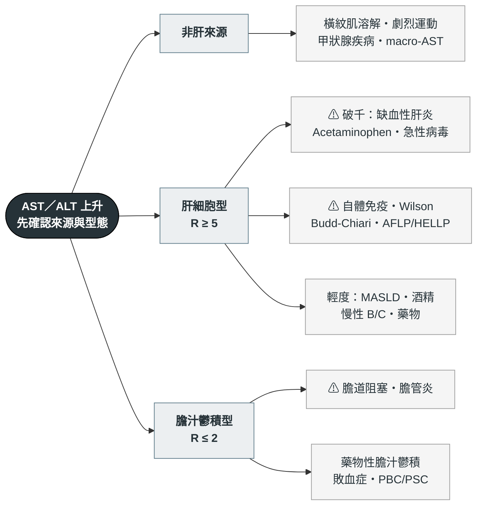

---
tags:
  - Med/Workup/GI
  - 禁忌
aliases:
  - Acute liver injury
  - ALI
  - 急性肝損傷
  - 肝指數上升
  - Transaminitis
  - Elevated aminotransferases
  - Acute hepatitis workup
created: 2026-07-28
updated: 2026-07-28
status: 可用
source: "Harrison's Principles of Internal Medicine（Evaluation of Liver Function；Acute Hepatitis）；AASLD Position Paper: The Management of Acute Liver Failure（2011 update，ALF 三個例外的出處）；ACG Clinical Guideline: Evaluation of Abnormal Liver Chemistries (2017)；ACG Clinical Guideline: Idiosyncratic Drug-Induced Liver Injury (2021)；ACG Clinical Guideline: Alcohol-Associated Liver Disease (2024)；AASLD DILI Practice Guidance (2021)；AASLD Palliative Care and Symptom-Based Management in Decompensated Cirrhosis（acetaminophen 2 g/day 上限）；EASL CPG on Drug-Induced Liver Injury (2019)；EASL CPG Wilson's Disease (2012)；Koch DG et al. Am J Gastroenterol 2017;112:1389（ALFSG severe acute liver injury 定義）；O'Grady GJ et al. Gastroenterology 1989;97:439（King's College criteria）；Bernuau J et al.（Clichy criteria）；Cassidy WM & Reynolds TB. J Clin Gastroenterol 1994（ALT/LDH ratio）；Lee WM et al. Gastroenterology 2009;137:856（非 acetaminophen ALF 的 IV NAC）；Kuffner EK et al. BMC Med 2007;5:13（慢性飲酒者治療劑量 acetaminophen）"
cssclass: clinical-note
cant_miss:
  - "Acetaminophen 中毒"
  - "缺血性肝炎 Ischemic hepatitis"
  - "急性肝衰竭 Acute liver failure"
  - "[[Wilson disease]]"
  - "妊娠相關肝病 AFLP／HELLP"
differential:
  - "[[Acute hepatitis]]"
  - "藥物性肝損傷 DILI"
  - "[[MASLD]]"
  - "缺血性肝炎"
  - "[[CBD stone]]"
key_tests:
  - "AST／ALT／ALP／T-bil（算 R value）"
  - "PT/INR、albumin"
  - "血糖、ammonia、意識評估"
  - "[[Abdominal ultrasound]] ＋ Doppler"
  - "CK（排除肌肉來源）"
---

# Acute liver injury ｜ 急性肝損傷 · 肝指數異常的流程

> [!abstract] 一句話總覽
> 看到 AST/ALT 上升，要連續問三個問題，**順序不能顛倒**：**① 這是肝嗎**（AST 也來自肌肉）→ **② 嚴重度到哪一級**（看 INR 與意識，**不是看 ALT 幾千**）→ **③ 什麼型態、什麼病因**（R value）。第二問先於第三問，因為決定要不要打電話給移植中心的是 INR 和腦病變，找病因是接下來的事。

> [!danger] Can't-miss — 漏掉會死人
> | 不能漏 | 一眼線索 | 立刻做什麼 |
> |---|---|---|
> | Acetaminophen 中毒 | 大量服藥史或**服藥史不明**、ALT 破千而 bilirubin 相對不高 | Acetaminophen level ＋ Rumack-Matthew nomogram；**高度懷疑就先給 NAC，不要等報告** |
> | 缺血性肝炎（shock liver） | 低血壓／心衰竭／低氧事件後 24–72 小時，AST、ALT、**LDH 同步暴衝且快速回落** | 治血行動力學原因（[[Shock]]、[[Heart failure]]）；肝本身不需特別治療 |
> | 急性肝衰竭 ALF | **INR ≥ 1.5 ＋ 任何程度肝性腦病變**、無肝硬化底子、病程 < 26 週 | 查血糖（會低）、ammonia；**避免鎮靜**；在病人還轉得動時聯絡移植中心 |
> | 猛爆型 [[Wilson disease]] | 年輕、Coombs 陰性溶血、**ALP／T-bil < 4**、AST/ALT > 2.2 | Ceruloplasmin、24 小時尿銅、裂隙燈；出路是肝移植 |
> | 妊娠：AFLP／HELLP | 妊娠後期；**低血糖是 AFLP 的指紋**、HELLP 通常沒有 | 產科急會診——**治療是生產，不是保守觀察** |
> | 急性 Budd-Chiari | 腹痛 ＋ 腹水 ＋ 肝腫大三聯，凝血功能異常背景 | **腹部超音波 Doppler**（一般 B mode 看不到） |

> [!tip] 到床邊的前 5 分鐘
> **看**：血壓與意識、**asterixis**、慢性肝病 stigmata（有 → 想的是急性慢性肝衰竭而非 ALF）、鞏膜。
> **問**：**最近兩個月新加了什麼**（含中草藥、保健食品、減肥產品，逐項點名問）？**有沒有一次吃大量止痛藥或自殺意念**？最近有沒有低血壓、大出血、心衰竭發作？有沒有在用免疫抑制劑或 rituximab？
> **做**：AST／ALT／ALP／γ-GT／T-bil／D-bil、**PT/INR ＋ albumin**、**血糖**、CBC/DC、CK、acetaminophen level、病毒標記、[[Abdominal ultrasound]] ＋ Doppler。

---

## 鑑別架構圖

*先看骨架再看細節。第一層分岔是「是不是肝」與 R value 的型態，不是器官位置。⚠ ＝ can't-miss。*

> [!warning] 第一個陷阱：AST 上升不一定是肝
> AST 大量存在於**骨骼肌、心肌、紅血球**，ALT 雖較肝專一但也有肌肉來源。主力線索是 **CK 大幅上升 ＋ AST > ALT**（橫紋肌溶解、劇烈運動、他汀類肌病變），以及**溶血檢體**（紅血球內 AST 漏出造成假性上升）。**γ-GT 只能當旁證**：它確立的用途是「確認 **ALP** 上升是不是來自肝膽」，對 AST/ALT 的來源鑑別價值有限，**γ-GT 正常不能排除肝細胞損傷**，也不可單獨當作篩檢肝病的工具。另有**單獨且持續的 AST 上升、病人完全無症狀**——想 macro-AST（AST 與免疫球蛋白結合、清除變慢），是良性現象，做 PEG 沉澱可證實。甲狀腺功能異常（亢進與低下都算）與腎上腺功能不全也會造成不明原因的肝指數輕度上升。

## 病史 History

| 問題 | 若為「是」→ 想到 |
|---|---|
| **最近兩個月新加了什麼藥？**含中草藥、保健食品、減肥與健身產品 | DILI——台灣本土以中草藥與保健食品為大宗；抗生素中 **amoxicillin-clavulanate** 最常見，抗結核藥（INH）與 methotrexate 也要主動問 |
| 一次吃大量止痛藥？**是不是分好幾次吃**？有沒有自殺意念？ | Acetaminophen 中毒。真正要警覺的是 **分次反覆超量（staggered overdose）、禁食／營養不良、服藥時間說不清楚**——這三種都讓 nomogram 失效。「慢性飲酒者治療劑量就會中毒」是舊說法，**前瞻試驗顯示戒酒治療中的慢性飲酒者連續數日服 4 g/日並未造成 ALT 上升**，早年的個案回頭看多半實際有超量 |
| 近期低血壓、大出血、敗血症、心衰竭發作、心跳停止？ | 缺血性肝炎；**右心衰竭的鬱血肝也可以在沒有明顯低血壓紀錄下發生** |
| 有沒有在用免疫抑制劑、化療、**rituximab**、類固醇？ | **B 型肝炎再活化**——治療前沒驗 HBsAg／anti-HBc 是可預防的死亡；免疫檢查點抑制劑肝炎 |
| 陣發性右上腹絞痛，痛完就緩解？ | 結石通過造成的**一過性 transaminase 暴衝**（見下方陷阱）→ [[RUQ pain]]、[[CBD stone]] |
| 每天喝多少酒、喝多久？ | 酒精性肝炎；但 **AST 很少超過 400**，破千要另找原因 |
| 生食貝類、東南亞旅遊、未熟豬肉、群聚；輸血、共用針具、刺青 | 急性 A／E 型；[[Hepatitis B]]、[[Hepatitis C]] |
| 懷孕？第幾週？ | AFLP、HELLP、妊娠劇吐；**孕婦感染 E 型肝炎猛爆風險高** |
| 年輕人 ＋ 動作障礙或精神症狀、病毒標記全陰？ | [[Wilson disease]] |
| 意識改變、日夜顛倒、算術變差？ | 肝性腦病變 → 這一刻起就不是「肝指數異常」，是 ALF（見 [[Hepatic encephalopathy]]） |

## 理學檢查 PE

| 要做的 PE | 陽性代表 |
|---|---|
| 意識分級 ＋ **asterixis** | 肝性腦病變；**有腦病變 ＋ INR ≥ 1.5 就是 ALF**，這是分水嶺 |
| 血壓、心律、頸靜脈怒張、下肢水腫 | 缺血性肝炎的上游原因（[[Shock]]、[[Heart failure]] 的鬱血肝） |
| **慢性肝病 stigmata**：蜘蛛痣、肝掌、腹水、脾腫、男性女乳 | 有 → 底子是 [[Cirrhosis]]，這次是**急性慢性肝衰竭（ACLF）而非 ALF**，處置與預後完全不同 |
| 肝臟大小與壓痛 | 急速腫大＋壓痛：鬱血肝、急性 Budd-Chiari；**急速縮小是壞消息**（大量肝細胞壞死） |
| 裂隙燈找 Kayser-Fleischer ring | [[Wilson disease]]（純肝表現者只有約半數陽性，**陰性不能排除**） |
| 肌肉壓痛、近端無力 | 肌肉來源（併驗 CK） |

## 第一批檢查 Initial Workup

| 時機 | 檢查 | 想回答的問題 |
|---|---|---|
| 立刻 | **PT/INR ＋ albumin** | **合成功能**——嚴重度分級靠這個，不是靠 ALT |
| 立刻 | AST／ALT／ALP／γ-GT／**T-bil ＋ D-bil** | 算 **R value** 決定型態；D-bil 見 [[Jaundice]] |
| 立刻 | **血糖** ＋ 電解質 ＋ ammonia ＋ 意識評估 | ALF 會**低血糖**且容易被當成鎮靜；腦病變分級 |
| 立刻 | **Acetaminophen level**、CK、CBC/DC、乳酸、血液培養（發燒時） | 有解毒劑的病因先排除；肌肉來源；敗血症 |
| 立刻 | [[Abdominal ultrasound]] **＋ Doppler** | 膽管有無擴張（內外科分水嶺）；肝靜脈與門靜脈是否通暢 |
| 次要 | anti-HAV IgM、HBsAg ＋ anti-HBc IgM、anti-HCV ＋ **HCV RNA**、anti-HEV IgM | 病毒病因；標記怎麼配見 [[Jaundice]] |
| 次要 | ANA／ASMA／IgG、ceruloplasmin ＋ 24 小時尿銅、HSV/VZV/EBV/CMV PCR | 自體免疫肝炎、[[Wilson disease]]、免疫低下者的疱疹病毒肝炎 |
| 次要 | 肝切片（**經頸靜脈途徑**） | 病因不明且會改變處置時；INR 延長者不走經皮 |

### 嚴重度分層：這一格決定今天晚上做什麼

*同樣是 ALT 破千，落在哪一層完全不同。分級靠 **INR 與意識**，與 transaminase 的絕對值無關。*

| 分層 | 定義 | 處置 |
|---|---|---|
| 單純肝損傷 | Transaminase 上升，**INR 正常、意識清楚** | 找病因、停可疑藥、門診或一般病房追蹤 |
| 重度肝損傷（severe ALI） | **凝血功能已受影響但仍無腦病變** | 住院、每 6–12 小時追 INR 與意識——**這一層隨時會掉進 ALF** |
| **急性肝衰竭 ALF** | **INR ≥ 1.5 ＋ 任何程度肝性腦病變**，無肝硬化底子，病程 < 26 週 | ICU、聯絡移植中心 |

> [!note] ALF 的三個條件與「有肝硬化仍算 ALF」的例外
> 三個條件缺一不可：**沒有腦病變就不是 ALF，只是急性肝炎**；有肝硬化底子的通常是 ACLF。
> **AASLD 2011 明列三個例外**：[[Wilson disease]]、**垂直感染的 B 型肝炎**、**自體免疫肝炎**——即使已有肝硬化，只要是病程 < 26 週的首次（de novo）表現，仍歸類為 ALF、仍可進移植名單。**Budd-Chiari 症候群**是後續 EASL 與綜論才併入的第四項；**選擇題要挑「公認例外」，三個是最安全的答案**。
> Severe ALI（sALI）的門檻是 ALFSG 的**研究登錄用**定義：**INR ≥ 2.0 ＋ ALT ≥ 10× ULN 兩項同時成立（不是二選一）＋ 完全沒有任何程度腦病變**；非 acetaminophen 者再加 **T-bil ≥ 3.0 mg/dL**。它的用途是「這個人要住院緊盯」，不是合格／不合格的硬性準則。（符合 sALI 後惡化成 ALF／死亡／移植：非 acetaminophen 組約 40%，acetaminophen 組僅約 7%。）

> [!danger] 最重要的反直覺點：ALT 掉下來不等於好轉
> **Transaminase 的高度與預後無關**，它只反映「現在有多少肝細胞正在死」。當 **ALT 開始下降、但 bilirubin 與 INR 繼續上升**，代表的是**能死的肝細胞已經死得差不多了**（hepatic exhaustion）——這是惡化，不是恢復。
> **但這是教科書與專家共識層級的臨床法則，不是前瞻研究驗證過的預後指標**：恢復期也會出現 ALT 先降、bilirubin 因排泄落後而續升的同一種型態。判定惡化的依據是 **INR 與腦病變的趨勢**，ALT 曲線只能當背景。追蹤要看的是 **INR、bilirubin、creatinine、乳酸、意識、血糖**這一組。

### R value：一個數字決定下一批開什麼

**R ＝（ALT ÷ ALT 的 ULN）÷（ALP ÷ ALP 的 ULN）**

| R | 型態 | 下一批 |
|---|---|---|
| **≥ 5** | 肝細胞型 | 病毒標記 ＋ 自體免疫 ＋ 銅代謝 ＋ acetaminophen level |
| **2 < R < 5** | 混合型 | 兩邊都追，優先想藥物 |
| **≤ 2** | 膽汁鬱積型 | [[Abdominal ultrasound]] 看膽管擴張 → MRCP／[[ERCP]] |

邊界值 **5 與 2 分別歸給肝細胞型與膽汁鬱積型**，不歸混合型。R value 要用**首次異常時**的數值算，晚期抽的會失真。膽紅素分型（direct／indirect）與 DILI 的內因性／特異體質性分類、抗結核藥停藥門檻、Hy's law，完整內容在 [[Jaundice]]。

## 鑑別診斷

### 致命（can't-miss）

| 疾病                     | 支持線索                                                                                                                                                                                                                                                                         | 排除方法                                                  |
| ---------------------- | ---------------------------------------------------------------------------------------------------------------------------------------------------------------------------------------------------------------------------------------------------------------------------- | ----------------------------------------------------- |
| Acetaminophen 中毒       | ALT 可達數千、**bilirubin 相對低**、INR 早期就延長                                                                                                                                                                                                                                         | Level ＋ nomogram（**只適用單次、時間明確的過量**）；慢性攝取或時間不明就直接給 NAC |
| 缺血性肝炎                  | 低血壓／心衰竭事件後 24–72 小時，AST、ALT、**LDH 同步暴衝**，**72 小時內降一半以上**；bilirubin 只輕微上升 **ALT／LDH < 1.5 偏向缺血、病毒性明顯偏高**（病毒性平均 4.65、缺血 0.87；以 1.5 鑑別病毒性 sens 94%／spec 84%）。⚠ **acetaminophen 的 ALT/LDH 也偏低（約 1.46）**，所以低比值只能推開「病毒性」，**分不了缺血 vs acetaminophen**——那要靠血壓紀錄、服藥史與 level。治上游血行動力學原因 |                                                       |
| 急性病毒性肝炎                | ALT > AST、可破千、ALP 幾乎不動                                                                                                                                                                                                                                                       | 病毒標記組合（見 [[Jaundice]]）→ [[Acute hepatitis]]           |
| [[Wilson disease]] 猛爆型 | 年輕、Coombs 陰性溶血、**ALP／T-bil < 4**、AST/ALT > 2.2；**ALP 低到不合理**                                                                                                                                                                                                                 | Ceruloplasmin、24 小時尿銅、K-F ring                        |
| 急性 Budd-Chiari         | 腹痛＋腹水＋肝腫大，骨髓增生性腫瘤或血栓體質背景                                                                                                                                                                                                                                                     | **超音波 Doppler**；JAK2 V617F                            |
| **AFLP** 妊娠急性脂肪肝       | **低血糖 ＋ 高血氨 ＋ 低 fibrinogen ＋ DIC ＋ 腎損傷**（Swansea criteria）——**低血糖是它的指紋**                                                                                                                                                                                                     | 產科急會診；母體穩定後**儘快生產**                                   |
| **HELLP**              | 溶血（LDH↑、schistocyte）＋ AST/ALT↑ ＋ **血小板 < 100k**，常合併高血壓與蛋白尿，**通常沒有低血糖**                                                                                                                                                                                                       | 同上；生產是唯一根治                                            |
| B 型肝炎再活化               | 免疫抑制或化療（尤其 rituximab）中或停藥後，ALT 突然暴升                                                                                                                                                                                                                                          | HBsAg、anti-HBc、**HBV DNA**；治療前就該篩檢並預防性抗病毒             |

### 常見

| 疾病 | 支持線索 | 排除方法 |
|---|---|---|
| 藥物性肝損傷 DILI | 用藥時序吻合、停藥後改善；**是排除性診斷** | 完整用藥史（含中草藥、保健食品）＋ R value 分型 ＋ 排除其他病因 |
| 酒精性肝炎 | **AST／ALT > 2**（教科書慣用；**ACG 2024 準則寫的是 > 1.5**，兩個數字都會出現在題目裡）**且 AST 與 ALT 都很少 > 400 IU/L**、γ-GT↑、MCV↑ | 飲酒史 ＋ 排除其他原因；**AST 破千請找別的病因** |
| [[MASLD]]／代謝性脂肪肝 | ALT > AST、多為輕度（< 5× ULN）、代謝症候群背景 | 超音波 ＋ 排除其他；體重與代謝控制 |
| 慢性 B／C 型肝炎急性發作 | 已知帶原或抗體陽性、ALT 起伏 | HBV DNA／HCV RNA |
| [[CBD stone]] 通過 | 絞痛發作時 **ALT 短暫暴衝**、24–48 小時內快速回落，**ALP 與 bilirubin 隨後才升** | 腹超 → MRCP；別被「破千」誤導成病毒性肝炎 |

### 少見但要想到

| 疾病 | 支持線索 | 排除方法 |
|---|---|---|
| 自體免疫肝炎 | 年輕女性、其他自體免疫病、高 IgG、ANA／ASMA 陽性；**也可以破千** | 自體抗體 ＋ 肝切片；治療前務必排除病毒 |
| 疱疹病毒肝炎（HSV／VZV／EBV／CMV） | 免疫低下或孕婦、**發燒 ＋ ALT 高但黃疸不明顯（anicteric）**、白血球低 | PCR；**懷疑 HSV 就經驗性給 acyclovir**，等切片會來不及 |
| 熱衰竭／熱中暑、劇烈運動 | 高溫暴露或極限運動後，CK 同步暴升 | 病史 ＋ CK；降溫與水化 |
| 蕈菇中毒（Amanita） | 誤食野菇後 6–24 小時腹瀉，接著肝指數暴衝 | 病史；毒物中心 |
| 腫瘤大量浸潤肝臟 | 已知惡性腫瘤、肝腫大、ALP 不成比例上升 | 影像 ＋ 切片 |
| Celiac disease、甲狀腺疾病、腎上腺功能不全 | 找不到肝病因的**持續輕度**上升 | 抗體、TSH、cortisol |

## 處置分流 Disposition

| 去向 | 條件 |
|---|---|
| ICU | **INR ≥ 1.5 ＋ 任何程度肝性腦病變**（＝ALF）；低血糖需持續輸糖；血行動力學不穩；乳酸持續上升 |
| 住院 | INR 已延長但無腦病變（severe ALI）；ALT 破千；無法進食；懷疑 acetaminophen、Wilson、Budd-Chiari、膽道阻塞；孕婦任何肝指數異常 |
| 門診追蹤 | INR 正常、意識清楚、輕度上升且無合成功能異常——**但仍要在 1–2 週內重驗**，不能開單就結案 |

> [!tip] NAC 不是只給 acetaminophen
> **非 acetaminophen 的 ALF 也用 IV NAC**：隨機雙盲試驗顯示無移植存活率 **40% vs 安慰劑 27%**，但**效益只出現在早期（coma grade I–II）**，已經進到 grade III–IV 就沒有好處。所以這是「愈早愈好」的藥，不是「等病因確定再說」的藥。

> [!note] King's College criteria：兩組的軸線不一樣，不能用同一句話蓋過去
> KCC 嚴格說是**「不移植就會死」的預後工具**，不是移植中心的掛號條件；正式列名要走各國分配系統。**符合條件時死亡率已經很高，所以要提早聯絡而不是等符合。**
>
> | | Acetaminophen 組 | 非 acetaminophen 組 |
> |---|---|---|
> | 軸線 | 酸中毒 ＋ 凝血 ＋ **腎功能** ＋ 腦病變 | 凝血 ＋ bilirubin ＋ 年齡 ＋ 病因 ＋ 時間間隔（**不含腎功能、不含酸中毒**） |
> | 單一項即可 | 復甦後動脈血 **pH < 7.3** | **INR > 6.5** |
> | 或並存 | INR > 6.5 ＋ Cr > 3.4 mg/dL ＋ grade III–IV 腦病變，**三項同時成立** | 五項符合**三項**：年齡 < 10 或 > 40；病因為 non-A non-B 肝炎／藥物性／不明；黃疸到腦病變間隔 > 7 天；INR > 3.5；T-bil > 17.5 mg/dL |
>
> **補充項**：acetaminophen 組現多加上 **arterial lactate > 3.5 mmol/L（早期復甦後）或 > 3.0（完全復甦後）**。
> **對照的另一套是 Clichy criteria**（法國，原用於 B 肝）：**factor V < 20%（< 30 歲）或 < 30%（≥ 30 歲）＋ grade III/IV 腦病變**——常被拿來與 KCC 併列出題。

> [!danger] 腦水腫是 ALF 的頭號死因，查了 ammonia 就要有對應動作
> **ammonia > 150–200 μmol/L 與顱內高壓、腦疝風險相關**（單次數值不能拿來分級腦病變，看的是趨勢）。
> **Grade III–IV 腦病變 → 插管保護呼吸道**；床頭抬高 30°、頭頸正中位；高張食鹽水或 mannitol；避免發燒、避免高碳酸血症、避免不必要的刺激。
> **沒有出血、也沒有要做侵入性處置時，不要常規用 FFP 矯正 INR**——會把 INR 這個唯一的預後與監測指標洗掉。

## 禁忌與陷阱

> [!danger] 絕對不可
> | 情境 | 絕對不可 | 為什麼 | 該做什麼 |
> |---|---|---|---|
> | 疑似 acetaminophen 過量 | **等 level 報告回來才給 NAC** | NAC 的效益隨延遲快速下降，**8 小時內給幾乎不會進展到肝衰竭**；時間不明或慢性攝取時 nomogram 根本不適用 | **先給 NAC**，同時抽 level；後續再依結果決定停不停 |
> | 急性肝衰竭／肝性腦病變 | **給 benzodiazepine 等鎮靜劑** | 肝代謝不掉、藥效延長，掩蓋腦病變分級、壓抑呼吸、惡化腦水腫 | 找誘因（感染、出血、電解質、**低血糖**）；躁動危及安全時以保護呼吸道為優先 |
> | ALT 破千但病因未明 | **先給類固醇「壓肝指數」** | 會讓病毒性與疱疹病毒肝炎爆開，並洗掉後續自體免疫抗體與切片結果 | 停可疑藥、完成病毒與銅代謝檢查；類固醇只用在確立的自體免疫肝炎、免疫檢查點抑制劑肝炎、DRESS |
> | 孕婦 AFLP／HELLP | **保守觀察等肝指數自己下來** | 病灶是胎盤，不生產就不會好，母胎死亡率高 | 產科急會診，**穩定後儘快生產** |
> | INR 延長 ＋ 血小板低 | **直接做經皮肝切片** | 大出血風險 | 改**經頸靜脈**肝切片，或先矯正再做 |
> | 開始免疫抑制劑或 rituximab 前 | **沒驗 HBsAg 與 anti-HBc 就開始** | B 肝再活化可致猛爆性肝衰竭，且**完全可預防** | 治療前篩檢，陽性者預防性給抗病毒藥 |
> | 肝功能異常的病人 | **常規給 NSAID 或加開腎毒性藥物** | 腎損傷、消化道出血、腹水惡化；腎功能還是 King's College acetaminophen 組的計分項 | 止痛首選 acetaminophen，**但肝硬化病人要限量：500 mg q6h、每日上限 2 g**（不是一般人的 4 g），仍在飲酒或營養不良者更保守；opioid 亦盡量避免 |
> | 已插管、無出血、無侵入性處置的 ALF | **常規輸 FFP「把 INR 拉回來」** | INR 是判斷是否需移植的唯一動態指標，矯正掉就看不見病程 | 只在活動性出血或即將做侵入性處置時矯正；否則追蹤趨勢 |

> [!warning] 常見錯誤
> - **用 ALT 的高低判斷嚴重度**——決定去向的是 INR 與意識。**ALT 下降合併 bilirubin/INR 上升是惡化。**
> - **看到 AST 上升就當肝**——沒驗 CK、沒看 γ-GT，橫紋肌溶解與 macro-AST 會被當成肝炎追一整年。
> - **只問處方藥**——中草藥、保健食品、減肥產品是台灣 DILI 的大宗，要逐項點名問。
> - **ALT 破千就假設是病毒性**——結石通過與缺血性肝炎都能破千，但**兩者都快速回落**；看的是曲線斜率與 LDH，不是單一時間點。
> - **忘了驗血糖**——ALF 的低血糖常被當成腦病變加重而給更多鎮靜，兩個錯誤疊在一起。
> - **有慢性肝病 stigmata 卻套用 ALF 的定義**——那是 ACLF，預後與移植路徑都不一樣。
> - **輕度上升就叫病人「三個月後再看」**——DILI 與 B 肝再活化都在這段空窗惡化；1–2 週內要重驗。

## 相關連結

- [[Jaundice]] — 膽紅素分型（direct／indirect）、病毒標記怎麼配、DILI 的內因性 vs 特異體質性與抗結核藥停藥門檻、Hy's law 完整在那一篇
- [[Acute hepatitis]]、[[Hepatitis A]]、[[Hepatitis B]]、[[Hepatitis C]] — 各病毒的病程與治療
- [[Wilson disease]] — 年輕人「肝＋神經＋溶血」的推導鏈
- [[Hepatic encephalopathy]] — 腦病變分級與誘因；[[Cirrhosis]] — 慢性底子與 ACLF 的分界
- [[Shock]]、[[Heart failure]] — 缺血性肝炎與鬱血肝的上游
- [[RUQ pain]]、[[CBD stone]]、[[ERCP]] — 膽汁鬱積型的下一步
- [[MASLD]] — 輕度、慢性上升的最常見原因
- [[Abdominal ultrasound]] — 含 Doppler 在 Budd-Chiari 的角色
- [[禁忌選項]] — 上表已收錄
