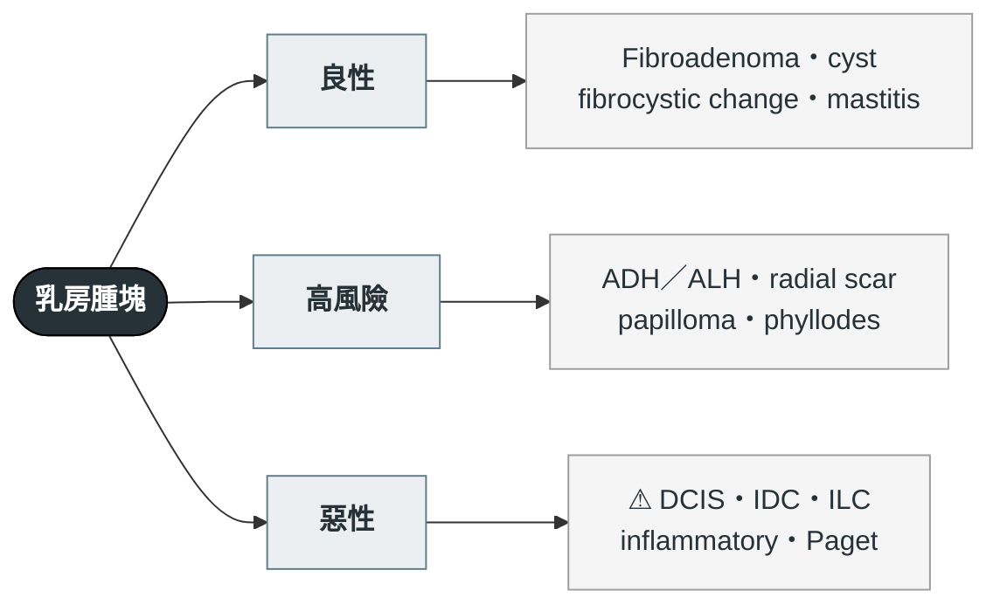

---
tags:
  - Clinical/Workup/Breast
  - breast
aliases: [Breast mass, 乳房腫塊, Breast lump, Breast mass evaluation, Nipple discharge, 乳頭分泌物]
created: 2026-09-18
updated: 2026-09-18
status: 可用
source: 外科離站考三年教材《乳房外科 113–115 年》（115-2 Q43、113-1 Q43、115-1 Q14、115-2 Q44、115-1 Q47、115-2 Q45、114-1 Q18、113-1 Q42、113-2 Q43）；ACR Appropriateness Criteria Palpable Breast Masses；BI-RADS 5th ed.
services:
  - BreastSurgery
cssclass: clinical-note
cant_miss:
  - "[[Breast cancer]]"
differential:
  - "[[Benign breast disease]]"
  - "[[Breast cancer]]"
  - "[[DCIS]]"
key_tests:
  - "[[Breast ultrasound]]"
  - "[[Mammography]]"
  - "[[Core needle biopsy]]"
---

# Breast mass ｜ 乳房腫塊 · Breast Mass

> [!abstract] 一句話總覽
> 每一個可觸及腫塊都走 **triple assessment**（觸診 → 影像 → 組織）；**年齡決定第一線影像**，影像決定要不要拿組織，組織才決定良惡。三者任一不一致 → 當可疑處理。

> [!danger] Can't-miss
> | 不能漏 | 一眼線索 | 立刻做什麼排除 |
> |---|---|---|
> | [[Breast cancer]] | 硬、固定、邊緣不清；皮膚凹陷／乳頭內縮；單側血性分泌物；>40 歲新腫塊 | 影像（依年齡）＋ core needle biopsy |
> | Inflammatory breast cancer | 紅腫熱、peau d'orange、抗生素無效 | 皮膚 punch biopsy，不要當 mastitis 追蹤 |

> [!tip] 到床邊的前 5 分鐘
> **問**：多久、有沒有變化、月經週期相關、家族史／BRCA、分泌物性質
> **看**：兩側對稱、皮膚、乳頭、腋下與鎖骨上淋巴結
> **做**：依年齡開第一線影像；不要直接跳 MRI 或 PET

---

## 第一步：年齡選影像

| 年齡 | 第一線 | 為什麼 |
|---|---|---|
| <30 歲 | **Ultrasound** | 乳腺緻密，mammography 被 masking 遮住、靈敏度低；避免不必要輻射 |
| 30–39 歲 | Ultrasound 為主，可加 mammography | 過渡年齡，兩者互補 |
| ≥40 歲 | **Mammography ＋ ultrasound** | 密度下降，攝影靈敏度上升；同時篩另一側 |
| 高風險（gBRCA、家族史） | 起步仍是 mammography ＋ US；MRI 用於篩檢與補充 | PET/CT **不**用於初始評估 |

> [!note] 篩檢 vs 診斷
> 篩檢（無症狀）才有年齡門檻：國健署 2025 起 40–74 歲每 2 年一次（舊制 45–69）。**摸到腫塊就是診斷性影像，沒有年齡限制。**

## 第二步：讀 BI-RADS → 決定要不要拿組織

| BI-RADS | 意思 | 下一步 |
|---|---|---|
| 0 | 評估未完成 | 補影像（加壓／放大／US／舊片比對），**不是切片也不是正常** |
| 1–2 | 陰性／良性 | 常規篩檢 |
| 3 | 可能良性（≤2%） | 6 個月短追蹤 |
| 4–5 | 可疑／高度可疑 | **Core needle biopsy** |
| 6 | 已證實惡性 | 進入治療 |

- 30 歲以下 US 典型 fibroadenoma（BI-RADS 3）→ 追蹤即可，不用加 mammography。
- 組織首選 **core needle biopsy**（可分 in situ／invasive、可做受體）；FNA 只適合囊腫或淋巴結。

## 第三步：影像特徵提示什麼

| 所見 | 想到 |
|---|---|
| MRI 動態曲線 **type III（快速上升後 washout）** | 最可疑的動力學型態 → 一定取組織 |
| 攝影不明顯、US 瀰漫浸潤、邊緣模糊、體積常被低估 | **Invasive lobular carcinoma**（E-cadherin 缺失、單列浸潤、不成團）→ MRI 評估範圍 |
| 群聚多形性微鈣化，無腫塊 | [[DCIS]] → stereotactic biopsy |
| 單側單管血性分泌物 | 最常見 **intraductal papilloma**；仍需排除 DCIS → 乳管攝影／切除 |

## 鑑別架構

→ 良性與高風險的處置分層見 [[Benign breast disease]]；確診惡性後的局部與全身治療見 [[Axillary management]]、[[Adjuvant therapy of breast cancer]]。

## 禁忌與陷阱

> [!danger] 絕對不可
> | 情境 | 絕對不可 | 為什麼 | 該做什麼 |
> |---|---|---|---|
> | 影像良性但觸診可疑 | 因影像陰性就放掉 | Triple assessment 任一不符即不算良性；ILC 攝影常陰性 | Core biopsy 或 MRI |
> | BI-RADS 0 | 告訴病人「正常」 | 0 是未完成，部分最後升到 4–5 | 安排補充影像 |
> | 紅腫的乳房 | 只給抗生素追蹤 | Inflammatory breast cancer 會被當 mastitis | 無效即 punch biopsy |

## 相關連結

- [[Benign breast disease]] — 切片良性之後怎麼分層
- [[DCIS]] — 微鈣化來源
- [[Breast Surgery]] — MOC
