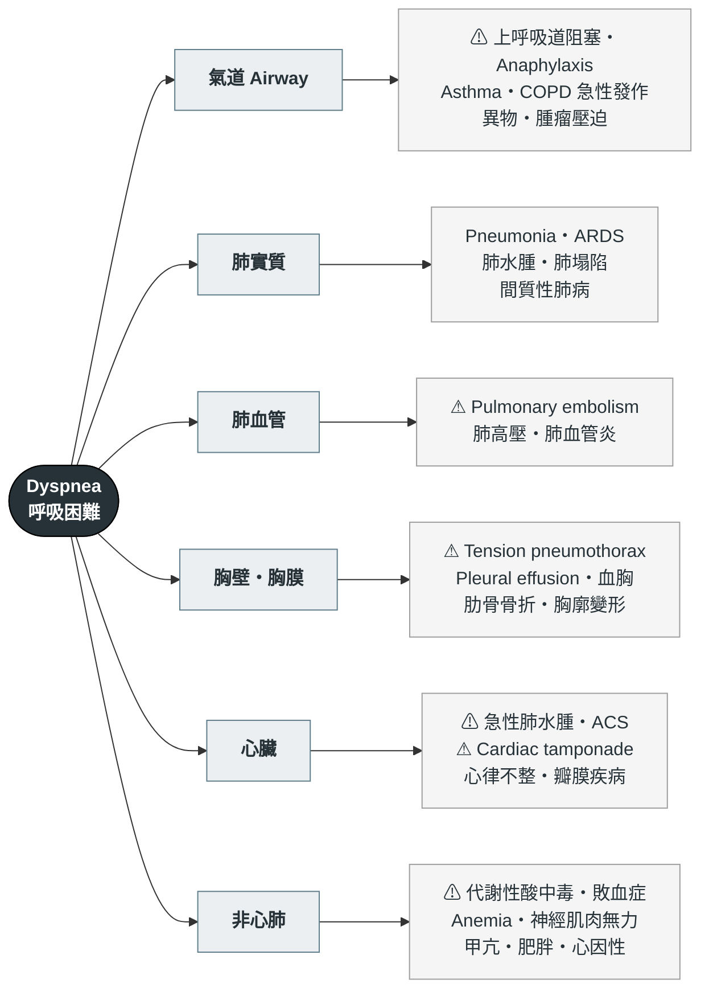

---
tags:
  - Med/Workup/Resp
  - Med/Workup/EM
  - dyspnea
  - 禁忌
aliases:
  - Dyspnea
  - 呼吸困難
  - 喘
  - Shortness of breath
  - SOB
  - Breathlessness
created: 2026-07-27
updated: 2026-07-27
status: 可用
source: 急診／胸腔內科呼吸困難鑑別框架；BTS 氧氣治療與 BTS/ICS acute hypercapnic respiratory failure 指引；ATLS 11；ESC 肺栓塞診斷流程
cssclass: clinical-note
cant_miss:
  - "[[Pneumothorax]]"
  - "[[Pulmonary embolism]]"
  - "[[Heart failure]]"
  - "[[Anaphylaxis]]"
  - "[[Asthma]]"
  - "[[COPD]]"
  - "[[ACS]]"
  - "[[Cardiac tamponade]]"
differential:
  - "[[Pneumonia]]"
  - "[[Pleural effusion]]"
  - "[[Anemia]]"
  - "[[Atrial fibrillation]]"
  - "[[ARDS]]"
  - "[[Empyema]]"
key_tests:
  - "[[Arterial blood gas]]"
  - "[[Chest X-ray]]"
  - "[[EKG ischemia]]"
  - "[[Troponin]]"
  - "[[Echocardiography]]"
  - "[[Pleural fluid analysis]]"
---

# Dyspnea ｜ 呼吸困難 · Shortness of Breath

> [!abstract] 一句話總覽
> 被 call「病人喘」的時候，整套流程只在回答三件事：**① 現在會不會死**（呼吸衰竭／[[Shock]]）、**② 是肺、是心、還是都不是**（血液／代謝／神經肌肉／心因性）、**③ 要不要現在插管**。
> 第三題是**臨床決定**，不是等血氣回來才決定的；第二題最常錯在「聽診乾淨就以為不是肺、也不是心」。

> [!danger] Can't-miss — 漏掉會死人
> 這一格永遠先讀。**沒排除完不准往下走。**
>
> | 不能漏 | 一眼線索 | 立刻做什麼 |
> |---|---|---|
> | Tension [[Pneumothorax]] 張力性氣胸 | **單側呼吸音消失＋叩診過度反響**、氣管偏向對側、頸靜脈怒張、血壓掉；有外傷、穿刺或正壓通氣史 | **臨床診斷，不等 CXR**：立刻針刺減壓（**成人第 5 肋間、腋中線稍前方，針長 ≥ 8 cm；小體型 5 cm**），再放 [[Chest tube drainage]] |
> | Massive [[Pulmonary embolism]] 大量肺栓塞 | 突發喘＋低血壓、心搏快、**肺部聽診乾淨**、單側下肢腫、近期手術／臥床／惡性腫瘤 | 不穩 → **床邊 [[Echocardiography]] 看右心室擴大**即可決策；穩定 → CT pulmonary angiography (CTPA) |
> | 急性肺水腫（[[Heart failure]]）／若已進展為 cardiogenic shock 見 [[Shock]] | 坐直才喘、冒冷汗、**粉紅泡沫痰**、兩側 crackles、S3、頸靜脈怒張 | 坐起＋氧氣＋**non-invasive ventilation (NIV)（限血壓撐得住者；已低血壓／心因性休克不上 NIV，改備插管與升壓藥）**；靜脈利尿劑；血壓夠才給硝酸鹽；EKG 找 [[ACS]] |
> | 上呼吸道阻塞／[[Anaphylaxis]] | **Stridor**、聲音改變、流口水吞不下、舌與嘴唇腫、蕁麻疹、暴露史 | **不要躺平、不要鎮靜**；anaphylaxis 立刻**大腿外側肌肉注射 adrenaline**；同時叫最有經驗的人備困難氣道 |
> | Severe [[Asthma]]／[[COPD]] 急性發作瀕臨呼吸衰竭 | **講不出完整句子**、輔助呼吸肌、**silent chest**、意識變差、PaCO₂ **由低轉「正常」** | 吸入型支氣管擴張劑＋全身性類固醇；**氧氣目標：氣喘 94–98%；只有 COPD／有 CO₂ 滯留風險者才是 88–92%**；NIV；**同步準備插管** |
> | [[ACS]]（anginal equivalent） | **糖尿病、老年、女性可以完全沒有胸痛**，只表現為喘、冒冷汗、噁心、突然「撐不住」 | 10 分鐘內 **EKG**（見 [[EKG ischemia]]）＋ [[Troponin]] |
> | 代謝性酸中毒的代償性喘 | **深而快**的呼吸（Kussmaul）、肺部乾淨、SpO₂ 正常；DKA、salicylate 中毒、敗血症、尿毒背景 | [[Arterial blood gas]] ＋ 血糖、ketone、lactate、anion gap——**治的是酸不是肺** |
>
> **還有三個會被「喘」蓋掉的**：[[Cardiac tamponade]]（頸靜脈怒張＋心音遠＋pulsus paradoxus，床邊超音波一眼）、[[Aortic dissection]]（可經由心包填塞或急性主動脈瓣逆流而以喘表現，完整對照見 [[Chest pain]]）、[[ARDS]]（有誘因＋頑固低血氧＋兩側浸潤，要同時排除純心因性）。

> [!tip] 到床邊的前 5 分鐘
> **看**：呼吸速率與型態、**SpO₂ 以及「在多少氧氣下」**、輔助呼吸肌與三凹、**能不能講完整句子**、tripod position（前傾撐手）、意識、頸靜脈、末梢與發紺、兩側胸廓起伏是否對稱。
> **問**：**什麼時候開始、多快**？**躺平會不會更喘**？有沒有胸痛、發燒、單側腿腫、近期手術或臥床？
> **做**：氧氣（**滴定，不是全開**）、監視器、EKG、[[Chest X-ray]]、[[Arterial blood gas]]、CBC、生化與 lactate、[[Troponin]]、BNP、床邊超音波。
> **判**：先答「**要不要現在插管**」，再回頭找病因。末梢冰冷花斑就當 [[Shock]] 處理。

---

## 鑑別架構圖

*⚠ ＝ can't-miss。*

> [!tip] 為什麼要把「肺」拆成四支
> 呼吸是四個獨立環節，**任何一環壞掉都表現成喘，但處置完全不同**：**氣道**通不通 → 打開它；**肺實質**能不能交換 → 治病灶；**肺血管**有沒有血流過去 → 抗凝或溶栓；**胸壁與胸膜**能不能膨脹 → 引流或減壓。第五支**心臟**是幫浦，第六支**非心肺**是「肺是好的，只是被要求做更多工」——最容易整組被忘掉，也是「聽診乾淨」的主要來源。

## 喘＋肺部聽診乾淨：最有價值的組合

> [!danger] 聽診正常只排除了一件事
> 喘得很明顯但胸部聽起來乾乾淨淨，不是「應該沒什麼事」，而是**你剛拿到了整場最有鑑別力的一條資訊**：呼吸音異常來自**氣道與肺泡裡有東西**（痰、水、氣、塌陷），聽診乾淨只排除了這一類。
> **完全不排除**：血管（[[Pulmonary embolism]]）、血液（[[Anemia]]、CO 中毒）、代謝（酸中毒代償）、幫浦（[[Cardiac tamponade]]、右向左分流）、神經肌肉（吸不進氣只會**聲音變小**）、早期 ARDS（**症狀先於影像與聽診**）。**心因性／過度換氣也在這一格，但排最後一名**。

| 喘但聽診乾淨 | 為什麼聽不到 | 抓它的動作 |
|---|---|---|
| [[Pulmonary embolism]] | 血流被擋住，空氣進出正常 | 機率分層 → CTPA；不穩看右心 |
| 代謝性酸中毒（DKA、salicylate、敗血症、尿毒） | 肺是**代償器官**，不是病灶 | [[Arterial blood gas]] ＋ anion gap ＋ 血糖／ketone／lactate |
| [[Anemia]] | 攜氧量不足，肺功能完好 | CBC——最便宜也最可逆的一個 |
| 早期 [[ARDS]] | 影像與聽診落後於低血氧 | 追 SpO₂／PaO₂ 趨勢與危險因子，不要等 CXR 變白 |
| 神經肌肉無力（重症肌無力、Guillain-Barré） | 通氣量不足，但氣道與肺泡是正常的 | **測肺活量與吸氣負壓**——不要看 SpO₂ |

> [!warning] 呼吸速率快而 SpO₂ 正常，是更危險的組合
> 那個高呼吸速率就是病人為了維持氧合所付的代價。**SpO₂ 正常只代表代償還沒失敗，不代表沒有病**——最常見的兩個答案是 PE 與代謝性酸中毒，都可以在 SpO₂ 99% 下把人帶走。

## 病史 History

### 第一層：多快發生的

| 發作速度 | 優先想 |
|---|---|
| **秒～分鐘** | Tension [[Pneumothorax]]、massive [[Pulmonary embolism]]、[[Anaphylaxis]]、異物吸入、flash pulmonary edema |
| **數小時～數天** | [[Pneumonia]]、[[Asthma]]／[[COPD]] 急性發作、[[Heart failure]] 惡化、[[Pleural effusion]]、[[Empyema]] |
| **數週～數月** | [[Anemia]]、間質性肺病、惡性積水、肺動脈高壓、神經肌肉疾病、甲狀腺功能異常、體能下降 |

**慢性喘的病人突然變喘，要當作急性事件重新查一次。** 最常見的是原病惡化，但氣胸、PE、感染、心律不整都會疊加在慢性病上，很容易被「他本來就喘」帶過去。

### 第二層：體位與時間——最便宜的定位工具

| 描述 | 名稱 | 定位價值 |
|---|---|---|
| 平躺加重，要墊高幾顆枕頭才睡得著 | **Orthopnea** | 左心衰竭最典型；但**橫膈無力（雙側橫膈麻痺）、大量腹水、嚴重肥胖也會**。要問「幾顆枕頭」並跟平常比 |
| 入睡後被喘醒、必須坐起來、要好一陣子才緩解 | **Paroxysmal nocturnal dyspnea (PND)** | 對左心衰竭的**特異性比 orthopnea 高**。氣喘的夜咳醒是另一回事——多半伴 wheeze，且支氣管擴張劑有效 |
| **坐直或站起來才喘，躺下反而好** | **Platypnea**（合併姿勢性血氧下降 ＝ orthodeoxia） | 罕見但指向極明確：**right-to-left shunt** —— patent foramen ovale (PFO)／atrial septal defect、hepatopulmonary syndrome、肺基底部動靜脈畸形。做**氣泡對比超音波** |
| 只有側躺某一邊才喘 | **Trepopnea** | 大量單側胸水、單側肺病灶、部分心衰 |

### 第三層：把鑑別拉開的關鍵問題

| 問題 | 若為「是」→ 想到 |
|---|---|
| 有沒有胸痛？痛跟呼吸有沒有關係？ | Pleuritic → [[Pulmonary embolism]]、[[Pneumothorax]]、胸膜炎；壓迫感 → [[ACS]]（見 [[Chest pain]]） |
| 有沒有發燒、咳嗽有痰？ | [[Pneumonia]]、[[Empyema]]（見 [[Fever]]） |
| **單側腿腫或痛？** | 深層靜脈栓塞 → [[Pulmonary embolism]]；兩側對稱腫脹見 [[Edema]] |
| 最近有沒有手術、骨折、長途飛行、臥床、荷爾蒙藥、惡性腫瘤？ | VTE 風險，直接改變 PE 的事前機率 |
| 體重最近有沒有變？幾天內增加好幾公斤？ | 容積過載 → [[Heart failure]]、腎功能惡化（見 [[Dialysis]]） |
| 有沒有喘鳴、過敏、接觸新東西或吃了什麼？ | [[Asthma]]、[[Anaphylaxis]] |
| 抽菸幾包年？有沒有粉塵、石綿、鳥類、黴的暴露？ | [[COPD]]、肺癌、[[CAD]]、間質性肺病、職業性氣喘 |
| **爬幾層樓會喘？跟三個月前比呢？** | 把「喘」量化成可追蹤的東西——比任何形容詞都有用 |

> [!warning] 這四題不問，整條路可能走錯
> **① 用藥史**——β-blocker（可誘發支氣管痙攣）、aspirin／NSAID、amiodarone 與化療藥（藥物性肺病）、**病人有沒有自己停掉利尿劑或吸入劑**、抗凝藥有沒有漏吃（見 [[DOAC]]）。
> **② 基礎心肺功能**——「他平常的 SpO₂ 是多少、平常走多遠會喘」：**沒有基準線就無法判斷現在是不是變差**，慢性 CO₂ 滯留者尤其如此。
> **③ 免疫狀態與住院史**——免疫低下者的肺炎可以不發燒，CXR 也可以乾淨。**④ 有沒有既有診斷被拿來解釋一切**——「他本來就有氣喘」是漏掉 PE 與心衰最常見的一句話。

## 理學檢查 PE

*喘的 PE 有一個順序：**先看**（呼吸做得辛不辛苦）、**再摸**（氣管與頸靜脈）、**才聽**。聽診放最後，因為它最不敏感。*

| 要做的 PE | 陽性代表 |
|---|---|
| **呼吸速率**（真的量滿一分鐘） | 正常 12–20；**qSOFA 用 ≥ 22，> 24 是明確警訊**。**由快轉慢而病人沒有變好 ＝ 快停了**，這是最被低估的惡化訊號 |
| 呼吸型態 | **Kussmaul**（深且快）→ 代謝性酸中毒；**Cheyne-Stokes** → 心衰或中樞病變；淺快 → 限制性生理或疼痛 |
| **能講幾個字** | 只能講單字或講不出話 ＝ 瀕臨呼吸衰竭，**不需要任何數據就能決定插管** |
| 輔助呼吸肌、三凹、**胸腹反向運動**、tripod position | 橫膈已經疲乏；paradoxical breathing 是插管訊號；**尊重他自己選的姿勢**，不要硬壓平 |
| **氣管位置** | 偏離患側 → tension [[Pneumothorax]]、大量胸水；偏向患側 → 肺塌陷、肺纖維化 |
| Wheeze vs **Stridor** | Wheeze 兩側 → [[Asthma]]／[[COPD]]，也可能是 **cardiac asthma**；單側固定 → 異物或腫瘤。**Stridor 以吸氣期為主 ＝ 上呼吸道，聲門或以上** |
| Crackles | 兩側基部細碎 → 肺水腫；乾燥如撕魔鬼氈（velcro）→ 間質性肺病；局部粗糙 → [[Pneumonia]] |
| 叩診 ＋ **呼吸音減弱或消失** | 過度反響 → 氣胸、嚴重氣腫；濁音 → [[Pleural effusion]]、consolidation。**Silent chest 不是好轉，是快沒氣了** |
| **頸靜脈壓** | 升高 → 右心負荷：[[Heart failure]]、tension pneumothorax、[[Cardiac tamponade]]、massive PE、[[Constrictive pericarditis]]；扁平＋喘 → 想低血容或純肺實質 |
| 下肢（**一定要掀被子看兩側**） | 兩側對稱凹陷性水腫 → 容積過載；**單側不對稱腫脹＋壓痛 → DVT → PE** |
| 心音（見 [[Cardiac auscultation]]） | S3 → 容積負荷；新雜音 → 急性瓣膜逆流（想 [[Infective endocarditis]]）；心音遠＋**pulsus paradoxus** → 填塞或嚴重氣喘；**loud P2** → 肺動脈高壓 |
| 末梢與皮膚 | 冰冷花斑 → [[Shock]]；中央性發紺 → 嚴重低血氧或右向左分流；蕁麻疹／血管性水腫 → [[Anaphylaxis]] |

![[assets/dyspnea-tension-pneumothorax-cxr.jpg|760]]
*A：左側 tension pneumothorax，患側胸腔過度透亮、肺塌陷且左橫膈下壓，氣管與縱膈被推向右側；B：緊急減壓與胸管置放後明顯改善。張力性氣胸仍是**臨床診斷，不能為了等 X 光延誤減壓**。Source: [Choi et al., *Medicina* 2023, Figure 2](https://pmc.ncbi.nlm.nih.gov/articles/PMC10535224/)（CC BY 4.0）。*

![[assets/pulmonary-edema-cardiogenic-vs-noncardiogenic.jpg|760]]
*與上圖對照：左側 cardiogenic pulmonary edema 呈中心性肺門周圍陰影、peribronchovascular cuffing 與 Kerley B lines；右側是較斑片、周邊的 noncardiogenic edema／ARDS。急性心因性肺水腫還要一起找心臟擴大、cephalization 與雙側胸水。Source: [Mihailescu et al., *Diagnostics* 2023, Figure 3](https://pmc.ncbi.nlm.nih.gov/articles/PMC10604083/)（CC BY 4.0）。*

## 第一批檢查 Initial Workup

| 時機 | 檢查 | 想回答的問題 |
|---|---|---|
| **立刻** | SpO₂（**連同給氧濃度一起記**） | 有沒有低血氧。**正常不排除呼吸衰竭**，也完全不反映 CO₂。與臨床不符或給氧後完全不動 → 改用 **co-oximetry** 找 CO 中毒、methemoglobinemia |
| 立刻 | [[Arterial blood gas]] | 是不是 CO₂ 累積型（type II）、酸鹼與代償方向、A-a gradient、乳酸。**判讀原理與計算全部寫在那一篇** |
| 立刻 | [[Chest X-ray]]（能站就站） | 氣胸、肺水腫、consolidation、胸水、心臟大小、縱膈腔 |
| 立刻 | EKG（見 [[EKG ischemia]]） | [[ACS]]、心律不整（[[Atrial fibrillation]]、[[Ventricular tachycardia]]）、右心負荷 |
| 立刻 | [[Troponin]] | ACS。**PE 與心衰也會升高**——升高代表預後差，不等於 ACS |
| 立刻 | CBC、生化、電解質、血糖、lactate | [[Anemia]]——最便宜也最可逆的一個；代謝性原因與器官灌流 |
| 依情境 | BNP / NT-proBNP | 「這個喘是不是心衰」。**低值的排除價值大於高值的確診價值**；肥胖會壓低，年齡、腎功能差、[[Atrial fibrillation]]、PE 都會拉高 |
| 依情境 | D-dimer | **只在臨床機率低／中時才有意義**（見下方） |
| 依情境 | CT pulmonary angiography (CTPA) | 確認或排除 [[Pulmonary embolism]] |
| 依情境 | 床邊超音波：[[Echocardiography]] ＋ 肺部 | 左心功能、瓣膜、**右心室擴大**、心包積液；B-lines（間質水腫）、lung sliding 消失（氣胸）、胸水定位 |
| 依情境 | 痰培養、呼吸道病毒檢驗 | [[Pneumonia]] |
| 依情境 | 胸水抽吸 → [[Pleural fluid analysis]] | 有胸水且性質不明 |
| 依情境 | 肺活量與吸氣負壓 | 懷疑神經肌肉無力——**這時候 SpO₂ 是最沒用的指標** |

> [!danger] D-dimer 的使用前提：先分層，再決定要不要驗
> D-dimer 是**排除工具**，全部價值來自「**事前機率低／中 ＋ 陰性**」。**先做臨床機率分層**：Wells（DVT 徵象、心搏過速、近期手術或臥床、VTE 病史、咳血、惡性腫瘤、**PE 是否為最可能的診斷**）；PERC 用在機率本來就極低、想連驗都省掉的族群。
> **高機率不驗 D-dimer，直接排 CTPA**——陰性也不能讓你放心，只換來延誤。**低機率也不能亂驗**：老年、懷孕、感染、術後、惡性腫瘤、住院本身都會讓它升高，一驗就被偽陽性帶著跑一連串影像。
> **≥ 50 歲**改用**年齡調整界值 ＝ 年齡 × 10 µg/L FEU** 可減少偽陽性——**僅限「非高機率」病人，且僅適用以 FEU（標準界值 500 µg/L）報告的試劑；報 DDU 的實驗室要先換算**。

![[assets/lung-us-a-lines.jpg|620]]
*正常含氣肺的 B-mode：胸膜線下方出現等距、水平重複的 A-lines；是否有 lung sliding 必須在即時影像觀察，單張靜態圖本身不能證明。*

![[assets/lung-us-b-lines.jpg|760]]
*B-lines 從胸膜線垂直延伸到畫面底部、會抹掉 A-lines；左為離散 B-lines，右為 confluent B-lines。多區、雙側 B-lines 支持間質／肺泡水分增加，但不是心因性肺水腫專屬。*

![[assets/lung-us-seashore-barcode.jpg|760]]
*M-mode：左側正常 lung sliding 形成 seashore sign；右側胸膜線上下皆為平行線的 barcode／stratosphere sign，表示該點沒有 sliding。它支持氣胸，但主支氣管插管、胸膜沾黏與 apnea 也可能沒有 sliding。三圖 Source: [Allinovi et al., *J Ultrason* 2021, Figures 3, 7, 6](https://pmc.ncbi.nlm.nih.gov/articles/PMC8439137/)（CC BY-NC-ND 4.0）。*

## 鑑別診斷

*致命那一層＝頂部的 can't-miss 表，不重複。以下是排除致命之後的鑑別。*

### 常見

| 疾病 | 支持線索 | 排除方法 |
|---|---|---|
| [[Pneumonia]] | 發燒、咳嗽有痰、局部 crackles | CXR、痰培養 |
| [[COPD]] exacerbation | 抽菸史、痰量或膿性改變、wheeze | 臨床；ABG 看 CO₂ 與 pH |
| [[Asthma]] exacerbation | 陣發、夜間或清晨、過敏史、**可逆** | 支氣管擴張劑反應、peak flow |
| [[Heart failure]] 慢性惡化 | Orthopnea、PND、水腫、體重增加 | BNP、CXR、[[Echocardiography]] |
| [[Anemia]] | 疲倦、蒼白、活動後喘、出血或月經量多 | CBC |
| [[Atrial fibrillation]] 快速心室反應 | 心悸、脈搏不規則、突然變喘 | EKG |
| [[Pleural effusion]]／[[Empyema]] | 單側呼吸音減弱、叩診濁音 | CXR、超音波、[[Pleural fluid analysis]] |
| 肺塌陷、痰栓 | 臥床、術後、咳不出來、單側呼吸音減弱 | CXR；先積極拍痰與抽痰 |
| 焦慮／過度換氣 | 手腳與口周發麻、嘆息式呼吸、年輕、聽診乾淨 | **排除性診斷**——先排完致命再說 |

### 少見但要想到

| 疾病 | 支持線索 | 排除方法 |
|---|---|---|
| 神經肌肉無力（myasthenia gravis、Guillain-Barré、ALS） | 平躺更喘、聲音變小、吞嚥困難、四肢無力 | **肺活量與吸氣負壓**——不要看 SpO₂ |
| 間質性肺病／肺纖維化 | 長期漸進、velcro crackles、杵狀指 | HRCT、肺功能 |
| 肺動脈高壓 | 用力時暈厥、loud P2、右心衰徵象 | Echo → 右心導管 |
| 限制型生理：[[Constrictive pericarditis]]／[[Restrictive cardiomyopathy]]／[[HCM]] | 頸靜脈怒張但**肺乾淨**、腹水多於下肢水腫；HCM 則是用力時喘或昏厥＋動態性雜音 | Echo、CT／MRI |
| [[Infective endocarditis]] 造成急性瓣膜逆流 | 發燒 ＋ 新雜音 ＋ 突發肺水腫 | 血液培養 ×3、echo |
| CO 中毒、methemoglobinemia | SpO₂ 與臨床不符、給氧無反應、燃燒或用藥暴露 | **Co-oximetry** |
| 甲狀腺功能亢進／甲狀腺風暴 | 心搏極快、體重減輕、顫抖、[[Atrial fibrillation]] | TSH、free T4 |
| 右向左分流（PFO、hepatopulmonary syndrome） | **Platypnea-orthodeoxia**、肝硬化 | 氣泡對比超音波 |
| 惡性腫瘤相關（惡性積水、淋巴管轉移、氣道壓迫） | 腫瘤病史、反覆抽水、體重減輕 | 影像 ＋ 胸水分析 |

> [!warning] 喘的病人變躁動或變嗜睡，第一個想的不是精神狀態
> **躁動 ＝ 缺氧，直到證明不是。嗜睡 ＝ CO₂ 累積，直到證明不是。** 正確反應是**檢查氧合與通氣、準備氣道**，不是叫鎮靜劑——鎮靜會直接拿掉病人最後的呼吸驅動。
> 氧合與通氣都確認沒問題之後，才輪到 [[Delirium]]（感染、藥物、電解質）與代謝性原因（低血糖、低血鈉、[[Hypercalcemia]]——腫瘤或 [[Multiple Myeloma]] 病人要驗校正鈣值）。

## 處置分流 Disposition

> [!danger] 插管是臨床決定，不是數字決定
> 「等血氣結果再決定插不插管」是錯的：血氣描述的是**剛剛那幾分鐘**，等報告回來的那段時間病人可能已經停止呼吸。
> **看到這些就插，不要等任何數據**：意識變差到保護不住呼吸道、**胸腹反向呼吸**、只能講單字或講不出話、**呼吸速率由快轉慢而病人沒有變好**、給了最大支持仍持續惡化、心跳或血壓開始掉、上呼吸道阻塞正在進展。
> 反過來也成立：**PaCO₂ 很高但意識清楚、講得出話、對 NIV 有反應的慢性 CO₂ 滯留者，不該只因為一個數字就插管**——同一個 PaCO₂ 在急性重度氣喘是紅色警報，在慢性 COPD 可能是他的日常。**要比的是趨勢與病人，不是絕對值。**

| 支持方式 | 最適合 | 不適合／要小心 |
|---|---|---|
| 鼻導管／面罩 | 單純低血氧、清醒、能自理 | **一般急症病人目標 94–98%；只有 COPD 與有 CO₂ 滯留風險者才是 88–92%**，都不是開到 100% |
| High-flow nasal cannula (HFNC) | **低血氧型（type I）呼吸衰竭**、肺炎；流量高又能講話進食 | 對排 CO₂ 的幫助有限；**用了就要訂下明確的再評估時間**，不能拿它拖延插管 |
| NIV — CPAP | **急性心因性肺水腫**（撐開肺泡、同時降前後負荷） | 低血壓／心因性休克、意識不清、嘔吐、臉部外傷 |
| NIV — bilevel（BiPAP） | **COPD 急性發作合併高碳酸血症與呼吸性酸中毒**（**經初步治療＋控制性給氧後 pH 仍 < 7.35 且 PaCO₂ > 6.5 kPa ≈ 49 mmHg**）、肥胖低通氣。**pH < 7.25 ＝ 重度，NIV 失敗率高，同步請 ICU 評估插管** | 同上，再加：氣道保護不住、上呼吸道阻塞、大量分泌物、**未引流的氣胸** |
| 插管與機械通氣 | 上述任一臨床指標 | 氣喘與 COPD 插管後注意 **auto-PEEP**；可接受較高的 CO₂（permissive hypercapnia）換取較低的氣道壓 |

| 去向 | 條件 |
|---|---|
| **立即急救／備插管** | 意識變差、講不出話、胸腹反向呼吸、給氧後 SpO₂ 仍低、血壓掉、stridor、疑似張力性氣胸 |
| ICU | 需要 NIV 或 HFNC 但反應不明確、需升壓藥、massive PE、瀕臨呼吸衰竭的氣喘、pH 持續下降、需頻繁追血氣 |
| 住院 | 需要氧氣才能維持、新診斷的心衰或肺炎且無法口服、氣胸放了胸管、原因未明但**活動時會掉血氧** |
| 門診追蹤／回家 | 室內空氣下 SpO₂ 正常**且走動後不掉**、原因明確且可口服治療、有人陪伴、能回診 |

> [!tip] 回家前讓他走一段路再量一次
> 靜態坐著量的 SpO₂ 正常，不代表他回家爬得上樓梯。**走動後血氧**是門診最容易做也最常被跳過的動作——早期間質性肺病、PE、貧血、心衰都可能只在活動時才掉。

## 禁忌與陷阱

> [!danger] 絕對不可
> | 情境 | 絕對不可 | 為什麼 | 該做什麼 |
> |---|---|---|---|
> | [[COPD]] 急性發作、慢性 CO₂ 滯留者 | 為了追 SpO₂ 100% 而給高濃度氧 | V/Q mismatch 惡化與 Haldane effect 使 CO₂ 上升 → 呼吸性酸中毒、CO₂ narcosis；高濃度氧與較高死亡率相關 | **滴定到 88–92%**；持續惡化就上 NIV，而**不是把氧氣關掉** |
> | 疑似 tension [[Pneumothorax]] 尚未減壓 | 直接上正壓（NIV 或插管後 bagging） | 正壓把更多氣體打進胸腔，張力瞬間惡化、靜脈回流中斷 → 心跳停止 | **先減壓再給正壓**；臨床懷疑就動手，不等 CXR |
> | 疑似上呼吸道阻塞（stridor、會厭炎、血管性水腫、異物） | 讓病人躺平、先給鎮靜安撫、或貿然用壓舌板檢查咽喉 | 他自己維持的姿勢與呼吸驅動就是最後的代償，一移除就完全阻塞 | **讓他保持自己選的坐姿**；叫最有經驗的人，備困難氣道與外科氣道 |
> | 臨床高度懷疑 [[Pulmonary embolism]] | 拿 D-dimer 當排除工具 | 高機率下陰性不足以排除，只換來延誤 | **直接排 CTPA**；不穩就床邊超音波看右心，不要把不穩的病人推去做影像 |
> | 高機率 PE、等影像期間 | 因為「還沒確診」而完全不給抗凝 | 等待期間栓塞可能繼續形成 | 出血風險可接受就**先開始抗凝**，影像回來再調整（見 [[DOAC]]） |
> | 急性肺水腫 | 「先補一點水看看」而給大量輸液 | 已經是壓力或容積過載，輸液直接讓肺更濕 | 坐起、氧氣、NIV、靜脈利尿劑；血壓夠才加硝酸鹽；無尿且利尿劑無效考慮 [[Dialysis]] |
> | 喘而躁動的病人 | 為了讓他配合檢查而給鎮靜劑 | 躁動多半是缺氧的表現，鎮靜會拿掉呼吸驅動 | 先處理氧合與通氣；真需要鎮靜就在**能立刻插管的條件下**做 |
> | 重度氣喘而 PaCO₂「正常」 | 因為數字正常而放心觀察 | 嚴重氣喘本該過度換氣；PaCO₂ 從低轉正常代表呼吸肌已經撐不住 | 視為**即將呼吸衰竭**，升級治療並備插管 |
> | [[Anaphylaxis]] | 把抗組織胺或類固醇當主要治療、或延後 adrenaline | 延誤 adrenaline 是死亡的主因 | **大腿外側肌肉注射 adrenaline**，其餘皆為輔助 |
> | 大量胸水引流 | 一次抽到「病人舒服為止」而不設上限 | Re-expansion pulmonary edema | **單次引流 < 1.5 L、分次進行**，過程中出現胸痛或劇咳即停（見 [[Chest tube drainage]]） |

> [!warning] 常見錯誤
> - **沒有真的量呼吸速率**——它是最能預測惡化的 vital sign，也是最常被照抄成「16」的一個。
> - **SpO₂ 正常就放心**——PE、代謝性酸中毒、貧血、早期呼吸肌疲乏都可以 SpO₂ 正常；而 CO₂ 累積，SpO₂ **永遠不會反映**。
> - **CXR 正常就排除**——PE、氣喘、上呼吸道阻塞、貧血、酸中毒、早期肺水腫的 CXR 都可以是乾淨的。

## 相關連結

- [[Shock]] — 末梢冰冷時
- [[Arterial blood gas]] — 酸鹼與氧合
- [[Chest pain]] — ACS／PE／dissection
- [[Heart failure]] · [[Pneumonia]] · [[Empyema]] — 最常見的答案
- [[Echocardiography]] · [[Chest tube drainage]] — 分流與引流
- [[Edema]] · [[Fever]] — 常同時出現
- [[禁忌選項]] — 上表已收錄
