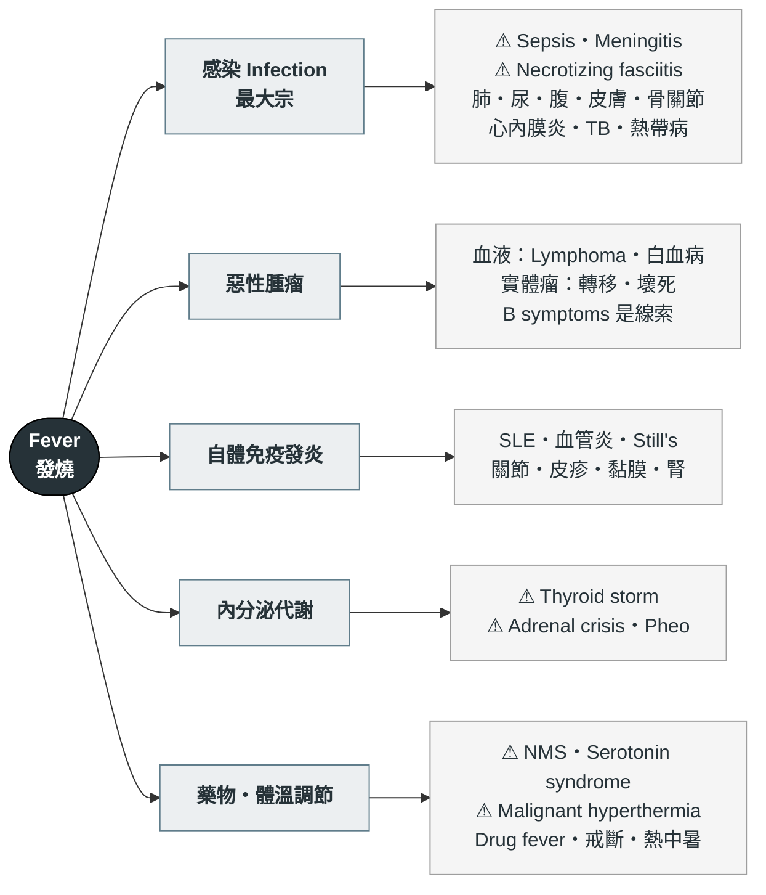

---
tags:
  - Med/Workup/ID
  - Med/Workup/EM
  - fever
  - 禁忌
aliases:
  - Fever
  - 發燒
  - Pyrexia
  - FUO
  - 不明熱
created: 2026-07-25
updated: 2026-07-25
status: 可用
source: 標準感染科／急診鑑別框架；FUO 定義（Petersdorf 1961 及現代修訂）、febrile neutropenia 門檻（IDSA 2010 / NCCN）、fever vs hyperthermia 機制均已查證（見文中）。案例來源：內科 OSCE 考古多題、教學查房手繪架構
cssclass: clinical-note
cant_miss:
  - "[[Sepsis]]"
  - "[[Febrile neutropenia]]"
  - "[[Meningitis]]"
  - "[[Necrotizing fasciitis]]"
  - "[[Thyroid storm]]"
  - "[[Adrenal crisis]]"
  - "[[Neuroleptic malignant syndrome]]"
differential:
  - "[[Pneumonia]]"
  - "[[Acute pyelonephritis]]"
  - "[[Infective endocarditis]]"
  - "[[Tuberculosis]]"
  - "[[SLE]]"
  - "[[Lymphoma]]"
  - "[[AML]]"
  - "[[Hyperthyroidism]]"
key_tests:
  - "[[Blood culture]]"
  - "[[CBC with differential]]"
  - "[[Urinalysis]]"
  - "[[Chest X-ray]]"
  - "[[Lumbar puncture]]"
  - "[[Procalcitonin]]"
---

# Fever ｜ 發燒 · Pyrexia

> [!abstract] 一句話總覽
> 發燒本身不是診斷，是**「身體某處正在發生事情」的訊號**。整套流程只在做三件事：**① 病人現在穩不穩**（敗血症？）、**② 這是感染還是其他四類**、**③ 如果是感染，感染源在哪**。第三題答不出來的時候，八成是理學檢查沒做完，不是檢查開不夠。

> [!danger] Can't-miss — 漏掉會死人
> 這一格永遠先讀。**沒排除完不准往下走。**
>
> | 不能漏 | 一眼線索 | 立刻做什麼 |
> |---|---|---|
> | [[Sepsis]] 敗血症／敗血性休克 | 低血壓、心搏快、呼吸快、意識改變、末梢冰冷 | **血液培養 → 立刻經驗性抗生素 ＋ 輸液**；驗 **lactate** |
> | [[Febrile neutropenia]] 嗜中性球低下發燒 | 近期化療、免疫抑制劑 | **ANC 是急件**；發燒＋ANC 低 → **1 小時內**給廣效抗生素，不等培養結果 |
> | [[Meningitis]] 腦膜炎／腦炎 | 頭痛、頸僵、意識改變、畏光、癲癇 | 腦膜刺激徵 → **[[Lumbar puncture]]**；懷疑細菌性**先給抗生素再做 LP** |
> | [[Necrotizing fasciitis]] 壞死性筋膜炎 | **痛得不成比例**、皮膚張力大／變色、捻髮感、進展飛快 | 外科急會診清創——**影像不能延誤手術** |
> | [[Thyroid storm]] 甲狀腺風暴 | 高燒＋心搏極快／房顫＋躁動＋腹瀉 | TSH／free T4；β-blocker ＋ 抗甲狀腺藥 |
> | [[Adrenal crisis]] 腎上腺危象 | 低血壓對輸液無反應、低血鈉、高血鉀、有類固醇使用史 | **懷疑就先給 hydrocortisone**，不等抽血結果 |
> | [[Neuroleptic malignant syndrome]] 等藥物性高溫 | 肌肉僵硬、CK 飆高、近期用抗精神病藥／停巴金森藥 | **停藥 ＋ 積極物理降溫**——退燒藥無效 |
>
> **旅遊史陽性再加一條**：[[Malaria]]。惡性瘧可在數日內致命，**發燒＋近期到過流行區＝立刻做血液抹片**。

> [!tip] 到床邊的前 5 分鐘
> **看**：完整 vital signs（**血壓、心跳、呼吸速率、SpO₂、體溫**）、意識、末梢灌流、有沒有 rash。
> **問**：燒多久？**有沒有寒顫發抖到牙齒打顫**？最近有沒有化療／新加的藥？有沒有旅遊或接觸？
> **做**：血液培養（**抗生素前**）、CBC/DC、CRP、生化、lactate、U/A、CXR。
> **判**：先答「穩不穩」——不穩就先處理循環，不要卡在找病因。

---

## 鑑別架構圖

*先看骨架再看細節。這張圖回答「可能性從哪幾個分支長出來」，不是「先做什麼再做什麼」。⚠ ＝ can't-miss。*

> [!tip] 為什麼是這五支
> 經典的不明熱四分類是 **感染／惡性／非感染性發炎／其他**。這裡把「其他」拆成 **內分泌** 與 **藥物・體溫調節** 兩支，理由是它們的**處置邏輯完全不同**：
> 前四支是「找病因、治病因」；**第五支多半不是真的發燒，是高溫**——退燒藥無效，錯把它當感染會拖死人。
>
> 記憶順序建議 **感染 → 藥物 → 其餘三支**：感染機率最高，藥物最容易被整組忘掉（尤其住院中新加的藥）。

## 發燒 vs 高溫：全篇最關鍵的分岔

| | **Fever 發燒** | **Hyperthermia 高溫** |
|---|---|---|
| 機制 | 細胞激素 → PGE₂ → **下視丘設定點被調高**；身體「認為」該這麼熱 | **設定點正常**，但產熱 > 散熱 |
| 典型病因 | 感染、發炎、腫瘤 | NMS、serotonin syndrome、malignant hyperthermia、熱中暑、甲狀腺風暴 |
| 病人主觀 | 覺得**冷**、會發抖（身體想升溫到新設定點） | 覺得**熱** |
| **退燒藥** | **有效** | **完全無效** |
| 正確處置 | 治病因；退燒藥主要是為了舒適 | **物理降溫 ＋ 移除病因 ＋ 特異解藥**（如 MH 用 dantrolene） |
| 溫度上限 | 少超過 41°C（設定點有天花板） | **可超過 41°C**，沒有上限 |

> [!danger] 為什麼一定要先分這兩個
> 高溫的病人給 acetaminophen **一點用都沒有**——問題不在設定點。你以為「有給退燒藥了」，實際上溫度持續往上、肌肉持續產熱，最後走向橫紋肌溶解、急性腎損傷、DIC。
> **床邊分辨的捷徑**：病人**肌肉僵硬**（NMS、MH）或**環境高溫下無汗**（熱中暑）→ 想高溫，不要只開退燒藥。

![[assets/fever-pathway.jpg|720]]
*LPS 等外源性 pyrogen 先刺激白血球，經 IL-1／IL-6／IFN-γ／TNF 促成 PGE₂，再作用於下視丘把設定點上移；NSAID／acetaminophen 的作用點在 PGE₂ 上游的 COX。這張圖畫的是 fever；hyperthermia 的設定點不變，問題在產熱過多或散熱失敗。Source: [OpenStax Microbiology, Figure 17.26](https://openstax.org/books/microbiology/pages/17-5-inflammation-and-fever)（CC BY-NC-SA 4.0）。*

## 病史 History

*發燒的病史有兩層：第一層問「發燒本身」，第二層**從頭到腳掃一遍找感染源**。第二層才是拿到診斷的地方。*

### 第一層：發燒本身

| 問題                             | 若為「是」→ 想到                                      |
| ------------------------------ | ---------------------------------------------- |
| **有沒有寒顫到發抖、牙齒打顫？**（true rigor） | 強烈提示**菌血症**——尤其尿路、膽道、導管來源                      |
| 燒多久了？                          | 急性（<1 週）以感染為主；**>3 週且查不出來 → 進入不明熱思路**（見下方）     |
| 一天燒幾次？有時間規律嗎？                  | 發燒型態的鑑別價值有限，別過度解讀；例外是瘧疾的週期性發作                  |
| 退燒藥有沒有效？                       | **完全無效** → 想 hyperthermia（見上表）                 |
| 有沒有體重減輕、夜間盜汗？                  | **B symptoms** → [[Lymphoma]]、[[Tuberculosis]] |

### 第二層：從頭到腳找感染源

| 問什麼 | 指向 |
|---|---|
| 頭痛、頸部僵硬、畏光、意識改變 | [[Meningitis]] |
| 鼻塞、臉部悶痛、牙痛 | 鼻竇炎、牙源性感染 |
| 咳嗽、有痰、喘、胸痛 | [[Pneumonia]]、[[Empyema]] |
| 腹痛、腹瀉、黃疸 | 腹腔內感染、[[Acute cholangitis]] |
| **頻尿、尿痛、腰痛** | [[Acute pyelonephritis]]、[[UTI]] |
| **皮膚傷口、紅腫、褥瘡、蟲咬** | 蜂窩性組織炎、[[Necrotizing fasciitis]]、[[Scrub typhus]] |
| 關節紅腫熱痛、無法負重 | 化膿性關節炎、骨髓炎 |
| **肛門周圍痛**（病人常不好意思說） | 肛周膿瘍——免疫低下者特別要問 |

### 第三層：不能漏的背景

> [!warning] 這五題不問，整條路可能走錯
> **① 用藥史**——尤其**最近 2–4 週新加的藥**（drug fever）、化療、類固醇、生物製劑、抗精神病藥。
> **② 免疫狀態**——HIV、糖尿病、肝硬化、脾切除、長期類固醇。免疫低下者的感染**症狀很不典型，甚至燒不起來**。
> **③ TOCC**——旅遊（瘧疾、登革熱）、職業、接觸（人與**動物**都要問）、群聚。
> **④ 體內外植入物**——人工瓣膜／關節、中心靜脈導管、導尿管、支架。有植入物就要想 [[Infective endocarditis]] 與導管相關感染。
> **⑤ 手術與住院史**——術後發燒有自己的時序邏輯；住院 >3 天才開始燒屬院內感染路線。

> [!tip] 女性病患一定要問月經與懷孕
> 懷孕會改變用藥與影像的選擇；經期異常則可能是血液疾病或自體免疫的線索。

## 理學檢查 PE

*發燒的 PE 原則只有一句：**找感染源要從頭摸到腳，包含你不好意思看的地方。** 感染源找不到，多半是漏了皮膚、口腔、關節、會陰這四處。*

| 部位 | 要找什麼 |
|---|---|
| **皮膚（全身，含背側）** | Rash（**壓得退嗎**）、**eschar 焦痂**、傷口、褥瘡、蜂窩組織炎、針孔、栓塞性病灶 |
| 頭頸 | 結膜蒼白／出血點、鞏膜黃疸、口腔 **thrush／齲齒**、鼻竇壓痛 |
| **腦膜刺激徵** | 頸部僵硬、**Kernig sign**、**Brudzinski sign** |
| **淋巴結** | **頸部 → 腋下 → 鼠蹊三處都要摸**；記錄大小、硬度、可動性、有無壓痛 |
| 甲狀腺 | Goiter、壓痛 |
| 心 | **新出現的雜音** → [[Infective endocarditis]]；心包摩擦音 |
| 肺 | Crackles、呼吸音減弱、叩診濁音 |
| 腹 | 肝脾腫大、局部壓痛、腹膜炎徵象 |
| **CV angle knocking** | 陽性 → [[Acute pyelonephritis]] |
| 關節 | 紅腫熱痛、活動範圍受限、關節積液 |
| **會陰／肛周・直腸** | 肛周膿瘍、攝護腺壓痛 |
| 導管與植入物 | 穿刺處紅腫、分泌物 |

> [!tip] 三個容易漏掉、但常常就是答案的地方
> **① 背側皮膚**——不翻身就看不到褥瘡與皮疹。
> **② 淋巴結三處全摸**——只摸頸部會漏掉鼠蹊。
> **③ 主動去聽新雜音**——不特別去找就只會記錄「no murmur」，然後漏掉心內膜炎。

![[assets/scrub-typhus-eschar.jpg|560]]
*恙蟲病典型 eschar：中央黑色壞死焦痂，外圍有紅暈。臨床上要主動翻找腋下、腹股溝、腰際與乳房下等被衣物遮住的皺褶。Source: [CDC Public Health Image Library, PHIL 23438](https://wwwn.cdc.gov/phil/Details.aspx?pid=23438)（public domain）。*

![[assets/kernig-brudzinski-signs.jpg|720]]
*由左至右：Kernig sign（髖、膝先屈曲 90°，伸膝時疼痛／阻力）、Brudzinski 對側腿徵、Brudzinski neck sign（被動屈頸後髖膝反射性屈曲）。兩徵敏感度低，陰性不能排除腦膜炎。Source: [Mehndiratta et al., *Ann Indian Acad Neurol* 2012, Figure 1](https://pmc.ncbi.nlm.nih.gov/articles/PMC3548367/)。*

## 第一批檢查 Initial Workup

| 時機 | 檢查 | 想回答的問題 |
|---|---|---|
| **立刻** | **[[Blood culture]] ×2**（不同部位、**給抗生素前**） | 有無菌血症、菌種與敏感性 |
| 立刻 | [[CBC with differential]] | 白血球高低、**left shift**、**ANC**、**blast**、cytopenia |
| 立刻 | CRP、ESR | 發炎程度與趨勢 |
| 立刻 | 生化：肝腎功能、電解質、**lactate** | 器官灌流與功能 |
| 立刻 | [[Urinalysis]] ＋ 尿培養 | 泌尿道感染 |
| 立刻 | [[Chest X-ray]] | 肺炎、胸水、粟粒狀病灶 |
| 依情境 | [[Procalcitonin]] | 輔助判斷細菌性感染（**不能單獨決定給不給抗生素**） |
| 依情境 | 痰培養＋**抗酸染色** | [[Pneumonia]]、[[Tuberculosis]] |
| 依情境 | [[Lumbar puncture]] | 有腦膜刺激徵或意識改變 |
| 依情境 | TSH、free T4 | 心搏過快、顫抖、體重減輕、甲狀腺腫 |
| 依情境 | 自體免疫標記（ANA、RF、anti-dsDNA、C3/C4、ENA） | 有關節、皮疹、黏膜、腎臟表現 |
| 依情境 | 熱帶病：登革熱 NS1／血清學、**瘧疾血液抹片**、恙蟲病血清學 | 有旅遊或戶外接觸史 |
| 依情境 | HIV 篩檢 | 反覆或伺機性感染、不典型表現 |
| 依情境 | 腹部超音波／CT | 腹腔內膿瘍、肝膽病灶、淋巴結腫大 |

> [!danger] 抗生素之前一定要先抽培養
> 抗生素一給下去，培養陽性率立刻掉。**但「先抽培養」不能變成延遲抗生素的理由**——敗血症與嗜中性球低下發燒的時間窗以小時計。
> 正確順序：**抽培養 →（同一個動作內）立刻給抗生素**，不是「等培養結果再說」。

> [!warning] 沒有痰也要試著咳
> 病人說「沒有痰」不等於採不到檢體。誘咳、深部抽吸都可能拿到有用的東西——尤其懷疑結核時。

> [!tip] 影像沒有 finding 不代表沒有感染源
> CXR 正常的肺炎、早期腹腔膿瘍、心內膜炎的贅生物，第一次影像都可能是乾淨的。
> 臨床高度懷疑而影像陰性 → **重複影像或換模態**，不要因為第一張正常就放棄整個分支。

## 鑑別診斷

*依「致命 → 常見 → 少見但要想到」分層。頂部的 can't-miss 是這張表第一層的濃縮。*

### 致命（can't-miss）

| 疾病 | 支持線索 | 排除方法 |
|---|---|---|
| [[Sepsis]] | 低血壓、意識改變、呼吸快、末梢差 | Lactate、血液培養、器官功能 |
| [[Febrile neutropenia]] | 近期化療、口腔潰瘍 | **CBC/DC 算 ANC** |
| [[Meningitis]] | 頭痛、頸僵、意識改變 | 腦膜刺激徵 → [[Lumbar puncture]] |
| [[Necrotizing fasciitis]] | 痛不成比例、皮膚張力／變色、捻髮感 | 外科急會診（不等影像） |
| [[Thyroid storm]] | 心搏極快、躁動、腹瀉、goiter | TSH、free T4 |
| [[Adrenal crisis]] | 對輸液無反應的低血壓、低鈉高鉀 | 先給 hydrocortisone，再驗 cortisol |
| [[Neuroleptic malignant syndrome]] | 肌肉僵硬、CK 高、抗精神病藥 | 停藥、CK、物理降溫 |
| [[Malaria]] | 旅遊史、週期性高燒寒顫 | **血液抹片** |

### 常見

| 疾病 | 支持線索 | 排除方法 |
|---|---|---|
| [[Pneumonia]] | 咳嗽有痰、crackles、喘 | CXR、痰培養 |
| [[Acute pyelonephritis]] | 頻尿尿痛、CV angle 敲痛 | U/A、尿培養 |
| [[Cellulitis]] | 局部紅腫熱痛、界線不清 | 臨床 ± 影像 |
| [[Influenza]] ／病毒感染 | 全身痠痛、上呼吸道症狀、群聚 | 快篩 |
| [[Acute cholangitis]] | Charcot 三徵 | 膽紅素、ALP、腹超 |
| [[Dengue fever]] | 眼窩痛、骨頭痛、皮疹、流行區旅遊 | NS1、血清學；**注意血小板與出血** |
| Drug fever | 新加藥物 2–4 週內、**病人看起來沒那麼病**、嗜酸性球可能升高 | **停藥試驗**——停藥後 72 小時內退燒 |

### 少見但要想到

| 疾病                           | 支持線索                            | 排除方法                                   |
| ---------------------------- | ------------------------------- | -------------------------------------- |
| [[Infective endocarditis]]   | 新雜音、栓塞現象、靜脈注射藥物、人工瓣膜            | 血液培養 ×3、心臟超音波                          |
| [[Tuberculosis]]             | 久咳、盜汗、體重減輕、接觸史                  | 痰抗酸染色／培養、CXR                           |
| [[Lymphoma]]                 | 無痛性淋巴結腫大、B symptoms、肝脾腫大        | 淋巴結**切片**、CT                           |
| [[AML]] ／急性白血病               | 貧血、出血、易感染，抹片見 **blast**         | CBC/DC、骨髓檢查                            |
| [[SLE]]                      | 關節痛、頰部紅斑、光敏感、口腔潰瘍、蛋白尿           | ANA、anti-dsDNA、C3/C4                   |
| Still's disease              | 高燒＋一過性鮭魚色皮疹＋關節炎，**ferritin 極高** | 排除性診斷                                  |
| 巨細胞動脈炎等血管炎                   | 老年、頭痛、顳動脈壓痛、視力變化                | ESR、顳動脈切片                              |
| [[Scrub typhus]] 恙蟲病         | 戶外草叢接觸、**eschar**               | 血清學；doxycycline 反應快                    |
| [[Cryptococcal meningitis]]  | 亞急性頭痛、免疫低下／HIV                  | CSF **india ink**、cryptococcal antigen |
| 深部膿瘍（肝、腎周、肛周、腰肌）             | 定位不明的持續發燒、局部悶痛                  | 腹部 CT                                  |
| 藥物性高溫（serotonin syndrome、MH） | 肌陣攣／僵硬、自律神經不穩、用藥史               | 臨床 ＋ CK；停藥與降溫                          |

> [!note] 燒超過三週查不出來 → 不明熱 FUO
> **定義**：體溫 **> 38.3°C**、多次記錄、持續 **> 3 週**，且經適當檢查（門診 3 次或住院 3 天）仍無診斷。
> **四大類**：classic、nosocomial（住院時無燒、住院 >3 天後才燒）、immune-deficient、HIV-related。
> **病因四分類**：感染、惡性、非感染性發炎、其他。
> 進到不明熱之後最有價值的動作是**回頭重問病史、重做理學檢查**，其次才是加做影像（FDG-PET/CT）與切片。

## 處置分流 Disposition

| 去向 | 條件 |
|---|---|
| **立即急救** | 敗血性休克、意識改變、呼吸衰竭、疑似壞死性筋膜炎、體溫 > 41°C 的高溫 |
| ICU | 需升壓藥、器官衰竭、需密切監測的高溫或代謝危象 |
| 住院 | **嗜中性球低下發燒（一律住院）**、免疫低下、無法口服、需靜脈抗生素、診斷未明但看起來病態 |
| 門診追蹤 | Vital signs 穩定、來源明確且可口服治療、免疫正常、有人陪伴且能回診 |

> [!danger] 這三種病人「看起來還好」也要住院
> **① 嗜中性球低下**——沒有白血球就沒有發炎反應，等他看起來病態就太遲了。
> **② 老年人與糖尿病患**——可能**體溫燒不上來**，甚至以意識改變或跌倒表現。
> **③ 免疫抑制中（類固醇／生物製劑）**——症狀被藥物壓住，嚴重度會被低估。

## 禁忌與陷阱

> [!danger] 絕對不可
> | 情境 | 絕對不可 | 為什麼 | 該做什麼 |
> |---|---|---|---|
> | 疑似敗血症／嗜中性球低下發燒 | 為了等培養或影像而延後抗生素 | 每延遲一小時死亡率上升 | **抽完培養立刻給**，1 小時內 |
> | 疑似細菌性腦膜炎 | 為了先做 LP 而延後抗生素 | 延誤治療的代價遠大於培養被影響 | **先給抗生素，再做 LP** |
> | 意識改變／局部神經學缺損的疑似腦膜炎 | 未評估就直接 LP | 顱內壓升高時可能誘發腦疝 | 先做**腦部影像**再決定 |
> | 疑似 [[Adrenal crisis]] | 等 cortisol 結果才給類固醇 | 數小時內可致命 | **先給 hydrocortisone**，抽血同時進行 |
> | 藥物性高溫（NMS／MH／serotonin syndrome） | 只給退燒藥就當處理過了 | 設定點正常，退燒藥無效，體溫持續上升 | **停藥 ＋ 積極物理降溫 ＋ 特異解藥** |
> | 疑似 [[Necrotizing fasciitis]] | 為了排 CT／MRI 而延後手術 | 進展以小時計，影像陰性不能排除 | **外科急會診優先** |
> | 疑似 [[Dengue fever]] | 給 NSAID／aspirin 退燒 | 血小板低下期會加重出血 | 用 acetaminophen；避免侵入性操作 |
> | 病毒感染的兒童與青少年 | 給 aspirin | Reye syndrome | 用 acetaminophen 或 ibuprofen |
> | 疑似結核 | 未隔離就安置在一般病房 | 空氣傳播、群聚感染 | **等痰結果的同時就要隔離** |

> [!warning] 常見錯誤
> - **理學檢查沒做完就開一堆檢查**——感染源找不到，最常見的原因是沒看背側皮膚、沒摸鼠蹊淋巴結、沒做肛門檢查。
> - **忘了藥物這一整支**——住院中新加的藥是 drug fever 的常見來源，而且停藥就好。
> - **把高溫當發燒治**——只給退燒藥，錯過停藥與降溫的時間窗。
> - **CXR 正常就排除肺部**——早期肺炎與脫水狀態下影像可以是乾淨的。
> - **抗生素給了才想到抽培養**——順序一顛倒，後面整場都在猜。
> - **發燒型態過度解讀**——除了瘧疾等少數例外，型態幫不上忙，別在這上面浪費時間。

## 相關連結

- [[Sepsis]] — 第一個要排除的
- [[Febrile neutropenia]] — 唯一以「小時」計時的發燒
- [[Blood culture]] — 採檢時機與套數
- [[Lumbar puncture]] — 適應症與先後順序
- [[Tuberculosis]] · [[Lymphoma]] · [[SLE]] — 長期發燒的三大方向
- [[禁忌選項]] — 上表已收錄
