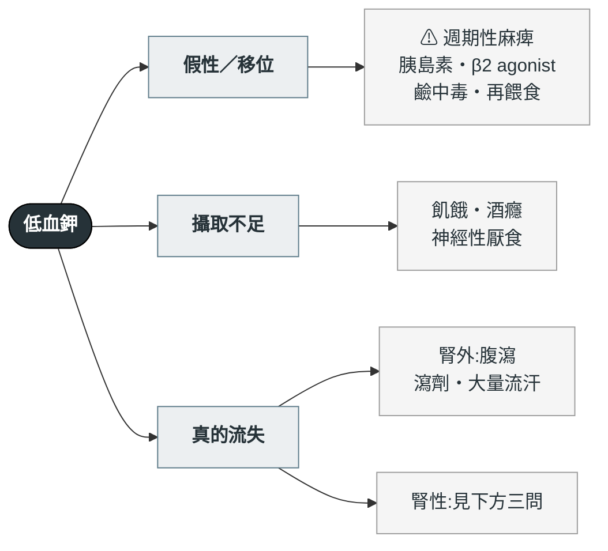

---
tags:
  - Med/Workup/Nephro
  - Med/Workup/Endo
  - 禁忌
aliases:
  - Hypokalemia
  - 低血鉀
  - 低鉀血症
  - 高血壓合併低血鉀
  - Hypokalemic alkalosis
  - 低血鉀代謝性鹼中毒
created: 2026-07-29
updated: 2026-07-29
status: 可用
source: Endocrine Society PA Guideline；Palmer 電解質判讀綜論；Kamel & Halperin 2017（urine K/Cr）
cssclass: clinical-note
cant_miss:
  - "[[Ventricular tachycardia]]"
  - "[[Primary aldosteronism]]"
key_tests:
  - "[[Urine indices]]"
  - "[[Arterial blood gas]]"
  - "[[EKG ischemia]]"
---

# Hypokalemia ｜ 低血鉀

> [!abstract] 一句話總覽
> 血鉀低只有**三個來源**:鉀根本沒進來、鉀跑進細胞裡、鉀被排掉了。**先排除移位**(移位不需要補很多鉀,補多了回來會高血鉀),再用**三個問題**把「排掉」那一支切乾淨:**① 血壓 ② 酸鹼與尿氯 ③ renin 與 aldosterone**。

> [!danger] Can't-miss — 漏掉會死人
> | 不能漏 | 一眼線索 | 立刻做什麼 |
> |---|---|---|
> | **惡性心律不整** | K <2.5、合併洋地黃或 QT 延長藥、U 波 | **心電圖 ＋ 監視器**;靜脈補鉀 |
> | **合併低血鎂** | 補鉀補不上去、利尿劑、腹瀉、PPI | **先驗並補 Mg**——鎂不補,鉀補不進去 |
> | **週期性麻痺** | 突發全身無力、剛吃完大餐或運動後、亞洲年輕男性 | 驗 TSH／T4(**甲亢性週期性麻痺**);**只給少量鉀** |
> | **[[Primary aldosteronism]]** | 高血壓 ＋ 自發性或利尿劑誘發的低血鉀 | 別急著補完就結案,**先留檢體再補** |

> [!tip] 到床邊的前 5 分鐘
> **看**:意識、肌力、心電圖(U 波、ST 下降、QT 延長)、**血壓**
> **問**:利尿劑?嘔吐或腹瀉?中藥／甘草?最近有沒有大量進食或運動?家族史?
> **做**:EKG、血鉀鎂鈣、[[Arterial blood gas]]、**[[Urine indices|尿鉀與尿氯]]**(**務必在補鉀與輸液之前留**)

---

## 鑑別架構圖

## 三個問題(本篇的招牌)

*確定是「腎在漏鉀」之後,用這三問把剩下的切乾淨。這是本區的導航主體,其他篇只寫結論。*

### 第 0 步:先確認鉀真的是從腎漏的

| 指標 | 腎在漏 | 腎外流失(腸道)或移位 |
|---|---|---|
| **Urine K/Cr ratio** | **>13 mEq/g Cr** | <13 |
| 24 小時尿鉀 | **>25–30 mEq/day** | <25 |

→ 算式、TTKG 為何退場 → [[Urine indices]]

### 問題 ①:血壓高不高?

**不高** → 腎小管失鹽 → 走 [[Renal tubulopathies|Bartter／Gitelman]]、嘔吐、利尿劑
**高** → 走礦皮質素路線,進問題 ③

### 問題 ②:酸還是鹼?

| 酸鹼 | 往哪想 |
|---|---|
| **代謝性鹼中毒** | 主線。接著看**尿氯**:**<20** ＝ 嘔吐／利尿劑停用;**>20** ＝ Bartter／Gitelman／利尿劑使用中／礦皮質素過多 |
| **代謝性酸中毒** | **跳出醛固酮軸** → **[[RTA]] type 1／2**、腹瀉、[[DKA]] 治療中的鉀移位 |

> [!warning] 低血鉀 ＋ 酸中毒 ＝ 換一條路
> 礦皮質素過多**幾乎都**合併鹼中毒,所以看到**酸**中毒就先離開 PA／Liddle 這條線。
> **但反推不是絕對的**:同時存在的酸化過程會把鹼中毒蓋掉——腹瀉、[[RTA]]、大量生理食鹽水復甦(高血氯性酸中毒)、晚期 [[CKD]]、acetazolamide。最乾淨的反例是 **amphotericin B**:它同時造成遠端 RTA **與**腎性失鉀。
> 酸中毒那一支還要想到:**吸入甲苯(強力膠)**、輸尿管腸道改道。
> 分型與尿液指標 → [[Arterial blood gas]](血液端)與 [[Urine indices]](尿端)。

### 問題 ③:renin 與 aldosterone 誰高誰低?(限血壓高者)

| Renin | Aldosterone | 診斷 |
|---|---|---|
| **低** | **高** | **[[Primary aldosteronism]]** |
| **高** | **高** | 續發性:腎動脈狹窄、腎素瘤、惡性高血壓 |
| **低** | **低** | **[[Renal tubulopathies\|Liddle syndrome]]**、甘草／AME(11β-HSD2)、**[[Cushing syndrome]]**、**[[Congenital adrenal hyperplasia\|CAH 11β-／17α-羥化酶缺乏]]** |

> [!important] 「兩個都低」那一格怎麼再切開
> 四個病生化長得一樣,靠**額外的臨床線索**分:
>
> | 線索 | 指向 |
> |---|---|
> | 家族史、年輕、**amiloride 有效而 spironolactone 無效** | **Liddle** |
> | 甘草、中藥、喉糖 | **AME／假性醛固酮增多症** |
> | 向心性肥胖、紫紋、近端肌無力、高血糖 | **[[Cushing syndrome]]** |
> | 女性男性化或無第二性徵、原發性無月經、身材矮小 | **[[Congenital adrenal hyperplasia\|CAH]]** |

## 病史 History

| 問題 | 若為「是」→ 想到 |
|---|---|
| 在吃利尿劑嗎?最後一次什麼時候? | 最常見原因;也讓尿液指標失真 |
| 嘔吐或鼻胃管引流? | 鹼中毒 ＋ 尿氯低;**尿鈉可能不低**(bicarbonaturia) |
| 腹瀉、瀉劑濫用? | 低血鉀 ＋ **酸**中毒 |
| **甘草、中藥、喉糖、口嚼菸**? | AME |
| 突發無力,發作前大吃或運動? | **週期性麻痺**(查甲狀腺) |
| 家族史、年輕發病的高血壓? | **Liddle**、[[Renal tubulopathies\|Gitelman]] |
| 抗生素(amphotericin B、aminoglycoside)、cisplatin? | 腎小管毒性 → 合併低血鎂 |

## 第一批檢查

| 時機 | 檢查 | 想回答 |
|---|---|---|
| **立刻** | EKG、**血 Mg**、[[Arterial blood gas]] | 有沒有心律不整風險;酸還是鹼 |
| **立刻(補鉀前)** | **尿 K、尿 Cr、尿 Cl** → [[Urine indices]] | 腎漏還是腎外;尿氯分型 |
| 血壓高者 | **aldosterone ＋ renin ＋ ARR** | 問題 ③ |
| 依線索 | TSH／free T4、cortisol 篩檢、17-OHP | 週期性麻痺／Cushing／CAH |

> [!danger] 檢體要在治療之前留
> 補鉀、輸液、給利尿劑都會改變尿鉀與尿氯。**先留 10 mL 尿,再開醫囑**——這一步錯過就補不回來。

## 處置骨架

| 情境 | 處置 |
|---|---|
| K <2.5 或有症狀／心電圖變化 | **靜脈補鉀 ＋ 監視器**。周邊靜脈上限約 **40 mEq/L、≤10–20 mEq/hr**;要更快需中心靜脈 |
| **稀釋液的選擇** | **用生理食鹽水,不要用含糖點滴**——葡萄糖刺激胰島素,把鉀推進細胞,血鉀會先掉更低 |
| 一般缺鉀 | 口服補充;**同時補鎂** |
| 合併鹼中毒 | 用 **KCl**(氯離子同時矯正鹼中毒) |
| **甲亢性週期性麻痺** | **非選擇性 β-blocker(propranolol)是首選**——直接逆轉細胞內移位且不會反彈。補鉀只給少量(<10 mmol/hr) |
| 病因治療 | 依上面三問的結果 |

> [!danger] 週期性麻痺補鉀的反彈
> 鉀沒有真的少,只是跑進細胞。以 KCl 治療的 TPP 病人**約四成會反彈成高血鉀(>5.5)**。
> 所以順序是:**propranolol 優先、少量補鉀、避開含糖點滴、治療甲亢本身。**

## 禁忌與陷阱

> [!danger] 絕對不可
> | 情境 | 絕對不可 | 為什麼 | 該做什麼 |
> |---|---|---|---|
> | 低血鉀補不上去 | 一直加鉀 | **低血鎂**時遠端腎小管持續漏鉀 | **先驗並補 Mg** |
> | 週期性麻痺 | 積極大量補鉀、用含糖點滴 | 鉀在細胞內,約四成會反彈成高血鉀;葡萄糖會再推一把 | **Propranolol** ＋ 少量鉀 ＋ 生理食鹽水;治甲亢 |
> | 高血壓 ＋ 低血鉀 | 補完鉀就結案 | 這正是 PA 的篩檢適應症 | 驗 ARR;**帶著低血鉀抽 ARR 會假陰性,先補鉀再抽** |
> | 尚未留尿液電解質 | 先補鉀或輸液 | 之後的數值反映你的處置 | 先留尿 |
> | 低血鉀 ＋ 酸中毒 | 往醛固酮軸想 | 醛固酮過多是**鹼**中毒 | 轉向 [[RTA]]、腹瀉 |

> [!warning] 常見錯誤
> - **忘了量血壓**——問題 ① 是整個演算法的第一個分岔,卻最常被跳過
> - **忘了問甘草與中藥**——台灣族群這一條的產出率不低
> - **用 TTKG** 判斷腎性失鉀——公式假設已被作者放棄,改用 urine K/Cr(見 [[Urine indices]])
> - **只補鉀不補鎂**

## 相關連結

- [[Primary aldosteronism]] — 問題 ③「低 renin ＋ 高 aldosterone」那一格的專篇
- [[Renal tubulopathies]] — 血壓不高那一支(Bartter／Gitelman)與「兩個都低」那一格的 Liddle
- [[Cushing syndrome]] · [[Congenital adrenal hyperplasia]] — 「兩個都低」的另外兩個出口
- [[Urine indices]] — urine K/Cr、尿氯、TTKG 的算式與失效條件
- [[Arterial blood gas]] — 酸鹼分型;問題 ② 的前置步驟
- [[CKD]] · [[AKI]] — 腎功能異常會改寫上面所有尿液指標的切點
