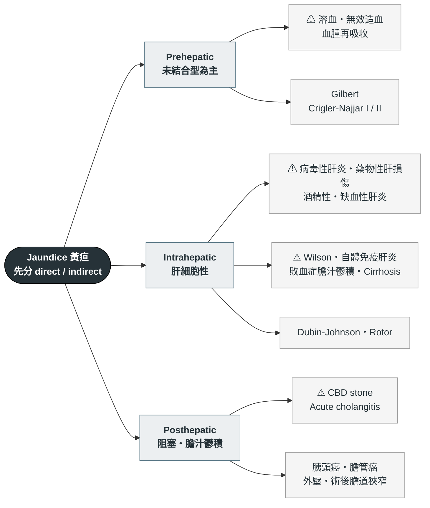

---
tags:
  - Med/Workup/GI
  - 禁忌
aliases:
  - Jaundice
  - 黃疸
  - Hyperbilirubinemia
  - 高膽紅素血症
created: 2026-07-28
updated: 2026-07-28
status: 可用
source: "114-1 醫學(三) 3、15、16、114-2 醫學(三) 18 延伸；Harrison's Principles of Internal Medicine（Jaundice；Evaluation of Liver Function）；An Official ATS Statement: Hepatotoxicity of Antituberculosis Therapy (2006)；AASLD Position Paper: The Management of Acute Liver Failure；Tokyo Guidelines 2018（TG18, acute cholangitis）；StatPearls（Rotor / Dubin-Johnson syndrome）；Korman JD et al. Hepatology 2008;48:1167（ALF-Wilson 篩檢比值出處）；EASL CPG Wilson's Disease 2012；CIOMS DILI 2020 與 AASLD DILI Practice Guidance 2021（R value、Hy's law、類固醇適應症）；GeneReviews: Rotor Syndrome；FDA Guidance: Drug-Induced Liver Injury (2009)"
cssclass: clinical-note
cant_miss:
  - "[[Acute cholangitis]]"
  - "急性肝衰竭 Acute liver failure"
  - "Acetaminophen 中毒"
  - "[[Wilson disease]]"
differential:
  - "[[Acute hepatitis]]"
  - "[[CBD stone]]"
  - "[[Pancreatic cancer]]"
  - "[[Cirrhosis]]"
  - "Gilbert syndrome"
key_tests:
  - "T-bil / D-bil 分型"
  - "AST/ALT、ALP、γ-GT"
  - "PT/INR、albumin"
  - "[[Abdominal ultrasound]]"
---

# Jaundice ｜ 黃疸 · Jaundice

> [!abstract] 一句話總覽
> 黃疸的第一刀**永遠不是部位，而是分型**：conjugated（direct）還是 unconjugated（indirect）。切完這一刀，一半的鑑別診斷當場消失；第二刀才輪到「肝前、肝內、肝後」。最怕的是急性膽管炎（要減壓，不是只給抗生素）與急性肝衰竭（要打電話給移植中心）。

> [!danger] Can't-miss — 漏掉會死人
> 這一格永遠先讀。**沒排除完不准往下走。**
>
> | 不能漏 | 一眼線索 | 立刻做什麼排除 |
> |---|---|---|
> | [[Acute cholangitis]] 急性膽管炎 | **Charcot 三徵：發燒＋黃疸＋RUQ 痛**（特異度 ~96%，但**敏感度只有 ~26%——三徵不齊絕不能排除**）；再加**低血壓＋意識改變＝Reynolds 五徵**（敗血症） | 血液培養×2、T-bil/D-bil、ALP、[[Abdominal ultrasound]] 看膽管擴張 → **抗生素＋緊急膽道減壓** |
> | 急性肝衰竭 Acute liver failure | 黃疸＋意識改變／asterixis、出血傾向、低血糖 | **PT/INR、ammonia、血糖**；INR ≥1.5 ＋ 肝性腦病變且無慢性肝病 → 聯絡移植中心 |
> | Acetaminophen 中毒 | 大量服藥史、AST/ALT 破千且快速下降 | Acetaminophen level ＋ Rumack-Matthew nomogram；高度懷疑時**先給 NAC，不要等報告** |
> | 猛爆型 [[Wilson disease]] | 年輕人、Coombs 陰性溶血、**ALP／T-bil < 4**、AST/ALT > 2.2 | Ceruloplasmin、24 小時尿銅、裂隙燈找 K-F ring |
> | 大量溶血 | Hb 快速下降、LDH↑、haptoglobin↓、**indirect 為主** | CBC/DC、reticulocyte、peripheral smear、Coombs（見 [[Anemia]]） |

> [!warning] 三徵不齊 ≠ 不是膽管炎
> Charcot 三徵敏感度僅約 26%，四分之三的急性膽管炎不會三項到齊。要用 **TG18 三軸**：**A 全身發炎**（發燒／寒顫、WBC 或 CRP 異常）、**B 膽汁鬱積**（黃疸、肝功能異常）、**C 影像**（膽管擴張或病因證據）。**A ＋（B 或 C 之一）＝疑似；A ＋ B ＋ C ＝確診**。疑似就該開抗生素並安排減壓，不要等三徵。

> [!tip] 到床邊的前 5 分鐘
> **看**：Vital signs（**體溫、血壓**）、意識與 asterixis、自然光下的鞏膜、慢性肝病 stigmata（蜘蛛痣、腹水、肝掌）。
> **問**：**小便顏色變濃、大便顏色變淡了嗎**？有沒有**發燒＋右上腹痛**？**最近兩個月新加了什麼藥**（含中草藥、保健食品）？
> **做**：**T-bil ＋ D-bil**、AST/ALT/ALP/γ-GT、**PT/INR ＋ albumin**、CBC/DC、血糖、U/A、[[Abdominal ultrasound]]。

---

## 鑑別架構圖

*先看骨架再看細節。這張圖回答「可能性從哪幾個分支長出來」，不是「先做什麼再做什麼」。第一層分岔就是 direct／indirect。⚠ ＝ can't-miss。*

> [!tip] 床邊最快的分流：驗尿
> Unconjugated bilirubin 與 albumin 緊密結合、不被腎絲球過濾，**尿液膽紅素必為陰性**；所以**尿驗出膽紅素＝conjugated 上升**。但「茶色尿」有兩種：膽紅素尿（conjugated）與血紅素尿（溶血），兩者都讓尿變深、**指向的分支卻完全相反**——不能只憑病人口述的顏色下結論，要驗。

## 病史 History

*黃疸的病史重點是「時序」與「暴露」：什麼時候開始黃的、黃之前發生了什麼事。*

| 問題 | 若為「是」→ 想到 |
|---|---|
| 發燒 ＋ 右上腹痛 ＋ 黃疸？ | [[Acute cholangitis]]（Charcot 三徵）→ 見 [[RUQ pain]]、[[Fever]] |
| 小便變濃茶色、**大便變灰白**？ | Conjugated／阻塞性：[[CBD stone]]、[[Pancreatic cancer]]、膽管癌 |
| **不痛**的黃疸 ＋ 體重減輕 ＋ 食慾差？ | 惡性阻塞（胰頭癌、膽管癌）——無痛是警訊，不是安慰 |
| 最近兩個月新加什麼藥？**含中草藥、保健食品、減肥產品**；有沒有一次吃大量止痛藥？ | 藥物性肝損傷（DILI）、acetaminophen 中毒；抗結核藥與 amoxicillin-clavulanate 要特別警覺 |
| 每天喝多少酒、喝多久？ | 酒精性肝炎；也是 [[Cirrhosis]] 的背景 |
| 近期低血壓、大出血、心衰竭發作？ | 缺血性肝炎（shock liver）→ [[Shock]] |
| **禁食、感染、手術、劇烈運動後才黃，以前也有過幾次？** | Gilbert syndrome |
| 生食貝類、東南亞旅遊、同事群聚？輸血、共用針具、刺青？ | 急性 A 型（孕婦＋南亞或未熟豬肉 → E 型）；[[Hepatitis B]]、[[Hepatitis C]] |
| 年輕人 ＋ 動作障礙或精神症狀，且病毒標記陰性？ | [[Wilson disease]] |
| 意識改變、日夜顛倒？ | [[Hepatic encephalopathy]]／急性肝衰竭（也見 [[Delirium]]） |

**一定不能漏問**：完整用藥史（處方藥、中草藥、保健食品，逐項點名問）、酒精量、TOCC、B/C 肝與家族肝癌史、過去腹部與膽道手術、輸血史。

## 理學檢查 PE

| 要做的 PE | 陽性代表 |
|---|---|
| **自然光下看鞏膜**（不要在黃光病房判斷） | T-bil 約 > 2–3 mg/dL 才看得出來；鞏膜比皮膚早黃 |
| 體溫 ＋ 血壓 ＋ 意識 | 發燒＋黃疸＋RUQ 痛＝Charcot 三徵；再加低血壓＋意識改變＝Reynolds 五徵 → [[Shock]] |
| Murphy's sign | [[Acute cholecystitis]] |
| **Courvoisier's sign**：無痛、可觸及的腫大膽囊 | 遠端膽道**惡性**阻塞（[[Pancreatic cancer]]、膽管癌）；結石造成的阻塞多因膽囊纖維化而摸不到 |
| **Asterixis 撲翼樣震顫** | [[Hepatic encephalopathy]] → 立刻查 INR，往急性肝衰竭想 |
| 慢性肝病 stigmata：蜘蛛痣、肝掌、男性女乳、腹水、caput medusae | [[Cirrhosis]]（併 [[Ascitic fluid analysis]]） |
| 肝脾腫大；全身抓痕 | 肝：肝炎、腫瘤浸潤、鬱血肝｜脾：門脈高壓或慢性溶血｜抓痕：慢性膽汁鬱積的搔癢 |
| 結膜蒼白、心搏過速 | 溶血或出血 → [[Anemia]] |
| 裂隙燈找 Kayser-Fleischer ring | [[Wilson disease]]（有神經症狀者幾乎 100%，純肝表現者約半數） |

## 第一批檢查 Initial Workup

| 時機 | 檢查 | 想回答的問題 |
|---|---|---|
| 立刻 | **T-bil ＋ D-bil** | **第一刀**：conjugated 還是 unconjugated |
| 立刻 | AST／ALT／ALP／**γ-GT** | **第二刀**：肝細胞性還是膽汁鬱積型 |
| 立刻 | **PT/INR ＋ albumin** | 肝的合成功能；INR 是急性肝衰竭的分界，不是湊數項目 |
| 立刻 | CBC/DC、reticulocyte、LDH、haptoglobin、peripheral smear、Coombs | 有沒有溶血（[[Anemia]]） |
| 立刻 | U/A（尿膽紅素）、血糖、ammonia、電解質；有發燒或低血壓時加**血液培養 ×2 ＋ lactate** | 床邊分型；急性肝衰竭會**低血糖**；腦病變程度；[[Acute cholangitis]] 與敗血症 |
| 立刻 | [[Abdominal ultrasound]] | **膽管有沒有擴張**——內外科的分水嶺 |
| 次要 | 病毒標記組合（見下表） | 找病因 |
| 次要 | Acetaminophen level、ANA／ASMA／IgG、ceruloplasmin ＋ 24 小時尿銅 | 藥物、自體免疫肝炎、[[Wilson disease]] |
| 次要 | MRCP／CT／EUS，必要時 [[ERCP]]；amylase／lipase | 膽管擴張後定位阻塞點（**ERCP 主要是治療性的，不是第一線診斷工具**）；併發 [[Acute pancreatitis]] |

### 分型：肝細胞性 vs 膽汁鬱積型

| | 肝細胞性 hepatocellular | 膽汁鬱積型 cholestatic |
|---|---|---|
| 主升的項目 | **AST／ALT**（可破千），ALP 幾乎不動 | **ALP ／ γ-GT**，transaminase 只輕度上升 |
| 典型病因 | 病毒性肝炎、藥物、缺血性肝炎、自體免疫肝炎、[[Wilson disease]] | [[CBD stone]]、[[Acute cholangitis]]、胰頭癌、膽管癌、藥物性膽汁鬱積、敗血症 |
| 下一步 | 病毒標記 ＋ 自體免疫 ＋ 銅代謝 | [[Abdominal ultrasound]] 看**膽管擴張** → MRCP／[[ERCP]] |

**R value** ＝（ALT／ALT ULN）÷（ALP／ALP ULN）：**R ≥ 5 肝細胞型、R ≤ 2 膽汁鬱積型、2 < R < 5 混合型**（**邊界值 5 與 2 分別歸給肝細胞型與膽汁鬱積型，不歸混合型**）。一個數字就決定你下一批是驗病毒還是照超音波。**肝細胞型那一支的完整流程**——嚴重度分層（severe ALI vs ALF）、ALT 破千的鑑別、非肝來源的排除——在 [[Acute liver injury]]。

> [!warning] ALP 高不等於膽道問題
> ALP 也來自**骨骼、胎盤、腸道**。看到 ALP 上升要先加驗 **γ-GT**：
> **γ-GT 同步上升 → 肝膽來源**；**γ-GT 正常 → 往骨骼想**（骨轉移、Paget's disease、骨折癒合、維生素 D 缺乏），此時要一併看鈣、磷，見 [[Hypercalcemia]]。
> 孕婦（胎盤型）與青春期生長期的 ALP 生理性上升，不要當成病。

> [!tip] AST／ALT 的比值也在講故事
> **ALT > AST** → 病毒性、脂肪肝早期（[[MASLD]]）｜**AST／ALT > 2 且兩者多在 300 以下** → 酒精性
> **兩者同時破千且快速下降** → 缺血性肝炎或 acetaminophen｜**ALT 破千 ＋ ALP 低到不合理 ＋ ALP／T-bil < 4 ＋ Coombs 陰性溶血** → 猛爆型 [[Wilson disease]]

### 急性肝炎：先分型，再選標記

| 想抓的病 | 開什麼 | 為什麼是這個標記 |
|---|---|---|
| 急性 A 型肝炎 | **anti-HAV IgM** | 總 anti-HAV 分不出感染期或疫苗；**IgM 才代表急性** |
| 急性 B 型肝炎 | **HBsAg ＋ anti-HBc IgM** | HBsAg 抓現症病毒；anti-HBc IgM 抓急性期與空窗期 |
| B 肝的背景資料 | anti-HBs（保護力／疫苗）、HBeAg 或 HBV DNA（複製活性） | 回答的是另一個問題，**不是這次黃疸的病因診斷** |
| 急慢性 C 型肝炎 | **anti-HCV ＋ HCV RNA** | anti-HCV 有 **8–12 週**空窗（免疫抑制者更久），而 **HCV RNA 暴露後 1–2 週就驗得到**；抗體陽性不分現症或已清除 → **要 RNA 才算數** |
| 急性 E 型肝炎 | **anti-HEV IgM** | 孕婦、未熟豬肉、東南亞／南亞旅遊；**孕婦猛爆風險高** |

> [!warning] 為什麼「只驗 HBsAg 陰性」不能說不是 B 肝
> 急性 B 肝有一段 **window period**：HBsAg 已經消失、anti-HBs 還沒出現，這時候唯一陽性的標記是 **anti-HBc IgM**。而若只驗「總 anti-HBc」也一樣失效——總 anti-HBc 陽性只代表「這輩子接觸過 HBV」，不分現在有沒有在發作。通則：**每個標記各自回答一個問句**——HBsAg＝現在有沒有病毒；anti-HBs＝有沒有保護力；anti-HBc IgM＝是不是急性或空窗；總 anti-HBc＝這輩子碰過沒；HBeAg／HBV DNA＝複製活不活躍。配錯問句，驗了也等於沒驗。

| 肝內膽管擴張：parallel channel／shotgun sign | CBD 長軸量測 |
|---|---|
| ![[assets/jaundice-ihd-dilatation-us.jpg\|420]] | ![[assets/jaundice-cbd-measurement-a.jpg\|360]] |

*左：擴張的肝內膽管（實心箭頭／圈）與門靜脈分支（空心箭頭）平行，形成 parallel-channel sign。右：CBD 應在長軸、避開 cystic duct 匯入口，取內壁到內壁的前後徑；同一膽管在不同位置量可差很多。一般 CD／CBD ≥7 mm 需結合年齡、症狀與肝膽指數追查；高齡或膽囊切除後可較寬。超音波看到膽管擴張卻沒看到原因，不能排除 distal CBD stone 或腫瘤，下一步常需 MRCP／EUS。Sources: [Ultrasonographic evaluation of patients with abnormal liver function tests](https://pmc.ncbi.nlm.nih.gov/articles/PMC8942730/), Fig. 3；[Ultrasound of bile ducts—reference values and measurement technique](https://pmc.ncbi.nlm.nih.gov/articles/PMC11988351/), Fig. 3。*

## 鑑別診斷

*完整清單，依「致命 → 常見 → 少見但要想到」分層。頂部的 can't-miss 是這張表第一層的濃縮。*

### 致命（can't-miss）

| 疾病 | 支持線索 | 排除方法 |
|---|---|---|
| [[Acute cholangitis]] | Charcot 三徵／Reynolds 五徵、ALP↑、膽管擴張 | 血培養、腹超；治療＝抗生素 ＋ **膽道減壓** |
| 急性肝衰竭（含 acetaminophen） | 黃疸 ＋ 意識改變、INR ≥ 1.5、低血糖 | INR、ammonia、acetaminophen level；聯絡移植中心 |
| 猛爆型 [[Wilson disease]] | 年輕、Coombs 陰性溶血、ALP／T-bil < 4、AST/ALT > 2.2 | Ceruloplasmin、24 小時尿銅、裂隙燈；治療是肝移植 |
| 缺血性肝炎（shock liver） | 低血壓事件後 transaminase 破千且快速回落 | 治血行動力學原因（[[Shock]]） |
| 大量溶血 | Hb 快掉、LDH↑、haptoglobin↓、indirect 為主 | Smear、Coombs、[[Anemia]] |
| 敗血症相關膽汁鬱積 | **direct↑ 但膽管不擴張**、感染源在肝外 | 找感染源（[[Pneumonia]]、腹腔內感染）；治感染而不是治肝 |

### 常見

| 疾病 | 支持線索 | 排除方法 |
|---|---|---|
| 急性病毒性肝炎（[[Hepatitis A]]／[[Hepatitis B]]／[[Hepatitis C]]） | ALT > AST 且可破千、ALP 幾乎不動 | 病毒標記組合（見上表）→ [[Acute hepatitis]] |
| 藥物性肝損傷 DILI | 用藥時序吻合、停藥後改善 | 完整用藥史 ＋ 分型；見下節 |
| 酒精性肝炎 | AST／ALT > 2 且多 < 300、γ-GT↑、MCV↑ | 飲酒史 ＋ 排除其他原因 |
| [[CBD stone]] | 陣發性 RUQ 痛、ALP 與膽紅素起伏 | 腹超 → MRCP／[[ERCP]] |
| [[Cirrhosis]] 失代償 | 慢性肝病 stigmata、腹水、脾腫、血小板低 | 超音波、[[Ascitic fluid analysis]] |
| Gilbert syndrome | 禁食／壓力後輕度 indirect↑，**其餘肝功能全正常** | 不需侵入性檢查，追蹤即可 |

### 少見但要想到

| 疾病 | 支持線索 | 排除方法 |
|---|---|---|
| [[Pancreatic cancer]]（頭部）／膽管癌 | **無痛性黃疸**、體重減輕、Courvoisier's sign | 腹超 → CT／MRCP／EUS 切片 |
| 自體免疫肝炎 | 年輕女性、高球蛋白、ANA／ASMA 陽性 | 自體抗體 ＋ 肝切片 |
| PBC／PSC | 慢性搔癢、ALP 長期偏高；PBC 抗粒線體抗體陽性 | AMA、MRCP |
| [[Liver abscess]]、肝腫瘤浸潤 | 高燒、肝壓痛、糖尿病；或已知惡性腫瘤 | 腹超／CT |
| 妊娠相關：肝內膽汁鬱積、HELLP、AFLP | 孕期、搔癢、血小板低、低血糖 | 產科急會診 |

### 先天性高膽紅素血症：用「年齡＋分型」兩刀切完

| 疾病 | 分型 | 發病年齡／情境 | 關鍵一句 |
|---|---|---|---|
| **Gilbert syndrome** | Unconjugated | 青少年至成年；**禁食、感染、手術、脫水、劇烈運動、壓力**誘發 | 最常見（**盛行率隨族群與診斷標準不同，報告落在 3–10%**）且完全良性；UGT1A1 活性約降至正常的 30%；T-bil **平時多 < 3 mg/dL，但禁食／生病時可升到 4–6 mg/dL——超過 3 不等於排除 Gilbert**。臨床意義主要在藥物代謝：irinotecan（SN-38 清除變慢、毒性↑）、atazanavir；也會加重新生兒黃疸、常被誤當肝病反覆檢查。**台灣／東亞的致病變異以 UGT1A1\*6（G71R）為主，不是白種人常見的 UGT1A1\*28（TA）7 啟動子插入** |
| **Crigler-Najjar type I** | Unconjugated | **新生兒期**發病，T-bil 常 20–45 mg/dL、核黃疸 | UGT1A1 幾乎完全缺失，需終身照光甚至肝移植。**成人首次出現黃疸可以直接排除它** |
| **Crigler-Najjar type II**（Arias） | Unconjugated | 可活到成年，T-bil 多 6–20 mg/dL | 部分缺失，**phenobarbital 可使膽紅素下降 > 25%（type I 完全無反應）**——這個藥物試驗就是分界；重病、禁食、麻醉等壓力下仍有核黃疸風險 |
| **Dubin-Johnson syndrome** | **Conjugated** | 成年；懷孕或口服避孕藥時可能顯現 | **肝呈黑色**（類黑色素沉積）；**尿總 coproporphyrin 正常**，但 isomer I 佔比升到 ~80–90%（正常約 25%）。良性、不需治療 |
| **Rotor syndrome** | **Conjugated** | 成年 | **肝不黑**、組織學正常；**尿總 coproporphyrin 升高 2.5–5 倍**，isomer I 佔比約 65%（也升高，但低於 DJS）。良性、不需治療 |

> [!tip] Coproporphyrin 這一格怎麼記才不會寫反
> **看總量**：Rotor **升高 2.5–5 倍**，**DJS 是正常的**——總量才是兩者的分水嶺。
> **看 isomer I 佔比**：兩者都升高，DJS（~80–90%）> Rotor（~65%）> 正常（~25%）——這一項只能分程度，不能二分。

> [!note] 這張表的用法是「兩刀」，不是「背五個病」
> **第一刀分型**：unconjugated 只剩 Gilbert 與 Crigler-Najjar；conjugated 只剩 Dubin-Johnson 與 Rotor。
> **第二刀看年齡**：酵素**完全**缺失的在嬰兒期就發作（type I），**部分**缺失的才能活到成年並被壓力誘發（Gilbert、type II）。年齡本身就是鑑別工具，不必記酵素活性的百分比。

### 藥物性肝損傷 DILI

| | 內因性 intrinsic | 特異體質性 idiosyncratic |
|---|---|---|
| 與劑量的關係 | **劑量依賴、可預測**，有明確中毒劑量 | **與劑量關係弱、不可預測**，取決於宿主（年齡、飲酒、NAT2 慢乙醯化型、既有肝病） |
| 潛伏期 | 短，數小時至數天 | 數週至數月，變異大 |
| 代表藥 | **Acetaminophen**、四氯化碳、高劑量 methotrexate | **抗結核藥（INH）**、amoxicillin-clavulanate、phenytoin、halothane |
| 處置 | 有解毒劑（NAC） | **停掉可疑藥物並觀察**；類固醇**不是常規**，但有明確適應症：切片有自體免疫特徵（DI-AIH）、**免疫檢查點抑制劑肝炎**、TKI、DRESS → 短療程並快速減量 |

| 抗結核藥 | 肝毒性 | 招牌副作用 |
|---|---|---|
| Isoniazid（INH） | 高（特異體質性） | 周邊神經病變 → 併服 vitamin B6（pyridoxine）；藥物性狼瘡 |
| Rifampin（RIF） | 中（多為膽汁鬱積型；也可單獨升高 unconjugated bilirubin） | 體液橘紅色、流感樣症候群、**強力 CYP450 誘導劑** |
| Pyrazinamide（PZA） | 高，且**明確與劑量相關**（現行劑量下與 INH 誰最強仍有爭議——考題答「PZA 最高」） | 高尿酸血症與痛風、關節痛 |
| Ethambutol（EMB） | 幾乎沒有 | **視神經炎、紅綠色盲**（定期查視力與色覺）；腎功能不良需調量 |
| Streptomycin（SM） | 幾乎沒有 | 耳毒性（第八對腦神經）、腎毒性；**孕婦禁用** |

> [!danger] 抗結核藥的停藥門檻——只看兩件事：倍數與症狀
> | 情況 | 處置 |
> |---|---|
> | **ALT ≥ 3× ULN，且合併肝炎症狀（食慾不振、噁心、嘔吐、腹痛、無法解釋的倦怠）和／或黃疸** | **停藥**，改用替代處方 |
> | **ALT ≥ 5× ULN，即使完全無症狀** | **停藥** |
> | ALT 輕度上升、無症狀、bilirubin 正常 | **不停藥，密切追蹤肝功能** |
>
> 真的要停時，通常先停肝毒性最高的（INH、RIF、PZA），**EMB、SM 這類幾乎不傷肝的可以留著**撐住抗結核治療。見 [[Tuberculosis]]。
> **Hy's law（四要素，缺一不算）**：① ALT 或 AST **> 3× ULN**；② total bilirubin **> 2× ULN**；③ **無膽汁鬱積證據**（ALP 未上升到 > 2× ULN）；④ **找不到其他能解釋的原因**（病毒性肝炎 A–E、既有或急性肝病、其他肝毒性藥物）。四項同時成立 → **死亡或需肝移植的機率 > 10%**。這是紅線，不是觀察區。

## 處置分流 Disposition

> [!danger] 急性肝衰竭的定義——這是打電話給移植中心的分界
> **凝血功能異常（INR ≥ 1.5）＋ 肝性腦病變（[[Hepatic encephalopathy]]），且病人「沒有慢性肝病／肝硬化」，病程 < 26 週。**
> 三個條件缺一不可：**沒有腦病變就不是急性肝衰竭，只是急性肝炎**；有肝硬化底子的**通常**不是 ALF，是急性慢性肝衰竭（ACLF）。

| 去向      | 條件                                                                         |
| ------- | -------------------------------------------------------------------------- |
| ICU     | 敗血性休克／Reynolds 五徵；急性肝衰竭（INR ≥ 1.5 ＋ 肝性腦病變）；活動性大量溶血合併血行動力學不穩                |
| 住院      | 急性膽管炎需膽道減壓；膽管擴張待 [[ERCP]]／MRCP；transaminase 破千或 INR 延長；無法進食脫水；懷疑猛爆型 Wilson |
| 門診追蹤／回家 | 生命徵象穩定、意識清楚、INR 正常、膽管不擴張，且屬單純 indirect 上升而其餘肝功能全正常（如 Gilbert）              |

## 禁忌與陷阱

> [!danger] 絕對不可
> | 情境 | 絕對不可 | 為什麼 | 該做什麼 |
> |---|---|---|---|
> | [[Acute cholangitis]] 合併敗血症 | **只給抗生素、不做膽道減壓** | 阻塞的膽道等於一個持續加壓的膿腔，抗生素進不去；不減壓死亡率極高 | 抗生素 ＋ **緊急膽道減壓**：[[ERCP]] 取石／放支架，失敗則 PTBD 或手術 |
> | 任何新發黃疸 | **看到黃疸就當肝炎，只驗 AST／ALT** | 沒驗 direct／indirect 就是跳過第一刀，溶血與阻塞會被整個漏掉 | **T-bil ＋ D-bil ＋ ALP／γ-GT ＋ 腹超**，同一批開完 |
> | 急性肝衰竭／肝性腦病變 | **給 benzodiazepine 等鎮靜劑** | 肝臟代謝不掉、藥效延長，掩蓋腦病變分級並壓抑呼吸，惡化腦水腫 | 找誘因（感染、出血、電解質、低血糖）；躁動危及安全時以保護呼吸道為優先，見 [[Hepatic encephalopathy]] |
>
> [!warning] 常見錯誤
> - **只驗 total bilirubin 不驗 direct**——第一刀沒切，後面全部是猜的。
> - **ALP 高就當膽道阻塞**——沒加 γ-GT，會把骨轉移當肝病（見 [[Hypercalcemia]]）。
> - **只驗 HBsAg 陰性就說不是 B 肝**——空窗期唯一陽性的是 anti-HBc IgM；**anti-HCV 陽性也不等於現症感染**，要 HCV RNA。
> - **抗結核藥一有肝指數上升就全停**——輕度、無症狀、膽紅素正常是追蹤，不是停藥；反過來，**問用藥史只問處方藥**也會漏診：中草藥、保健食品、減肥產品是台灣 DILI 的大宗，要逐項點名問。
> - **超音波沒看到結石就排除阻塞**——總膽管下段常被腸氣遮住；**膽管擴張本身就是往下追的理由**。同理，**無痛性黃疸當成肝炎追蹤三個月**，就是胰頭癌與膽管癌被延誤的典型路徑。

## 相關連結

- [[Acute liver injury]] — 肝指數上升的完整流程：先確認是不是肝、嚴重度分層（severe ALI／ALF）、ALT 破千的三大原因、King's College criteria
- [[RUQ pain]]、[[Abdominal pain]] — 黃疸合併腹痛時的完整分支；Charcot 三徵在那裡也是 can't-miss
- [[Acute cholangitis]]、[[CBD stone]]、[[ERCP]] — 阻塞性黃疸的診斷與減壓時機；[[Acute hepatitis]]、[[Hepatitis A]]、[[Hepatitis B]]、[[Hepatitis C]] — 病毒標記的完整解讀
- [[Wilson disease]] — 年輕人「肝＋神經」的推導鏈；[[Tuberculosis]] — 抗結核藥肝損傷的原始情境
- [[Cirrhosis]]、[[Hepatic encephalopathy]]、[[Ascitic fluid analysis]]、[[MASLD]] — 慢性肝病端；[[Anemia]] — unconjugated 分支的溶血評估；[[Pancreatic cancer]] — 無痛性黃疸的頭號惡性原因
- [[禁忌選項]] — 上表已收錄
