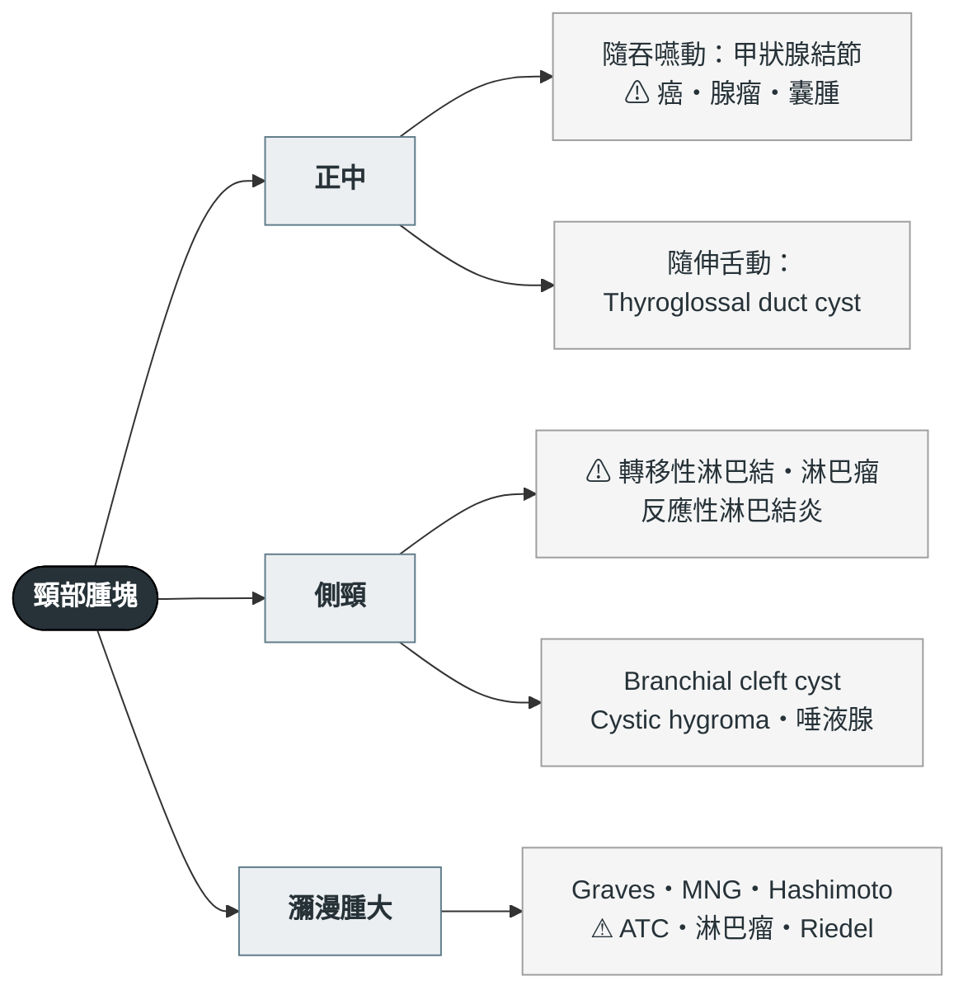

---
tags:
  - Med/Workup/Endo
  - Med/Workup/ENT
  - thyroid
  - 禁忌
aliases: [Neck mass, 頸部腫塊, 頸部腫瘤, Neck lump, Thyroid nodule workup, 甲狀腺結節評估, Goiter, 甲狀腺腫, Neck swelling]
created: 2026-09-16
updated: 2026-09-16
status: 可用
source: 外科離站考三年教材《內分泌外科 113–115 年》（115-2 Q42、113-2 Q40、114-2 Q39、114-2 Q41、113-1 Q39）；ATA 2015 成人甲狀腺結節與分化型甲狀腺癌指引（超音波分層與 FNA 門檻）；ATA 2016 甲狀腺亢進指引（Graves 手術適應症與術前準備）；Bethesda 2023 第三版；AAO-HNS 2017 成人頸部腫塊評估指引；JCEM 2014 Pemberton's sign explained
services:
  - ThyroidSurgery
  - Endo
  - ENT
cssclass: clinical-note
cant_miss:
  - "[[Thyroid cancer]]（ATC：數週暴長）"
  - "轉移性淋巴結（成人側頸無痛硬塊）"
  - "[[Thyroid lymphoma]]"
  - "胸骨後甲狀腺腫的氣道與上腔靜脈壓迫"
  - "[[Thyroid storm]]（毒性甲狀腺腫未控制）"
differential:
  - "[[Thyroid nodule]]"
  - "[[Thyroid cancer]]"
  - "[[Graves disease]]"
  - "Thyroglossal duct cyst"
  - "Branchial cleft cyst"
  - "反應性淋巴結炎"
key_tests:
  - "[[Thyroid function test]]（TSH 先驗）"
  - "[[Thyroid ultrasound]]（結節分層＋側頸淋巴結）"
  - "[[Fine-needle aspiration]] → Bethesda"
  - "核醫甲狀腺掃描（只在 TSH 低時）"
  - "CT（已確診癌或胸骨後延伸才做）"
---

# Neck mass ｜ 頸部腫塊 · 從頸部腫塊到甲狀腺結節與甲狀腺腫

> [!abstract] 一句話總覽
> 頸部腫塊先**定位**：正中隨吞嚥動是甲狀腺、正中隨伸舌動是甲狀舌管囊腫、成人側頸無痛硬塊預設是轉移性淋巴結。落到甲狀腺後只有三步，順序不能顛倒：**TSH → 超音波分層 → FNA**。TSH 低才做核醫掃描，熱結節不抽；thyroglobulin 不在初評用。

> [!danger] Can't-miss — 漏掉會死人
> | 不能漏 | 一眼線索 | 立刻做什麼排除 |
> |---|---|---|
> | 未分化癌 ATC | 老年人、多年甲狀腺腫**數週內暴長**、固定、沙啞、喘鳴 | 先評估氣道；核心切片（同時排除淋巴瘤）；不要當良性腫觀察 |
> | 轉移性淋巴結 | 成人側頸**無痛、硬、固定**單顆腫塊 | FNA（不做切開切片）；找原發：鼻咽、口咽、喉、甲狀腺；抽吸液驗 Tg |
> | [[Thyroid lymphoma]] | 老年女性、Hashimoto 底子、快速長大 | 核心切片；化療放療，不開刀 |
> | 胸骨後甲狀腺腫壓迫 | 平躺呼吸困難、喘鳴、顏面腫、頸靜脈怒張、Pemberton sign 陽性 | 胸腔 CT 看氣管偏移與延伸深度；手術適應症 |
> | 毒性甲狀腺腫合併甲亢 | 心悸、體重減輕、手抖、TSH 低 | 先控制到 euthyroid 再談手術，否則 [[Thyroid storm]] |
> | 深頸部感染／Ludwig angina | 發燒、口底腫脹、牙關緊閉、吞嚥困難 | 氣道優先；CT；抗生素與引流 |

> [!tip] 到床邊的前 5 分鐘
> **看**：呼吸與喘鳴、聲音、腫塊在正中還是側頸、皮膚有無發紅、Graves 眼徵。
> **問**：多久了、有沒有變快、會不會痛、聲音有沒有變、有沒有心悸怕熱或怕冷倦怠、兒時有沒有照過頭頸放射線、家裡有沒有甲狀腺癌或 MEN2。
> **做**：請病人吞口水與伸舌看腫塊動不動、觸診質地與活動度、摸側頸淋巴結、雙臂高舉一分鐘看 Pemberton。開 TSH，排頸部超音波。

---

## 鑑別架構圖

*第一層分岔是位置與移動方式，不是器官。⚠ ＝ can't-miss。*

> [!note] 成人側頸腫塊的 80 法則
> 成人非甲狀腺頸部腫塊約 80% 是腫瘤 → 其中 80% 惡性 → 其中 80% 轉移 → 其中 80% 原發在鎖骨以上。所以先找原發，不要急著切開切片。「Lateral aberrant thyroid」= 側頸淋巴結內的乳突癌轉移，不是異位甲狀腺（113-2 Q40）。

## 病史 History

| 問題 | 若為「是」→ 想到 |
|---|---|
| 腫塊隨吞嚥上下動？ | 甲狀腺來源（固定在氣管前筋膜） |
| 腫塊隨伸舌上移？ | Thyroglossal duct cyst |
| 幾週內快速變大？ | ⚠ ATC、[[Thyroid lymphoma]]、囊腫內出血（會痛） |
| 聲音沙啞、吞嚥困難、平躺喘？ | 侵犯 RLN 或壓迫氣管食道 → [[Thyroid cancer]]、胸骨後甲狀腺腫 |
| 心悸、怕熱、體重減輕、手抖？ | 毒性甲狀腺腫（[[Graves disease]]、toxic MNG、toxic adenoma） |
| 怕冷、倦怠、體重增加？ | Hashimoto |
| 頸部會痛、最近感冒？ | Subacute (de Quervain) thyroiditis、反應性淋巴結炎 |
| 兒時頭頸放射線暴露？ | PTC 最重要的環境危險因子 |
| 家族有甲狀腺癌、MEN2、FAP？ | 遺傳性 MTC、家族性 PTC |
| 年紀很輕（<20）或男性？ | 結節惡性比例相對較高 |
| 抽菸、喝酒、檳榔？ | 頭頸鱗癌轉移到側頸淋巴結 |

**一定不能漏問**：用藥史（amiodarone、鋰鹽、含碘顯影劑近期使用）、放射線暴露史、家族史、TOCC（結核性淋巴結炎）。

## 理學檢查 PE

| 要做的 PE | 陽性代表 |
|---|---|
| 吞嚥時腫塊上移 | 甲狀腺來源 |
| 伸舌時腫塊上移 | Thyroglossal duct cyst |
| 質地硬、固定、表面不規則 | 惡性 |
| 側頸淋巴結：無痛、硬、固定 | 轉移；PTC 常在 level III–IV，鼻咽癌在 level II／後三角 |
| **Pemberton sign**：雙臂高舉貼耳 1 分鐘 → 顏面充血、頸靜脈怒張、喘 | 胸廓入口阻塞，胸骨後甲狀腺腫壓迫上腔靜脈（114-2 Q41） |
| 腺體上有 bruit、眼病變、脛前黏液水腫 | [[Graves disease]] |
| 木質硬、與周圍組織黏連 | Riedel thyroiditis 或 ATC |
| 後三角、透光、軟 | Cystic hygroma |
| 胸骨上凹摸不到腺體下緣 | 胸骨後延伸 |

## 第一批檢查 Initial Workup

| 時機 | 檢查 | 想回答的問題 |
|---|---|---|
| 立刻 | **TSH**（[[Thyroid function test]]） | 分岔點：低 → 核醫掃描找熱結節；正常或高 → 直接超音波 |
| 立刻 | [[Thyroid ultrasound]] 含側頸淋巴結 | 型態分層、決定 FNA 門檻、看可疑淋巴結 |
| TSH 低時 | 核醫甲狀腺掃描 | 熱結節幾乎不是癌、走甲亢治療、不需 FNA；冷結節不等於癌，掃描不能排除惡性 |
| 依門檻 | [[Fine-needle aspiration]] → Bethesda | 唯一能把機率變診斷的一步；可疑淋巴結一併抽並驗抽吸液 Tg |
| 次要 | anti-TPO、TRAb | Hashimoto、Graves；TRAb 是甲亢標記，不是補甲狀腺素的理由（113-1 Q39） |
| 次要 | calcitonin | 家族史、FNA 疑 MTC、或 Bethesda III／IV 時考慮 |
| 已確診或胸骨後 | 胸腔／頸部 CT | 術前分期：延伸深度、氣管偏移、氣管食道侵犯、縱膈淋巴結。**不是結節良惡性工具**；含碘顯影劑後 RAI 延後 1–2 個月 |
| 已確診 | 喉鏡 | 術前聲帶功能基線 |

> [!warning] 初評不要驗 thyroglobulin
> 良性結節、MNG、甲狀腺炎都會讓它上升，沒有可用切點（115-2 Q42）。它的位置是分化型癌全切除加 RAI 之後的復發標記。唯一術前用法：可疑側頸淋巴結的抽吸液 Tg。

### 超音波分層與 FNA 門檻（ATA 2015）

| 分層 | 典型影像 | 惡性風險 | FNA 門檻 |
|---|---|---|---|
| High | 實心低回音 + 任一：微鈣化、不規則邊緣、taller-than-wide、甲狀腺外侵犯、邊緣鈣化中斷伴軟組織突出 | >70–90% | ≥1 cm |
| Intermediate | 實心低回音、邊緣平滑、無上述 | 10–20% | ≥1 cm |
| Low | 等／高回音實心；或部分囊性、實心部分偏心 | 5–10% | ≥1.5 cm |
| Very low | 海綿樣；或部分囊性無可疑特徵 | <3% | ≥2 cm 才考慮，觀察亦可 |
| Benign | 純囊性 | <1% | 不需 FNA（有症狀可抽液） |

ACR TI-RADS／EU-TIRADS 是同一邏輯的計分版，門檻略有不同：**越像實心低回音又有微鈣化，越小就要抽**。

### Bethesda 2023（第三版）與下一步

| 類別 | 名稱 | 惡性風險（約） | 下一步 |
|---|---|---|---|
| I | Nondiagnostic | 13% | 超音波導引重抽；囊性且無可疑者可追蹤 |
| II | Benign | 4% | 超音波追蹤 12–24 個月；不做 TSH 抑制 |
| III | AUS | 22% | 重抽、分子檢測、或診斷性腺葉切除 |
| IV | Follicular neoplasm | 30% | 分子檢測或診斷性腺葉切除；抹片看不到包膜，腺瘤與癌分不開（114-2 Q39） |
| V | Suspicious for malignancy | 74% | 手術（113-2 Q40） |
| VI | Malignant | 97% | 手術；術前完成頸部超音波分期 |

分子檢測：BRAF V600E 幾乎確定 PTC；RAS 只代表濾泡譜系、仍需手術標本判侵犯。細節與各型癌的處置見 [[Thyroid cancer]]。

## 鑑別診斷

### 致命（can't-miss）

| 疾病 | 支持線索 | 排除方法 |
|---|---|---|
| ATC（[[Thyroid cancer]]） | 老年、數週暴長、固定、喘鳴 | 核心切片、氣道評估 |
| 轉移性淋巴結 | 成人側頸無痛硬塊、抽菸檳榔史 | FNA；鼻咽鏡、喉鏡找原發 |
| [[Thyroid lymphoma]] | Hashimoto 底子、快速長大 | 核心切片 |
| 胸骨後甲狀腺腫壓迫 | Pemberton 陽性、平躺喘 | 胸腔 CT；手術 |
| 深頸部感染 | 發燒、牙關緊閉、口底腫 | CT、氣道、引流 |

### 常見

| 疾病 | 支持線索 | 排除方法 |
|---|---|---|
| 良性 [[Thyroid nodule]]（colloid、囊腫、腺瘤） | 超音波 low／very low、Bethesda II | 分層與追蹤；濾泡腺瘤需腺葉切除確診 |
| 甲狀腺腫（見下表） | 瀰漫或多結節 | TSH、抗體、超音波 |
| 反應性淋巴結炎 | 多顆、壓痛、近期感染 | 觀察 2–4 週，不消退就組織診斷 |
| Thyroglossal duct cyst | 正中、隨伸舌動、年輕 | 超音波確認正常甲狀腺存在；Sistrunk 手術（連舌骨中段） |
| Branchial cleft cyst | 側頸 SCM 前緣、囊性 | 成人先排除囊性轉移（PTC、HPV 口咽癌）再當先天性 |
| 唾液腺腫瘤 | 下頜下或耳前；腮腺 pleomorphic adenoma 最多 | 超音波 + FNA；腮腺不切開切片，直接淺葉切除 |

### 少見但要想到

| 疾病 | 支持線索 | 排除方法 |
|---|---|---|
| 結核性淋巴結炎 | 慢性、多顆、可有瘻管、TOCC | FNA 抗酸染色與培養 |
| Cystic hygroma | 嬰幼兒後三角、透光 | 影像 |
| Riedel thyroiditis | 木質硬固定 | 切片 |
| Carotid body tumor | 側頸可左右動不能上下動、有搏動 | 影像，不要 FNA |

### 甲狀腺腫 goiter 的分類

兩個軸：**瀰漫 vs 結節**、**毒性 vs 非毒性**。功能決定先走內分泌或外科，形態決定要不要擔心惡性。

| 類型 | 代表疾病 | 功能 | 線索 |
|---|---|---|---|
| 瀰漫非毒性 | 碘缺乏、青春期／懷孕生理性、Hashimoto 早期 | 正常／低下 | 對稱均勻；anti-TPO (+) |
| 瀰漫毒性 | [[Graves disease]] | 亢進 | TRAb (+)、眼病變、bruit；掃描均勻高攝取 |
| 結節非毒性 | Multinodular goiter (MNG) | 正常 | 多顆結節慢慢變大；可胸骨後延伸 |
| 結節毒性 | Toxic MNG (Plummer)、toxic adenoma | 亢進 | TSH 低；掃描熱結節、其餘被抑制 |
| 發炎性 | Subacute 有痛；Hashimoto 無痛；Riedel 木質硬 | 亞急性先亢後低 | Riedel 需與 ATC、淋巴瘤區分 |

## 處置分流 Disposition

| 去向 | 條件 |
|---|---|
| 立即氣道評估／收治 | 喘鳴、平躺呼吸困難、數週暴長的固定腫塊、深頸部感染 |
| 轉外科安排手術 | Bethesda V／VI；Bethesda III／IV 選診斷性腺葉切除；良性甲狀腺腫有下列適應症 |
| 轉內分泌 | TSH 異常：甲亢先控制（ATD、RAI 或手術）；Hashimoto 依功能補充 |
| 門診超音波追蹤 | Bethesda II；未達 FNA 門檻的結節（依分層 6–24 個月回診） |

### 良性甲狀腺腫的手術適應症

- **壓迫症狀**：氣管（呼吸困難、平躺加重、喘鳴）、食道（吞嚥困難）、上腔靜脈（顏面腫、頸靜脈怒張）。任一組出現即構成適應症，藥物與 RAI 無法可靠縮小已纖維化的大甲狀腺腫。
- **胸骨後／胸內甲狀腺腫**：胸廓入口是骨性不可擴張空間。術前胸腔 CT 看延伸深度與氣管偏移；多數頸部切口可取出，深入縱膈或血供來自縱膈者需胸骨切開。
- **懷疑惡性**：任一結節落入可疑分層或 Bethesda 類別。
- **甲亢而 RAI／ATD 不適合**：大甲狀腺腫、明顯 Graves 眼病變（RAI 可能惡化）、懷孕或半年內計畫懷孕、藥物嚴重副作用、合併可疑結節、病人偏好。術式傾向 [[Total thyroidectomy]] 而非 subtotal。
- **外觀**：弱適應症，需與併發症風險權衡。

> [!warning] Graves 術前準備
> 抗甲狀腺藥物先達 euthyroid → 術前 7–10 天 Lugol／SSKI 減少腺體血流 → β-blocker 控心跳。沒做到就是 [[Thyroid storm]] 的風險。

### 腺葉切除後要不要補甲狀腺素

只看功能，不為了抑制結節。術後 TSH 升高且合併懷孕、anti-TPO (+)、有症狀或冠心病才補（冠心病者低劑量起始）；TRAb 是 Graves 標記、方向相反（113-1 Q39）。ATA 2015 不建議對良性結節常規用 [[Levothyroxine]] 壓 TSH。

## 禁忌與陷阱

> [!danger] 絕對不可
> | 情境 | 絕對不可 | 為什麼 | 該做什麼 |
> |---|---|---|---|
> | 成人側頸無痛硬塊 | 切開切片 | 破壞淋巴引流平面、惡化日後頸部廓清 | FNA，找原發 |
> | TSH 正常的結節 | 用核醫掃描或 CT／MRI 排除惡性 | 冷結節多數良性、影像分不出腺瘤與癌 | 超音波分層 + FNA |
> | 結節初評 | 驗 thyroglobulin 判良惡 | 沒有切點 | 只在術後追蹤用 |
> | 甲亢未控制 | 排手術 | 甲狀腺風暴 | ATD 到 euthyroid + Lugol + β-blocker |
> | Carotid body tumor 或搏動性腫塊 | FNA | 出血 | 影像 |
> | 老年人數週暴長的甲狀腺腫 | 排三個月後回診 | ATC 或淋巴瘤 | 核心切片、氣道評估 |

> [!warning] 常見錯誤
> - 順序顛倒：還沒驗 TSH 就排 FNA，結果抽到熱結節。
> - 把純囊性或海綿樣結節當 high suspicion 抽。
> - Bethesda IV 拿 FNA 報告跟病人說「是良性」。
> - 為了抑制良性結節長期給 levothyroxine。
> - 胸骨後甲狀腺腫只做頸部超音波，沒做胸腔 CT 就上刀。

## 相關連結

- [[Thyroid cancer]] — 各型癌的機制、手術範圍、RAI 與追蹤
- [[Thyroid nodule]] — 良性結節的追蹤間隔
- [[Graves disease]]、[[Thyroid storm]] — 毒性甲狀腺腫的內科面
- [[Total thyroidectomy]]、[[Thyroid lobectomy]] — 術式與併發症
- [[Thyroid Surgery]] — MOC
