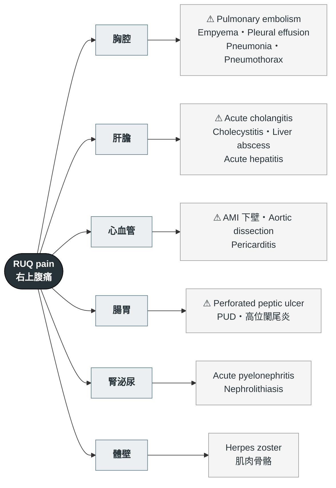

---
tags:
  - Med/Workup/GI
  - Med/Workup/EM
  - RUQ-pain
  - 禁忌
aliases:
  - RUQ pain
  - 右上腹痛
  - Right upper quadrant pain
created: 2026-07-25
updated: 2026-07-25
status: 可用
source: 標準急診鑑別框架；胸水相關數字門檻查證自 StatPearls / ATS（見 [[Pleural fluid analysis]]）。案例來源：內科 OSCE 考古（68y/o M, RUQ pain aggravated during respiration）
cssclass: clinical-note
cant_miss:
  - "[[Perforated peptic ulcer]]"
  - "[[AMI]]"
  - "[[Acute cholangitis]]"
  - "[[Pulmonary embolism]]"
  - "[[Aortic dissection]]"
differential:
  - "[[Empyema]]"
  - "[[Acute cholecystitis]]"
  - "[[Liver abscess]]"
  - "[[Acute hepatitis]]"
  - "[[Pneumonia]]"
  - "[[Acute pyelonephritis]]"
key_tests:
  - "[[Chest X-ray]]"
  - "[[EKG]]"
  - "[[Abdominal ultrasound]]"
  - "[[Stool occult blood]]"
  - "[[Pleural fluid analysis]]"
---

# RUQ pain ｜ 右上腹痛 · Right Upper Quadrant Pain

> [!abstract] 一句話總覽
> 右上腹痛的最大陷阱是**只想橫膈膜以下**。橫膈膜上下共用 T7–T11 皮節，**右下肺／右側胸膜的病變會投射成 RUQ 痛**——而「隨呼吸加劇（pleuritic）」這個描述，就是把懷疑往胸腔拉的最強單一線索。

> [!danger] Can't-miss — 漏掉會死人
> 這一格永遠先讀。**沒排除完不准往下走。**
>
> | 不能漏 | 一眼線索 | 立刻做什麼排除 |
> |---|---|---|
> | [[Perforated peptic ulcer]] 消化性潰瘍穿孔 | 突發劇痛、板狀腹、腹膜炎徵象 | **站立位 CXR / KUB 看橫膈下 free air** |
> | [[AMI]] 下壁心肌梗塞 | 冒冷汗、噁心、轉移痛、心血管危險因子 | **[[EKG]]（含 V3R/V4R）＋ troponin** |
> | [[Acute cholangitis]] 急性膽管炎 | Charcot 三徵：發燒＋黃疸＋RUQ 痛 | T-bil/D-bil、ALP、腹超；併低血壓／意識改變＝Reynolds 五徵，敗血症 |
> | [[Pulmonary embolism]] 肺栓塞 | Pleuritic 痛、喘、心搏過速、VTE 風險 | Wells score → D-dimer / CTA |
> | [[Aortic dissection]] 主動脈剝離 | 撕裂痛、兩側血壓差 | CXR 縱膈腔變寬 → CTA |
>
> **上腹痛的兩項底線檢查**：**EKG**（排除下壁 MI）與**糞便潛血**。這兩項在任何上腹痛都該做，成本低而漏掉的代價高。

> [!tip] 到床邊的前 5 分鐘
> **看**：Vital signs（尤其 **SpO₂** 與體溫）、病人姿勢、呼吸費力程度。
> **問**：痛跟**呼吸**有沒有關係？有沒有**發燒／咳嗽**？最近兩週有沒有**呼吸道感染**？
> **做**：EKG、CXR（站立位）、CBC/DC、肝膽功能、amylase/lipase、U/A。

---

## 鑑別架構圖

*先看骨架再看細節。這張圖回答「可能性從哪幾個分支長出來」，不是「先做什麼再做什麼」。⚠ ＝ can't-miss。*

> [!tip] 這六個分支直接背下來
> 換成 epigastralgia、LUQ pain、甚至 flank pain，也是同一套骨架，只是末梢換人。
> 記憶點在於**別漏掉最上面與最下面**：胸腔（橫膈膜以上）與體壁（橫膈膜以外），這兩支最常被跳過。

*T7–T11 橫跨下胸壁與上腹壁，因此下胸腔病灶可被病人描述成上腹痛。Source: [Wikimedia Commons — Dermatomes labeled](https://commons.wikimedia.org/wiki/File:Dermatomes_labeled,_female-male_front-back_3d-shaded.svg), Goran tek-en（CC BY-SA 4.0）。*

![[assets/ruq-referred-pain.jpg]]
*橫膈的痛覺傳入走膈神經 C3–5，可被投射到肩頸區；圖中紫色區即 lung and diaphragm 的典型轉移痛分布。Source: [OpenStax, Figure 15.7 Referred Pain Chart](https://openstax.org/books/anatomy-and-physiology-2e/pages/15-2-autonomic-reflexes-and-homeostasis)（CC BY-NC-SA 4.0）。*

## 病史 History

*LQQOPERA 一項不漏。RUQ 痛的關鍵是「用一個問題把橫膈膜上下分開」。*

| 問題 | 若為「是」→ 想到 |
|---|---|
| **深呼吸／咳嗽會更痛嗎？**（pleuritic） | **胸腔**：[[Empyema]]、[[Pleural effusion]]、[[Pneumonia]]、[[Pulmonary embolism]]、[[Pneumothorax]]；或膈下刺激（subphrenic abscess、膽囊炎併腹膜炎） |
| 吃完（油膩）東西後更痛？ | [[Acute cholecystitis]]、[[CBD stone]] |
| 痛轉移到右肩／肩胛？ | 膈神經受刺激（C3–5）：膽囊、膈下病灶 |
| 發燒＋黃疸？ | [[Acute cholangitis]]（Charcot 三徵） |
| 有咳嗽、有痰、會喘？ | 肺炎 → parapneumonic effusion → 膿胸 |
| **最近兩週有呼吸道感染嗎？燒退一半又燒起來？** | Parapneumonic effusion 的典型時序 |
| 解黑便、吐咖啡色物？ | 上消化道出血、[[Peptic ulcer disease]] |
| 腰痛、小便痛／頻尿／血尿？ | [[Acute pyelonephritis]]、[[Nephrolithiasis]] |
| 冒冷汗、噁心、胸悶？ | [[AMI]] |
| 體重減輕、夜間盜汗、久咳？ | [[Tuberculosis]] |

**一定不能漏問**：TOCC、用藥史（NSAID → 潰瘍；抗凝血劑）、酒精、過去腹部手術、B/C 肝、旅遊接觸史。

> [!warning] 病人不會主動說的兩件事
> **① 近期呼吸道感染**——他認為「那件事已經好了」，跟現在的肚子痛無關，所以不會提。但它是 parapneumonic effusion 唯一的病因線索。
> **② 大便與小便的顏色**——問「排便正常嗎」得到的答案是「正常」；要問「顏色有沒有變淡」「小便有沒有變濃茶色」才問得出膽道阻塞。
>
> 通則：**開放式問句問不出來的東西，要用封閉式具體問句。**

## 理學檢查 PE

*右上腹痛的 PE 重心常常不在腹部。肺部的視、觸、叩、聽四項都要做完，不能只聽診。*

| 要做的 PE | 陽性代表 |
|---|---|
| **視**：呼吸動作左右對稱？肋間隙？ | 患側擴張變差 → 大量積液 |
| **觸**：tactile fremitus | **減弱** → 積液／氣胸；**增強** → 實質化（consolidation） |
| **叩**：percussion | **Dullness** → 積液；**hyperresonance** → 氣胸 |
| **聽**：breath sound | **患側減弱** ± crackles → 積液／肺炎；pleural friction rub → 胸膜炎 |
| Murphy's sign | 陽性 → [[Acute cholecystitis]] |
| 腹部觸診＋腸音 | 板狀腹／反彈痛 → 穿孔、腹膜炎 |
| **CV angle knocking** | 陽性 → [[Acute pyelonephritis]] |
| 鞏膜、皮膚黃疸 | 膽道阻塞 |

> [!tip] 叩診＋聽診是分水嶺
> **右下肺 dullness ＋ breath sound 減弱** 這組合，在還沒照 X 光前就該讓你把懷疑從「肝膽」翻向「胸腔」。
> 而 **dullness ＋ fremitus↓** 是積液、**dullness ＋ fremitus↑** 是實質化——加做觸診才分得出來。

## 第一批檢查 Initial Workup

| 時機 | 檢查 | 想回答的問題 |
|---|---|---|
| 立刻 | [[EKG]] | 排除下壁 MI |
| 立刻 | [[Chest X-ray]]（**站立位**） | ① 橫膈下 free air（穿孔）② 胸水 ③ 肺炎浸潤 |
| 立刻 | CBC/DC、CRP | 感染程度 |
| 立刻 | 肝膽：AST/ALT、ALP、γ-GT、T-bil/D-bil、PT/INR | 膽道阻塞 vs 肝細胞損傷 |
| 立刻 | Amylase / lipase | 胰臟炎 |
| 立刻 | [[Stool occult blood]] | 上消化道出血 |
| 立刻 | U/A | 泌尿道感染／結石 |
| 次要 | [[Abdominal ultrasound]] | 膽結石、膽囊壁、膽管擴張、肝膿瘍 |
| 次要 | [[Pleural fluid analysis]]（胸腔穿刺） | 有胸水時：定性並判斷要不要引流 |

> [!warning] 大量右側胸水的 EKG 陷阱
> 大量積液壓迫右心可造成 **RV strain**，在 **V1–V4 出現 ST depression**。
> 不要看到前胸導極 ST 變化就直接喊心肌缺血——要對照臨床、troponin 與影像。

> [!danger] 影像看到胸水 ≠ 膿胸
> **X 光只能認定「有胸水」**。白血球升高等感染徵兆只是輔助，**沒有抽胸水化驗就無法區分** uncomplicated parapneumonic effusion、complicated、與膿胸。
> 診斷寫 `pleural effusion, susp. empyema` 才精確。**診斷的精確度包含承認自己還不知道什麼。**

![[assets/ruq-right-pleural-effusion.jpg|387]]
*大量右側胸水：右半胸近乎完全白化，並把縱膈推向健側。Source: [Wikimedia Commons — Unilateral Pleural Effusion](https://commons.wikimedia.org/wiki/File:Unilateral_Pleural_Effusion.jpg), Sara Nabih（CC BY-SA 4.0）。*

![[assets/pleural-effusion-meniscus.png|377]]
*另一病例的站立正面片：左側肋膈角變鈍，液體上緣外側較高，形成典型 meniscus sign；此圖用來補足上一張大量胸水不易辨認的彎月形上緣。Source: [Wikimedia Commons — 14-02-Erguss im Stehen](https://commons.wikimedia.org/wiki/File:14-02-Erguss_im_Stehen.png), Hellerhoff（CC BY-SA 3.0）。*

![[assets/subdiaphragmatic-free-air.jpg|393]]
*穿孔對照：站立片右膈下可見新月形游離氣體（紅／綠箭頭之間），不是胸水。Source: [Wikimedia Commons — Pneumoperitoneum](https://commons.wikimedia.org/wiki/File:Pneumoperitoneum.jpg), Hellerhoff（CC BY-SA 3.0）。*

## 鑑別診斷

*完整清單，依「致命 → 常見 → 少見但要想到」分層。頂部的 can't-miss 是這張表第一層的濃縮。*

### 致命（can't-miss）

| 疾病 | 支持線索 | 排除方法 |
|---|---|---|
| [[Perforated peptic ulcer]] | 突發劇痛、板狀腹、NSAID 史 | 站立位 CXR free air |
| [[AMI]]（下壁） | 冒冷汗、噁心、放射痛 | EKG ＋ troponin |
| [[Acute cholangitis]] | Charcot 三徵 | 膽紅素、ALP、腹超 |
| [[Pulmonary embolism]] | Pleuritic 痛、喘、心搏快 | Wells → D-dimer / CTA |
| [[Aortic dissection]] | 撕裂痛、脈搏／血壓不對稱 | CXR 縱膈腔 → CTA |

### 常見

| 疾病 | 支持線索 | 排除方法 |
|---|---|---|
| [[Acute cholecystitis]] | 油餐後痛、Murphy's sign | 腹超 |
| [[Empyema]] / parapneumonic effusion | Pleuritic 痛、近期呼吸道感染、患側 dullness ＋ breath sound 下降 | CXR → 胸腔穿刺驗胸水 |
| [[Pneumonia]]（右下葉） | 發燒、咳嗽有痰、crackles | CXR |
| [[Acute hepatitis]] | 肝腫大壓痛、AST/ALT 高 | 肝功能、病毒標記 |
| [[Acute pyelonephritis]] | CV angle 敲痛、pyuria | U/A、尿培養 |
| [[Peptic ulcer disease]] | 上腹痛、黑便 | 糞便潛血、胃鏡 |

### 少見但要想到

| 疾病 | 支持線索 | 排除方法 |
|---|---|---|
| [[Liver abscess]] | 高燒、肝壓痛、糖尿病史 | 腹超 / CT |
| [[Tuberculosis]] 胸膜炎 | 久咳、體重減輕、盜汗、接觸史 | 胸水 ADA、抗酸染色 |
| [[Pneumothorax]] | 突發喘、hyperresonance | CXR |
| [[Pericarditis]] | 前傾緩解、心包摩擦音 | EKG diffuse ST elevation |
| Subphrenic abscess | 近期腹部手術／穿孔病史 | CT |
| Herpes zoster | 沿皮節分布、疹前期只有痛沒有疹 | 臨床 |
| [[Nephrolithiasis]] | 絞痛、血尿 | KUB / 腹超 |

## 處置分流 Disposition

| 去向 | 條件 |
|---|---|
| ICU | 敗血性休克、呼吸衰竭（SpO₂ 持續下降）、Reynolds 五徵 |
| 住院 | 需引流的胸腔感染（[[Chest tube drainage]] ＋ IV 抗生素）、需緊急處置的膽道阻塞、任一 can't-miss 未排除 |
| 門診追蹤 | Vital signs 穩定、影像陰性、疼痛可控且已排除致命原因 |

> [!warning] 安排侵入性處置時必須主動說明
> 要引流就必須說明可能併發 [[Pneumothorax]] 與 hemothorax，並交代術後監測計畫。
> 這不只是流程——**病人事後才知道有風險，等於沒有知情同意**。

## 禁忌與陷阱

> [!danger] 絕對不可
> | 情境 | 絕對不可 | 為什麼 | 該做什麼 |
> |---|---|---|---|
> | 未排除穿孔／腹膜炎的急性腹痛 | 給瀉劑、灌腸 | 升高腸內壓 → 穿孔擴大、糞便性腹膜炎 | NPO ＋ NG decompression ＋ 站立位影像找 free air |
> | 尚未排除 [[AMI]] 的上腹痛 | 直接當胃病開 PPI 打發 | 下壁 MI 常以上腹痛表現，錯過再灌流時間窗 | 先做 EKG ＋ troponin |
> | 懷疑 [[Aortic dissection]] | 給抗凝血／溶栓 | 會擴大剝離、致命出血 | CTA 確認後降壓降心率、外科會診 |
> | 大量胸水一次抽太多 | 單次抽超過約 1–1.5 L | Re-expansion pulmonary edema | 分次引流並監測症狀 |
> | 凝血功能未確認 | 直接做胸腔穿刺／插胸管 | 出血、hemothorax | 先查 PT/INR、血小板 |

> [!warning] 常見錯誤
> - **只做腹部 PE 不做胸部**——右上腹痛的診斷有相當比例落在橫膈膜以上。
> - **影像有胸水就講 empyema**——沒驗胸水只能寫 `susp.`。
> - **V1–V4 ST depression 一律當缺血**——大量右側積液的 RV strain 也長這樣。
> - **只問開放式問句**——近期感染史與大小便顏色都問不出來。
> - 忘了問結核相關症狀與接觸史。

## 相關連結

- [[Empyema]] — 胸腔分支中最需要主動排除的
- [[Pleural fluid analysis]] — Light's criteria、決定要不要引流
- [[Chest tube drainage]] — 處置與併發症
- [[禁忌選項]] — 上表已收錄
