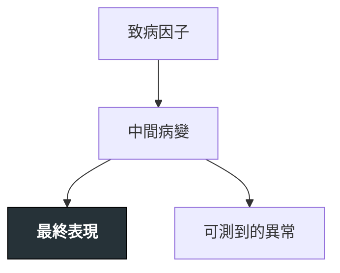

---
tags:
  - Clinical/Disease/
aliases:
created: "{{date:YYYY-MM-DD}}"
updated: "{{date:YYYY-MM-DD}}"
status: 骨架
source:
services:
cssclass: clinical-note
presents_as:
diagnosed_by:
treated_by:
differential:
complication:
---

# {{title}} ｜ 中文名 · English Name

> [!abstract] 一句話總覽
> 這是什麼病、核心機制、最關鍵的處置方向——一句話講完。

> [!tip] 30 秒行動卡
> **診斷關鍵**：（看到什麼就該想到它、哪個檢查一槌定音）
> **治療骨架**：（第一線是什麼）
> **絕對不可**：（沒有就寫「無」）

---

## 定義與定位

*這個病是什麼？在分類樹的哪個位置？跟隔壁的病靠什麼分開？*

| 項目 | 重點 |
|---|---|
| 本質 |  |
| 好發族群 |  |
| 分類位置 | [[]] |

## 病因與機制

*為什麼會發生？病生理鏈條長什麼樣？——這一節寫好，下面的「臨床表現」就不用背。*

> [!warning] 機制圖用 `flowchart TD`
> `LR` 會愈接愈寬，在 Obsidian 裡右邊會被切掉。節點控制在 **10 個以內**、單行約 14 個中文字。

> [!todo] 📷 要插入圖片｜機制／解剖示意
> **要能看到**：（寫下這張圖必須呈現什麼，方便日後找圖時判斷用不用）

## 臨床表現

*典型病人長什麼樣？哪些症狀是幾乎一定有、哪些是提示性的？*

- **典型**：
- **提示性**：
- **少見但重要**：

→ 相關主訴流程：[[]]（Workup）

## 診斷

*診斷標準是什麼？要開哪些檢查？哪個是 gold standard？*

| 診斷條件 | 內容 |
|---|---|
|  |  |

**要開的檢查**：[[]]（Test）

> [!todo] 📷 要插入圖片｜典型影像／病理長相
> **要能看到**：

## 鑑別診斷

*要跟誰分清楚？靠什麼分？*

| 要排除的 | 支持它的線索 | 怎麼排除 |
|---|---|---|
| [[]] |  |  |

## 治療

*第一線是什麼？什麼情況升級？*

| 情境 | 處置 |
|---|---|
| 第一線 | [[]] |
| 進階／難治 |  |
| 轉外科／手術適應症 |  |
| 不可手術／替代治療 |  |
| 支持性 |  |

## 併發症與預後

*住院時要盯什麼？出院後會怎麼樣？*

- **要盯的併發症**：[[]]
- **預後因子**：

## 禁忌與陷阱

> [!danger] 絕對不可
> | 情境 | 絕對不可 | 為什麼 | 該做什麼 |
> |---|---|---|---|
> |  |  |  |  |

> [!warning] 常見錯誤
> -

## 相關連結

- [[]] —
